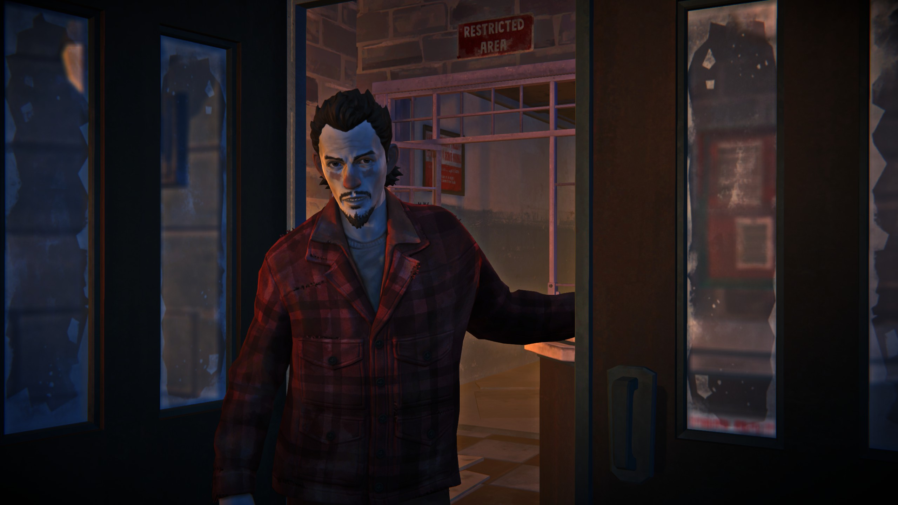
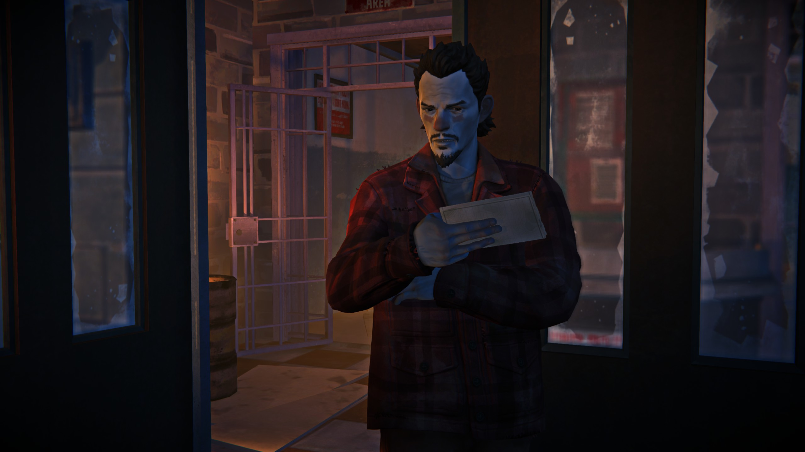
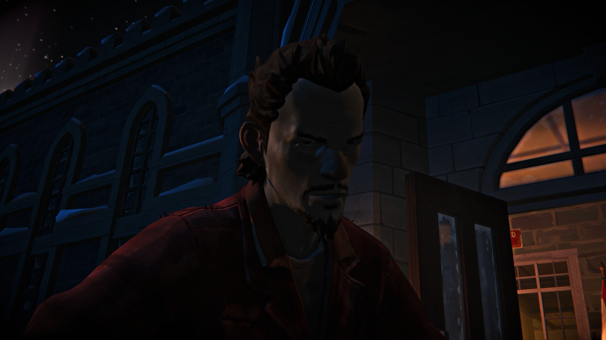
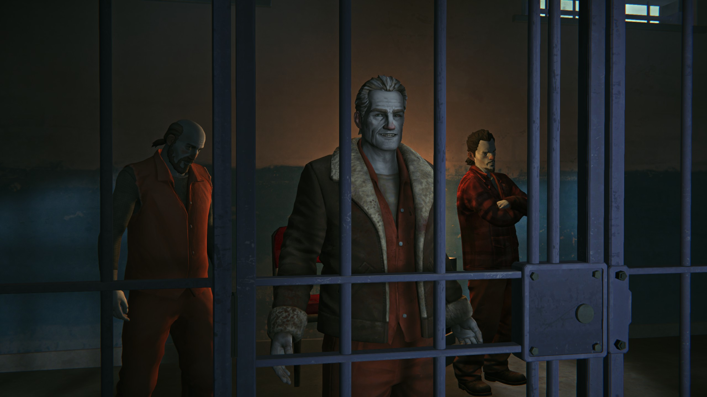
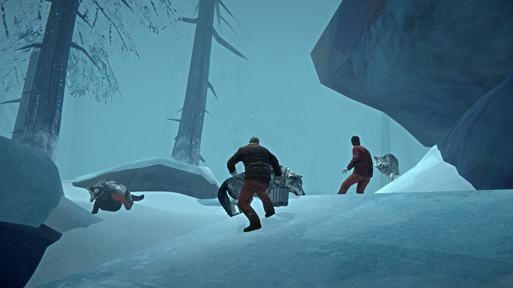
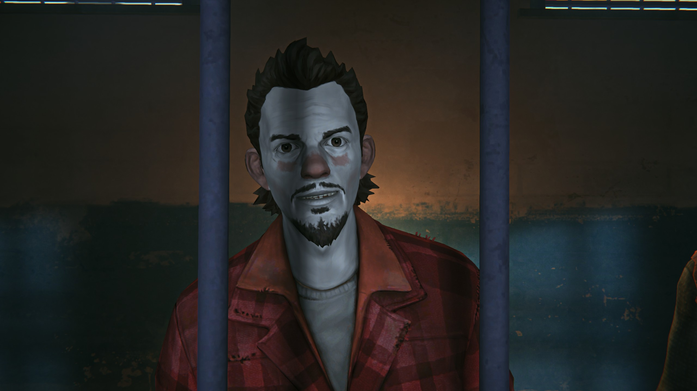
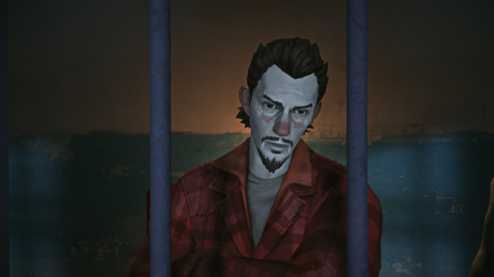

# Heller

**Categories:** Characters, Pages with update history · **Source:** [Fandom](https://thelongdark.fandom.com/wiki/Heller)

**Contents**

- [History](#history)
- [Appearance](#appearance)
- [Episode 1](#episode-1)
- [Episode 4](#episode-4)
- [Prologue](#prologue)
- [Blackrock Blues](#blackrock-blues)
- [The Power Plant](#the-power-plant)
- [The Detonators](#the-detonators)
- [Donner (mission)](#donner-mission)
- [Trivia](#trivia)
- [Gallery](#gallery)
- [Update history](#update-history)

**Heller**

[Heller](../assets/Heller.png)

**Release:** [1.95](./The%20Long%20Dark%20%E2%80%94%20Changelog.md#1.95)

**Date:** 6 October 2021

**Wintermute:** [Episode 4](./Episode%204%20-%20Fury%2C%20Then%20Silence.md)

**Location(s):** [Blackrock Prison](./Blackrock%20Prison.md)

**Biographical Information**

**Age:** 20's - 30's

**Status:** Alive

**Occupation:** Criminal

**Physical Information**

**Hair:** Black

**Eyes:** Brown

**Game Information**

**Voiced by:** Jordan Waunch

> “__Heller: Mathis said to give you this.  
 Mackenzie: That doesn't look like a coat...It's...cold out here. I won't find the dam if I freeze before I get there.__”
>
> — Heller: Do I look like a guy who gives a shit? You don't want to freeze out here? Then get moving! Heller slams the door shut on Mackenzie Heller at the start of [The Power Plant](./The%20Power%20Plant.md)

**Heller** is a member of the [Convicts](./Convicts.md) appearing in [Episode 4: Fury, Then Silence](./Episode%204%20-%20Fury%2C%20Then%20Silence.md). He serves as a secondary antagonist for the episode.

## History

Heller was one of the prisoners being transported to [Blackrock Prison](./Blackrock%20Prison.md), but his [Prison Bus crashed](./Crashed%20Prison%20Transport%20Bus.md) outside of [Milton](./Milton.md) during the [First Flare](./First%20Flare.md). He escaped the bus with several other Convicts and made his way to [Keeper's Pass South](./Keeper%27s%20Pass%20South.md) and later [Pleasant Valley](./Pleasant%20Valley.md), eventually leaving the region after many of the other Convicts began turning up dead, leading him to realize that [someone](./Molly.md) was hunting them. He is eventually tasked with carrying an unconscious [Will Mackenzie](./Will%20Mackenzie.md) to the Prison via [Mathis'](./Mathis.md) orders, having to hear [Vachon](./Vachon.md) bellyache the whole way there.

He is Mathis' most faithful sidekick, and has few qualms when it comes to sending [Will](./Will%20Mackenzie.md) to face the cold and aggressive wildlife of the [Blackrock Region](./Blackrock.md), unlike Vachon. Heller seems quite close to Mathis, being part of the prison break on the Mainland that landed both of them in Blackrock Prison to begin with. However he often expresses his concern that Mathis may be going crazy, but follows his orders in order to avoid the heat coming his way. One thing is certain however; if the tide turns, he will try to save his skin at all costs.

Heller is almost always seen paired with Vachon, being the more aggressive, selfish, and uncaring of the two. He often refers to Mackenzie as a "dog" after he is tasked with constantly performing dangerous work for the gang, with this term eventually spreading to other Convicts in the prison.

## Appearance

Like the other inmates, he partially wears his old prisoner clothes, namely the typical orange jumpsuit of Blackrock inmates, as well as a [Mackinaw Jacket](./Mackinaw%20Jacket.md) and some [Trail Boots](./Trail%20Boots.md). He seems much younger than Mathis and Vachon, and yet is already quite dark and evil, much like [Donner](./Donner.md).

## Episode 1

Heller does not appear in Episode 1, but his name (HELLER, S.) appears on the [Prison Transport Manifest](./Prison%20Transport%20Manifest.md) near the [Crashed Prison Transport Bus](./Crashed%20Prison%20Transport%20Bus.md), foreshadowing him.

## Episode 4

### [Prologue](./Prologue.md)

Heller appears with Vachon carrying Mackenzie on a stretcher. He later comes under attack with the rest of the group and is forced to search for Mackenzie after he escapes.

### [Blackrock Blues](./Blackrock%20Blues.md)

Heller appears with Vachon and Mathis once Mackenzie wakes up. After Mathis savagely beats the Warden [Franklin](./Franklin.md), Mathis tasks the two criminals to clean him up. He recounts the story of how Mathis' last prison break on the Mainland landed him on a bus to Blackrock Prison.

Heller is later convinced by Mackenzie to secretly let him out of [Blackrock Prison](./Blackrock%20Prison.md) behind Mathis' back in order to find [Blackrock Infirmary Medication](./Blackrock%20Infirmary%20Medication.md) for [Franklin](./Franklin.md). After Heller and Vachon realize that the medication is outside the Prison, and do not wish to risk being killed by hostile wildlife, they reluctantly let the pilot loose.

### [The Power Plant](./The%20Power%20Plant.md)

Heller appears at the start of the mission by tossing a map of the Power Plant to Mackenzie, telling him to get moving and fix the power to the Prison. When Mackenzie asks if he can have a coat, Heller shows his lack of empathy by yelling at him to hurry up or freeze, as Mathis only issued the Power Plant map to the pilot.

### [The Detonators](./The%20Detonators.md)

Heller appears with Vachon to pester Mackenzie as Mathis interrogates him and Franklin, telling the pilot to find the [Detonators](./Detonators.md) before "Mathis goes a few more rounds with the Warden."

He later appears at the end of the mission along with Vachon, seizing Mackenzie after he delivers the Detonators.

### [Donner (mission)](./Donner%20%28mission%29.md)

Heller appears before Mathis after the Prison explodes informing him that the other Convicts blew the Detonators the wrong way in Solitary. He later appears in the Prison Yard yelling at other Convicts to find and shoot Mackenzie, even spotting him from a prison tower spotlight if the player is not careful.

Heller later appears at the Power Plant in the final cutscene, informing Mathis that [Donner](./Donner.md) was pulled from Solitary but is in critical condition.

## Trivia

Despite being a major character in Episode 4, Heller does not get his own [What I Know](./What%20I%20Know.md) character section.

## Gallery

## Update history

- UPDATE **6 October 2021 ([Update](./The%20Long%20Dark%20%E2%80%94%20Changelog.md#1.95)):**
  - Added to game.
