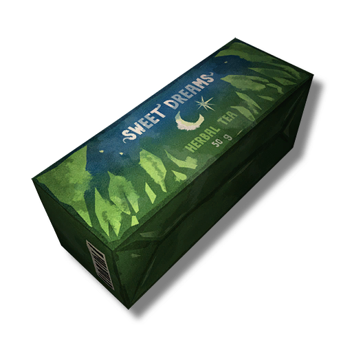
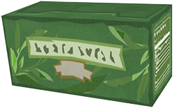

# Herbal Tea

**Contents**

- [Overview](#overview)
- [Products](#products)
- [Medical Applications](#medical-applications)
- [Trivia](#trivia)
- [Gallery](#gallery)
- [Update history](#update-history)

**Herbal Tea**

| Property | Details |
| --- | --- |
|  |  / *Herbal\_Tea\_icon.png* |
| Release | [17 December 2014](./The%20Long%20Dark%20%E2%80%94%20Changelog.md#0.181) |
| Wintermute | No |
| Renewable | Yes ([Trader](./Trader.md) or very rarely through [Beachcombing](./Beachcombing.md)) |
| **Properties** |  |
| Item type | [Food And Drink](./Food%20And%20Drink.md)\|- |
| Stackable | No |
| Examine | A package of fragrant tea. The label promises restorative benefits and more peaceful rest. |
| **Values** |  |
| Weight | 0.01 kg (0.02 lbs) |
| **Decay Rate** |  |
| Inside | 0.067% per day |
| Outside | 0.067% per day |

**Herbal Tea**is an ingredient for making [Cup of Herbal Tea](./Cup%20of%20Herbal%20Tea.md).

## Overview

These tea boxes can be found with five packets of tea inside and takes 0.25L/0.07 gallons of [water](./Water%20%28Potable%29.md) to make one cup of herbal tea.

When cooked, the condition will be 50% higher than the package it was made from, up to a maximum of 100%. For example, a package with 20% condition would produce a cup of tea with 70% condition.

While the Herbal Tea deteriorates over time, cups of herbal tea do not. Therefore it's wise to make cups of herbal tea before the package becomes ruined.

Herbal Tea is packaged as a product called *Sweet Dreams Herbal Tea*.

## Products

## Medical Applications

Herbal Tea, when drunk hot or cold, will give you the "[Improved Rest](./Improved%20Rest.md)" [Affliction](./Afflictions.md#Improved_rest_affliction), which will increase condition gained while sleeping by 2% an hour one's next 6 hours of sleep (whether this be all at once or across multiple sleep sessions), meaning one glass of Herbal Tea can restore up to an additional 12% condition.

## Trivia

The ingredients on the back list: "Chamomile Flower, Mint Leaf, Natural Flavors." and that it was "Made In Canada."

## Gallery

| Column 1 |
| --- |
|  / *Old model* |

## Update history

- UPDATE **17 December 2014 ([Update](./The%20Long%20Dark%20%E2%80%94%20Early%20Access%20Changelog.md#0.181)):**
  - Added to game.

**Lua execution error in Module:Navbox function navbox** [ru:Травяной\_чай](ru:%D0%A2%D1%80%D0%B0%D0%B2%D1%8F%D0%BD%D0%BE%D0%B9_%D1%87%D0%B0%D0%B9) [fr:Herbal\_Tea](fr:Herbal_Tea)
