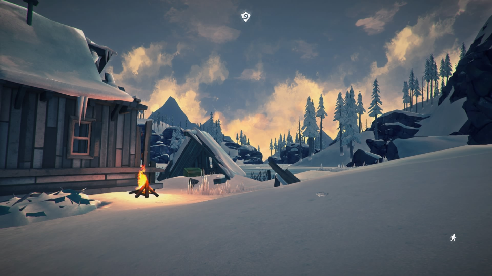

# Hermit's Cabin

**Categories:** Locations, Locations in Mountain Town, Sheltered locations · **Source:** [Fandom](https://thelongdark.fandom.com/wiki/Hermit's_Cabin)

**Contents**

- [Overview](#overview)
- [Survival](#survival)
- [Dangers](#dangers)
- [Gallery](#gallery)

**Hermit's Cabin**

[Hermits cabin](../assets/Hermits_cabin.jpg)

**Location**

[Hermit's Cabin Location](../assets/Hermit%27s_Cabin_Location.png)

**Region:** [Mountain Town](./Mountain%20Town.md)

**General**

**Firebox:** [Wood Stove](./Wood%20Stove.md)

Provides some shelter **Hermit's Cabin** is a dilapidated structure in [Mountain Town](./Mountain%20Town.md).

<!-- #Overview -->
​

<!-- #overview -->
## Overview

The cabin is an outdoors location on the northwest bank of the [Milton Basin](./Milton%20Basin.md). It can serve as a temporary base, especially if traveling between [Forlorn Muskeg](./Forlorn%20Muskeg.md).

<!-- #Survival -->
​

<!-- #survival -->
### Survival

A wood stove, wooden crates and containers are inside the ruins, as well as a firewood bin in the rear, with [Rose Hips](./Rose%20Hip.md) growing nearby. These wooden crates may be broken down for [reclaimed wood](./Reclaimed%20Wood.md) and may also contain random items. A [Rabbit](./Rabbit.md) grove is near, as well as [cattails](./Cat%20Tail%20Stalk.md) and a [birch forest](./Birch%20Bark.md). On the lake's central island, [crows](./Crow.md) may circle a frozen corpse.

<!-- #Dangers -->
​

<!-- #dangers -->
### Dangers

[Wolves](./Wolf.md) commonly roam on the lake, both north and south of the cabin. [Moose](./Moose.md) may spawn rarely along the northern basin.

<!-- #Gallery -->
​

<!-- #gallery -->
## Gallery

[ru:Лачуга отшельника](https://ru.wikipedia.org/wiki/%D0%9B%D0%B0%D1%87%D1%83%D0%B3%D0%B0_%D0%BE%D1%82%D1%88%D0%B5%D0%BB%D1%8C%D0%BD%D0%B8%D0%BA%D0%B0) [es:Cabaña del ermitaño](https://es.wikipedia.org/wiki/Caba%C3%B1a_del_ermita%C3%B1o)
