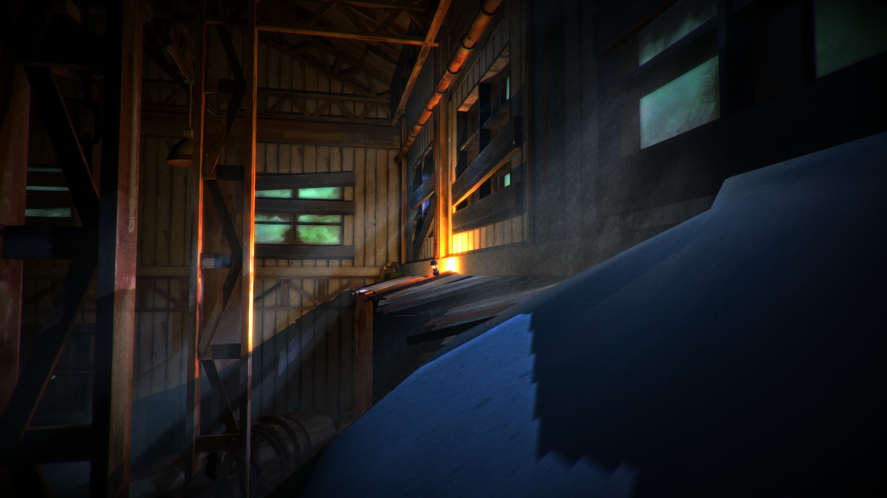
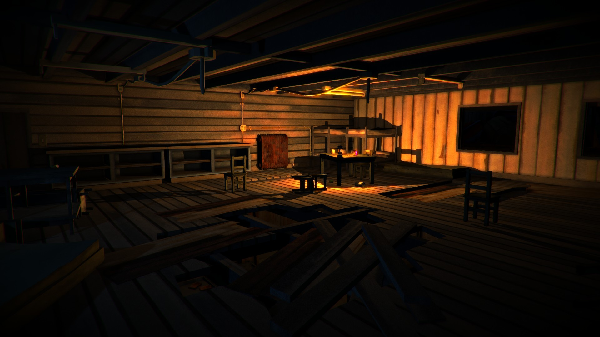
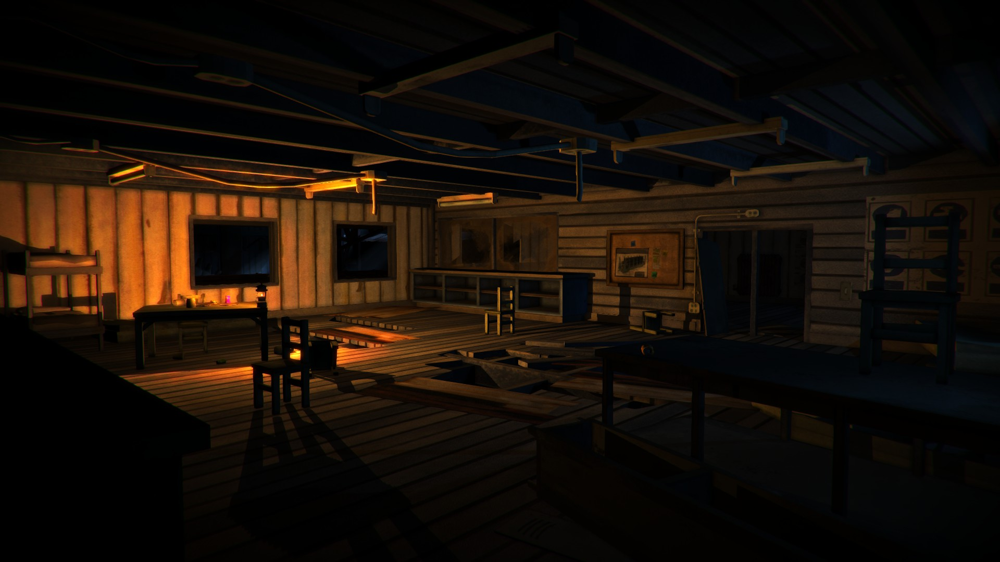
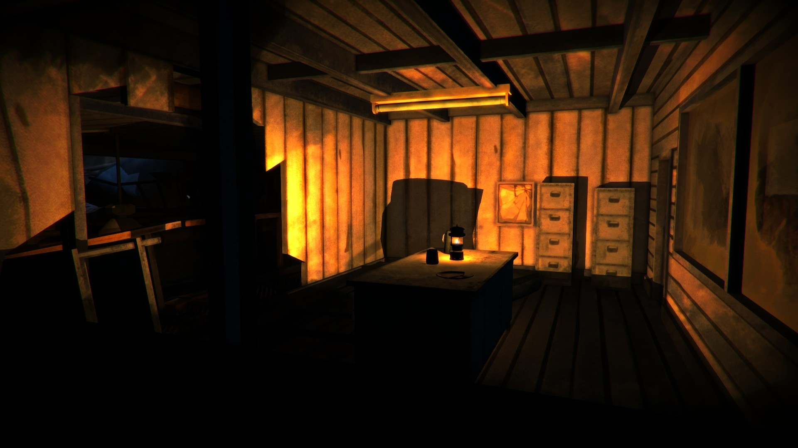
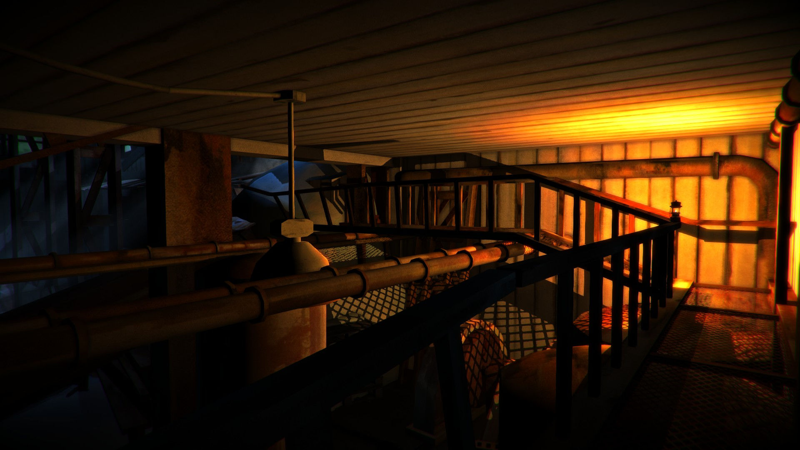
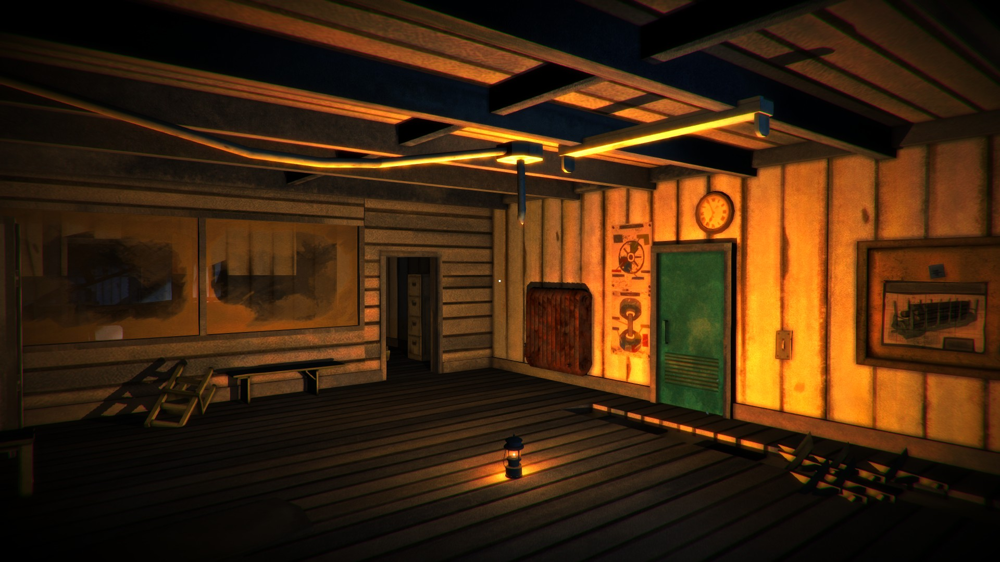
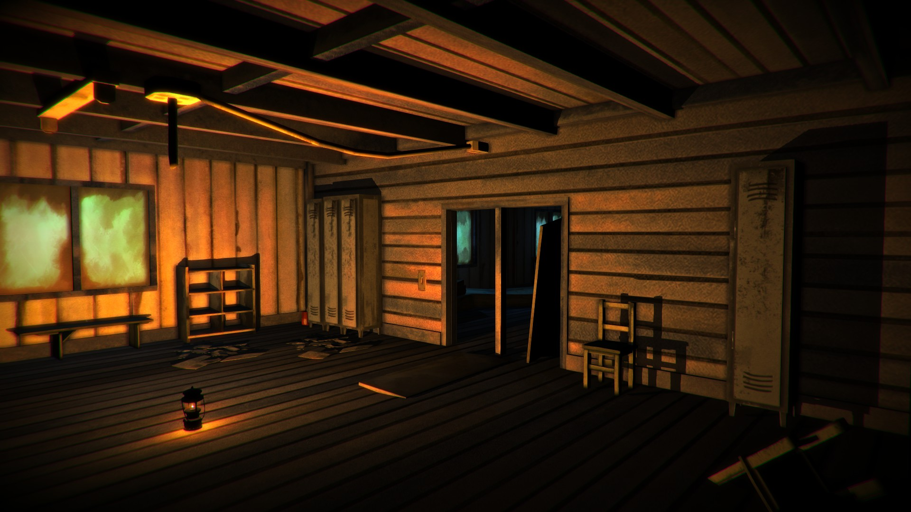
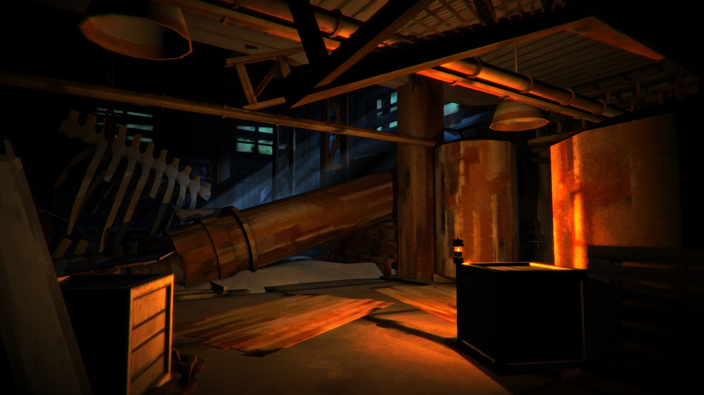
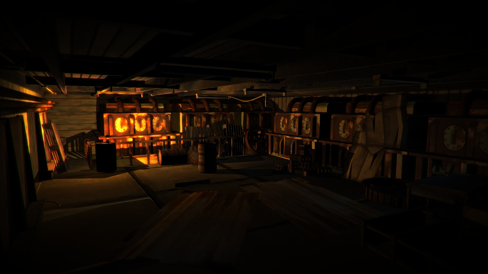
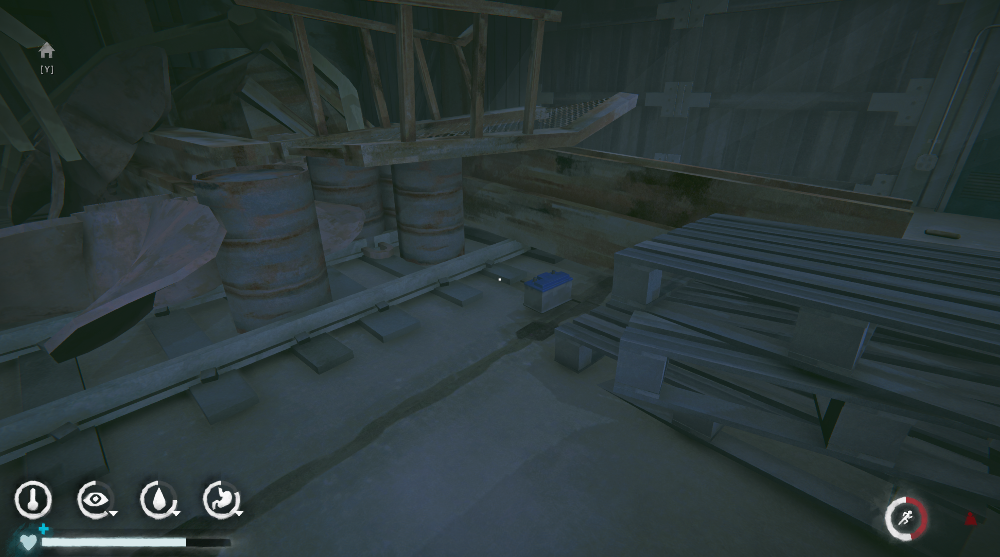

# Hibernia Processing

**Categories:** Indoor locations, Industrial locations, Locations, Locations in Desolation Point, Locations with a workbench · **Source:** [Fandom](https://thelongdark.fandom.com/wiki/Hibernia_Processing)

**Contents**

- [Overview](#overview)
- [The Yard](#the-yard)
- [Interior](#interior)
- [Safehouse](#safehouse)
- [Trivia](#trivia)
- [Gallery](#gallery)

**Hibernia Processing**

\[\[File: /  / _Exterior_ /  / _Interior_

250px\]\]

**Location**

_Hibernia\_Processing\_Location.png_

Region

[Desolation Point](./Desolation%20Point.md)

Location

**Description:** An old whaling station

**General**

Type

Industrial

Firebox

_bed\_icon.png_

Has a bed

_workbench\_icon\_green.png_

Has a workbench

## Overview

Hibernia Processing is an old whaling station situated almost at the end of Desolation Point. The location is visible from the road, as well as from the top deck of the [Lonely Lighthouse](./Lonely%20Lighthouse.md). The outside area and road is patrolled by several [wolves](./Wolf.md). Preparation for a possible encounter with any predator is highly recommended, but hiding inside one of the smaller structures and sleeping may cause them to drift away, allowing the player to escape.

## The Yard

The yard area has a group of conjoined trailers on one side; a lone trailer with an outdoor fire barrel sits on the other side of the main building of the Hibernia Processing warehouse. The yard can be accessed from both the road and the coast, either by climbing up the main boat ramp from the east, or climbing through a [Truck](./Truck.md) that is blocking the main gate from the west.

The road up from Hibernia can also spawn a [Moose](./Moose.md) and a nearby [Warm Cave](./Warm%20Cave.md) can spawn a [Bear](./Bear.md).

## Interior

Much of the entire interior is dimly lit, so an artificial light source may be beneficial during most of the day and night. The building is also relatively cold, and players with low-quality clothing may need to start a fire or use a bed to warm up.

The Hibernia Processing building has two entrances: a door straight from the east leads to the lower floor, while a staircase at south side leads up to a spacious staff lounge.

The first floor includes a huge processing hall and a smaller engine room, where a staircase to the second floor is located. The processing hall contains whale-processing equipment and whale bones, and a large amount of wooden crates, pallets, and other objects that can be harvested.

There are also a couple potential hidden caches (i.e., informally stashed items--not to be confused with cache boxes in [Hushed River Valley](./Hushed%20River%20Valley.md) and Story mode), including a possible rifle location.

One hidden stash is accessible by walking through a pipe heading up into some boat-storage racks. The other can be accessed by breaking down most of the green crates blocking the corner to the left of the player when entering the processing floor from the engine room. There may also be one or more tools (e.g., a [prybar](./Prybar.md)) hidden in niches in the room. The engine room, besides pallets and cardboard, has a [fire barrel](./Fire%20Barrel.md), a [work bench](./Work%20Bench.md), as well as a [safe](./Safe.md) in the corner of the room, half-hidden behind a wooden pallet. Any of a few types of tools may also spawn on the shelving along the wall with the safe.

The second floor has three rooms. The biggest one, the staff lounge, has a few [beds](./Bed.md), tables, and chairs. You will also find shelves, which usually have some clothes on them and potentially other essential items such as [matches](./Matches%20%28disambiguation%29.md). Under one of the bunkbeds a [Distress Pistol](./Distress%20Pistol.md) may be found caseless and without any [flare shells](./Flare%20Shell.md), however some may spawn on nearby shelves. The adjoining locker room may also contain such items and has an exit to the outside area, some harvestable objects, and four lockers. The third room is a small office room with two [file cabinets](./File%20Cabinet.md), and a table with drawers. The room also has a hole in the wall leading a catwalk above the processing hall's maintenance floor. Walking further and overcoming the snowdrift, a [body](./Frozen%20Corpse.md) can be seen in the corner. There is a [heavy hammer](./Heavy%20Hammer.md) against the east wall in the processing room.

As of Patch 2.38 (dec. 24) there is an additional stack of [Batteries](./Car%20Battery.md) here, in order to supply with trading materials for the [Trader](./Trader.md). On Interloper, aside from the ones usually found to repair the Transmitter, there is a chance of at least 4 more Batteries to spawn (More info is required to check if there are chances of more or less). These new batteries spawn in all existing worlds, but require having [Tales of the Far Territory](./Tales%20from%20the%20Far%20Territory.md) DLC installed.

The player can fall through the holes in 2nd floor safely, although this is not advised. This can be prevented by covering the holes with planks using [Safehouse Customization](./Safehouse%20Customization.md).

It is full of whale bones, and certain objects such as pallets, which can make it hard to traverse, and impossible to enter some areas without breaking down something.

## Safehouse

Due to its spacious interior and many amenities, along with the nearby forge at [The Riken](./The%20Riken.md), coal in the nearby mines, [beachcombing](./Beachcombing.md), and hunting at [Little Island](./Little%20Island.md), Hibernia Processing has long been a popular [safehouse](./Safehouse.md) for players living in [Desolation Point](./Desolation%20Point.md). Its large interior comes with plenty of storage, and there is more than enough space for extensive [customization](./Safehouse%20Customization.md). The biggest weakness of Hibernia as a safehouse is the region it's in: Desolation Point is a relatively small and isolated region, making it less than ideal for players who wish to travel around the island, especially if they wish to visit the [Far Territory](./Tales%20from%20the%20Far%20Territory.md).

## Trivia

- Hibernia (meaning "Land of Winter") is the Classical Latin name for the island of [Ireland](https://en.wikipedia.org/wiki/Hibernia). This could imply that the founders of the company are/were of Irish descent.

## Gallery

_Hibernia Processing, view on a corpse from the snowdrift on the maintenance floor._

_Hibernia Processing, staff lounge, view from the locker room entrance._

_Hibernia Processing, staff lounge, view from the stairs._

_Hibernia Processing, office, view through the window from staff lounge._

_Hibernia Processing, maintenance floor, view from the office._

_Hibernia Processing, locker room, view from the staff lounge entrance._

_Hibernia Processing, locker room, view from the office._

_Hibernia Processing, processing hall, view from the engine room._

_Hibernia Processing, processing hall, view from the first floor entrance._

_Hibernia Processing Engine Room, view from the stairs._

_Example location of a battery added with Patch 2.38_
