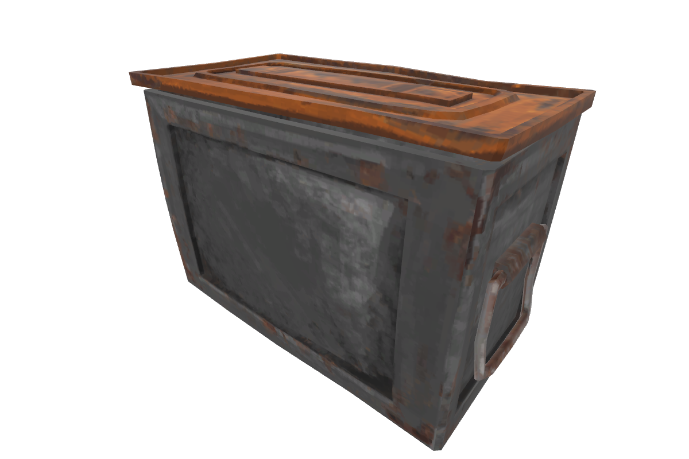

# Hidden Cache

**Contents**

- [Locations](#Locations)
- [Hushed River Valley](#Hushed_River_Valley)
- [Ash Canyon](#Ash_Canyon)
- [Blackrock](#Blackrock)
- [Bleak Inlet](#Bleak_Inlet)
- [Sundered Pass](#Sundered_Pass)

<table class="infobox">
<caption>Hidden Cache</caption>
<colgroup>
<col style="width: 50%" />
<col style="width: 50%" />
</colgroup>
<tbody>
<tr>
<td colspan="2"><figure>

<figcaption>Hidden_Cache.png</figcaption>
</figure></td>
</tr>
<tr>
<td>
Release
</td>
<td>
14 June 2018
</td>
</tr>
<tr>
<td>
Update
</td>
<td>
<a href="./The%20Long%20Dark%20%E2%80%94%20Changelog.md#1.33" class="wikilink" title="1.33">1.33</a>
</td>
</tr>
<tr>
<td>
Story item
</td>
<td>
No
</td>
</tr>
<tr>
<td colspan="2" class="section">
<strong>Container</strong>
</td>
</tr>
<tr>
<td>
Capacity
</td>
<td>
15 kg(33 lbs)
</td>
</tr>
<tr>
<td colspan="2" class="section">
<strong>Advanced data</strong>
</td>
</tr>
<tr>
<td>
Object key
</td>
<td>
STORY_HiddenCacheContainer
</td>
</tr>
</tbody>
</table>

**Hidden Caches** are small containers filled with useful loot found consistently through the many Episodes of <a href="./Wintermute.md" class="wikilink" title="Wintermute">Wintermute</a> as part of various side missions.

They can also be found in <a href="./Survival%20Mode.md" class="wikilink" title="Survival Mode">Survival Mode</a>. Currently, they only exist in <a href="./Ash%20Canyon.md" class="wikilink" title="Ash Canyon">Ash Canyon</a>, <a href="./Blackrock.md" class="wikilink" title="Blackrock">Blackrock</a>, <a href="./Bleak%20Inlet.md" class="wikilink" title="Bleak Inlet">Bleak Inlet</a>, <a href="./Hushed%20River%20Valley.md" class="wikilink" title="Hushed River Valley">Hushed River Valley</a> and <a href="./Sundered%20Pass.md" class="wikilink" title="Sundered Pass">Sundered Pass</a>. They spawn in different locations for each playthrough, their number depending on the [difficulty](https://thelongdark.fandom.com/wiki/Survival_Mode#Experience). <a href="./Hushed%20River%20Valley.md" class="wikilink" title="Hushed River Valley">Hushed River Valley</a> which has the highest \# of them, will spawn a minimum of 7 (min of 1 on <a href="./Interloper.md" class="wikilink" title="interloper">interloper</a>/<a href="./Misery.md" class="wikilink" title="misery">misery</a>).

They contain medium-high level food and clothes and, sometimes, even books. A Hidden Cache has a total capacity of 15.00 kg.

## Locations

### Hushed River Valley

- **Only guaranteed spawn**. Inside the southernmost entrance for the northern <a href="./Ice%20Cave.md" class="wikilink" title="Ice Cave">Ice Cave</a> system. Enter at <a href="./Reclusive%20Falls.md" class="wikilink" title="Reclusive Falls">Reclusive Falls</a>, follow the stream and get past the inner waterfall, look inside raised area on right side, dead end of a tunnel to the left or end of a tunnel to the right. Contains: <a href="./Revolver.md" class="wikilink" title="Revolver">Revolver</a>, <a href="./Revolver%20Ammunition.md" class="wikilink" title="Revolver Ammunition">Revolver Ammunition</a>, <a href="./Condensed%20Milk.md" class="wikilink" title="condensed milk">condensed milk</a>/<a href="./Military-Grade%20MRE.md" class="wikilink" title="MRE">MRE</a>/<a href="./Peanut%20Butter.md" class="wikilink" title="Peanut Butter">Peanut Butter</a> and <a href="./Balaclava.md" class="wikilink" title="balaclava">balaclava</a>/<a href="./Long%20Wool%20Scarf.md" class="wikilink" title="Long Wool Scarf">Long Wool Scarf</a>/<a href="./Wool%20Ear%20Wrap.md" class="wikilink" title="Wool Ear Wrap">Wool Ear Wrap</a>.
  - Interloper loot: <a href="./Combat%20Pants.md" class="wikilink" title="Combat Pants">Combat Pants</a>/<a href="./Jeans.md" class="wikilink" title="Jeans">Jeans</a>, <a href="./Rabbitskin%20Hat.md" class="wikilink" title="Rabbitskin Hat">Rabbitskin Hat</a>/<a href="./Wool%20Ear%20Wrap.md" class="wikilink" title="Wool Ear Wrap">Wool Ear Wrap</a>, <a href="./Pork%20and%20Beans.md" class="wikilink" title="Pork and Beans">Pork and Beans</a>/<a href="./Salty%20Crackers.md" class="wikilink" title="Salty Crackers">Salty Crackers</a> and <a href="./Can%20Opener.md" class="wikilink" title="Can Opener">Can Opener</a>/<a href="./Whetstone.md" class="wikilink" title="Whetstone">Whetstone</a>/-.

<a href="./Pilgrim.md" class="wikilink" title="Pilgrim">Pilgrim</a>/<a href="./Voyageur.md" class="wikilink" title="Voyageur">Voyageur</a>/<a href="./Stalker.md" class="wikilink" title="Stalker">Stalker</a>

<a href="./Stairsteps%20Lake.md" class="wikilink" title="Stairsteps Lake">Stairsteps Lake</a> Plateau Caches 1-7 (4/3/2 spawns):

- In a nook behind a rock, below a small waterfall - on the pool dividing the stream starting from <a href="./Cloudtop%20Falls.md" class="wikilink" title="Cloudtop Falls">Cloudtop Falls</a> into a stream for Stairsteps Lake
- Behind the nook of a large rock formation, on the shore of the stream (near the end) starting from <a href="./Cloudtop%20Falls.md" class="wikilink" title="Cloudtop Falls">Cloudtop Falls</a>, downstream of all the small waterfalls
- Inside a hollow tree next to a <a href="./Rock%20Climb.md" class="wikilink" title="Rock Climb">Rock Climb</a>, southeast of <a href="./Offset%20Falls.md" class="wikilink" title="Offset Falls">Offset Falls</a>
- On the shore of a deer pond, between a gaggle of trees, on the plateau above and just east of <a href="./Reclusive%20Falls.md" class="wikilink" title="Reclusive Falls">Reclusive Falls</a>. Access from the river by balancing across a log bridge
- Inside a hollow tree just east of the big rock formation, see below
- Inside a small open hollow, the entrance is blocked by <a href="./Scrub%20Brush.md" class="wikilink" title="scrub brush">scrub brush</a>. Located underneath a big rock formation, north of the Stairsteps bear cave
- Under the upturned roots of an extended tree stump, just south of the central Stairsteps cave

Northwestern Plateau Caches 8-12 (3/2/1 spawns):

- On a shelf just northwest of <a href="./Twin%20Sisters%20Falls.md" class="wikilink" title="Twin Sisters Falls">Twin Sisters Falls</a>, between some rocks. Access from the plateau by balancing across a log bridge
- Next to a stone block, just north of an island on the <a href="./Hushed%20River.md" class="wikilink" title="Hushed River">Hushed River</a>. Halfway between <a href="./Offset%20Falls.md" class="wikilink" title="Offset Falls">Offset Falls</a> and <a href="./Reclusive%20Falls.md" class="wikilink" title="Reclusive Falls">Reclusive Falls</a>
- Under the upturned roots of an extended tree stump, on the shore of a tiny pond, just north of the plateau's bear cave
- On the shore of a deer pond, underneath a fallen tree and behind some <a href="./Scrub%20Brush.md" class="wikilink" title="scrub brush">scrub brush</a>, between <a href="./Mammoth%20Falls.md" class="wikilink" title="Mammoth Falls">Mammoth Falls</a> <a href="./Rope%20Climbing.md" class="wikilink" title="rope climb">rope climb</a> and an entrance to the northern <a href="./Ice%20Cave.md" class="wikilink" title="Ice Cave">Ice Cave</a> system
- Between a rock wall and a tree, north of <a href="./Reclusive%20Falls.md" class="wikilink" title="Reclusive Falls">Reclusive Falls</a>, south of an entrance to the northern <a href="./Ice%20Cave.md" class="wikilink" title="Ice Cave">Ice Cave</a> system and the nearby camp

Monolith Lake Caches 13-15 (1 spawn):

- Behind a short stone pillar next to a small waterfall. On the stream halfway between <a href="./Quarrelling%20Falls.md" class="wikilink" title="Quarrelling Falls">Quarrelling Falls</a> and <a href="./Little%20Bear%20and%20Cub%20Falls.md" class="wikilink" title="Little Bear and Cub Falls">Little Bear and Cub Falls</a>
- Behind the nook of a stone wall underneath <a href="./Banner%20Falls.md" class="wikilink" title="Banner Falls">Banner Falls</a>, on the eastern side
- A short walk north of <a href="./Peak%20Cave.md" class="wikilink" title="Peak Cave">Peak Cave</a>. Behind the nook of a stone wall, due west from the furthest <a href="./Oak%20Tree.md" class="wikilink" title="Oak Tree">Oak Tree</a>

The Valley Caches 16-18 (1 spawn):

- Behind a nook, on a narrow path just underneath the <a href="./Little%20Bear%20and%20Cub%20Falls.md" class="wikilink" title="Little Bear and Cub Falls">Little Bear and Cub Falls</a>
- In a narrow rock passage close to the bottom for the <a href="./Pensive%20Vista.md" class="wikilink" title="Pensive Vista">Pensive Vista</a> <a href="./Rope%20Climbing.md" class="wikilink" title="rope climbs">rope climbs</a>
- Behind a tree, on a higher slope above the Valley river, close to the southern cliff face. Between <a href="./Landslide.md" class="wikilink" title="Landslide">Landslide</a> and <a href="./Moose%20Overlook.md" class="wikilink" title="Moose Overlook">Moose Overlook</a>

Southern <a href="./Ice%20Cave.md" class="wikilink" title="Ice Caves">Ice Caves</a> Exterior Caches 19-24 (1-3 spawns, 1 possible spawn on interloper/misery):

- Next to a tree at <a href="./Valley%20View%20Point.md" class="wikilink" title="Valley View Point">Valley View Point</a>. Accessible by breaking down <a href="./Scrub%20Brush.md" class="wikilink" title="scrub brush">scrub brush</a> on the southern side
- 2 cache spawns on a small ledge overlooking the Valley. Access through a low arch blocked by <a href="./Scrub%20Brush.md" class="wikilink" title="scrub brushes">scrub brushes</a>. Found on the narrow pathway visible below Valley View Point, close to a double <a href="./Rock%20Climb.md" class="wikilink" title="Rock Climb">Rock Climb</a>
- Next to a rock wall on top of an archway overlooking the plateau, right next to a <a href="./Rope%20Climbing.md" class="wikilink" title="climbing rope">climbing rope</a> that leads to the southern upper plateau for HRV. Accessible by a narrow path and a log bridge from the plateau, or by a longer path and a series of log bridges from the entrance to the region
- Next to a low rock, on a hill right above an entrance for the southern <a href="./Ice%20Cave.md" class="wikilink" title="Ice Cave">Ice Cave</a> System. Reach this level through the <a href="./Ice%20Cave.md" class="wikilink" title="Ice Cave">Ice Cave</a> system or by a <a href="./Rope%20Climbing.md" class="wikilink" title="rope climb">rope climb</a> (see above)
- Next to a low stone wall, on a ledge southeast of a <a href="./Rope%20Climbing.md" class="wikilink" title="rope climb">rope climb</a> and an entrance for the South <a href="./Ice%20Cave.md" class="wikilink" title="Ice Cave">Ice Cave</a> System. Accessible by a log bridge

### Ash Canyon

- Near one end of the tree bridge connecting the <a href="./Climber%27s%20Cave.md" class="wikilink" title="Climber&#39;s Cave">Climber's Cave</a> and <a href="./Pillar%27s%20Footrest.md" class="wikilink" title="Pillar&#39;s Footrest">Pillar's Footrest</a> regions.
- North of <a href="./Wolf%27s%20Jaw%20Overlook.md" class="wikilink" title="Wolf&#39;s Jaw Overlook">Wolf's Jaw Overlook</a>
- At the top of the lowest rope climb between <a href="./Stone%20Shelf%20Cave.md" class="wikilink" title="Stone Shelf Cave">Stone Shelf Cave</a> and the <a href="./Gold%20Mine.md" class="wikilink" title="Gold Mine">Gold Mine</a>.

### Blackrock

- Ravine east of <a href="./Blocked%20Bridge.md" class="wikilink" title="Blocked Bridge">Blocked Bridge</a>
- Ravine east of <a href="./Jailer%27s%20Residence.md" class="wikilink" title="Jailer&#39;s Residence">Jailer's Residence</a>
- Ravine west of <a href="./Cook%27s%20Farm.md" class="wikilink" title="Cook&#39;s Farm">Cook's Farm</a>
- Ravine southwest of <a href="./Fool%27s%20Corner.md" class="wikilink" title="Fool&#39;s Corner">Fool's Corner</a>
- Ravine underneath <a href="./Mule%20Bridge.md" class="wikilink" title="Mule Bridge">Mule Bridge</a>

### Bleak Inlet

- South of <a href="./Pensive%20Lookout.md" class="wikilink" title="Pensive Lookout">Pensive Lookout</a>.
- On top of the Trailer in <a href="./Last%20Resort%20Cannery.md" class="wikilink" title="Last Resort Cannery">Last Resort Cannery</a> (reached via the obstacle course).

### Sundered Pass

- In the middle of <a href="./Abandoned%20Mine.md" class="wikilink" title="Abandoned Mine">Abandoned Mine</a>.
- At the collapsed bridge. To reach it you need to follow the road leading down from the <a href="./Weather%20Station.md" class="wikilink" title="Weather Station">Weather Station</a>.

**Lua execution error in Module:Navbox function navbox** <a href="ru:%D0%9C%D0%B5%D1%82%D0%B0%D0%BB%D0%BB%D0%B8%D1%87%D0%B5%D1%81%D0%BA%D0%B8%D0%B9_%D0%BA%D0%BE%D0%BD%D1%82%D0%B5%D0%B9%D0%BD%D0%B5%D1%80_(%D1%82%D0%B0%D0%B9%D0%BD%D0%B8%D0%BA)" class="wikilink" title="ru:Металлический контейнер (тайник)">ru:Металлический контейнер (тайник)</a>

