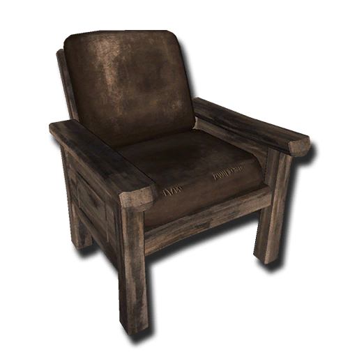

# Hide Chair

**Contents**

- [Overview](#overview)
- [Harvesting](#harvesting)
- [Crafting](#crafting)
- [Update History](#update-history)

**Hide Chair**

| Property | Details |
| --- | --- |
|  |  / *Hide\_Chair\_icon.png* |
| Release | [TFTFT Part 6 Broken Silence](./The%20Long%20Dark%20%E2%80%94%20Changelog.md#2.33) |
| **Values** |  |
| Weight | 5.00 kg (11 lbs) |
| **Actions** |  |
| Backpack | Drop, Place |

The **Hide Chair** is a [Decorations](./Decorations.md) item that can be [Crafted](./Crafting.md) as part of the [Safehouse Customization](./Safehouse%20Customization.md) feature.

## Overview

A makeshift wooden chair, a Hide Chair can be crafted at a [Furniture Workbench](./Furniture%20Workbench.md), but requires [Woodworking Tools](./Woodworking%20Tools.md).

Progress for Crafting this item will be stored in the Furniture Workbench's container inventory, rather than the player's inventory. Once crafted, the item can be automatically placed in the Safehouse. Canceling this prompt will force the item back into the Furniture Workbench's container inventory. The chair can only be placed on a wide, clear space on the floor when in Customization Mode.

Despite having a Backpack carry weight value, the chair cannot be picked up and placed back into the player's inventory once crafted, and so it cannot be carried from one base to another. The only option is to move or destroy it (destroying the chair will yield no resources, so consider the material cost/time investment before creating this item).

## Harvesting

The Hide Chair can be harvested with a [Hatchet](./Hatchet.md) in 2 hours and produces 1 [Cured Deer Hide](./Cured%20Deer%20Hide.md) and 3 [Fir Firewood](./Fir%20Firewood.md).

## Crafting

**Hide Chair**

| Property | Details |
| --- | --- |
|  | - |
|  | - |
|  | 780 minutes (13 hour 0 minutes) |
| **Requirements** |  |
| Facility | **Template:iconlink** |
| Tool | **Template:iconlink** |
| **Materials** |  |
| **Template:iconlink plain** |  |
| Item | [Fir Firewood](./Fir%20Firewood.md) |
| Quantity | 8 |
| **Template:iconlink plain** |  |
|  | [Cured Deer Hide](./Cured%20Deer%20Hide.md) |
|  | 2 |
| **Template:iconlink plain** |  |
|  | [Ptarmigan Down](./Ptarmigan%20Down.md) |
|  | 8 |
| **Template:iconlink plain** |  |
|  | [Cured Gut](./Cured%20Gut.md) |
|  | 3 |

## Update History

**Template:update history****Lua execution error in Module:Navbox function navbox** [ru:Обитое шкурой кресло](ru:%D0%9E%D0%B1%D0%B8%D1%82%D0%BE%D0%B5_%D1%88%D0%BA%D1%83%D1%80%D0%BE%D0%B9_%D0%BA%D1%80%D0%B5%D1%81%D0%BB%D0%BE)
