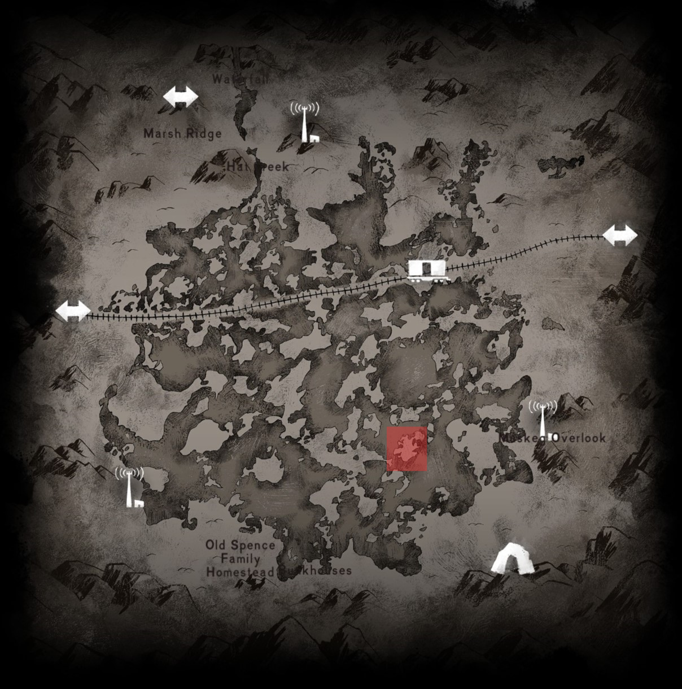

# High Blind

**High Blind**

| Property | Details |
| --- | --- |
|  |  / *Forlorn\_Muskleg\_High\_Blind.jpg* |
| **Location** |  |
|  |  / *High\_Blind\_Location.png* |
| Region | [Forlorn Muskeg](./Forlorn%20Muskeg.md)\|- |
| Type | Outdoors\|- |
