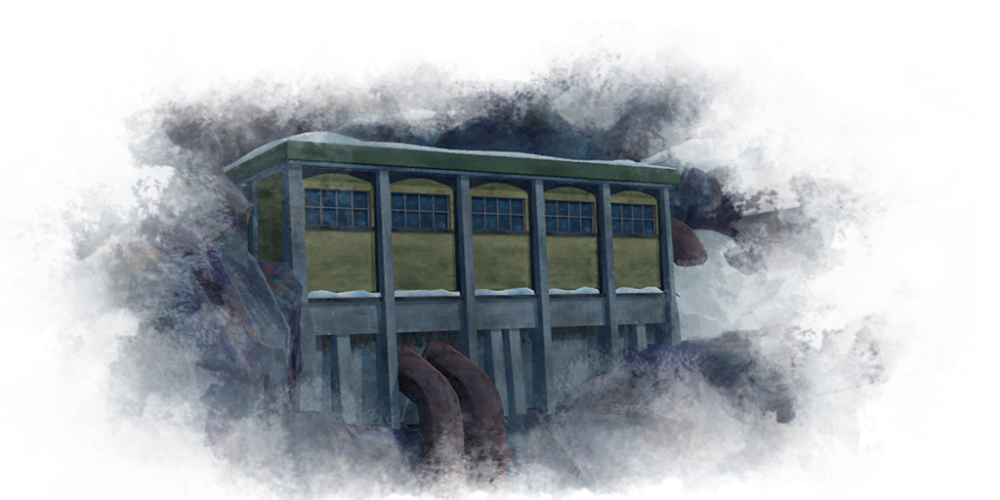

# High Energy

<table class="infobox">
<caption>High Energy</caption>
<colgroup>
<col style="width: 50%" />
<col style="width: 50%" />
</colgroup>
<tbody>
<tr>
<td colspan="2"><figure>

<figcaption>Missions_story_ep5_HighEnergy.png</figcaption>
</figure></td>
</tr>
<tr>
<td>
Episode
</td>
<td></td>
</tr>
<tr>
<td colspan="2" class="section">
<strong>Missions</strong>
</td>
</tr>
<tr>
<td>
Previous
</td>
<td>
<a href="./The%20Cold%2C%20Broken%20Road.md" class="wikilink" title="The Cold, Broken Road">The Cold, Broken Road</a>
</td>
</tr>
<tr>
<td>
Current
</td>
<td>
High Energy
</td>
</tr>
<tr>
<td>
Next
</td>
<td>
<a href="./To%20SAR%20And%20Back.md" class="wikilink" title="To SAR And Back">To SAR And Back</a>
</td>
</tr>
<tr>
<td>
Region
</td>
<td>
<a href="./Suzuki%20Environs.md" class="wikilink" title="Suzuki Environs">Suzuki Environs</a> <a href="./Suzuki%20Geothermal%20Region.md" class="wikilink" title="Suzuki Geothermal Region">Suzuki Geothermal Region</a>
</td>
</tr>
<tr>
<td>
Characters
</td>
<td>
<a href="./Will%20Mackenzie.md" class="wikilink" title="Will Mackenzie">Will Mackenzie</a> 
<a href="./Jace.md" class="wikilink" title="Jace">Jace</a> 
<a href="./Atwood.md" class="wikilink" title="Atwood">Atwood</a>
</td>
</tr>
</tbody>
</table>

|  |  |  |
|----|----|----|
| “ | Activate each Substation before the aurora returns. | ” |

**High Energy** is the second mission of Part Two: Strange History in <a href="./Episode%205%20-%20The%20Light%20At%20The%20End%20Of%20All%20Things.md" class="wikilink" title="Episode 5: The Light At The End Of All Things">Episode 5: The Light At The End Of All Things</a> of the <a href="./Wintermute.md" class="wikilink" title="Wintermute">Wintermute</a> story of <a href="./The%20Long%20Dark.md" class="wikilink" title="The Long Dark"><em>The Long Dark</em></a>.

## Objectives

- Go to the Geothermal Region
- Activate all of the Substations before nightfall.
  - Activate Substation 1.
  - Activate Substation 2.
  - Activate Substation 3.
- Return to Suzuki.
- Return to the control room.
  - Go with Jace to the tuner room.
  - Adjust the telescope so Jace can download the data.
  - Find Astrid in Perserverance Mills.

## Walkthrough

## Trivia

**Lua execution error in Module:Navbox function navbox**

