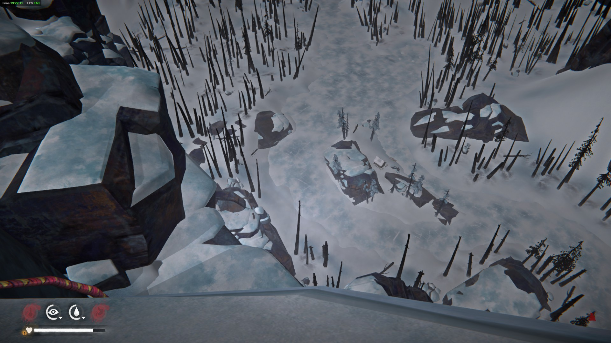
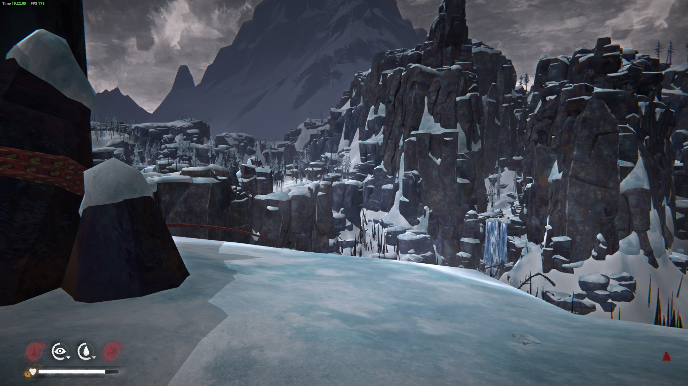

# High Meadow

**Categories:** Locations, Locations in Ash Canyon, Outdoor locations · **Source:** [Fandom](https://thelongdark.fandom.com/wiki/High_Meadow)

**High Meadow**

_High\_Meadows.jpg_

**Location**

_High\_Meadow\_Location.png_

**Region:** [Ash Canyon](./Ash%20Canyon.md)

**Type:** Outdoors

## Overview

An isolated small meadow upon an hill, expect just cold and harsh weather. No shelter can be found here, scarce in resources too. The meadow is a prime location for map making, featuring a vista spot. To reach it, start from the rope bridge and climb the rock on the right side and approach the cliff, a message should pop up when you reach the place.

## Loot

The meadow contains 0-3 birch saplings, and under the wooden ramp leading to the rope bridge there may spawn a [Stump Remover](./Stump%20Remover.md), [Dusting Sulfur](./Dusting%20Sulfur.md) or a random skill book. On the other side of the bridge there may be a backpack with random loot leaning against the boulder on the right side.

## Gallery

_High\_Meadows.jpg_

_Downward\_View\_of\_Rope\_from\_High\_Meadow.jpg_

_Outward\_View\_of\_Rope\_from\_High\_Meadow.jpg_
