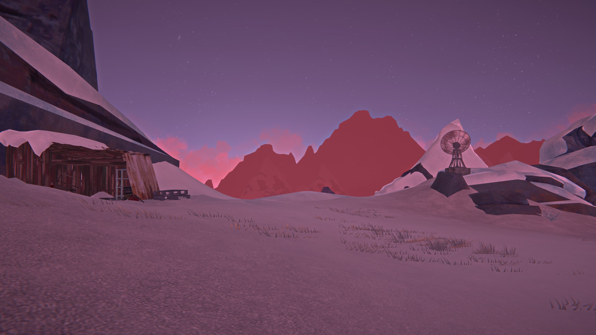
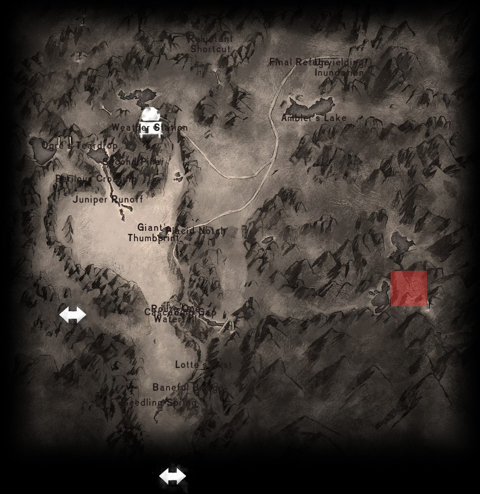
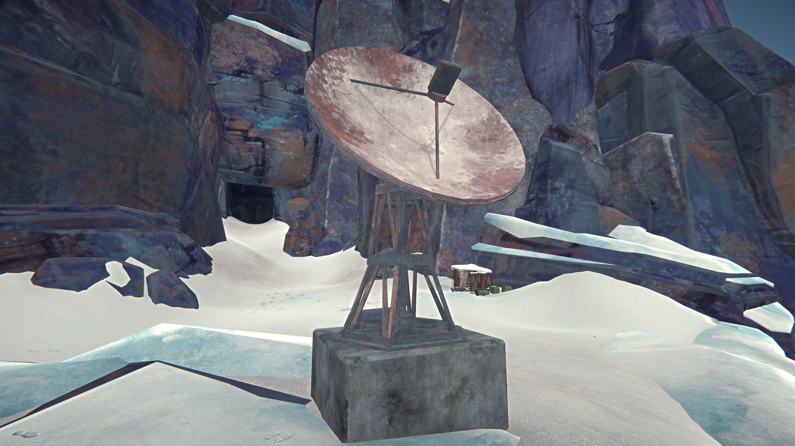
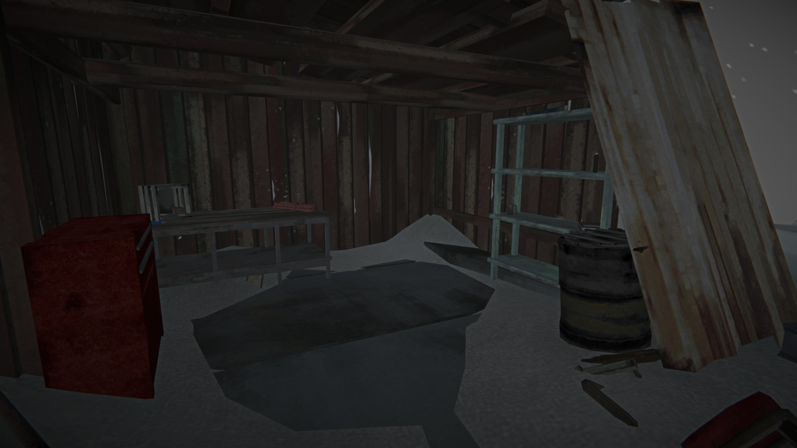

# High Peak Plateau

**High Peak Plateau**

| Property | Details |
| --- | --- |
|  |  / *High\_Peak\_Plateau\_Area.jpg* |
| **Location** |  |
|  |  / *High\_Peak\_Plateau\_Location.png* |
| Region | [Sundered Pass](./Sundered%20Pass.md)\|- |
| **General** |  |
| Firebox | [Fire Barrel](./Fire%20Barrel.md) |
|  | Provides some shelter\|} **High Peak Plateau** is an unmarked location in [Sundered Pass](./Sundered%20Pass.md). It is located to the far east of the map in the mountains and can only be accessed via progressing through the [Last Horizon](./Last%20Horizon.md) Tale. / ## Overview / The peak is reached after the long climb up to [Roamer's Cave](./Roamer%27s%20Cave.md) and an even longer hike through the mountains. The peak has a single transmitter and storage shed nearby containing a windproof [Fire Barrel](./Fire%20Barrel.md). It also has a ptarmigan nest nearby. The location is very cold due to the extremely high altitude, being the highest location in [Sundered Pass](./Sundered%20Pass.md). / This location is the highest in elevation the survivor can reach throughout Great Bear Island. / The loot found at the top includes: / - [Mountaineering Rope](./Mountaineering%20Rope.md) / - [Car Battery](./Car%20Battery.md) / - [Rüdiger's Diary 2](./R%C3%BCdiger%27s%20Diary%202.md) / - [Foreman's Technical Log 3](./Foreman%27s%20Technical%20Log%203.md) (with a Polaroid inside, [Foreman's Polaroid 3](./Foreman%27s%20Polaroid%203.md)) / - Several [Crates](./Crate.md) / - A [Supply Bin](./Supply%20Bin.md) / Heading west of the transmitter provides an anchor for the Mountaineering Rope and leads to a small pond and later a one way slope back down the mountain, close to [Cascading Gap](./Cascading%20Gap.md). / \|  / *The Transmitter* \|  / *The shed up close* \| / \| --- \| --- \| / **Lua execution error in Module:Navbox function navbox** |
|  / *The Transmitter* |  / *The shed up close* |
