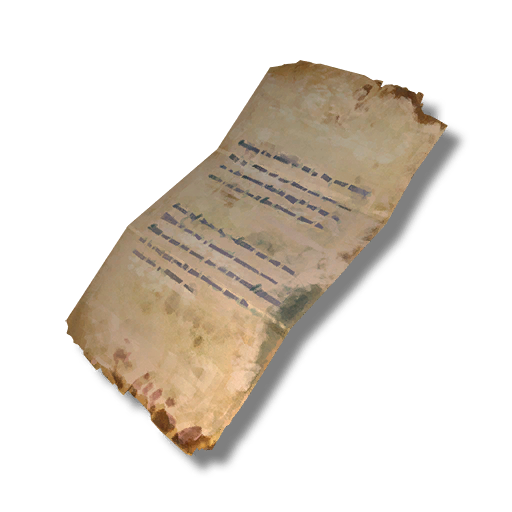

# Highway Robbery

  
*For the side mission found in <a href="./Episode%201%20-%20Do%20Not%20Go%20Gentle.md" class="wikilink" title="Episode 1: Do Not Go Gentle">Episode 1: Do Not Go Gentle</a>, see <a href="./Highway%20Robbery%20%28mission%29.md" class="wikilink" title="Highway Robbery (mission)">Highway Robbery (mission)</a>.*

<table class="infobox">
<caption>Highway Robbery</caption>
<colgroup>
<col style="width: 50%" />
<col style="width: 50%" />
</colgroup>
<tbody>
<tr>
<td colspan="2"><figure>

<figcaption>Highway_Robbery_icon.png</figcaption>
</figure></td>
</tr>
<tr>
<td>
Release
</td>
<td>
<a href="./The%20Long%20Dark%20%E2%80%94%20Early%20Access%20Changelog.md#1.00" class="wikilink" title="1 August 2017">1 August 2017</a>
</td>
</tr>
<tr>
<td>
Wintermute
</td>
<td>
<a href="./Episode%201%20-%20Do%20Not%20Go%20Gentle.md" class="wikilink" title="Episode 1">Episode 1</a> - <a href="./Highway%20Robbery%20%28mission%29.md" class="wikilink" title="Highway Robbery">Highway Robbery</a>
</td>
</tr>
<tr>
<td colspan="2" class="section">
<strong>Properties</strong>
</td>
</tr>
<tr>
<td>
Item type
</td>
<td>
<a href="./Collectibles.md" class="wikilink" title="Collectibles">Collectibles</a>|-
</td>
</tr>
<tr>
<td>
Stackable
</td>
<td>
No
</td>
</tr>
<tr>
<td>
Examine
</td>
<td>
A note describing the location of emergency supplies
</td>
</tr>
<tr>
<td colspan="2" class="section">
<strong>Values</strong>
</td>
</tr>
<tr>
<td>
Weight
</td>
<td>
0.00 kg (0 lbs)
</td>
</tr>
<tr>
<td colspan="2" class="section">
<strong>Actions</strong>
</td>
</tr>
<tr>
<td>
Backpack
</td>
<td>
Examine
</td>
</tr>
<tr>
<td>
On ground
</td>
<td>
Take It, Read Text, Leave It
</td>
</tr>
<tr>
<td colspan="2" class="section">
<strong>Advanced data</strong>
</td>
</tr>
<tr>
<td>
Item key
</td>
<td>
STORY_MiltonFlareGunNote
</td>
</tr>
</tbody>
</table>

**Highway Robbery** is a <a href="./Collectibles.md" class="wikilink" title="Collectible">Collectible</a> item found in <a href="./Episode%201%20-%20Do%20Not%20Go%20Gentle.md" class="wikilink" title="Episode 1">Episode 1</a> of the <a href="./Wintermute.md" class="wikilink" title="Wintermute">Wintermute</a> story mode to start the <a href="./Highway%20Robbery%20%28mission%29.md" class="wikilink" title="Highway Robbery">Highway Robbery</a> side mission.

During the course of the mission, the surivor finds the note *Highway Robbery* from the <a href="./Orca%20Gas%20Station.md" class="wikilink" title="Orca Gas Station">Orca Gas Station</a> outside <a href="./Milton.md" class="wikilink" title="Milton">Milton</a>, and investigates an abandonded truck on <a href="./Spruce%20Falls%20Bridge.md" class="wikilink" title="Spruce Falls Bridge">Spruce Falls Bridge</a>.

## Transcript

The following text is transcribed from **Highway Robbery**

Hey Bud, sorry to leave you hanging like this with the storm and the power and everything. But it sounds like it's all gone to hell out at the upper bridge tonight. Cars broken down, a mess. And some rich Mainlander won't budge from his truck. Probably thinks we're all a bunch of bandits waiting to rip him off, usual story.

Anyway me and Jason are going to go up there and see if we can talk some sense into him, before the storm gets even worse. I'll sort you out in the morning.

Thanks,

Peter

## Update history

\* UPDATE **17 December 2018 (<a href="./The%20Long%20Dark%20%E2%80%94%20Changelog.md#1.41" class="wikilink" title="Update">Update</a>):**

- - Added to game.

**Lua execution error in Module:Navbox function navbox**

