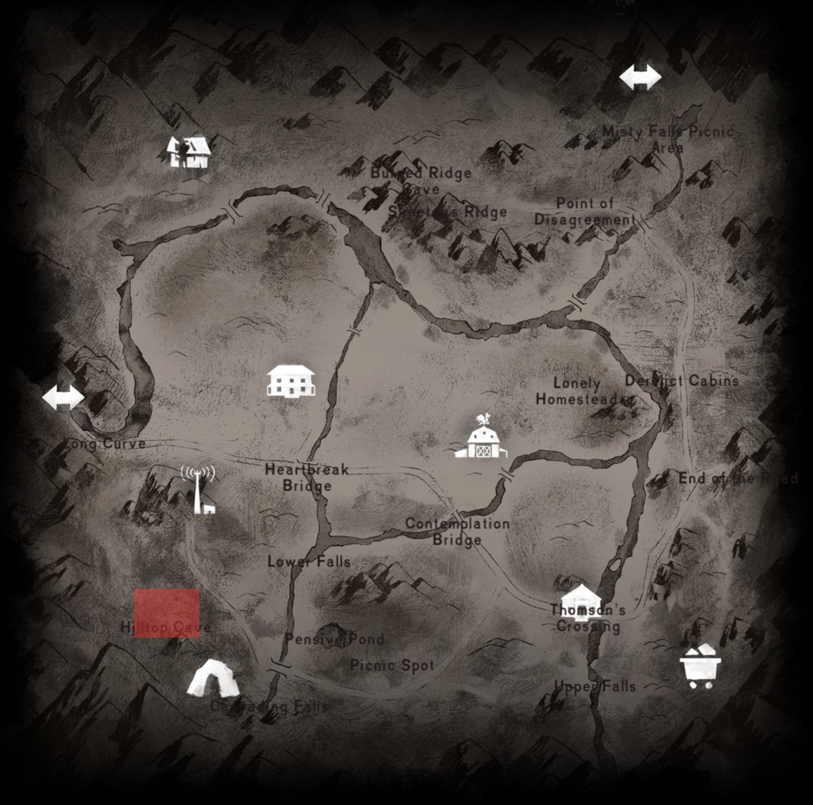

# Hilltop Cave

**Hilltop Cave**

| Property | Details |
| --- | --- |
| \[\[File: / \|  / *Exterior* \|  / *Interior* \| / \| --- \| --- \| | 250px\]\] |
|  / *Exterior* |  / *Interior* |
| **Location** |  |
|  / *Hilltop\_Cave\_Location.png* |  |
| Region | [Pleasant Valley](./Pleasant%20Valley.md)\|- / **General** |
| Type | Cave\|- /  / *bed\_icon.png* |
|  | Provides some shelter\|} **Hilltop Cave** is one of several caves dotted throughout [Pleasant Valley](./Pleasant%20Valley.md), located not far from [Signal Hill](./Signal%20Hill.md) and the [Winding River](./Winding%20River.md) transition cave (and subesquently [Cascading Falls](./Cascading%20Falls.md)). / ## Overview / Hilltop Cave lies next to a [Hunter's Blind](./Hunter%27s%20Blinds.md), both of which are south-west of the [Cave](./Cave%20%28Transition%20Zone%29.md) connecting to [Winding River](./Winding%20River.md). / [Old Man's Beard Lichen](./Old%20Man%27s%20Beard%20Lichen.md) and an abundance of [reishi mushrooms](./Reishi%20Mushroom.md) can be found in the area. [Frozen corpses](./Frozen%20Corpse.md), both human and [Deer Carcass](./Deer%20Carcass.md), can also be found in the area. There's a chance of finding a backpack and some food on the cave floor. The area is also home to several [rabbits](./Rabbit.md), as well as a [bear](./Bear.md) that may often wander through. / This cave can be useful if players are sleeping in [Signal Hill](./Signal%20Hill.md) and need to eliminate [Cabin Fever](./Cabin%20Fever.md), as it is relatively close by and, like most small caves, counts as an outdoor location. / \| Column 1 \| Column 2 \| Column 3 \| Column 4 \| / \| --- \| --- \| --- \| --- \| / \|  / *SS-PV-HilltopCave\_(1).jpg* \|  / *SS-PV-HilltopCave\_(2).jpg* \|  / *SS-PV-HilltopCave\_(3).jpg* \|  / *SS-PV-HilltopCave\_(5).jpg* \| / **Lua execution error in Module:Navbox function navbox** / [ru:Пещера на вершине холма](ru:%D0%9F%D0%B5%D1%89%D0%B5%D1%80%D0%B0_%D0%BD%D0%B0_%D0%B2%D0%B5%D1%80%D1%88%D0%B8%D0%BD%D0%B5_%D1%85%D0%BE%D0%BB%D0%BC%D0%B0) |
|  / *SS-PV-HilltopCave\_(1).jpg* |  / *SS-PV-HilltopCave\_(2).jpg* /  / *SS-PV-HilltopCave\_(3).jpg* /  / *SS-PV-HilltopCave\_(5).jpg* |
