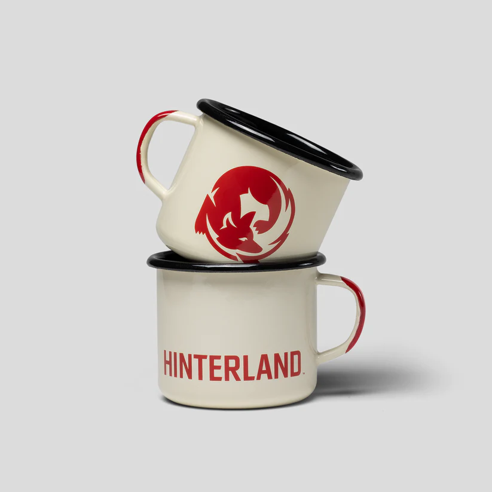
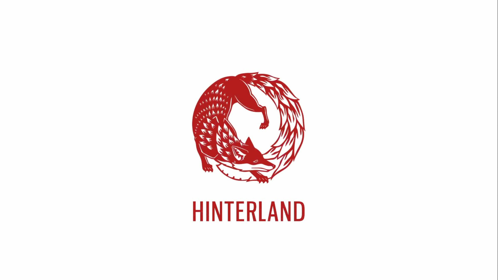
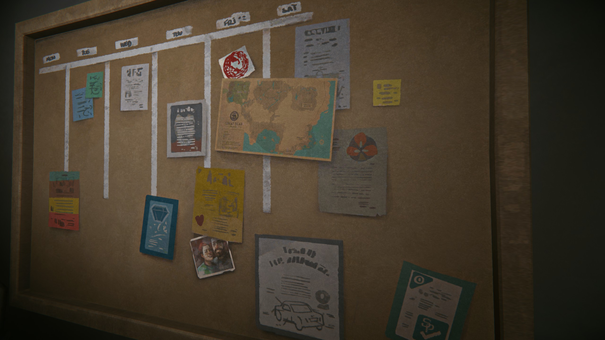

# Hinterland Studio Inc\.

**Categories:** The Long Dark · **Source:** [Fandom](https://thelongdark.fandom.com/wiki/Hinterland_Studio_Inc.)

**Contents**

- [History](#history)
- [Structure](#structure)
- [Products](#products)
- [Trivia](#trivia)
- [External links](#external-links)
- [Gallery](#gallery)
- [References](#references)

**Hinterland Studio Inc.**

**Industry:** Video games

**Founded:** 2012

**Founder:** Raphael van Lierop

**Headquarters:** [Vancouver](wikipedia:Vancouver), [BC](wikipedia:British_Columbia), [Canada](wikipedia:Canada)

**Products:** [The Long Dark](./The%20Long%20Dark.md)

**Number of employees:** 35 (Nov 2018)

**DUNS number:** 20-364-2843

**Website:** hinterlandgames.com

**Hinterland Studio Inc.** is an independent game studio headquartered in downtown Vancouver.

## History

The studio was founded by Raphael van Lierop, who previously directed Relic's _Warhammer 40,000: Space Marine_ and worked on other games such as _Company of Heroes,_ _Dawn of War,_ and _Far Cry 3_.[¹](#fn1) In 2012, van Lierop started Hinterland Studio and recruited veteran AAA game developers including Alan Lawrance of Volition Inc, Hokoyo Lim, art director for _League of Legends_, David Chan, audio designer at BioWare, and Marianna Krawczyk, lead writer of the _God of War_ series.[²](#fn2) Since then, the team has grown to include over 25 members.[³](#fn3) In August 2016, it was announced that Hinterland would be moving to its new headquarters on Dunsmuir Avenue in Cumberland.[⁴](#fn4) Currently, the only physical studio is located in downtown Vancouver at the former MacMillan Bloedel Building.[⁵](#fn5)[⁶](#fn6) In September of 2018, Hinterland hired six new employees, the most significant growth in team size since the studio's foundation. This was in part due to Hinterland hiring former employees of Capcom Vancouver, which went defunct that month. Hinterland also purchased motion-capture equipment from Capcom.[⁷](#fn7)

## Structure

Hinterland utilizes a distributed model, in which employees may work from locations other than the main studio. About half of the employees work at the main studio in downtown Vancouver, while the other half is distributed throughout North America.[⁸](#fn8) The team utilizes electronic communications and project management applications such as Slack, Skype, and Basecamp, and supplements these with occasional in-person meetings.[⁹](#fn9)

## Products

| Title | System | Release date |
| --- | --- | --- |
| _[The Long Dark](./The%20Long%20Dark.md)_ | Windows / OS X / Xbox One PlayStation 4 / Linux / Nintendo Switch | _Full Release_: 1 Aug 2017 / _Early Access_: 22 Sept 2014 |

## Trivia

- The names of studio employees are hidden throughout the game, such as in the [Crashed Prison Transport Bus manifest](./Crashed%20Prison%20Transport%20Bus.md#Prison_Transport_Manifest), as well as in the names of several locations, such as:
  - [Katie's Secluded Corner](./Katie%27s%20Secluded%20Corner.md)
  - [Andre's Peak](./Andre%27s%20Peak.md)
  - [Max's Last Stand](./Max%27s%20Last%20Stand.md)
  - [Matt's Truck](./Matt%27s%20Truck.md)
  - [Alan's Cave](./Alan%27s%20Cave.md)

## External links

- [Official site](http://hinterlandgames.com/)
- [Official forums](http://www.hinterlandforums.com/)
- [Facebook page](https://www.facebook.com/HinterlandGames)
- [Twitter page](https://twitter.com/hinterlandgames)

## Gallery

_The Hinterland logo is always found on a [Cup of Coffee](./Cup%20of%20Coffee.md)_

_[Lost and Found](./Lost%20and%20Found.md) box with the Hinterland logo_

_The old Hinterland logo on the board in the [Jackrabbit Remote Transport](./Jackrabbit%20Hangar.md) hangar in [Episode 1](./Episode%201%20-%20Do%20Not%20Go%20Gentle.md)_

## References

## Notes

---

1. Alexander, L. (2013, September 17). [Inspiration in isolation: The Long Dark takes on a different kind of survival fiction](https://www.gamasutra.com/view/news/199854/Inspiration_in_isolation_The_Long_Dark_takes_on_a_different_kind_of_survival_fiction.php). _Gamasutra_. Retrieved February 19, 2018.[↩︎](#fnref1)
2. Sinclair, B. (2013, September 9). [AAA devs form Hinterland](https://www.gamesindustry.biz/articles/2013-09-09-aaa-devs-form-hinterland). _Gamesindustry.biz_. Retrieved February 19, 2018.[↩︎](#fnref2)
3. Mergent Intellect. (2017, July). [20-364-2843 HINTERLAND STUDIO INC: Company Overview](http://www.mergentintellect.com/index.php/search/companyDetails/203642843#). Retrieved April 30, 2018.[↩︎](#fnref3)
4. (2016, October 18). [Movers and Shakers](https://issuu.com/markmacdonald7/docs/bevi_august_2016_final_new/35). _Business Examiner Vancouver Island (August 2016 issue),_ 35. Retrieved February 19, 2018.[↩︎](#fnref4)
5. (2017, July 19). [HINTERLAND STUDIO INC](https://advance.lexis.com/api/document?collection=company-financial&id=urn:contentItem:5PF5-C5X0-C1G6-J1T3-00000-00&context=1516831). _Worldbase._ Retrieved November 21, 2018.[↩︎](#fnref5)
6. [MacMillan Bloedel Building](https://www.historicplaces.ca/en/rep-reg/place-lieu.aspx?id=8781). _Canada's Historic Places_. Retrieved November 21, 2018.[↩︎](#fnref6)
7. Van Lierop, R. (2018, November 7). [Dev Diary November 2018](http://www.hinterlandforums.com/forums/topic/21577-dev-diary-november-2018/). Retrieved November 21, 2018.[↩︎](#fnref7)
8. Van Lierop, R. (2018, July 20). [Milton Mailbag--Dispatch #5](http://www.hinterlandforums.com/forums/topic/20776-milton-mailbag-dispatch-5/). _Hinterland Forums_. Retrieved November 21, 2018.[↩︎](#fnref8)
9. Nowak, P. (2015, September 22). [How Hinterland hires a workforce spread around North America.](http://www.canadianbusiness.com/innovation/how-hinterland-manages-a-workforce-spread-around-north-america/) _Canadian Business._ Retrieved February 19, 2018.[↩︎](#fnref9)
