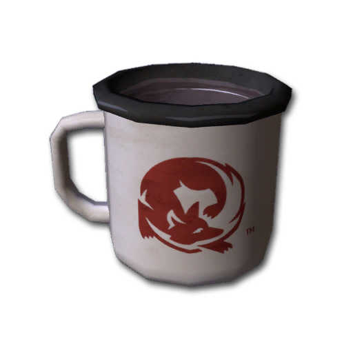
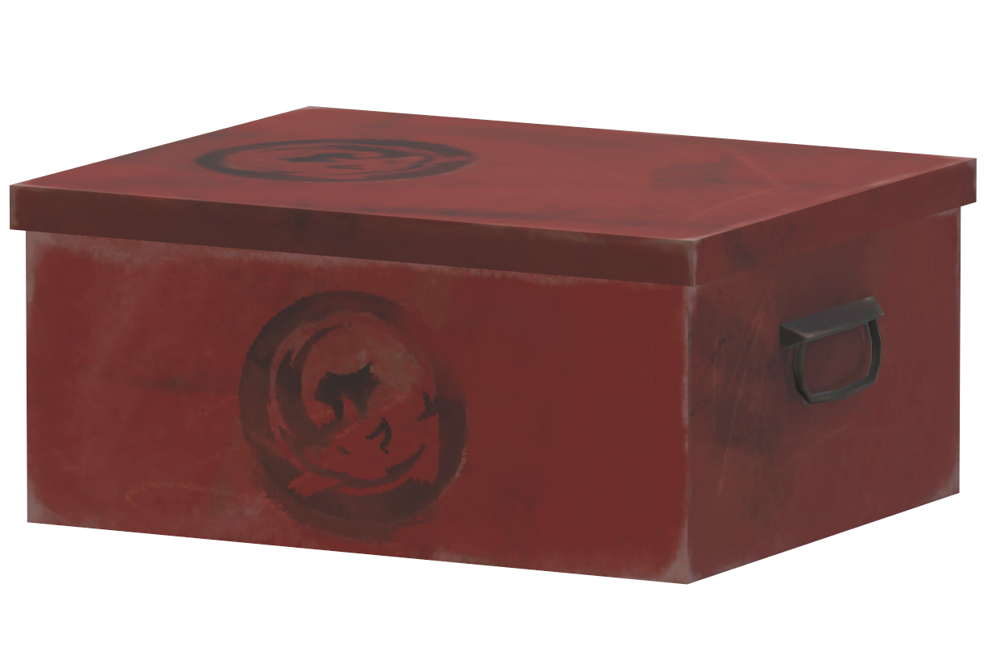
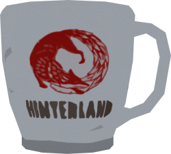

# Hinterland Studio Inc\.

**Contents**

- [History](#History)
- [Structure](#Structure)
- [Products](#Products)
- [Trivia](#Trivia)
- [External links](#External_links)
- [Gallery](#Gallery)
- [References](#References)

<table class="infobox">
<caption>Hinterland Studio Inc.</caption>
<colgroup>
<col style="width: 50%" />
<col style="width: 50%" />
</colgroup>
<tbody>
<tr>
<td colspan="2"><figure>

<figcaption>Landing+logo+wide2.png</figcaption>
</figure></td>
</tr>
<tr>
<td>
Industry
</td>
<td>
Video games
</td>
</tr>
<tr>
<td>
Founded
</td>
<td>
2012
</td>
</tr>
<tr>
<td>
Founder
</td>
<td>
Raphael van Lierop
</td>
</tr>
<tr>
<td>
Headquarters
</td>
<td>
<a href="wikipedia:Vancouver" class="wikilink" title="Vancouver">Vancouver</a>, <a href="wikipedia:British_Columbia" class="wikilink" title="BC">BC</a>, <a href="wikipedia:Canada" class="wikilink" title="Canada">Canada</a>
</td>
</tr>
<tr>
<td>
Products
</td>
<td>
<a href="./The%20Long%20Dark.md" class="wikilink" title="The Long Dark">The Long Dark</a>
</td>
</tr>
<tr>
<td>
Number of employees
</td>
<td>
35 (Nov 2018)
</td>
</tr>
<tr>
<td>
DUNS number
</td>
<td>
20-364-2843
</td>
</tr>
<tr>
<td>
Website
</td>
<td>
hinterlandgames.com
</td>
</tr>
</tbody>
</table>

**Hinterland Studio Inc.** is an independent game studio headquartered in downtown Vancouver.

**Template:quote2**

## History

The studio was founded by Raphael van Lierop, who previously directed Relic's *Warhammer 40,000: Space Marine* and worked on other games such as *Company of Heroes,* *Dawn of War,* and *Far Cry 3*.[^1] In 2012, van Lierop started Hinterland Studio and recruited veteran AAA game developers including Alan Lawrance of Volition Inc, Hokoyo Lim, art director for *League of Legends*, David Chan, audio designer at BioWare, and Marianna Krawczyk, lead writer of the *God of War* series.[^2] Since then, the team has grown to include over 25 members.[^3] In August 2016, it was announced that Hinterland would be moving to its new headquarters on Dunsmuir Avenue in Cumberland.[^4] Currently, the only physical studio is located in downtown Vancouver at the former MacMillan Bloedel Building.[^5][^6] In September of 2018, Hinterland hired six new employees, the most significant growth in team size since the studio's foundation. This was in part due to Hinterland hiring former employees of Capcom Vancouver, which went defunct that month. Hinterland also purchased motion-capture equipment from Capcom.[^7]

## Structure

Hinterland utilizes a distributed model, in which employees may work from locations other than the main studio. About half of the employees work at the main studio in downtown Vancouver, while the other half is distributed throughout North America.[^8] The team utilizes electronic communications and project management applications such as Slack, Skype, and Basecamp, and supplements these with occasional in-person meetings.[^9]

## Products

<table>
<colgroup>
<col style="width: 33%" />
<col style="width: 33%" />
<col style="width: 33%" />
</colgroup>
<thead>
<tr>
<th scope="col" style="background: #3C3A53">
Title
</th>
<th scope="col" style="background: #3C3A53">
System
</th>
<th scope="col" style="background: #3C3A53">
Release date
</th>
</tr>
</thead>
<tbody>
<tr>
<td>
<em><a href="./The%20Long%20Dark.md" class="wikilink" title="The Long Dark">The Long Dark</a></em>
</td>
<td>
Windows 
OS X 
Xbox One PlayStation 4 
Linux

Nintendo Switch
</td>
<td>
<em>Full Release</em>: 1 Aug 2017 
<em>Early Access</em>: 22 Sept 2014
</td>
</tr>
</tbody>
</table>

## Trivia

- The names of studio employees are hidden throughout the game, such as in the <a href="./Crashed%20Prison%20Transport%20Bus.md#Prison_Transport_Manifest" class="wikilink" title="Crashed Prison Transport Bus manifest">Crashed Prison Transport Bus manifest</a>, as well as in the names of several locations, such as:
  - <a href="./Katie%27s%20Secluded%20Corner.md" class="wikilink" title="Katie&#39;s Secluded Corner">Katie's Secluded Corner</a>
  - <a href="./Andre%27s%20Peak.md" class="wikilink" title="Andre&#39;s Peak">Andre's Peak</a>
  - <a href="./Max%27s%20Last%20Stand.md" class="wikilink" title="Max&#39;s Last Stand">Max's Last Stand</a>
  - <a href="./Matt%27s%20Truck.md" class="wikilink" title="Matt&#39;s Truck">Matt's Truck</a>
  - <a href="./Alan%27s%20Cave.md" class="wikilink" title="Alan&#39;s Cave">Alan's Cave</a>

## External links

- [Official site](http://hinterlandgames.com/)
- [Official forums](http://www.hinterlandforums.com/)
- [Facebook page](https://www.facebook.com/HinterlandGames)
- [Twitter page](https://twitter.com/hinterlandgames)

## Gallery

<table class="gallery">
<colgroup>
<col style="width: 25%" />
<col style="width: 25%" />
<col style="width: 25%" />
<col style="width: 25%" />
</colgroup>
<tbody>
<tr>
<td><figure>

<figcaption>The Hinterland logo is always found on a <a href="./Cup%20of%20Coffee.md" class="wikilink" title="Cup of Coffee">Cup of Coffee</a></figcaption>
</figure></td>
<td><figure>
[Missing image: Cup_of_coffee_bottom.jpg]
<figcaption>Ditto, bottom</figcaption>
</figure></td>
<td><figure>
[Missing image: Cup_of_Coffee_Mug_Real.webp]
<figcaption>A real world Cup of Coffee coffee cup</figcaption>
</figure></td>
<td><figure>

<figcaption><a href="./Lost%20and%20Found.md" class="wikilink" title="Lost and Found">Lost and Found</a> box with the Hinterland logo</figcaption>
</figure></td>
</tr>
<tr>
<td><figure>
[Missing image: Old_Hinterland_Logo.jpg]
<figcaption>The early Hinterland Logo</figcaption>
</figure></td>
<td><figure>

<figcaption>Cup of Coffee model with the old logo</figcaption>
</figure></td>
<td><figure>
[Missing image: Jackrabbit_Remote_Transport_Office_board.jpg]
<figcaption>The old Hinterland logo on the board in the <a href="./Jackrabbit%20Hangar.md" class="wikilink" title="Jackrabbit Remote Transport">Jackrabbit Remote Transport</a> hangar in <a href="./Episode%201%20-%20Do%20Not%20Go%20Gentle.md" class="wikilink" title="Episode 1">Episode 1</a></figcaption>
</figure></td>
<td></td>
</tr>
</tbody>
</table>

## References

**Template:reflistLua execution error in Module:Navbox function navbox**

## Notes

[^1]: Alexander, L. (2013, September 17). [Inspiration in isolation: The Long Dark takes on a different kind of survival fiction](https://www.gamasutra.com/view/news/199854/Inspiration_in_isolation_The_Long_Dark_takes_on_a_different_kind_of_survival_fiction.php). *Gamasutra*. Retrieved February 19, 2018.

[^2]: Sinclair, B. (2013, September 9). [AAA devs form Hinterland](https://www.gamesindustry.biz/articles/2013-09-09-aaa-devs-form-hinterland). *Gamesindustry.biz*. Retrieved February 19, 2018.

[^3]: Mergent Intellect. (2017, July). [20-364-2843 HINTERLAND STUDIO INC: Company Overview](http://www.mergentintellect.com/index.php/search/companyDetails/203642843#). Retrieved April 30, 2018.

[^4]: (2016, October 18). [Movers and Shakers](https://issuu.com/markmacdonald7/docs/bevi_august_2016_final_new/35). *Business Examiner Vancouver Island (August 2016 issue),* 35. Retrieved February 19, 2018.

[^5]: (2017, July 19). [HINTERLAND STUDIO INC](https://advance.lexis.com/api/document?collection=company-financial&id=urn:contentItem:5PF5-C5X0-C1G6-J1T3-00000-00&context=1516831). *Worldbase.* Retrieved November 21, 2018.

[^6]: [MacMillan Bloedel Building](https://www.historicplaces.ca/en/rep-reg/place-lieu.aspx?id=8781). *Canada's Historic Places*. Retrieved November 21, 2018.

[^7]: Van Lierop, R. (2018, November 7). [Dev Diary November 2018](http://www.hinterlandforums.com/forums/topic/21577-dev-diary-november-2018/). Retrieved November 21, 2018.

[^8]: Van Lierop, R. (2018, July 20). [Milton Mailbag--Dispatch \#5](http://www.hinterlandforums.com/forums/topic/20776-milton-mailbag-dispatch-5/). *Hinterland Forums*. Retrieved November 21, 2018.

[^9]: Nowak, P. (2015, September 22). [How Hinterland hires a workforce spread around North America.](http://www.canadianbusiness.com/innovation/how-hinterland-manages-a-workforce-spread-around-north-america/) *Canadian Business.* Retrieved February 19, 2018.
