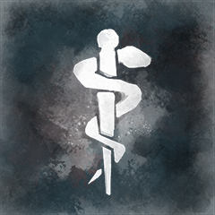

# Hippocratic Oath

<table class="infobox">
<caption>Hippocratic Oath</caption>
<colgroup>
<col style="width: 50%" />
<col style="width: 50%" />
</colgroup>
<tbody>
<tr>
<td colspan="2"><figure>

<figcaption>Hippocratic_Oath_icon.png</figcaption>
</figure></td>
</tr>
<tr>
<td>
Description
</td>
<td>
Rescue all three lost Survivors and stock the Hall with supplies.
</td>
</tr>
</tbody>
</table>

**Hippocratic Oath** is a <a href="./Wintermute.md" class="wikilink" title="Wintermute">Wintermute</a> <a href="./The%20Long%20Dark%20%E2%80%94%20Achievements.md" class="wikilink" title="achievement">achievement</a> in <a href="./Episode%203%20-%20Crossroads%20Elegy.md" class="wikilink" title="Episode 3: Crossroads Elegy">Episode 3: Crossroads Elegy</a> of *<a href="./The%20Long%20Dark.md" class="wikilink" title="The Long Dark">The Long Dark</a>*.

## Guide

This achievement is an unmissable story achievement obtained after rescuing all <a href="./Crash%20Survivor.md" class="wikilink" title="Crash Survivors">Crash Survivors</a> Logan, Ava, and Wade and returning them to the <a href="./Community%20Hall.md" class="wikilink" title="Community Hall">Community Hall</a> and also stocking the cabinet with the required supplies during the mission <a href="./Coming%20Storm.md" class="wikilink" title="Coming Storm">Coming Storm</a>.

## Trivia

- The achievement name is a reference to how new doctors and physicians are required to swear to never purposfully harm their patients. A "Hippocratic Oath" is in reference to how modern medical doctors are often required to "harm" their patients in order to heal and/or otherwise save them. (Example: injecting fresh blood with a needle or cutting the flesh to perform surgery).
  - Healing Dimitri with <a href="./Insulin.md" class="wikilink" title="Insulin">Insulin</a> by piercing his skin with a needle may satisfy this criteria.
  - Killing Timberwolves to save the Crash Survivors may also be considered a "Hippocratic Oath" to "not bring harm".

## Game History

- UPDATE **22 October 2019 (<a href="./The%20Long%20Dark%20%E2%80%94%20Changelog.md#1.60" class="wikilink" title="Update">Update</a>):**
  - Added to game.

**Lua execution error in Module:Navbox function navbox**==References==

