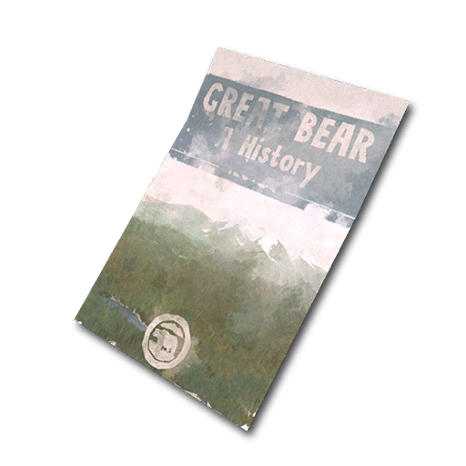

# History of The Collapse

**Contents**

- [Transcript](#Transcript)
- [Part 1](#Part_1)
- [Part 2](#Part_2)
- [Part 3](#Part_3)
- [Part 4](#Part_4)
- [Update history](#Update_history)

<table class="infobox">
<caption>History of The Collapse</caption>
<colgroup>
<col style="width: 50%" />
<col style="width: 50%" />
</colgroup>
<tbody>
<tr>
<td colspan="2"><figure>

<figcaption>History_of_The_Collapse_icon.png</figcaption>
</figure></td>
</tr>
<tr>
<td>
Wintermute
</td>
<td>
<a href="./Episode%201%20-%20Do%20Not%20Go%20Gentle.md" class="wikilink" title="Episode 1">Episode 1</a> <a href="./Episode%202%20-%20Luminance%20Fugue.md" class="wikilink" title="Episode 2">Episode 2</a>
</td>
</tr>
<tr>
<td colspan="2" class="section">
<strong>Properties</strong>
</td>
</tr>
<tr>
<td>
Item type
</td>
<td>
<a href="./Collectibles.md" class="wikilink" title="Collectibles">Collectibles</a>|-
</td>
</tr>
<tr>
<td>
Stackable
</td>
<td>
No
</td>
</tr>
<tr>
<td>
Examine
</td>
<td>
Leaflet containing information about Great Bear Island, presented by the Great Bear Historical Society.
</td>
</tr>
<tr>
<td colspan="2" class="section">
<strong>Values</strong>
</td>
</tr>
<tr>
<td>
Weight
</td>
<td>
0.00 kg (0 lbs)
</td>
</tr>
<tr>
<td colspan="2" class="section">
<strong>Actions</strong>
</td>
</tr>
<tr>
<td>
Backpack
</td>
<td>
Examine
</td>
</tr>
<tr>
<td>
On ground
</td>
<td>
Take It, Read Text, Leave It
</td>
</tr>
</tbody>
</table>

**History of Collapse** is the name given to 4 separate <a href="./Collectibles.md" class="wikilink" title="Collectibles">Collectibles</a> found in <a href="./Episode%201%20-%20Do%20Not%20Go%20Gentle.md" class="wikilink" title="Episode 1">Episode 1</a> and <a href="./Episode%202%20-%20Luminance%20Fugue.md" class="wikilink" title="Episode 2">Episode 2</a> of the <a href="./Wintermute.md" class="wikilink" title="Wintermute">Wintermute</a> story mode.

Episode 1:

- Part One is found in the <a href="./Orca%20Gas%20Station.md" class="wikilink" title="Orca Gas Station">Orca Gas Station</a> office
- Part Two is found in the office building of the <a href="./Milton%20Park.md" class="wikilink" title="Milton Park">Milton Park</a> under some benches

Episode 2:

- Part Three - in the <a href="./Hunting%20Lodge.md" class="wikilink" title="Hunting Lodge">Hunting Lodge</a> in <a href="./Broken%20Railroad.md" class="wikilink" title="Broken Railroad">Broken Railroad</a>. It's on a shelf right in front of the basement stairs.
- Part Four - inside Lake Cabin 1 (<a href="./Lone%20Lake%20Cabin.md" class="wikilink" title="Lone Lake Cabin">Lone Lake Cabin</a>) at <a href="./Mystery%20Lake%20%28location%29.md" class="wikilink" title="Mystery Lake (location)">Mystery Lake (location)</a> on the left shelf.

## Transcript

### Part 1

The following text is transcribed from **History of The Collapse, Part One**

In the mid-20XX, the ongoing global economic crisis, fueled by continued political instability in the US and Europe, contributing to increasing volatility in the financial markets, led to the sudden catastrophic collapse of the Canadian, and in general, the North American banking system. This immediately rendered Canadian currency worthless, triggered super-inflation of the US dollar, and all trade and economic activity promptly shifted to the Chinese Yuan or crypto-currencies (a la Bitcoin). Crippled economically, Canada was brought under the financial oversight of the North American Economic Zone, which positioned Canada as a kind of protectorate of a larger US-based economic bloc. From this point onward, the majority of economic activity became centralized on Canada’s already densely urbanized population, with smaller rural and remote communities being essentially cut off. Without a local economic lifeline many of these communities had become dependent on for their continued existence, most rural or remote communities became hollowed out, as people fled to urban areas in search of greater economic stability.

### Part 2

The following text is transcribed from **History of The Collapse, Part Two**

For places like Great Bear, already quite remote and suffering after decades of economic decline, the sudden Collapse was the final straw. Without any major local economic drivers of their own, the remaining communities on Great Bear became completely dependent on a supply lifeline from the Mainland -- regular shipments of basic staples designed to keep them alive: fuel, food, medical supplies, etc., in many ways, akin to WW2-era wartime rationing. In exchange for regular supply drops, the “Mainlanders” -- in some cases, at the behest of their economic overlords South of the border -- felt justified in taking whatever supplies and raw materials they needed to maintain the urban communities, including dismantling some of the heavy industrial infrastructure left on Great Bear.

### Part 3

The following text is transcribed from **History of The Collapse, Part Three**

Unhappy with their growing dependence on the Mainland for economic support, as well as the Mainlander’s continued view that Great Bear exists solely as a resource clearinghouse for their benefit, some people who chose to remain on Great Bear decided to engage their self-sufficiency. Small-scale local food production efforts, akin to the Victory Garden program of WW2 England and Canada, sprouted up all over Great Bear, with individuals and even communities taking it in their own hands to produce food and power resources. Some of these activities took on an aspect of being politically or even ideologically motivated -- these weren’t just gardens or small-scale attempts to provide for local needs. These were acts of rebellion against a (perceived?) occupying economic force.

### Part 4

The following text is transcribed from **History of The Collapse, Part Four**

Cut off from the Mainland -- economically and figuratively -- Great Bear Islanders became increasingly segregated into two pseudo-political entities along ideological lines: those who gratefully embraced dependence on the Mainland and viewed the regular supply ships as a charitable gesture in apology for the Mainland’s exploitation of Great Bear’s resource riches, and those who sought ultimate independence and who considered trade and travel between the Mainland to be a necessary evil, viewing Mainlanders with a degree of mistrust. Those in support of the Mainlanders even considered the small-scale “Victory Garden” type activities as a sign of lacking patriotism, a concept that hadn’t really existed as such in the Canadian mindset, pre-Collapse.

## Update history

- UPDATE **17 December 2018 (<a href="./The%20Long%20Dark%20%E2%80%94%20Changelog.md#1.41" class="wikilink" title="Update">Update</a>):**
  - Added to game.

**Lua execution error in Module:Navbox function navbox**

