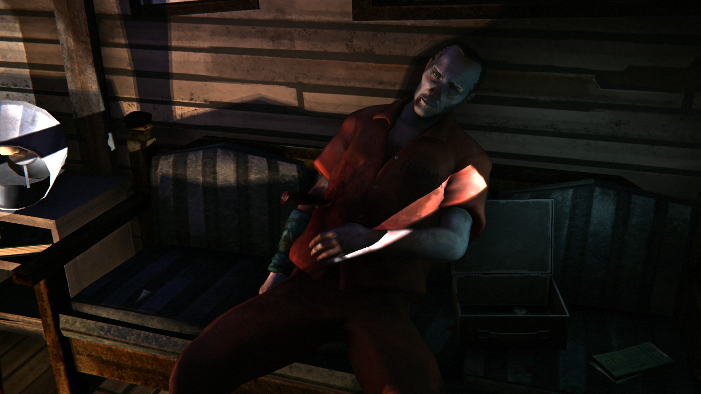

# Hobbs

**Contents**

- [History](#History)
- [Episode 1: Do Not Go Gentle](#Episode_1%3A_Do_Not_Go_Gentle)
- [The Grey Mother](#The_Grey_Mother)
- [Grey Mother thinks something happened at the tunnel leading out from Milton. Investigate.](#Grey_Mother_thinks_something_happened_at_the_tunnel_leading_out_from_Milton._Investigate.)
- [Something precious was stolen from Grey Mother. Find it, and return it to her.](#Something_precious_was_stolen_from_Grey_Mother._Find_it%2C_and_return_it_to_her.)
- [Paradise Lost](#Paradise_Lost)
- [Episode 3](#Episode_3)
- [Episode 4](#Episode_4)
- [Trivia](#Trivia)

<table class="infobox">
<caption>Hobbs</caption>
<colgroup>
<col style="width: 50%" />
<col style="width: 50%" />
</colgroup>
<tbody>
<tr>
<td colspan="2"><figure>
[Missing image: Hobbs.jpg]
<figcaption>Hobbs.jpg</figcaption>
</figure></td>
</tr>
<tr>
<td>
Release
</td>
<td>
1.41 (Wintermute Redux Update)
</td>
</tr>
<tr>
<td>
Date
</td>
<td>
17 December 2018
</td>
</tr>
<tr>
<td>
Wintermute
</td>
<td>
<a href="./Episode%201%20-%20Do%20Not%20Go%20Gentle.md" class="wikilink" title="Episode 1">Episode 1</a>
</td>
</tr>
<tr>
<td>
Mission
</td>
<td>
<a href="./The%20Grey%20Mother.md" class="wikilink" title="The Grey Mother">The Grey Mother</a>
</td>
</tr>
<tr>
<td>
Location(s)
</td>
<td>
<a href="./Paradise%20Meadows%20Farm.md" class="wikilink" title="Paradise Meadows Farm">Paradise Meadows Farm</a>
</td>
</tr>
<tr>
<td colspan="2" class="section">
<strong>Biographical Information</strong>
</td>
</tr>
<tr>
<td>
Age
</td>
<td>
40's
</td>
</tr>
<tr>
<td>
Status
</td>
<td>
Critical Condition: 
Dead if "Push Knife Deeper" is chosen 
 
Alive but in unknown if "Pull Knife Out" is chosen
</td>
</tr>
<tr>
<td>
Occupation
</td>
<td>
Criminal
</td>
</tr>
<tr>
<td colspan="2" class="section">
<strong>Physical Information</strong>
</td>
</tr>
<tr>
<td>
Eyes
</td>
<td>
Brown
</td>
</tr>
<tr>
<td colspan="2" class="section">
<strong>Game Information</strong>
</td>
</tr>
<tr>
<td>
Voiced by
</td>
<td>
Ben Cotton
</td>
</tr>
</tbody>
</table>

**Template:quote2** **Template:quote2** **Hobbs** is a minor character appearing in the [REDUX](https://thelongdark.fandom.com/wiki/The_Long_Dark/Changelog#1.41) version of <a href="./Wintermute.md" class="wikilink" title="Wintermute">Wintermute</a> Episode 1. He can be found in the <a href="./Paradise%20Meadows%20Farm.md" class="wikilink" title="Paradise Meadows Farm">Paradise Meadows Farm</a>, near the town of <a href="./Milton.md" class="wikilink" title="Milton">Milton</a>.

## History

Hobbs is one of the <a href="./Convicts.md" class="wikilink" title="Convicts">Convicts</a>, a felon on his way to <a href="./Blackrock%20Prison.md" class="wikilink" title="Blackrock Federal Penitentiary">Blackrock Federal Penitentiary</a> to serve a twenty-year sentence. The <a href="./First%20Flare.md" class="wikilink" title="First Flare">First Flare</a> struck during transit, and he and at least two other inmates fled the <a href="./Crashed%20Prison%20Transport%20Bus.md" class="wikilink" title="prison bus">prison bus</a> into the nearby town when it crashed outside <a href="./Milton.md" class="wikilink" title="Milton">Milton</a> (with the many other inmates going through the tunnel to <a href="./Pleasant%20Valley.md" class="wikilink" title="Pleasant Valley">Pleasant Valley</a>) , causing the tunnel to collapse. With his fellow inmates, Hobbs took the remaining citizens of Milton hostage in the <a href="./Old%20Schoolhouse.md" class="wikilink" title="Old Schoolhouse">Old Schoolhouse</a> before it caught fire due to the adverse electrical effects of the <a href="./Aurora.md" class="wikilink" title="Aurora">Aurora</a>, inadvertently killing those inside.

<a href="./Astrid%20Greenwood.md" class="wikilink" title="Astrid">Astrid</a> tried to rescue the people trapped by the blaze, but Hobbs intervened, resulting in her stabbing him with a <a href="./Hunting%20Knife.md" class="wikilink" title="Hunting Knife">Hunting Knife</a> in self defense and Hobbs taking the remainder of her scarf before running away (and later using the scarf as a makeshift bandage). Hobbs may be directly responsible for the the cuts seen on Astrid's hand and wrist in Episode 3, which presumably occurred during this altercation, judging from his statement "We barely clipped her wings... well she was bleeding... a bit."

Badly wounded, he fled town and took refuge at <a href="./Paradise%20Meadows%20Farm.md" class="wikilink" title="Paradise Meadows Farm">Paradise Meadows Farm</a>, taking the time to pilfer and break open a Lock Box belonging to <a href="./Martin%20Barker.md" class="wikilink" title="Martin Barker">Martin Barker</a> full of cash from inside the house, despite his dying state.

## Episode 1: Do Not Go Gentle

### <a href="./The%20Grey%20Mother.md" class="wikilink" title="The Grey Mother">The Grey Mother</a>

#### Grey Mother thinks something happened at the tunnel leading out from Milton. Investigate.

His name (HOBBS, T.) first appears on the <a href="./Prison%20Transport%20Manifest.md" class="wikilink" title="Prison Transport Manifest">Prison Transport Manifest</a> near the Crashed Prison Bus, foreshadowing him as a character.

#### Something precious was stolen from Grey Mother. Find it, and return it to her.

When first entering the farmhouse, <a href="./Will%20Mackenzie.md" class="wikilink" title="Will Mackenzie">Will Mackenzie</a> finds Hobbs on the couch with a <a href="./Hunting%20Knife.md" class="wikilink" title="Hunting Knife">Hunting Knife</a> in his belly. Hobbs tells him what happened and asks for the knife to be removed: granting the choice of killing him by pushing the knife deeper, or saving his life by removing the knife.

WARNING: No matter what option is chosen you will not get to keep the knife, so adjust your choice accordingly.

After you make your choice, Mackenzie takes the <a href="./Bank%20Deposit%20Box%20Key%2015.md" class="wikilink" title="Bank Deposit Box Key 15">Bank Deposit Box Key 15</a> from the Lock Box and leaves the dwelling, and Hobbs is never seen again.

### <a href="./Paradise%20Lost.md" class="wikilink" title="Paradise Lost">Paradise Lost</a>

Based on the decision spare or kill Hobbs, <a href="./Methuselah.md" class="wikilink" title="Methuselah">Methuselah</a> will have unique dialogue options later in Paradise Lost, giving a neutral warning to Mackenzie about "living by the sword" if he killed Hobbs or sounding relived but concerned that "this new world will grind his good nature to dust" if he spared the convict.

## Episode 3

Hobbs appears in a voice over recap during the beginning of Episode 3, mentioning the Old Schoolhouse.

## Episode 4

Hobbs once again appears in a voice over recap during the beginning of Episode 4, mentioning Blackrock Prison. Hobbs on the sofa

## Trivia

- Removing the knife from Hobbs' wound is the 'humane' option in-game, but realistically this would likely be as bad, if not worse than pushing the blade deeper. Blood loss from such a wound would be sealed by the knife itself; removing the knife would expose the wound, likely causing extensive bleeding and risk of death if left untreated. Ironically, such an injury should be dealt with by a doctor such as Astrid, not Will.
- Hobbs' knife removal is similar to the start of Episode 1, where Will removes the <a href="./Scrap%20Metal%20Shard.md" class="wikilink" title="Scrap Metal Shard">Scrap Metal Shard</a> from his hand. Being an extremity and not an abdomen wound, the bleeding would be more manageable.
- It is widely misunderstood that Hobbs and the other prisoners are arsonists, perpetuated by the fact that he initially takes credit for the deaths of Milton residents in the schoolhouse fire: "We sure warmed them up!". However, Hobbs later states, "We put them all in the old schoolhouse so we could keep an eye on them. And then something happened to the lights... the power... it was like sparks everywhere and then fire." This is consistent with the effects of the Aurora, which sometimes causes electrical fires, as evidenced in trailers showing burning power lines and various burned buildings throughout Great Bear that were never reached by the convicts.

**Lua execution error in Module:Navbox function navbox**

<a href="fr:Hobbs" class="wikilink" title="fr:Hobbs">fr:Hobbs</a> <a href="ru:%D0%A5%D0%BE%D0%B1%D0%B1%D1%81" class="wikilink" title="ru:Хоббс">ru:Хоббс</a>

