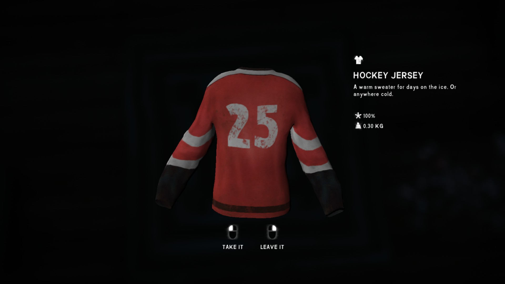
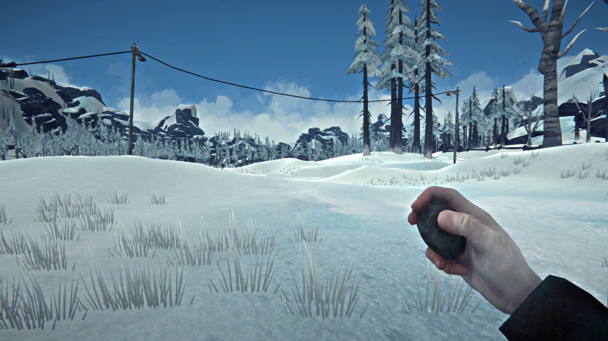

# Hockey Jersey

**Categories:** Clothing, DLC Content, Pages with update history · **Source:** [Fandom](https://thelongdark.fandom.com/wiki/Hockey_Jersey)

**Contents**

- [Overview](#overview)
- [Locations](#locations)
- [Products](#products)
- [Update history](#update-history)

**Hockey Jersey**

**General**

**Item Type:** Clothing

**Clothing Slot:** Inner torso

**Statistics**

**Weight:** 0.30 kg(0.66 lbs)

**Warmth bonus:** 1.0 °C(1.8 °F)

**Windproof bonus:** 3.0 °C(5.4 °F)

**Waterproof bonus:** 15%

**Protection:** 3%

**Mobility:** 0%

**Harvest:** 1 × [Cloth](./Cloth.md) 30 minutes

**Repair:** 1 × [Cloth](./Cloth.md) 60 minutes 40% condition

**DLC-Exclusive content.** This content requires the [Tales from the Far Territory](./Tales%20from%20the%20Far%20Territory.md) addon to be installed before it can be seen or used in regular gameplay.

 > “**A warm sweater for days on the ice. Or anywhere cold.**” > > — In-game description A **Hockey Jersey** is a type of clothing in _[The Long Dark](./The%20Long%20Dark.md)_. It is part of the _[Tales from the Far Territory](./Tales%20from%20the%20Far%20Territory.md)_ DLC.

## Overview

Light and warm mid-tier sweater, which spawns rarely on all game modes. The Hockey Jersey has similar stats to the [Thin Wool Sweater](./Thin%20Wool%20Sweater.md). The Hockey Jersey is 0.05 kg heavier, but 2.5 °C more Windproof, 1% more Protective and 5% less Waterproof. The Hockey Jersey [decays](./Decay.md) condition half as fast as Thin Wool Sweater.

It is one of the best Inner Torso clothing which can spawn on [Interloper](./Interloper.md) mode, along with the Thin Wool Sweater.

## Locations

- Rare but can spawn in most regions on all game modes.

## Products

| Item | Skills | Materials |
| --- | --- | --- |
| [Framed Hockey Jersey](./Framed%20Hockey%20Jersey.md) | None | - 2 × [Fir Firewood](./Fir%20Firewood.md) / - 1 × [Scrap Metal](./Scrap%20Metal.md) / - 1 × [Hockey Jersey](./Hockey%20Jersey.md) |

## Update history

- UPDATE **30 March 2023 ([Update](./The%20Long%20Dark%20%E2%80%94%20Changelog.md#2.10)):**
  - Added to game.

## Gallery

