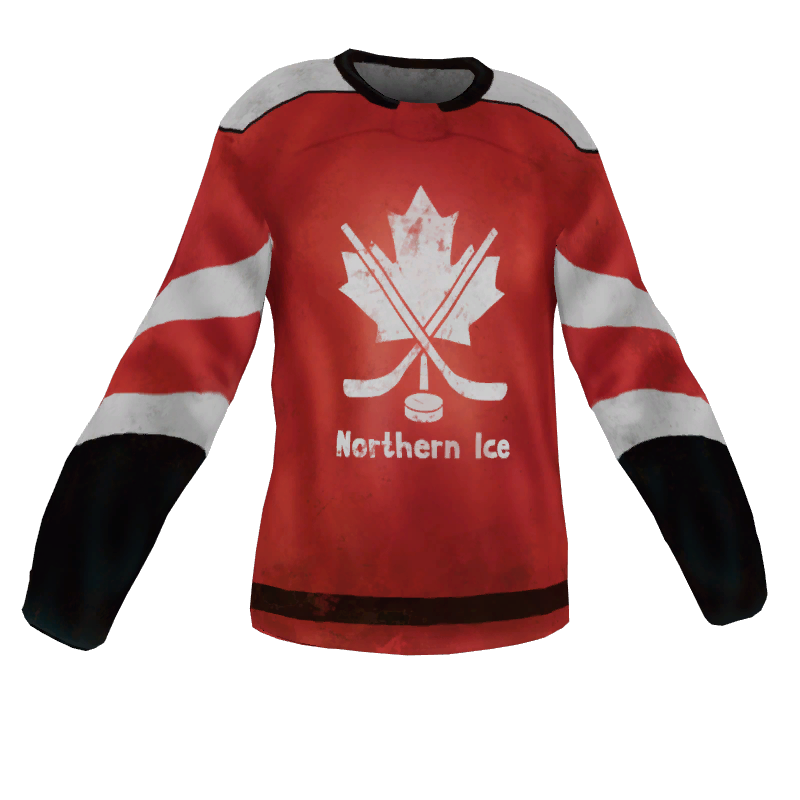
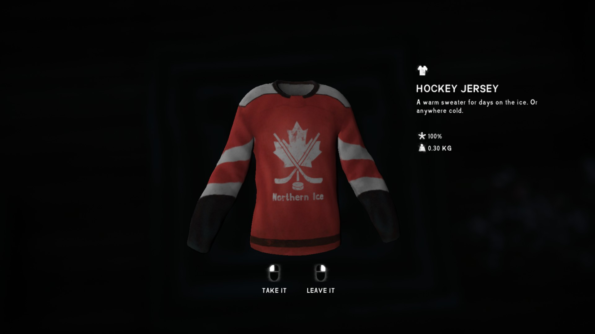

# Hockey Jersey

**Categories:** Clothing, DLC Content, Pages with update history · **Source:** [Fandom](https://thelongdark.fandom.com/wiki/Hockey_Jersey)

**Contents**

- [Overview](#overview)
- [Locations](#locations)
- [Products](#products)
- [Update history](#update-history)

**Hockey Jersey**

_Hockey\_Jersey\_icon.png_

**General**

**Item Type:** Clothing

**Clothing Slot:** Inner torso

**Statistics**

**Weight:** 0.30 kg(0.66 lbs)

**Warmth bonus:** 1.0 °C(1.8 °F)

**Windproof bonus:** 3.0 °C(5.4 °F)

**Waterproof bonus:** 15%

**Protection:** 3%

**Mobility:** 0%

**Harvest:** 1 × [Cloth](./Cloth.md) / 30 minutes

**Repair:** 1 × [Cloth](./Cloth.md) / 60 minutes / 40% condition

_Ptarmigan\_icon.png_

**DLC-Exclusive content.** / This content requires the [Tales from the Far Territory](./Tales%20from%20the%20Far%20Territory.md) addon to be installed before it can be seen or used in regular gameplay.

> “**A warm sweater for days on the ice. Or anywhere cold.**”
>
> — In-game description

Item

Skills

Materials

 [Framed Hockey Jersey](./Framed%20Hockey%20Jersey.md)

None

- 2 × [Fir Firewood](./Fir%20Firewood.md) / - 1 × [Scrap Metal](./Scrap%20Metal.md) / - 1 × [Hockey Jersey](./Hockey%20Jersey.md)

_Clothing model icon_

_Clothing model icon_

_The Hockey Jersey, on the ground and folded up._

_The front of a Hockey Jersey at 100% condition._

_The back of a Hockey Jersey at 100% condition._

_How the Hockey Jersey looks when worn on the Male paper doll model._

_A view of the full model for the player's arms when wearing a Hockey Jersey, from a third person perspective._

_The Hockey Jersey from the regular first person perspective, holding a Stone in hand._
