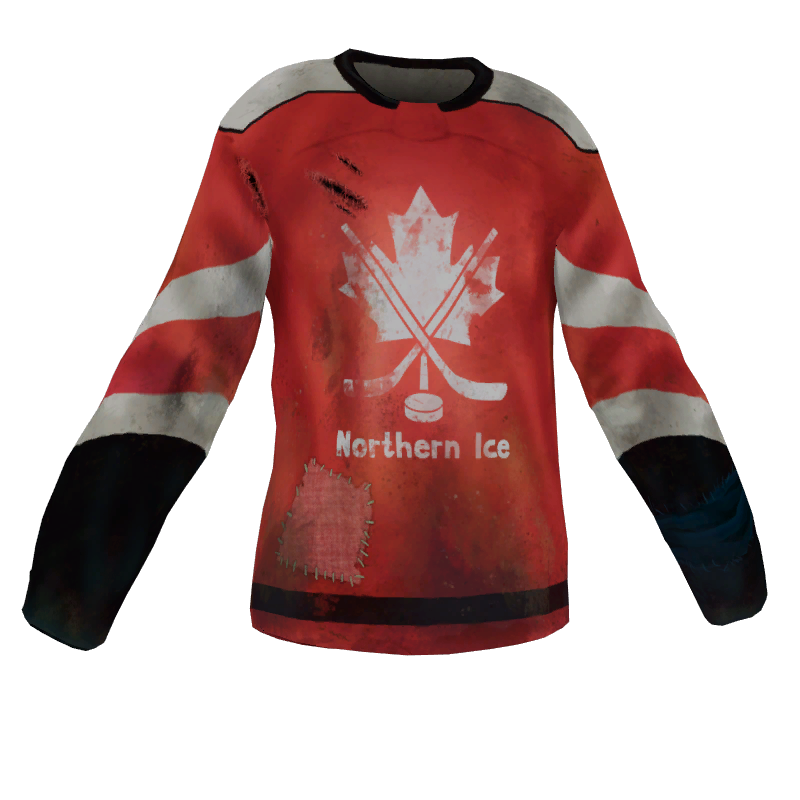

# Hockey Jersey

**Contents**

- [Overview](#Overview)
- [Locations](#Locations)
- [Products](#Products)
- [Update history](#Update_history)

<table class="infobox">
<caption>Hockey Jersey</caption>
<colgroup>
<col style="width: 50%" />
<col style="width: 50%" />
</colgroup>
<tbody>
<tr>
<td colspan="2"><figure>

<figcaption>Hockey_Jersey_icon.png</figcaption>
</figure></td>
</tr>
<tr>
<td colspan="2" class="section">
<strong>General</strong>
</td>
</tr>
<tr>
<td>
Item Type
</td>
<td>
Clothing|-
</td>
</tr>
<tr>
<td>
Clothing Slot
</td>
<td>
Inner torso
</td>
</tr>
<tr>
<td colspan="2" class="section">
<strong>Statistics</strong>
</td>
</tr>
<tr>
<td>
Weight
</td>
<td>
0.30 kg(0.66 lbs)
</td>
</tr>
<tr>
<td>
Warmth bonus
</td>
<td>
1.0 °C(1.8 °F)
</td>
</tr>
<tr>
<td>
Windproof bonus
</td>
<td>
3.0 °C(5.4 °F)
</td>
</tr>
<tr>
<td>
Waterproof bonus
</td>
<td>
15%
</td>
</tr>
<tr>
<td>
Protection
</td>
<td>
3%
</td>
</tr>
<tr>
<td>
Mobility
</td>
<td>
0%
</td>
</tr>
<tr>
<td>
Harvest
</td>
<td>
1 × <a href="./Cloth.md" class="wikilink" title="Cloth">Cloth</a> 
30 minutes
</td>
</tr>
<tr>
<td>
Repair
</td>
<td>
1 × <a href="./Cloth.md" class="wikilink" title="Cloth">Cloth</a> 
60 minutes 
40% condition
</td>
</tr>
</tbody>
</table>

<table>
<colgroup>
<col style="width: 33%" />
<col style="width: 33%" />
<col style="width: 33%" />
</colgroup>
<tbody>
<tr>
<td width="40px"><figure>
[Missing image: Ptarmigan_icon.png]
<figcaption>Ptarmigan_icon.png</figcaption>
</figure></td>
<td>
<strong>DLC-Exclusive content.</strong> 

This content requires the <a href="./Tales%20from%20the%20Far%20Territory.md" class="wikilink" title="Tales from the Far Territory">Tales from the Far Territory</a> addon to be installed before it can be seen or used in regular gameplay.

</td>
<td>
|}

<table>
<colgroup>
<col style="width: 33%" />
<col style="width: 33%" />
<col style="width: 33%" />
</colgroup>
<tbody>
<tr>
<td style="vertical-align: top; font-size: 3em; color: #5d5980; padding-right: 10px">
“
</td>
<td>
A warm sweater for days on the ice. Or anywhere cold.

&#10;

In-game description

</td>
<td style="vertical-align: bottom; font-size: 3em; color: #5d5980; padding-left: 10px">
”
</td>
</tr>
</tbody>
</table>

A <strong>Hockey Jersey</strong> is a type of clothing in <em><a href="./The%20Long%20Dark.md" class="wikilink" title="The Long Dark">The Long Dark</a></em>. It is part of the <em><a href="./Tales%20from%20the%20Far%20Territory.md" class="wikilink" title="Tales from the Far Territory">Tales from the Far Territory</a></em> DLC.

<h2 id="Overview">Overview</h2>

Light and warm mid-tier sweater, which spawns rarely on all game modes. The Hockey Jersey has similar stats to the <a href="./Thin%20Wool%20Sweater.md" class="wikilink" title="Thin Wool Sweater">Thin Wool Sweater</a>. The Hockey Jersey is 0.05 kg heavier, but 2.5 °C more Windproof, 1% more Protective and 5% less Waterproof. The Hockey Jersey <a href="./Decay.md" class="wikilink" title="decays">decays</a> condition half as fast as Thin Wool Sweater.

It is one of the best Inner Torso clothing which can spawn on <a href="./Interloper.md" class="wikilink" title="Interloper">Interloper</a> mode, along with the Thin Wool Sweater.

<h2 id="Locations">Locations</h2>
<ul>
<li>Rare but can spawn in most regions on all game modes.</li>
</ul>
<h2 id="Products">Products</h2>
<h2 id="Update_history">Update history</h2>

<ul>
<li>UPDATE <strong>30 March 2023 (<a href="./The%20Long%20Dark%20%E2%80%94%20Changelog.md#2.10" class="wikilink" title="Update">Update</a>):</strong>
<ul>
<li>Added to game.</li>
</ul></li>
</ul>

==Gallery==

<table class="gallery">
<colgroup>
<col style="width: 25%" />
<col style="width: 25%" />
<col style="width: 25%" />
<col style="width: 25%" />
</colgroup>
<tbody>
<tr>
<td><figure>

<figcaption>Clothing model icon</figcaption>
</figure></td>
<td><figure>

<figcaption>Clothing model icon</figcaption>
</figure></td>
<td><figure>
[Missing image: Hockey_Jersey_Folded.jpg]
<figcaption>The Hockey Jersey, on the ground and folded up.</figcaption>
</figure></td>
<td><figure>
[Missing image: HockeyJerseyFront.jpg]
<figcaption>The front of a Hockey Jersey at 100% condition.</figcaption>
</figure></td>
</tr>
<tr>
<td><figure>
[Missing image: HockeyJerseyBack.jpg]
<figcaption>The back of a Hockey Jersey at 100% condition.</figcaption>
</figure></td>
<td><figure>
[Missing image: HockeyJerseyDoll.jpg]
<figcaption>How the Hockey Jersey looks when worn on the Male paper doll model.</figcaption>
</figure></td>
<td><figure>
[Missing image: HockeyJerseyeExterior.jpg]
<figcaption>A view of the full model for the player's arms when wearing a Hockey Jersey, from a third person perspective.</figcaption>
</figure></td>
<td><figure>
[Missing image: HockeyJerseyFP_Rock.jpg]
<figcaption>The Hockey Jersey from the regular first person perspective, holding a Stone in hand.</figcaption>
</figure></td>
</tr>
</tbody>
</table>

<strong>Lua execution error in Module:Navbox function navbox</strong> <a href="ru:%D0%A5%D0%BE%D0%BA%D0%BA%D0%B5%D0%B9%D0%BD%D1%8B%D0%B9_%D1%81%D0%B2%D0%B8%D1%82%D0%B5%D1%80" class="wikilink" title="ru:Хоккейный свитер">ru:Хоккейный свитер</a>
</td>
</tr>
</tbody>
</table>

