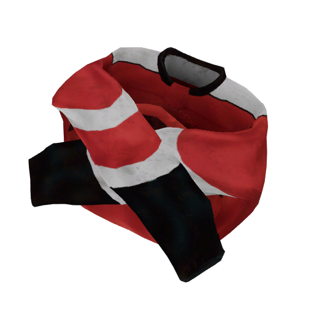
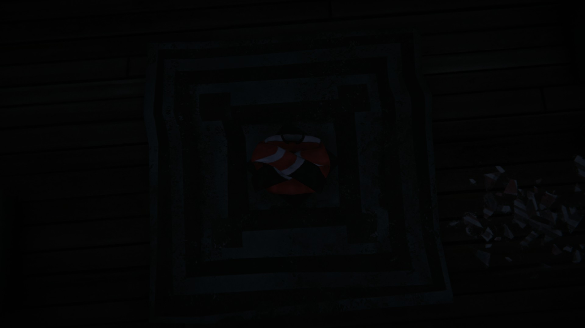
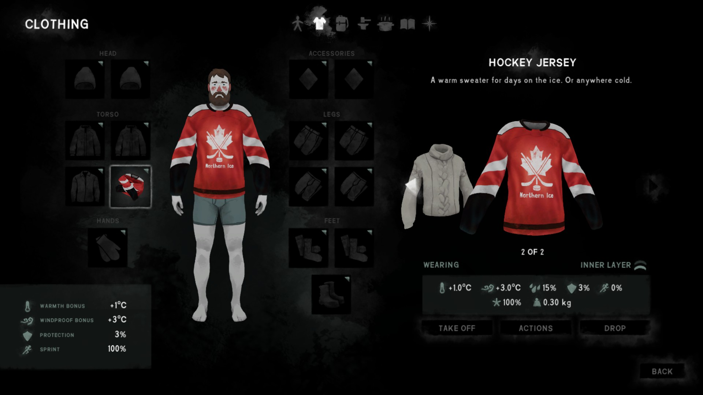
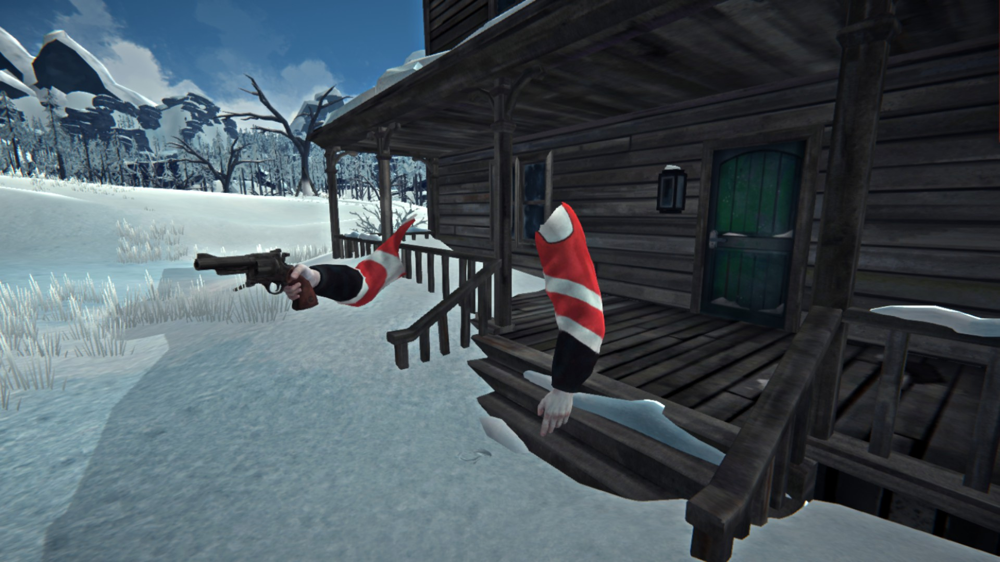

# Hockey Jersey

**Contents**

- [Overview](#overview)
- [Locations](#locations)
- [Products](#products)
- [Update history](#update-history)

**Hockey Jersey**

| Property | Details |
| --- | --- |
|  |  / *Hockey\_Jersey\_icon.png* |
| **General** |  |
| Item Type | Clothing\|- |
| Clothing Slot | Inner torso |
| **Statistics** |  |
| Weight | 0.30 kg(0.66 lbs) |
| Warmth bonus | 1.0 °C(1.8 °F) |
| Windproof bonus | 3.0 °C(5.4 °F) |
| Waterproof bonus | 15% |
| Protection | 3% |
| Mobility | 0% |
| Harvest | 1 × [Cloth](./Cloth.md) / 30 minutes |
| Repair | 1 × [Cloth](./Cloth.md) / 60 minutes / 40% condition |

| Column 1 | Column 2 | Column 3 | Column 4 |
| --- | --- | --- | --- |
|  / *Ptarmigan\_icon.png* | **DLC-Exclusive content.** / This content requires the [Tales from the Far Territory](./Tales%20from%20the%20Far%20Territory.md) addon to be installed before it can be seen or used in regular gameplay. | \|} / > “**A warm sweater for days on the ice. Or anywhere cold.**” / > / > — In-game description / A **Hockey Jersey** is a type of clothing in *[The Long Dark](./The%20Long%20Dark.md)*. It is part of the *[Tales from the Far Territory](./Tales%20from%20the%20Far%20Territory.md)* DLC. / ## Overview / Light and warm mid-tier sweater, which spawns rarely on all game modes. The Hockey Jersey has similar stats to the [Thin Wool Sweater](./Thin%20Wool%20Sweater.md). The Hockey Jersey is 0.05 kg heavier, but 2.5 °C more Windproof, 1% more Protective and 5% less Waterproof. The Hockey Jersey [decays](./Decay.md) condition half as fast as Thin Wool Sweater. / It is one of the best Inner Torso clothing which can spawn on [Interloper](./Interloper.md) mode, along with the Thin Wool Sweater. / ## Locations / - Rare but can spawn in most regions on all game modes. / ## Products / ## Update history / - UPDATE **30 March 2023 ([Update](./The%20Long%20Dark%20%E2%80%94%20Changelog.md#2.10)):** / - Added to game. / ==Gallery== / \| Column 1 \| Column 2 \| Column 3 \| Column 4 \| / \| --- \| --- \| --- \| --- \| / \|  / *Clothing model icon* \|  / *Clothing model icon* \|  / *The Hockey Jersey, on the ground and folded up.* \|  / *The front of a Hockey Jersey at 100% condition.* \| / \|  / *The back of a Hockey Jersey at 100% condition.* \|  / *How the Hockey Jersey looks when worn on the Male paper doll model.* \|  / *A view of the full model for the player's arms when wearing a Hockey Jersey, from a third person perspective.* \|  / *The Hockey Jersey from the regular first person perspective, holding a Stone in hand.* \| / **Lua execution error in Module:Navbox function navbox** [ru:Хоккейный свитер](ru:%D0%A5%D0%BE%D0%BA%D0%BA%D0%B5%D0%B9%D0%BD%D1%8B%D0%B9_%D1%81%D0%B2%D0%B8%D1%82%D0%B5%D1%80) |  |
| “ | **A warm sweater for days on the ice. Or anywhere cold.** / In-game description | ” |  |
|  / *Clothing model icon* |  / *Clothing model icon* |  / *The Hockey Jersey, on the ground and folded up.* |  / *The front of a Hockey Jersey at 100% condition.* |
|  / *The back of a Hockey Jersey at 100% condition.* |  / *How the Hockey Jersey looks when worn on the Male paper doll model.* |  / *A view of the full model for the player's arms when wearing a Hockey Jersey, from a third person perspective.* |  / *The Hockey Jersey from the regular first person perspective, holding a Stone in hand.* |
