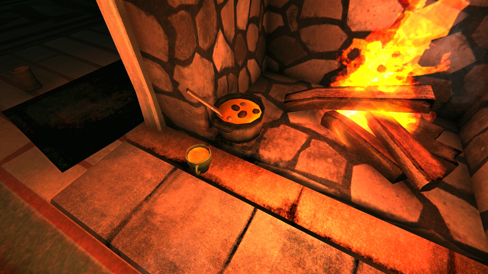

# Home\-made Soup

**Categories:** Food And Drink, Pages with update history, Wintermute · **Source:** [Fandom](https://thelongdark.fandom.com/wiki/Home-made_Soup)

**Contents**

- [Overview](#overview)
- [Redux Episode 1](#redux-episode-1)
- [The Grey Mother](#the-grey-mother)
- [Predux Episode 1](#predux-episode-1)
- [Update history](#update-history)

**Wintermute-Exclusive content.**

This content only appears in [Wintermute](./Wintermute.md).

**Home-made Soup**

[Home Made Soup icon](../assets/Home-Made_Soup_icon.png)

**Release:** [1 August 2017](./The%20Long%20Dark%20%E2%80%94%20Early%20Access%20Changelog.md#1.00)

**Wintermute:** Yes

**Properties**

**Item type:** [Food And Drink](./Food%20And%20Drink.md)

**Stackable:** No

**Examine:** Home-made soup. Warm, and nutritious.

**Values**

**Calories:** 600 kcal

**Hydration:** 0%

**Weight:** 0.25 kg (0.55 lbs)

**Advanced data**

**Item key:** GAMEPLAY\_HomeMadeSoup

> “__Grey Mother: "It's been awhile since Grey Mother had anyone to make meals for. Please...take some soup before you go..."  
 Mackenzie: "Uhh...thanks."__”

**Home-made Soup** (sic) is a [food](./Food%20And%20Drink.md) item found in [Episode 1: Do Not Go Gentle](./Episode%201%20-%20Do%20Not%20Go%20Gentle.md) in [Wintermute](./Wintermute.md).

## Overview

Home-made Soup is a soup created by [Grey Mother](./Grey%20Mother.md) as she shows her hospitality to [Will Mackenzie](./Will%20Mackenzie.md). Consuming Home-made Soup restores a moderate number of calories. It may also be warmed by a [Fire](./Fire.md) to grant the benefit [Warming Up](./Warming%20Up.md). It starts hot and does not begin cooling until first interacted with. This includes simply inspecting the item and leaving it by the fireplace without collecting it. Despite the contents of this food being a soup containing liquid, Home-made Soup does not provide any hydration to quench [Thirst](./Thirst.md).

The soup cannot be crafted, and is not available in [Survival Mode](./Survival%20Mode.md). The soup can be carried into [Episode 2: Luminance Fugue](./Episode%202%20-%20Luminance%20Fugue.md), but will be lost if it is not consumed by the end of the episode.

## Redux Episode 1

### [The Grey Mother](./The%20Grey%20Mother.md)

- It is received as a reward from Grey Mother after the player investigates and returns from the [Crashed Prison Transport Bus](./Crashed%20Prison%20Transport%20Bus.md).
- A second cup can taken after returning from the [Milton Credit Union](./Milton%20Credit%20Union.md) with [Grey Mother's Safety Deposit Box](./Grey%20Mother%27s%20Safety%20Deposit%20Box.md) (if the first one was taken).

## Predux Episode 1

[The Grey Mother (Predux)](./The%20Grey%20Mother%20%28Predux%29.md)

- It can be found by the [Fireplace](./Fireplace.md) after Mackenzie speaks to Grey Mother during the objective "Grey Mother seems tired. Try Talking to her after she's had some time to rest." After talking to her, the soup is near the fire.
- A second cup can taken after returning from the Milton Credit Union with Grey Mother's Safety Deposit Box (if the first one was taken).

## Update history

- UPDATE **1 August 2017 ([Update](./The%20Long%20Dark%20%E2%80%94%20Changelog.md#1.00)):**
  - Added to game.
- UPDATE **17 December 2018 ([Update](./The%20Long%20Dark%20%E2%80%94%20Changelog.md#1.41)):**
  - Updated the icon as part of the Redux edition.
