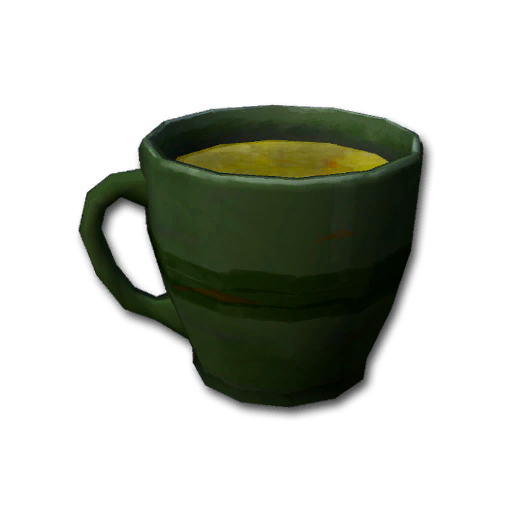
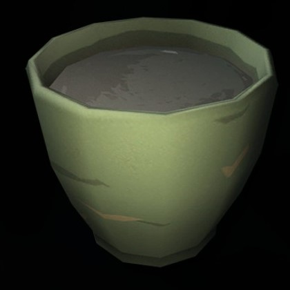

# Home\-made Soup

**Categories:** Food And Drink, Pages with update history, Wintermute · **Source:** [Fandom](https://thelongdark.fandom.com/wiki/Home-made_Soup)

**Contents**

- [Overview](#overview)
- [Redux Episode 1](#redux-episode-1)
- [The Grey Mother](#the-grey-mother)
- [Predux Episode 1](#predux-episode-1)
- [Update history](#update-history)

_2120907963\_TLD-Wintermute-v2.png.de8a285930f6a8f5ad9cf5878754cf5b.png_

**Wintermute-Exclusive content.** / This content only appears in [Wintermute](./Wintermute.md).

_Home-made\_Soup\_icon.png_

**Release:** [1 August 2017](./The%20Long%20Dark%20%E2%80%94%20Early%20Access%20Changelog.md#1.00)

**Wintermute:** Yes

**Properties**

**Item type:** [Food And Drink](./Food%20And%20Drink.md)\|-

**Stackable:** No

**Examine:** Home-made soup. Warm, and nutritious.

**Values**

**Calories:** 600 kcal

**Hydration:** 0%

**Weight:** 0.25 kg (0.55 lbs)

**Advanced data**

**Item key:** GAMEPLAY\_HomeMadeSoup

> “__Grey Mother: "It's been awhile since Grey Mother had anyone to make meals for. Please...take some soup before you go..."  
 Mackenzie: "Uhh...thanks."__”

_The Soup by the fireplace._

_Old icon_
