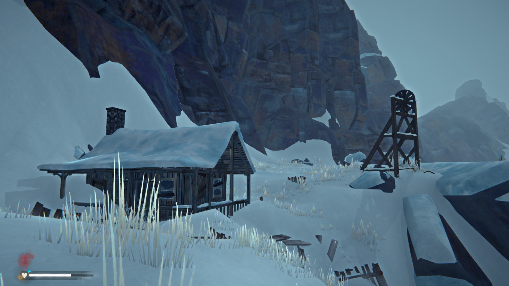
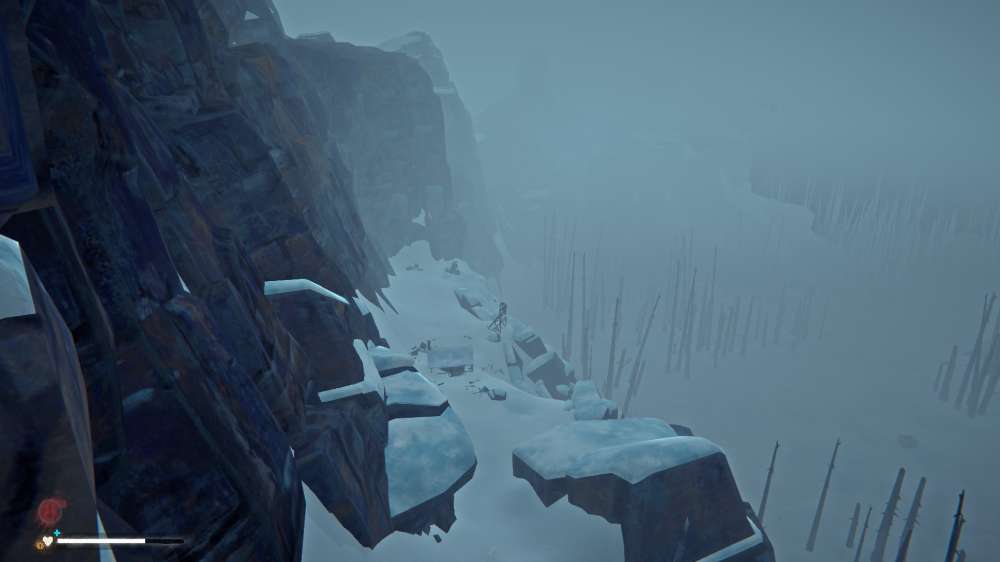
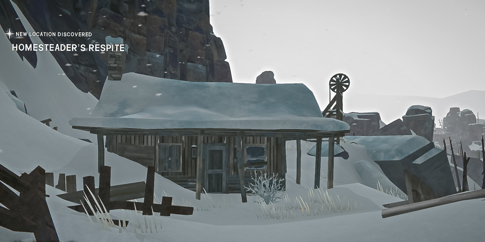
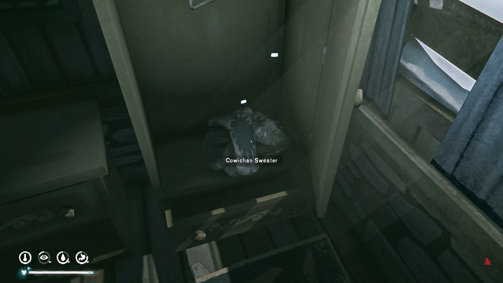

# Homesteader's Respite

**Homestead's Respite**

| Property | Details |
| --- | --- |
|  |  / *20201210010226\_1.jpg* |
| **Location** |  |
|  |  / *Homesteader's\_Respite\_Location.png* |
| Region | [Ash Canyon](./Ash%20Canyon.md)\|- |
| **General** |  |
| Type | Residential\|- |
|  / *bed\_icon.png* | Has a bed |
|  | Has an interior\|} / **Homesteader's Respite** is a small cabin located beside an old mining facility, near the eastern edge of [Ash Canyon](./Ash%20Canyon.md), a short distance north of [Bitter Marsh](./Bitter%20Marsh.md), and just below [Fire Overlook](./Fire%20Overlook.md). The cabin is sitting on a ledge between two rope climbs. / ## Access / To get the the cabin initially, players will have to first head to Fire Overlook and climb down the long rope. Once there, they can pick up a rope at the cabin, which can be deployed to provide easy access to the fishing hut at [Bitter Marsh](./Bitter%20Marsh.md). / It is possible to reach Homesteader's Respite from [Bitter Marsh](./Bitter%20Marsh.md) without a rope by walking up a nearby slope and [sticking to the cliff-face](./Mountain%20Goating.md), then dropping onto the ledge below. This path is the fastest for reaching Miner's Folly, however it clearly isn't a path Hinterland intended for players to take, and the steep angle may cause multiple sprains which will require treatment before climbing the long rope to [Fire Overlook](./Fire%20Overlook.md). / ## Overview / High-level clothes such as [Combat Pants](./Combat%20Pants.md) or [Cowichan Sweater](./Cowichan%20Sweater.md) as well as [research books](./Research%20Book.md), can be found inside, along with some foodstuffs. It is also a possible [Revolver](./Revolver.md) spawn. A [climbing rope](./Rope%20Climbing.md) might spawn on the mantlepiece, hanging on the wall, or below the table, which enables easier access to [Bitter Marsh](./Bitter%20Marsh.md) and its [Fishing Hut](./Fishing%20Hut.md). A coal bin can also be found behind the house. / No [Wildlife](./Wildlife.md) is present near the cabin apart from a [Ptarmigan](./Ptarmigan.md) nest on the south-east side, and, while the location does have a [Fireplace](./Fireplace.md) and a [Bed](./Bed.md), fuel is sparse on the ledge the cabin sits on. Therefore, firewood and other key resources such as food must be hauled up or down via the [Mountaineering Rope](./Mountaineering%20Rope.md). Overall, the cabin is alright for use as a safer longer-term [safe house](./Safehouse.md) than the nearby [Angler's Den](./Angler%27s%20Den.md), but it is less central than the latter and doesn't have as many resources in the local area. / ## Gallery / \| Column 1 \| Column 2 \| Column 3 \| / \| --- \| --- \| --- \| / \|  / *20201210005916\_1.jpg* \|  / *Homesteader's Respite* \|  / *High Tier clothing can be found inside* \| / **Lua execution error in Module:Navbox function navbox** |
|  / *20201210005916\_1.jpg* |  / *Homesteader's Respite* /  / *High Tier clothing can be found inside* |
