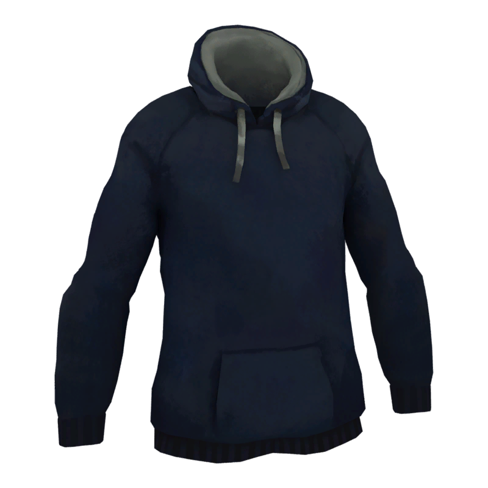
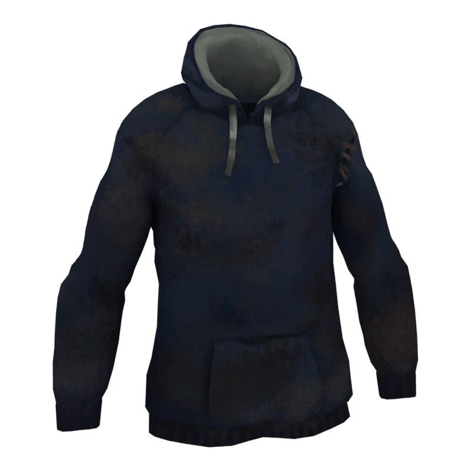

# Hoodie

**Categories:** Clothing, Pages with update history · **Source:** [Fandom](https://thelongdark.fandom.com/wiki/Hoodie)

**Hoodie**

_Hoodie\_icon.png_

**General**

**Item Type:** Clothing

**Renewable:** Yes (rare [Beachcombing](./Beachcombing.md))

**Clothing Slot:** Inner torso

**Statistics**

**Weight:** 0.25 kg(0.55 lbs)

**Warmth bonus:** 0.5 °C(0.9 °F)

**Windproof bonus:** 0.5 °C(0.9 °F)

**Waterproof bonus:** 10%

**Protection:** 2%

**Mobility:** 0%

**Harvest:** 1 [Cloth](./Cloth.md) / 45 minutes

**Repair:** 1 [Cloth](./Cloth.md) / 60 minutes / 30% condition

> “**Hooded cotton sweatshirt. You know, the kind that passes for high fashion with game developers these days.**”
>
> — In-game description

The **Hoodie** is a type of [Clothing](./Clothing.md) item in _[The Long Dark](./The%20Long%20Dark.md)_.

## Overview

A low tier inner torso shirt, a Hoodie offers little warmth and windproofing, along with a small waterproof and protection bonus. A Hoodie harbors a 1% additional protection bonus over a [Plaid Shirt](./Plaid%20Shirt.md), but 10% less waterproofing, and somewhat less cost efficient to repair than the latter.

Despite having a hood, the Hoodie doesn't cover Headwear Clothing slots.

A [Sweatshirt](./Sweatshirt.md) is a slight, but direct upgrade to the hoodie, the former offering slightly more wind-proofing.

_Clothing model_

_Clothing model damaged_

## Update history

- UPDATE **19 December 2016 ([Update](./The%20Long%20Dark%20%E2%80%94%20Early%20Access%20Changelog.md#0.386)):**
  - Added to game
