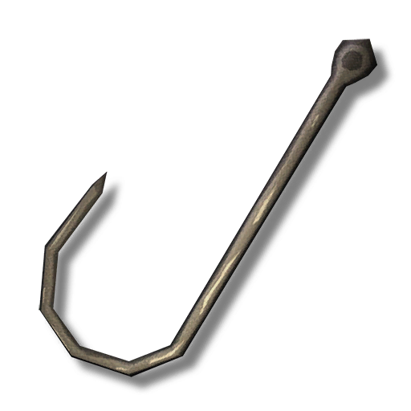
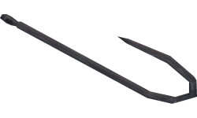

# Hook

**Categories:** Craftable tools, Tools · **Source:** [Fandom](https://thelongdark.fandom.com/wiki/Hook)

**Contents**

- [Crafting](#crafting)
- [Products](#products)
- [Gallery](#gallery)
- [Update history](#update-history)

**Hook**

| Property | Details |
| --- | --- |
|  |  / _Hook\_icon.png_ |
| Release | [27 November 2014](./The%20Long%20Dark%20%E2%80%94%20Changelog.md#0.163) |
| Wintermute | No |
| Renewable | Yes |
| **Properties** |  |
| Item type | [Tools](./Tools.md)\|- |
| Stackable | No |
| Examine | A basic hook suitable for fishing. |
| **Values** |  |
| Weight | 0.01 kg (0.02 lbs) |
| **Actions** |  |
| On ground | Take It, Leave It |

A [Hook](./Hook.md) is a tool that is required for building a [Fishing Tackle](./Fishing%20Tackle.md). It can either be found or constructed on a [Work Bench](./Work%20Bench.md) from [Scrap Metal](./Scrap%20Metal.md). They can be hard to spot in the world, but can often be found near Work Benches or inside [Fishing Huts](./Fishing%20Hut.md).

## Crafting

**Hook**

| Property | Details |
| --- | --- |
|  | - |
|  | - |
|  | 20 minutes |
| **Requirements** |  |
| Facility | **Template:iconlink** |
| **Materials** |  |
| **Template:iconlink plain** |  |
| Item | [Scrap Metal](./Scrap%20Metal.md) |
| Quantity | 1 |

## Products

## Gallery

_Old model._

## Update history

**Template:update history**
