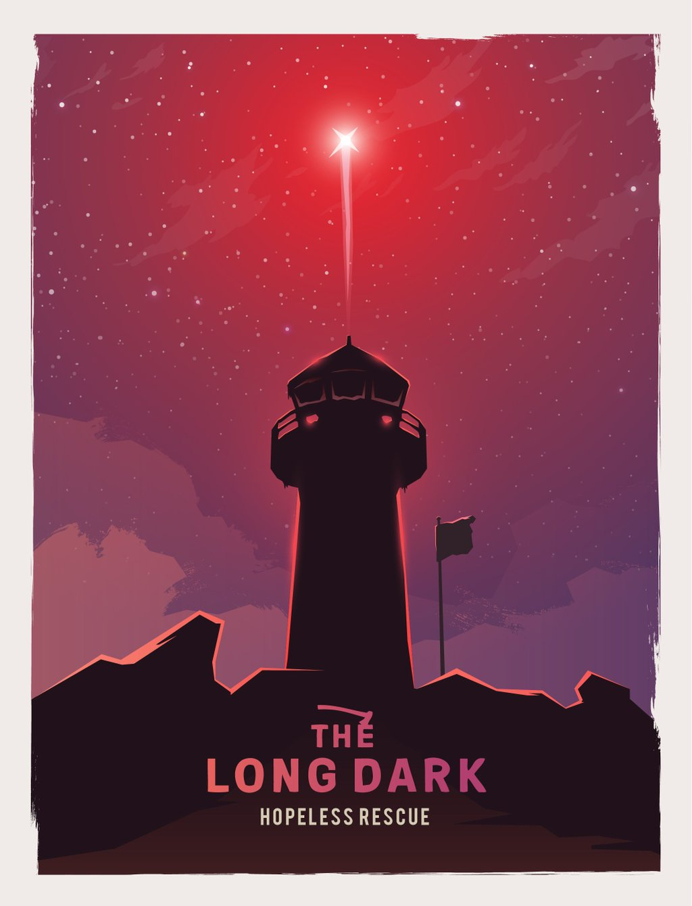

# Hopeless Rescue

**Contents**

- [Overview](#Overview)
- [Challenge Information](#Challenge_Information)
- [Strategy](#Strategy)
- [Wildlife](#Wildlife)
- [Tools](#Tools)
- [Clothing](#Clothing)
- [Food](#Food)
- [Condition](#Condition)
- [Possible Route](#Possible_Route)
- [Trivia](#Trivia)
- [Gallery](#Gallery)
- [Game History](#Game_History)

<table class="infobox">
<caption>Hopeless Rescue</caption>
<colgroup>
<col style="width: 50%" />
<col style="width: 50%" />
</colgroup>
<tbody>
<tr>
<td colspan="2"><figure>

<figcaption>Challenge_HopelessRescue.png</figcaption>
</figure></td>
</tr>
<tr>
<td colspan="2" class="section">
<strong>Details</strong>
</td>
</tr>
<tr>
<td>
Regions
</td>
<td>
<a href="./Mystery%20Lake%20%28region%29.md" class="wikilink" title="Mystery Lake">Mystery Lake</a>, <a href="./Timberwolf%20Mountain.md" class="wikilink" title="Timberwolf Mountain">Timberwolf Mountain</a>, <a href="./Desolation%20Point.md" class="wikilink" title="Desolation Point">Desolation Point</a>
</td>
</tr>
<tr>
<td>
Difficulty
</td>
<td>
4
</td>
</tr>
<tr>
<td>
Date Added
</td>
<td>
April 2016
</td>
</tr>
</tbody>
</table>

<table>
<colgroup>
<col style="width: 33%" />
<col style="width: 33%" />
<col style="width: 33%" />
</colgroup>
<tbody>
<tr>
<td style="vertical-align: top; font-size: 3em; color: #5d5980; padding-right: 10px">
“
</td>
<td>
Are you the last person alive? You have to know. If only you could get a signal out to someone...

&#10;

Main Menu description

</td>
<td style="vertical-align: bottom; font-size: 3em; color: #5d5980; padding-left: 10px">
”
</td>
</tr>
</tbody>
</table>

{\| style="margin:auto" \| style="vertical-align:top; font-size:3em; color:#5d5980; padding-right:10px" \|“ \| Are you the last person alive? You have to know. If only you could get a signal out to someone...\
Recover the Distress Pistol from the summit of Timberwolf Mountain. Fire it from the top of the Desolation Point Lighthouse.

Opening description

\| style="vertical-align:bottom; font-size:3em; color:#5d5980; padding-left:10px" \|” \|}

**Hopeless Rescue** is one of eight <a href="./Challenge.md" class="wikilink" title="Challenge">Challenges</a> in *<a href="./The%20Long%20Dark.md" class="wikilink" title="The Long Dark">The Long Dark</a>*.

## Overview

<table>
<colgroup>
<col style="width: 33%" />
<col style="width: 33%" />
<col style="width: 33%" />
</colgroup>
<tbody>
<tr>
<td style="vertical-align: top; font-size: 3em; color: #5d5980; padding-right: 10px">
“
</td>
<td>
1. Find the Distress Pistol at the summit of Timberwolf Mountain. 
2. Travel to the top of the Lighthouse in Desolation Point.

3. Equip the Distress Pistol.

4. Fire the Distress Pistol.

&#10;

All Journal Objectives

</td>
<td style="vertical-align: bottom; font-size: 3em; color: #5d5980; padding-left: 10px">
”
</td>
</tr>
</tbody>
</table>

The Hopeless Rescue challenge requires the player to recover a <a href="./Distress%20Pistol.md" class="wikilink" title="Distress Pistol">Distress Pistol</a> from the <a href="./Summit.md" class="wikilink" title="Summit">Summit</a> of <a href="./Timberwolf%20Mountain.md" class="wikilink" title="Timberwolf Mountain">Timberwolf Mountain</a>. The player must then hike down to <a href="./Desolation%20Point.md" class="wikilink" title="Desolation Point">Desolation Point</a> where they have to fire the Distress Pistol from the top of <a href="./Lonely%20Lighthouse.md" class="wikilink" title="Lonely Lighthouse">Lonely Lighthouse</a>.

The player has a time limit of seven days to complete the challenge, or else they will fail and be forced start over again.

## Challenge Information

Hopeless Rescue is set on Voyager difficulty, however hostile <a href="./Wildlife.md" class="wikilink" title="Wildlife">Wildlife</a> will spawn immediately with no grace period. Prior knowledge of the regions the player must pass through is very beneficial.

The player starts in <a href="./Trapper%27s%20Homestead.md" class="wikilink" title="Trapper&#39;s Homestead">Trapper's Homestead</a> in <a href="./Mystery%20Lake%20%28region%29.md" class="wikilink" title="Mystery Lake">Mystery Lake</a>, fully rested with 2000 calories The player has a very basic starting kit (some medical supplies, poor quality clothes).

The player will pass through several <a href="./Region.md" class="wikilink" title="regions">regions</a> and transition zones, including Mystery Lake, <a href="./Pleasant%20Valley.md" class="wikilink" title="Pleasant Valley">Pleasant Valley</a>, Timberwolf Mountain, <a href="./Coastal%20Highway.md" class="wikilink" title="Coastal Highway">Coastal Highway</a>, and Desolation Point.

The time remaining is displayed in the upper right corner of the screen under the time of day.

## Strategy

The most critical aspect of completing Hopeless Rescue is to maximize the distance traveled between rest periods. Refilling the player's <a href="./Fatigue.md" class="wikilink" title="Fatigue">Fatigue</a> when it is completely depleted will take half a day, so every time the player has to rest will consume valuable time. Therefore, traveling as far as possible between rest periods will decrease the amount of resting time required to complete the challenge.

There are several ways to maximize the distance traveled and minimize the amount of time spent resting:

- Keep carry weight as low as possible, ideally below the 15kg encumbrance weight that is imposed when the player is exhausted. The result is twofold, as it allows the player to travel faster and also slows fatigue.
- Do not dwell in the same area for very long. All of the items required to survive the seven days can be obtained quickly by looting buildings.
  - There is no reason to <a href="./Hunting.md" class="wikilink" title="hunt">hunt</a>, craft clothing or weapons, <a href="./Ice%20Fishing.md" class="wikilink" title="Ice Fishing">Ice Fishing</a>, complete <a href="./Research%20Book.md" class="wikilink" title="Research Books">Research Books</a>, or do other time-consuming activities.
- Drink <a href="./Cup%20of%20Coffee.md" class="wikilink" title="Cup of Coffee">Cup of Coffee</a>. Coffee refills the fatigue bar slightly and reduces fatigue drain for a short period of time. Coffee can be used to the best effect prior to <a href="./Rope%20Climbing.md" class="wikilink" title="Rope Climbing">Rope Climbing</a>. Coffee can be found in <a href="./Tin%20of%20Coffee.md" class="wikilink" title="Tin of Coffee">Tin of Coffee</a>, or inside microwaves.
  - Finding <a href="./Go!%20Energy%20Drink.md" class="wikilink" title="Go! Energy Drink">Go! Energy Drink</a> is a must, as it can help the player save time when faced with the multiple <a href="./Rope%20Climbing.md" class="wikilink" title="Rope Climbing">Rope Climbing</a> sections of Timberwolf Mountain.

### Wildlife

Because weight is a critical factor, the <a href="./Hunting%20Rifle.md" class="wikilink" title="Hunting Rifle">Hunting Rifle</a> may not be the best choice if the player is aiming to complete the challenge in the shortest time possible. Avoiding hostile wildlife, effectively using <a href="./Scent.md#Baiting%2FDecoys" class="wikilink" title="decoys">decoys</a>, and scaring animals away with <a href="./Flare.md" class="wikilink" title="flares">flares</a> or <a href="./Torch.md" class="wikilink" title="torches">torches</a> is the best way to stay safe, if a <a href="./Revolver.md" class="wikilink" title="Revolver">Revolver</a>isn't accessible. New players, however, may find the hunting rifle to be necessary to complete the challenge, and be willing to sacrifice the weight.

Once the player has retrieved the distress pistol, which is found with a number of <a href="./Flare%20Shell.md" class="wikilink" title="flare shells">flare shells</a> inside the <a href="./Tail%20Section.md" class="wikilink" title="Tail Section">Tail Section</a>, the distress pistol can be used as a weapon to shoot hostile wildlife.

### Tools

Tools have little usefulness in a short challenge like this one. A hatchet for <a href="./Wolf.md" class="wikilink" title="wolf">wolf</a> <a href="./Struggle.md" class="wikilink" title="struggles">struggles</a>, and a <a href="./Can%20Opener.md" class="wikilink" title="Can Opener">Can Opener</a> or a hunting knife are about the only useful tools. Firewood can almost always be found near indoor locations or caves, eliminating the need to carry it in the inventory.

### Clothing

In general, during the challenge, the player needs to move quickly through the regions, which also means the player can quickly move between indoor locations to warm up. Good <a href="./Clothing.md" class="wikilink" title="Clothing">Clothing</a> will result in the player needing to seek refuge from the cold less, but will also contribute significant weight.

### Food

The challenge is set to Voyager difficulty, which means that there is more than enough <a href="./Food%20And%20Drink.md" class="wikilink" title="food">food</a> to survive the seven days of the challenge. If the player loots as they travel, they may not need to carry more than one day's worth of food at any time, saving on weight. Once you get to the top of Timberwolf Mountain, with the amount of MRE's and potable water there (located in <a href="./Cargo%20Container.md" class="wikilink" title="Cargo Container">Cargo Containers</a>, which require a <a href="./Hacksaw.md" class="wikilink" title="Hacksaw">Hacksaw</a>), you shouldn't have to search for food ever again.

### Condition

It may be beneficial to intentionally let <a href="./Condition.md" class="wikilink" title="Condition">Condition</a> drain when the player is <a href="./Warmth.md" class="wikilink" title="freezing">freezing</a>, <a href="./Thirst.md" class="wikilink" title="dehydrated">dehydrated</a>, or <a href="./Hunger.md" class="wikilink" title="starved">starved</a> if it enables the player to travel further before requiring a stop. For instance, it is not necessary to start a <a href="./Fire.md" class="wikilink" title="Fire">Fire</a> as soon as the player becomes freezing, and the player may be better off losing some condition and <a href="./Warmth.md" class="wikilink" title="Warming">Warming</a> up when they reach the next indoor location or cave.

## Possible Route

<table>
<thead>
<tr>
<th scope="col" style="text-align: center; background: #3C3A53;">
Region
</th>
<th scope="col" style="text-align: center; background: #3C3A53;">
Locations
</th>
<th scope="col" style="background: #3C3A53">
Notes
</th>
</tr>
</thead>
<tbody>
<tr>
<td rowspan="2" style="text-align: center;">
<a href="./Mystery%20Lake%20%28disambiguation%29.md" class="wikilink" title="Mystery Lake">Mystery Lake</a>
</td>
<td style="text-align: center;">
<a href="./Trapper%27s%20Homestead.md" class="wikilink" title="Trapper&#39;s Homestead">Trapper's Homestead</a> → <a href="./Camp%20Office.md" class="wikilink" title="Camp Office">Camp Office</a> → <a href="./Lake%20Cabins.md" class="wikilink" title="Lake Cabins">Lake Cabins</a> → Mystery Lake Southern Access → <a href="./Carter%20Hydro%20Dam.md" class="wikilink" title="Carter Hydro Dam">Carter Hydro Dam</a>
</td>
<td rowspan="2">
Both routes yield a moderate amount of clothing. Route 2 has a chance of offering a <a href="./Survival%20Bow.md" class="wikilink" title="Survival Bow">Survival Bow</a> and <a href="./Simple%20Arrow.md" class="wikilink" title="arrows">arrows</a>.
</td>
</tr>
<tr>
<td style="text-align: center;">
Trapper's Homestead → <a href="./Unnamed%20Pond.md" class="wikilink" title="Unnamed Pond">Unnamed Pond</a> → <a href="./Clearcut.md" class="wikilink" title="Clearcut">Clearcut</a> → <a href="./Logging%20Camp.md" class="wikilink" title="Logging Camp">Logging Camp</a> → Carter Hydro Dam
</td>
</tr>
<tr>
<td style="text-align: center;">
<a href="./Winding%20River.md" class="wikilink" title="Carter Hydro Dam Environs">Carter Hydro Dam Environs</a>
</td>
<td style="text-align: center;">
Carter Hydro Dam → Cave
</td>
<td></td>
</tr>
<tr>
<td rowspan="2" style="text-align: center;">
<a href="./Pleasant%20Valley.md" class="wikilink" title="Pleasant Valley">Pleasant Valley</a>
</td>
<td style="text-align: center;">
Cave → <a href="./Signal%20Hill.md" class="wikilink" title="Signal Hill">Signal Hill</a> → <a href="./Pleasant%20Valley%20Farmstead.md" class="wikilink" title="Pleasant Valley Farmstead">Pleasant Valley Farmstead</a> → <a href="./Burned%20Ridge%20Cave.md" class="wikilink" title="Burned Ridge Cave">Burned Ridge Cave</a> → <a href="./Crash%20Site%20%28Pleasant%20Valley%29.md" class="wikilink" title="Crash Site">Crash Site</a> → <a href="./Prepper%27s%20Abandoned%20Cache.md" class="wikilink" title="Prepper&#39;s Abandoned Cache">Prepper's Abandoned Cache</a> → Rope climb to Timberwolf Mountain
</td>
<td rowspan="2">
Signal Hill has high tier clothing and generous food and drinks. Route 1 offers additional gear at the plane crash and in the farmhouse. Route 2 does not yield much loot but is slightly more direct.
</td>
</tr>
<tr>
<td style="text-align: center;">
Cave → <a href="./Signal%20Hill.md" class="wikilink" title="Signal Hill">Signal Hill</a> → <a href="./Three%20Strikes%20Farmstead.md" class="wikilink" title="Three Strikes Farmstead">Three Strikes Farmstead</a> → <a href="./Prepper%20Cache.md" class="wikilink" title="Prepper Cache">Prepper Cache</a> → Rope climb to Timberwolf Mountain
</td>
</tr>
<tr>
<td style="text-align: center;">
<a href="./Timberwolf%20Mountain.md" class="wikilink" title="Timberwolf Mountain">Timberwolf Mountain</a>
</td>
<td style="text-align: center;">
Rope climb from Pleasant Valley → <a href="./Mountaineer%27s%20Hut.md" class="wikilink" title="Mountaineer&#39;s Hut">Mountaineer's Hut</a> → <a href="./Wing.md" class="wikilink" title="Wing">Wing</a> → <a href="./Deer%20Clearing.md" class="wikilink" title="Deer Clearing">Deer Clearing</a> → <a href="./Secluded%20Shelf.md" class="wikilink" title="Secluded Shelf">Secluded Shelf</a> → Cave → <a href="./Summit.md" class="wikilink" title="Summit">Summit</a> → <a href="./Engine%20%28East%29.md" class="wikilink" title="Engine">Engine</a> → Mountaineer's Hut → Rope climb to Pleasant Valley
</td>
<td>
Opening <a href="./Cargo%20Container.md" class="wikilink" title="Cargo Container">Cargo Containers</a> is not necessary, and would require the extra weight of a <a href="./Hacksaw.md" class="wikilink" title="hacksaw">hacksaw</a>. In the small cave on the level below the summit is a <a href="./Mountaineering%20Rope.md" class="wikilink" title="mountaineering rope">mountaineering rope</a>, which can be carried down to the level of <a href="./Eric%27s%20Falls.md" class="wikilink" title="Eric&#39;s Falls">Eric's Falls</a>, and then deployed to reach the Engine level.
</td>
</tr>
<tr>
<td style="text-align: center;">
Pleasant Valley
</td>
<td style="text-align: center;">
Rope climb from Timberwolf Mountain → <a href="./Derelict%20Cabins.md" class="wikilink" title="Derelict Cabins">Derelict Cabins</a> → <a href="./Cinder%20Hills%20Coal%20Mine.md" class="wikilink" title="Cinder Hills Coal Mine">Cinder Hills Coal Mine</a>
</td>
<td></td>
</tr>
<tr>
<td rowspan="2" style="text-align: center;">
<a href="./Coastal%20Highway.md" class="wikilink" title="Coastal Highway">Coastal Highway</a>
</td>
<td style="text-align: center;">
Cinder Hills Coal Mine → <a href="./Coastal%20Townsite.md" class="wikilink" title="Coastal Townsite">Coastal Townsite</a> → <a href="./Commuter%27s%20Lament.md" class="wikilink" title="Commuter&#39;s Lament">Commuter's Lament</a>
</td>
<td rowspan="2">
By this stage, the player should have all the clothing needed to complete the challenge, so looting the buildings should be avoided.
</td>
</tr>
<tr>
<td style="text-align: center;">
Cinder Hills Coal Mine → <a href="./Log%20Sort.md" class="wikilink" title="Log Sort">Log Sort</a> → <a href="./Misanthrope%27s%20Homestead.md" class="wikilink" title="Misanthrope&#39;s Homestead">Misanthrope's Homestead</a> → Commuter's Lament
</td>
</tr>
<tr>
<td style="text-align: center;">
<a href="./Crumbling%20Highway.md" class="wikilink" title="Old Island Connector">Old Island Connector</a>
</td>
<td style="text-align: center;">
Commuter's Lament → <a href="./No.%203%20Coal%20Mine.md" class="wikilink" title="Abandoned Mine No. 3">Abandoned Mine No. 3</a>
</td>
<td></td>
</tr>
<tr>
<td style="text-align: center;">
<a href="./Desolation%20Point.md" class="wikilink" title="Desolation Point">Desolation Point</a>
</td>
<td style="text-align: center;">
Abandoned Mine No.3 → <a href="./Lonely%20Lighthouse.md" class="wikilink" title="Lonely Lighthouse">Lonely Lighthouse</a>
</td>
<td>
Fire the distress pistol.
</td>
</tr>
</tbody>
</table>

## Trivia

- The Distress Pistol normally at the <a href="./Ravine%20Basin.md" class="wikilink" title="Ravine Basin">Ravine Basin</a> does not spawn during the challenge.
- Completing the event will unlock the Hopeless Rescue <a href="./Badges.md" class="wikilink" title="Badge">Badge</a>.

## Gallery

<table class="gallery">
<colgroup>
<col style="width: 33%" />
<col style="width: 33%" />
<col style="width: 33%" />
</colgroup>
<tbody>
<tr>
<td><figure>

<figcaption>The badge awarded upon completing the challenge</figcaption>
</figure></td>
<td><figure>

<figcaption>Fan art</figcaption>
</figure></td>
<td><figure>
[Missing image: Hopeless_Rescue.png]
<figcaption>Old selection screen banner</figcaption>
</figure></td>
</tr>
</tbody>
</table>

## Game History

- Hopeless Rescue and <a href="./The%20Hunted%2C%20Part%20One.md" class="wikilink" title="The Hunted, Part One">The Hunted, Part One</a> were introduced on 21 April 2016 in <a href="./The%20Long%20Dark%20%E2%80%94%20Changelog.md#0.321" class="wikilink" title="version 0.321">version 0.321</a>, also known as the Tireless Menace update.

**Lua execution error in Module:Navbox function navbox**<a href="ru:%D0%91%D0%B5%D0%B7%D0%BD%D0%B0%D0%B4%D0%B5%D0%B6%D0%BD%D0%BE%D0%B5_%D1%81%D0%BF%D0%B0%D1%81%D0%B5%D0%BD%D0%B8%D0%B5" class="wikilink" title="ru:Безнадежное спасение">ru:Безнадежное спасение</a> <a href="es:Rescate_desesperado" class="wikilink" title="es:Rescate desesperado">es:Rescate desesperado</a>

