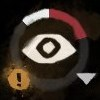

# Hunger

**Categories:** Gameplay · **Source:** [Fandom](https://thelongdark.fandom.com/wiki/Hunger)

**Contents**

- [Hunger bar / Calorie store](#hunger-bar-calorie-store)
- [Calorie usage](#calorie-usage)
- [Eating and Drinking](#eating-and-drinking)
- [Affecting condition](#affecting-condition)
- [Affecting fatigue](#affecting-fatigue)
- [Character quotes](#character-quotes)

 **Hunger** is one of the four essential [Needs](./Needs.md). Hunger is a measure of how many calories the player consumes and expends. The player's hunger is restored by consuming calories, which come in the form of [Foods and Drink](./Food%20And%20Drink.md). The player will begin to lose [Condition](./Condition.md) when their hunger is completely depleted.

## Hunger bar / Calorie store

Hunger on the Survival Tab is represented twice. Graphically as a bar (like the other Needs) and also as 'Calorie Store', an exact quantity of internal calories. The two are directly linked and are not distinct variables. Maximum calories are 2500, minimum is 0, corresponding to a full and empty hunger bar respectively. Hunger is the inverse of what the hunger bar displays; the character is hungriest when the bar is depleted and least hungry when the bar is full. Above the bar is a descriptor that changes as the bar fills to describe the current state of hunger. Its five possible states are Starving ↔︎ Ravenous ↔︎ Hungry ↔︎ Peckish ↔︎ Full. A red outline of an empty stomach appears on the HUD when Ravenous or Starving.

## Calorie usage

| Activity | Burn rate |
| --- | --- |
| Sleeping | 75 cal/h |
| Standing | 125 cal/h |
| Walking | 200 cal/h |
| Sprinting | 400 cal/h |
| Breaking Down | 250 cal/h |
| Building Snow Shelter | 300 cal/h |
| Repairing Snow Shelter | 200 cal/h |
| Dismantling Snow Shelter | 225 cal/h |
| Harvesting Carcass | 250 cal/h |
| Rope Climbing | 500 cal/h |

The above table lists calorie burn rate in [Interloper](./Interloper.md) difficulty. Calories are burned more slowly in lower difficulties. Calories are burned constantly, at a rate dependent on activity level. Having zero calories (starving) does not prevent work from being done.

## Eating and Drinking

Eating is done through either the radial menu or the inventory page. All [Foods and Drink](./Food%20And%20Drink.md) except [water](./Water%20%28Potable%29.md) offer some calories when consumed. When consuming a food that would result in hunger being satisfied more than the limit of 2500 calories, that food will be only partially consumed. The remainder will stay in the inventory with appropriately reduced calorie and weight attributes. Eating can be manually interrupted by pressing the escape key.

## Affecting condition

When no more calories are in the calorie store, [Condition](./Condition.md) drains at a rate of 1% each hour. Dying of starvation will, therefore, take a little while, and will require four game days if starting from 100% condition. Living without eating food every day is a game strategy known as [Hibernation](./Hibernation.md).

## Affecting fatigue

 A player that remains starving for more than 24 hours will start to have their [Fatigue](./Fatigue.md) affected; similar to [Intestinal Parasites](./Intestinal%20Parasites.md). The maximal amount of energy that the player will be able to acquire through sleep will start to decrease, which is represented by the red color that starts filling up the inside of the fatigue bar, as well as by the yellow exclamation mark that appears next to the fatigue bar. The maximum amount of fatigue that a player can have will decrease by 2% per hour, with a maximum decrease of 50%. Once the player has started eating, the fatigue cap will decrease by 5% per hour until it is fully removed. This issue is easily solved by consuming food, the red color won't vanish immediately, but the player will be allowed to gain full energy from sleep right away.

## Character quotes

- "I need to find food."
- "I could eat ANYTHING."
- "Gonna need to eat soon"
- "I gotta', eat, soon." (Female Survivor)
- "God I'd eat anything right about now." (Female Survivor)
- "All I can think about is food!"
- "I could eat a horse!"
- "I could eat a horse, and that's saying a lot cause I like horses." (Female Survivor)
- "Can you eat trees?" (Male Survivor)
- "Can you eat trees?" Cause I'm gonna. I'm gonna eat a tree. [Female Survivor only])
- "I'll die if I don't find food soon."
- "I need to find something to EAT"
- "I need SOMETHING to eat." (Female Survivor)
- "Damn it! So hungry..."
- "I think my stomach is eating itself."
- "Never thought I'd die of starvation."
- "I've never been so hungry in my life!"
- (Various stomach growling noises)
