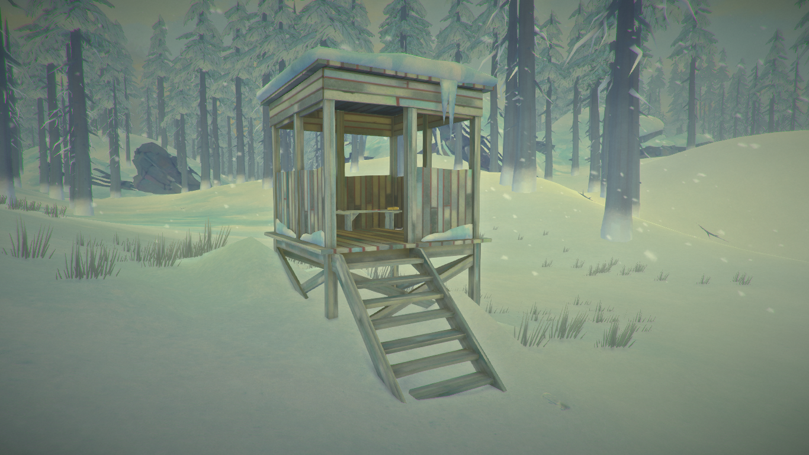

# Hunter's Blinds

**Source:** [Fandom](https://thelongdark.fandom.com/wiki/Hunter's_Blinds)

**Hunter's blinds** are a type of small structure used for hunting. _A Hunter's Blind near Hilltop Cave, Pleasant Valley._

## Overview

Hunter's blinds are enclosed wooden platforms used as stations from which to hunt deer and other game.

They provide some shelter from wind while hunting, are elevated for easier sighting of prey, and used to be inaccessible to all [wildlife](./Wildlife.md). In recent updates, however, wildlife can (though not always reliably) climb up the stairs, somewhat limiting their usefulness.

Blinds may also contain a small amount of useful loot, such as [food](./Food%20And%20Drink.md), firewood, or even a [survival bow](./Survival%20Bow.md). Note that the player cannot make a fire inside a blind, so, in very cold weather when making a fire may be necessary, predators will be able to attack a player who exits the blind to build a fire. Additionally, the blind's wind protection will not apply to fires built outside the structure. Therefore, it is wise to ensure one is well-stocked with potable water and food and clothed in warm layers when planning on hunting from a blind. The blind also doesn't count as shelter if you are afflicted with the [cabin fever](./Cabin%20Fever.md) debuff.

## Locations

- Near [Abandoned Prepper's Cache](./Prepper%27s%20Abandoned%20Cache.md), in [Pleasant Valley](./Pleasant%20Valley.md).
- Near [Hilltop Cave](./Hilltop%20Cave.md), in [Pleasant Valley](./Pleasant%20Valley.md).
- At the [Unnamed Pond](./Unnamed%20Pond.md) in [Mystery Lake](./Mystery%20Lake%20%28disambiguation%29.md).
- Next to [Alan's Cave](./Alan%27s%20Cave.md), in [Mystery Lake](./Mystery%20Lake%20%28disambiguation%29.md).
- The [Low Blind](./Low%20Blind.md) and [High Blind](./High%20Blind.md), in [Forlorn Muskeg](./Forlorn%20Muskeg.md).
- Downhill from the [Hunting Lodge](./Hunting%20Lodge.md) in [Broken Railroad](./Broken%20Railroad.md).
- Three in [Bleak Inlet](./Bleak%20Inlet.md) around the river delta.
- East of [Forsaken Airfield](./Forsaken%20Airfield.md). (Only accessible in the [Tales From the Far Territory](./Tales%20from%20the%20Far%20Territory.md) expansion.)
