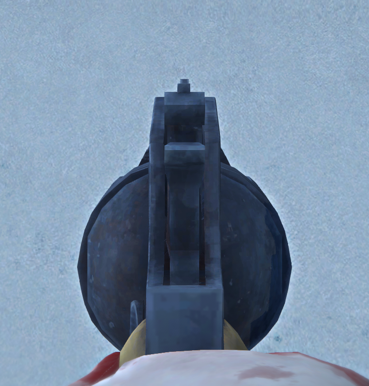

# Hunter's Revolver

**Categories:** DLC Content, Pages with update history, Tools · **Source:** [Fandom](https://thelongdark.fandom.com/wiki/Hunter's_Revolver)

**Contents**

- [Overview](#overview)
- [Revolver Range](#revolver-range)
- [Locations](#locations)
- [Differences from Revolver](#differences-from-revolver)
- [Gallery](#gallery)
- [Update history](#update-history)

_Ptarmigan\_icon.png_

**DLC-Exclusive content.** / This content requires the [Tales from the Far Territory](./Tales%20from%20the%20Far%20Territory.md) addon to be installed before it can be seen or used in regular gameplay.

 / **Hunter's Revolver** /  / _Hunter's\_Revolver\_icon.png_ / **Release:** [21 June 2023](./The%20Long%20Dark%20%E2%80%94%20Changelog.md#2.17) / **Wintermute:** No / **Renewable:** No (unique item) / **Properties** / **Item type:** [Tools](./Tools.md)\\|- / **Stackable:** No / **Examine:** Vintage, hand-cannon style. Its stout construction allows for deadlier shots at distance. / **Values** / **Weight:** 1.75 kg (3.85 lbs) / **Actions** / **Backpack:** Use, Actions, Drop / **On ground:** Take It, Equip It, Leave It / **Advanced data** / **Item key:** GEAR\_RevolverFancy / **Hunter's Revolver** is a unique variant of the [Revolver](./Revolver.md) in _The Long Dark_, added by the _[Tales from the Far Territory](./Tales%20from%20the%20Far%20Territory.md)_ expansion.

## Overview

The Hunter's Revolver is an artfully engraved and blued firearm with a distinct ivory grip featuring a diamond shaped insert. It has an extra long barrel enabling it to land hits from twice as far away, but the extra material makes it weigh 0.25 Kg more than the standard revolver.

Instead of rear iron sights, the hunters revolver has a front sight post on the back which can make aiming a challenge.

## Revolver Range

The range increase is applied to a ray-trace fired from the center of the screen when a shot is fired, normally the standard Revolver's ray-trace range is about 30 meters long, but the Hunter's Revolver's is 60 meters long. Past this range the weapon will be unable to damage any [Wildlife](./Wildlife.md).

## Locations

The Hunter's Revolver can be found in [Prepper Caches](./Prepper%20Cache.md), specifically the hunting Cache containing many animal furs. Prepper Caches can spawn in several different regions and will only spawn once per region.

It can be found:

- Under a metal shelf
- Under the pillow
- In a bucket next to a [Work Bench](./Work%20Bench.md)
- Under the Work Bench

## Differences from Revolver

- Base weight is 0.25kg more than the Revolver
- Range is 100% more than the Revolver
- Has two front posts as its iron sights

## Gallery

_The revolver's location under the workbench_

_Hunter's Revolver iron sights_

_Hunter's Revolver Ground Model_

## Update history

- UPDATE **21 June 2023 ([Update](./The%20Long%20Dark%20%E2%80%94%20Changelog.md#2.17)):**
  - Added to game.
