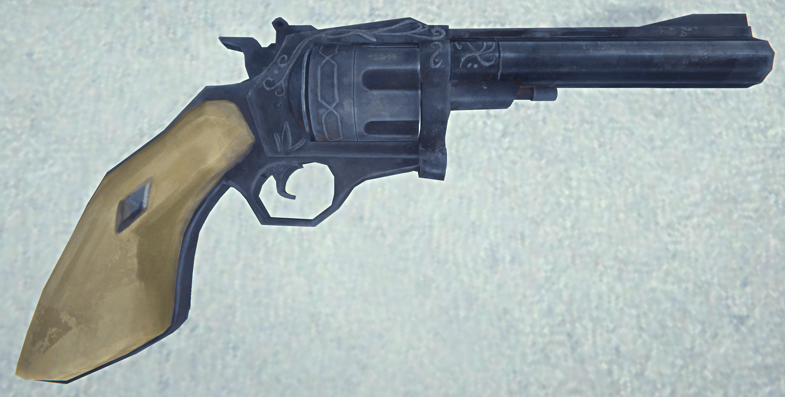

# Hunter's Revolver

**Categories:** DLC Content, Pages with update history, Tools · **Source:** [Fandom](https://thelongdark.fandom.com/wiki/Hunter's_Revolver)

**Contents**

- [Overview](#overview)
- [Revolver Range](#revolver-range)
- [Locations](#locations)
- [Differences from Revolver](#differences-from-revolver)
- [Gallery](#gallery)
- [Update history](#update-history)

| Column 1 | Column 2 | Column 3 |
| --- | --- | --- |

|  / _Hunter's\_Revolver\_icon.png_ |  |  |
| Release | [21 June 2023](./The%20Long%20Dark%20%E2%80%94%20Changelog.md#2.17) |  |
| Wintermute | No |  |
| Renewable | No (unique item) |  |
| **Properties** |  |  |
| Item type | [Tools](./Tools.md)\|- |  |
| Stackable | No |  |
| Examine | Vintage, hand-cannon style. Its stout construction allows for deadlier shots at distance. |  |
| **Values** |  |  |
| Weight | 1.75 kg (3.85 lbs) |  |
| **Actions** |  |  |
| Backpack | Use, Actions, Drop |  |
| On ground | Take It, Equip It, Leave It |  |
| **Advanced data** |  |  |
| Item key | GEAR\_RevolverFancy |  |
|  / _The revolver's location under the workbench_ |  / _Hunter's Revolver iron sights_ |  / _Hunter's Revolver Ground Model_ |
