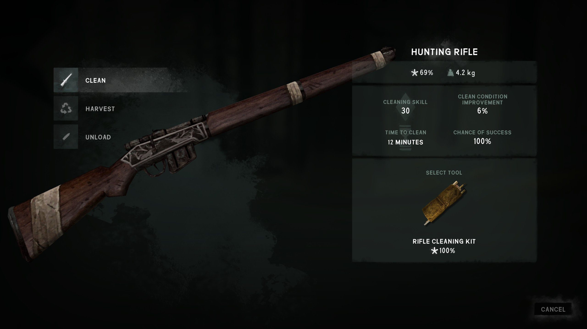
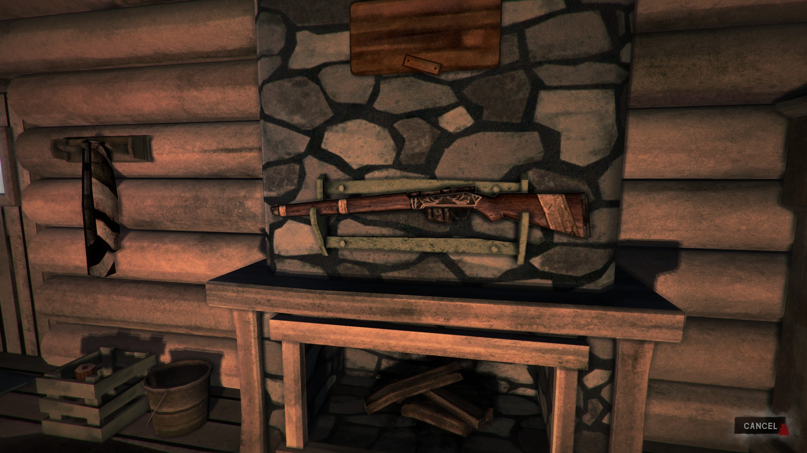
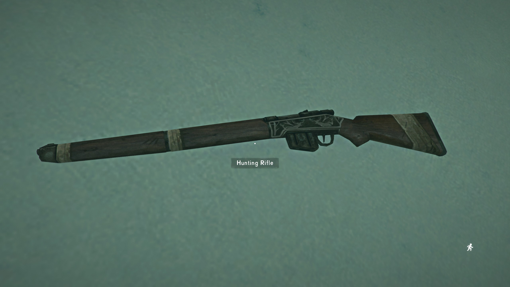

# Hunting Lodge Rifle

**Categories:** Pages with update history, Tools · **Source:** [Fandom](https://thelongdark.fandom.com/wiki/Hunting_Lodge_Rifle)

**Contents**

- [Overview](#overview)
- [Trivia](#trivia)
- [Gallery](#gallery)
- [Update history](#update-history)

**Hunting Lodge Rifle**

| Property | Details |
| --- | --- |
| | Missing image: Hunting\_Rifle\_icon\_(story).png / _Hunting\_Rifle\_icon\_(story).png_ |
| Release | [1 August 2017](./The%20Long%20Dark%20%E2%80%94%20Changelog%20%E2%80%94%20Archive%201.md#1-00-wintermute-1-0-launch-update-predux-release) |
| Wintermute | [Episode 2](./Episode%202%20-%20Luminance%20Fugue.md) - [You Fix My Rifle?](./You%20Fix%20My%20Rifle%3F.md) |
| **Properties** | |
| Item type | [Tools](./Tools.md) |
| Equipable | No |
| Stackable | No |
| **Values** | |
| Weight | 4.00 kg (8.8 lbs) |
| **Actions** | |
| Backpack | Examine |
| On ground | Take It, Leave It |

The **Hunting Lodge Rifle** is the unofficial name given to a [Tool](./Tools.md) simply named **Hunting Rifle** that was found in [Episode 2: Luminance Fugue](./Episode%202%20-%20Luminance%20Fugue.md) of the [Wintermute](./Wintermute.md) story mode as part of the mission \[<https://thelongdark.fandom.com/wiki/You%20Fix%20My%20Rifle>? You Fix My Rifle?\]. It is considered [Cut/Discontinued Content](./Cut%20%E2%80%94%20Discontinued%20Content.md), as it did not survive the transition from Predux Episode 2 to Redux Episode 2, as the item located where the Hunting Lodge Rifle was found would be replaced by the [Broken Bear Spear](./Broken%20Bear%20Spear.md).

## Overview

It serves as a reskinned version of the [Hunting Rifle](./Hunting%20Rifle.md), with a silver engraving of 2 [Deer](./Deer.md), 2 wraps of tape at the end of the barrel, and a large wrap of tape on the stock. It was obtained when exploring the [Hunting Lodge](./Hunting%20Lodge.md) in [Broken Railroad](./Broken%20Railroad.md), just above the [Fireplace](./Fireplace.md) of the first floor. [Jeremiah's Repaired Rifle](./Jeremiah%27s%20Repaired%20Rifle.md) would later be returned to [Jeremiah](./Jeremiah.md) and [Will Mackenzie](./Will%20Mackenzie.md) would keep the Hunting Lodge Rifle as his own Hunting Rifle for the rest of the episode.

The Hunting Lodge Rifle's design changes to a regular Hunting Rifle when the cutscene of Mackenzie finding it plays, as well as any other cutscene with Mackenzie holding the rifle. It also takes the appearance a regular Hunting Rifle in first person.

Only the backpack icon, the 3D model in the menu, and placing the rifle on the ground shows the unique design.

## Trivia

Many features of the Hunting Lodge Rifle would later be recycled into the [Curator's Rifle](./Curator%27s%20Rifle.md) (silver engravings became gold engravings) and [Vaughn's Rifle](./Vaughn%27s%20Rifle.md) (tape around the barrel and stock).

## Gallery

_[Curator's Rifle](./Curator%27s%20Rifle.md)_

_[Vaughn's Rifle](./Vaughn%27s%20Rifle.md)_

## Update history

- UPDATE **1 August 2017 ([Update](./The%20Long%20Dark%20%E2%80%94%20Changelog%20%E2%80%94%20Archive%201.md#1-00-wintermute-1-0-launch-update-predux-release)):**
  - Added to game.
- UPDATE **17 December 2018 ([Update](./The%20Long%20Dark%20%E2%80%94%20Changelog%20%E2%80%94%20Archive%201.md#1-41-wintermute-redux-update)):**
  - Removed from the game as part of the Redux edition.
