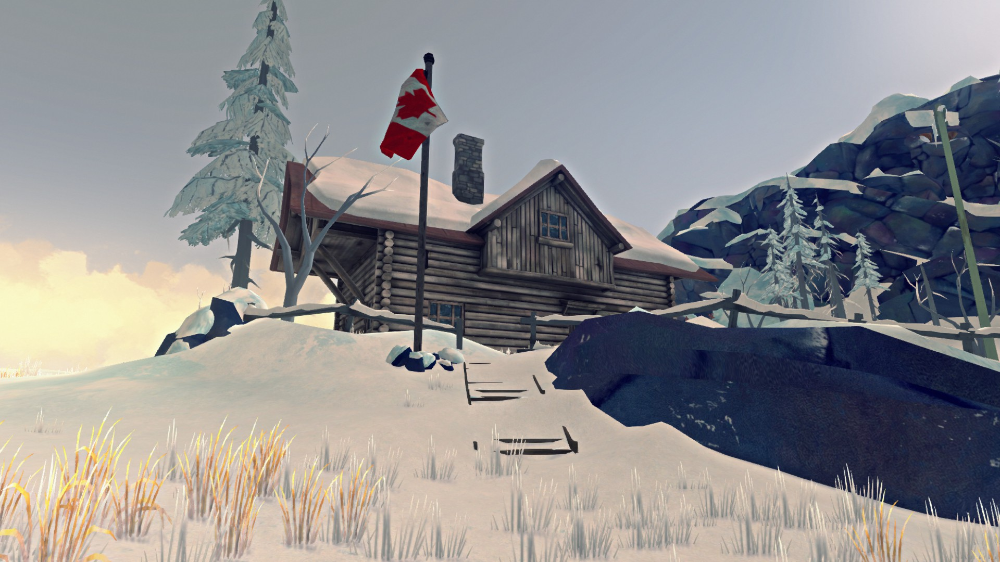
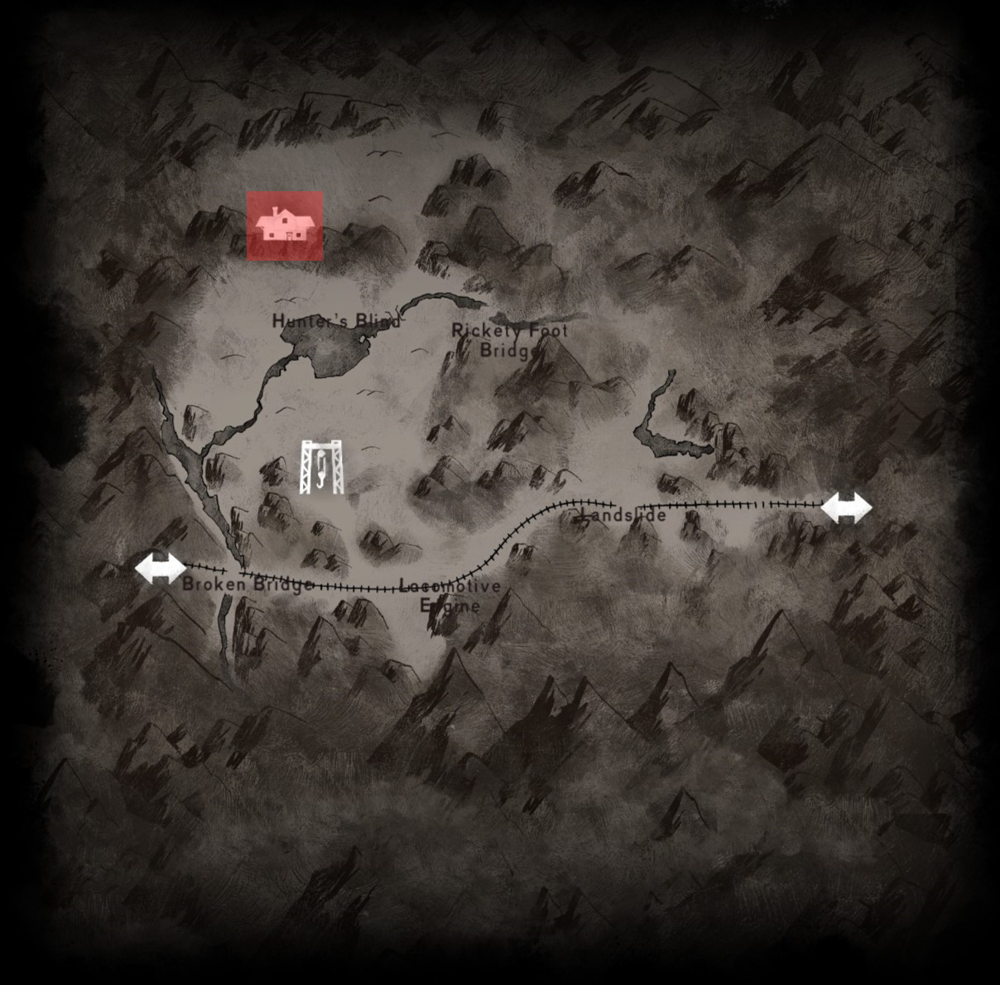
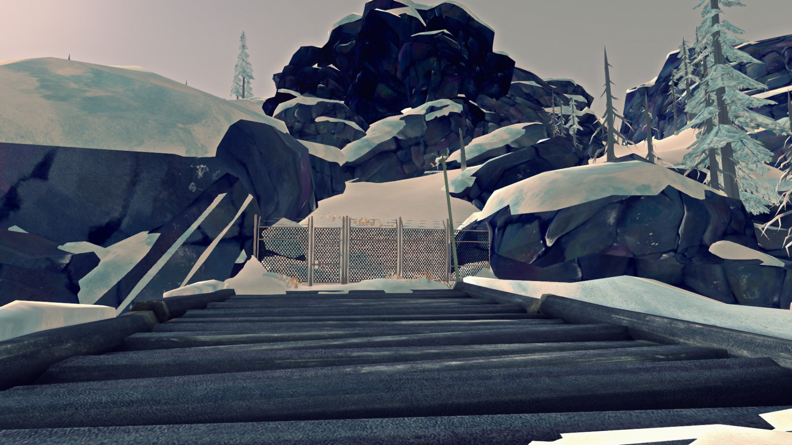
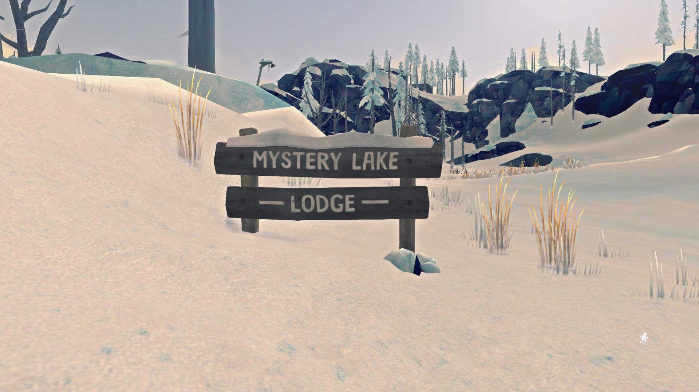
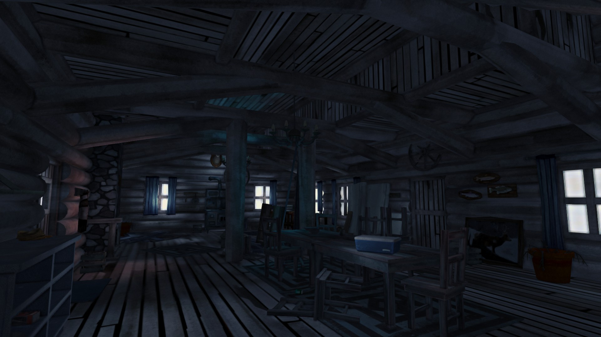
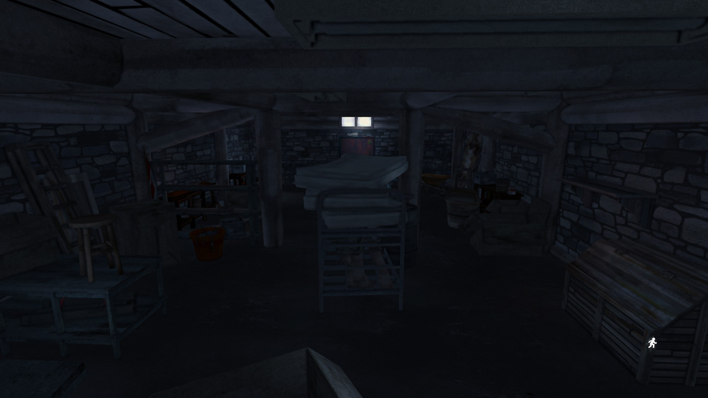
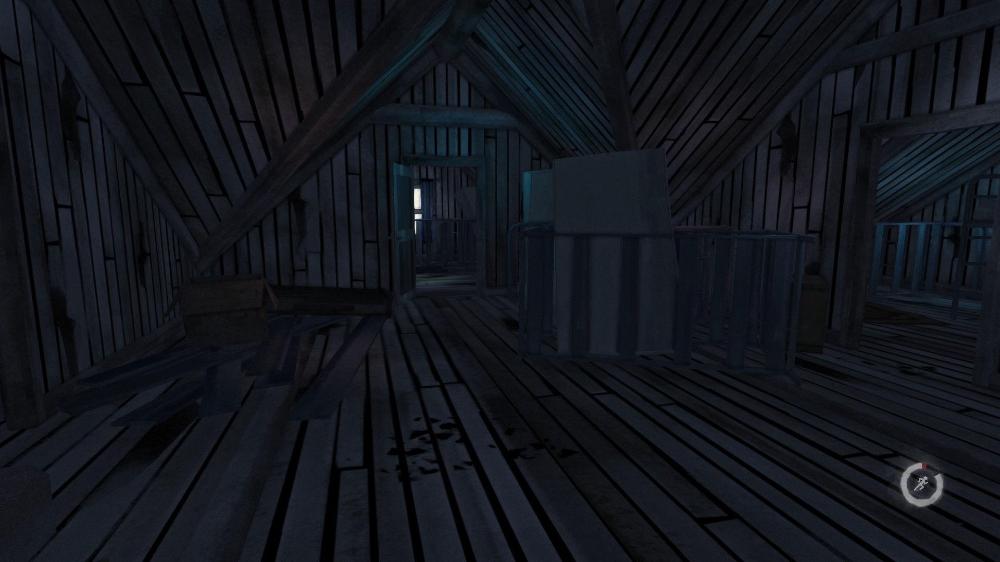

# Hunting Lodge

**Categories:** Indoor locations, Locations, Locations in Broken Railroad, Locations with a workbench, Military/Sporting locations, Residential locations · **Source:** [Fandom](https://thelongdark.fandom.com/wiki/Hunting_Lodge)

**Contents**

- [Overview](#overview)
- [Ground Floor](#ground-floor)
- [Loft](#loft)
- [Basement](#basement)
- [Nearby area](#nearby-area)
- [Use as Safehouse](#use-as-safehouse)
- [Notes](#notes)
- [Trivia](#trivia)
- [Gallery](#gallery)

**Hunting Lodge**

_Hunting\_lodge.jpg_

**Location**

_Hunting\_Lodge\_Location.png_

**Region:** [Broken Railroad](./Broken%20Railroad.md)\|-

**Description:** A two-story house

**General**

**Type:** ResidentialMilitary/Sporting\|-

_bed\_icon.png_

Has a bed

_workbench\_icon\_green.png_

Has a workbench\|-

**Missions:** [The Best Defense](./Episode%202%20-%20Luminance%20Fugue.md#The_Best_Defense%3F)

The **Hunting Lodge** is a location in [Broken Railroad](./Broken%20Railroad.md).

## Overview

The lodge is a large building with both a ground floor, a loft, and a basement. It's a possible spawn for the [Hunting Rifle](./Hunting%20Rifle.md) and usually has some [Rifle Ammunition](./Rifle%20Ammunition.md) lying around. Provided you have the [Tales from the Far Territory](./Tales%20from%20the%20Far%20Territory.md) DLC, the recipe card for [Breyerhouse Pie](./Breyerhouse%20Pie.md) can be found inside in several locations,

### Ground Floor

When entering from the north, players will come across a table and chairs. To the left there's a [Fireplace](./Fireplace.md), along with a [Stove](./Stove.md) and kitchen area, which usually contains some food and drink. A [Cooking Skillet](./Cooking%20Skillet.md) may spawn in the kitchen area. The [Breyerhouse Pie](./Breyerhouse%20Pie.md) [recipe card](./Recipe%20Cards.md) may be found on a table across from the stove.

Besides the chairs, there's a lot of [Planks](./Planks.md) that can be broken down for [Reclaimed Wood](./Reclaimed%20Wood.md). In Wintermute, the [Bear Spear](./Bear%20Spear.md) spawns atop the mantlepiece on the fireplace, while in Survival Mode, a [Hunting Rifle](./Hunting%20Rifle.md) may spawn on the rifle rack.

### Loft

Going up the stairs leads to a loft, which features three bedrooms and a storage room. Two of the bedrooms feature useable [beds](./Bed.md), along with a few containers which may contain various clothing. A [Hunting Rifle](./Hunting%20Rifle.md) can spawn behind the wardrobe in the bedroom with the trunk in Survival Mode, and various boxes of ammunition are scattered in various corners of the loft. In addition, a [Mountaineering Rope](./Mountaineering%20Rope.md) can be found stashed in one of the bedrooms.

The [Breyerhouse Pie](./Breyerhouse%20Pie.md) [recipe card](./Recipe%20Cards.md) may be found between the mattresses in the room opposite of the bathroom.

### Basement

Entering the basement, there are a bunch of shelves which may contain random items, along with [metal](./Metal%20Container.md) and [plastic](./Plastic%20Container.md) containers. The most useful item found in the basement is the Workbench. A [Revolver](./Revolver.md) can possibly spawn on one of the unusable bunk beds.

As of the [Tales from the Far Territory](./Tales%20from%20the%20Far%20Territory.md) update, the basement also spawns a [Vegetable Rack](./Vegetable%20Rack.md) near the wood box. A [Bag of Salt](./Salt%20%28Bag%29.md) can be found beside the Vegetable Rack. The [Breyerhouse Pie](./Breyerhouse%20Pie.md) [recipe card](./Recipe%20Cards.md) may be found on top of the vegetable rack.

### Nearby area

A [Truck](./Truck.md) and a [Car](./Car.md) sit to the right of the lodge. Behind the lodge is a small shed and some picnic tables. There is also a cliff behind the lodge with a rock to deploy a [Mountaineering Rope](./Mountaineering%20Rope.md). There is a cave in the cliff below the lodge, which is home to a [Bear](./Bear.md). The path to the lodge leads past a small pond, which is too shallow for fishing. Rabbits, reishi mushrooms, and cattails all can be found there. Be cautious as well, as there is a chance for a [Wolf](./Wolf.md) pack and/or a [Moose](./Moose.md) making it dangerous but having good hunting opportunities.

## Use as Safehouse

The Hunting Lodge can be used as a potential [Safe House](./Safehouse.md) when exploring Broken Railroad, as it is very spacious and has lots of game surrounding it, along with easy access to the [forge](./Forge.md) nearby. Predators can be a bit of a challenge when entering/exiting, however, the largest issue may be the lodge's isolation relative to much of Broken Railroad, and the remainder of Great Bear in general. It can still make for a decent stopover point for players who are coming or going from the [Far Territory](./Tales%20from%20the%20Far%20Territory.md).

## Notes

Before the lights in the sky, the lodge was being used as the base of operations for the remaining [Forest Talkers](./Forest%20Talkers.md).

When entering for the basement in [Episode 2: Luminance Fugue](./Episode%202%20-%20Luminance%20Fugue.md), the [Phone Box](./Phone%20Box.md) will ring. This is likely because it is part of the party line that Molly is using to speak to Astrid. Unfortunately it cannot be interacted with once the door is opened, as the ringing stops.

## Trivia

The fact that a car and truck are present at the Lodge makes no logical sense, as the bridge leading up to the Lodge has a gate and there is no road leading from the Maintenance Yard to the Lodge. Furthermore, there are no roads leading into the region aside from the railroad that would not even support railless vehicles. This is an oversight from the developers.

## Gallery

_A chain-link gate at the base of the hill that leads to the lodge_

_The sign on the path to the lodge_

_The main floor_

_The basement_

_The top floor_
