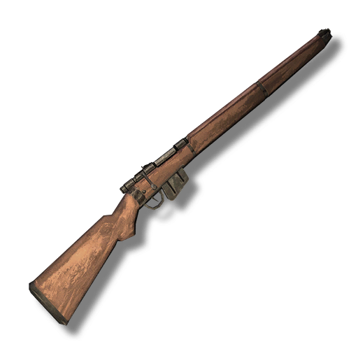
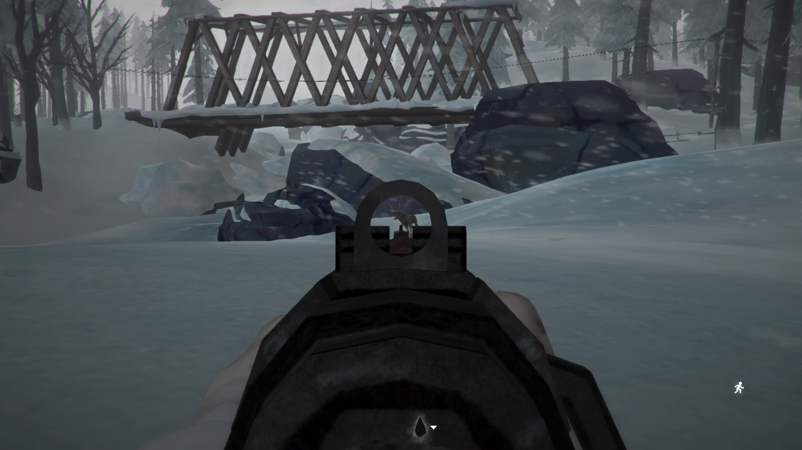
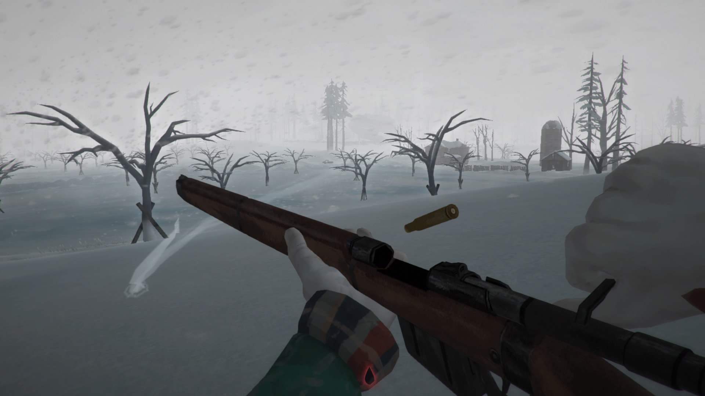
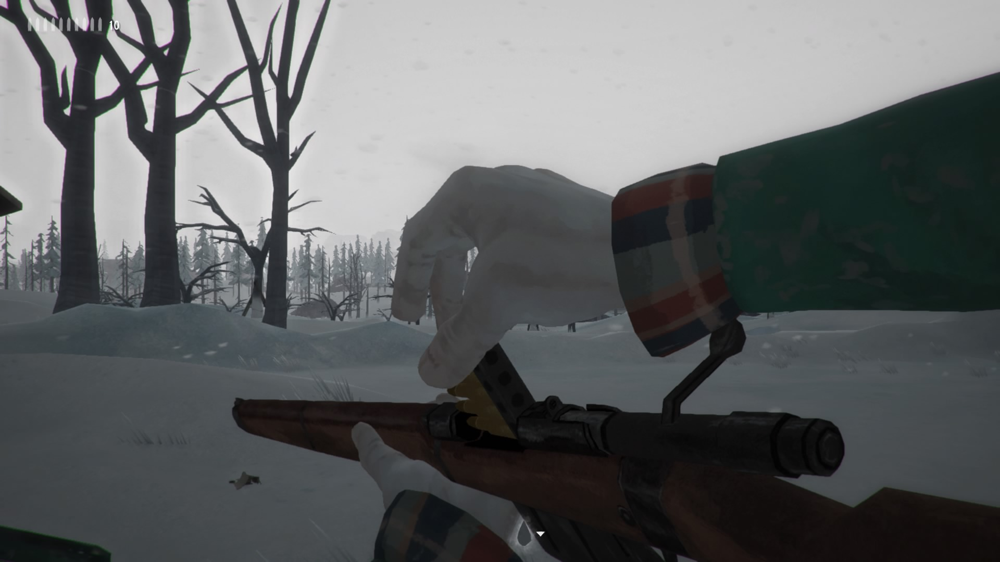
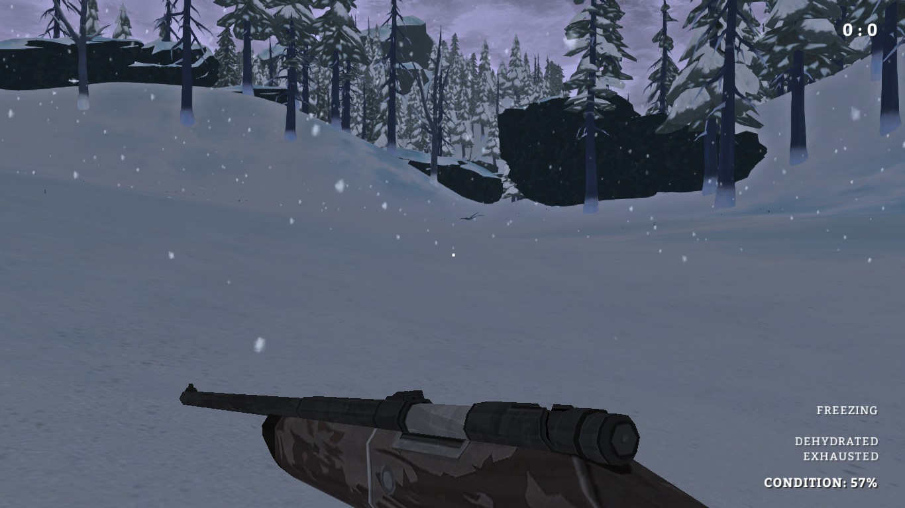
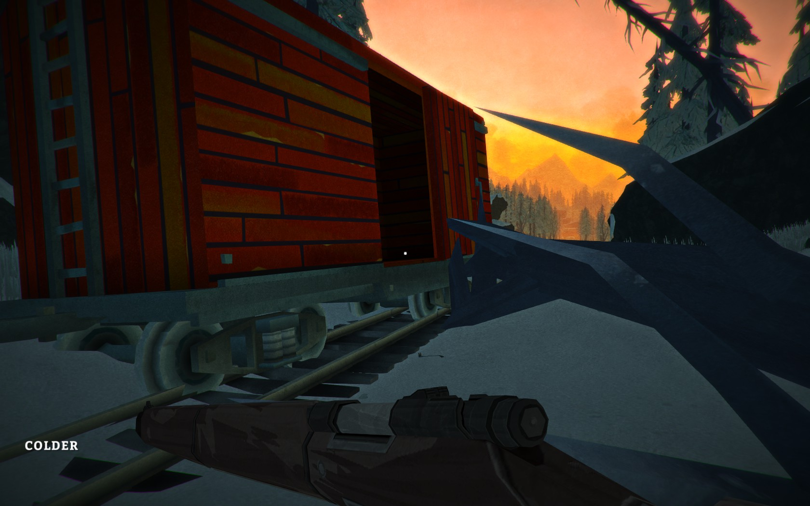
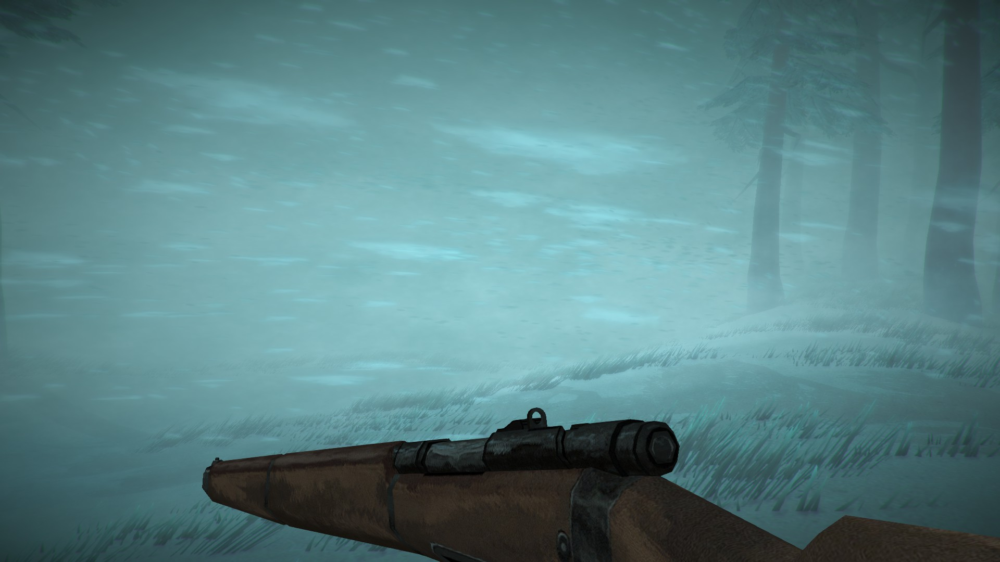
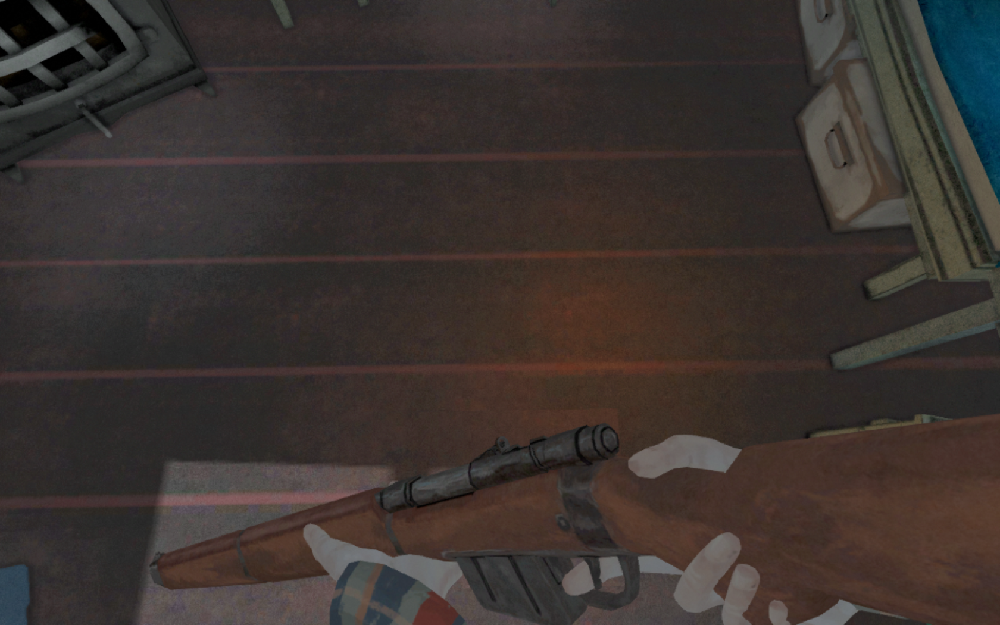
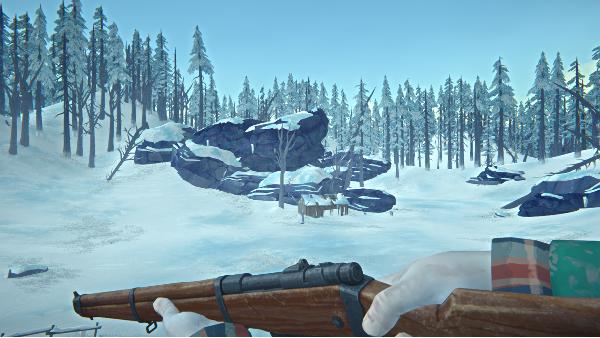
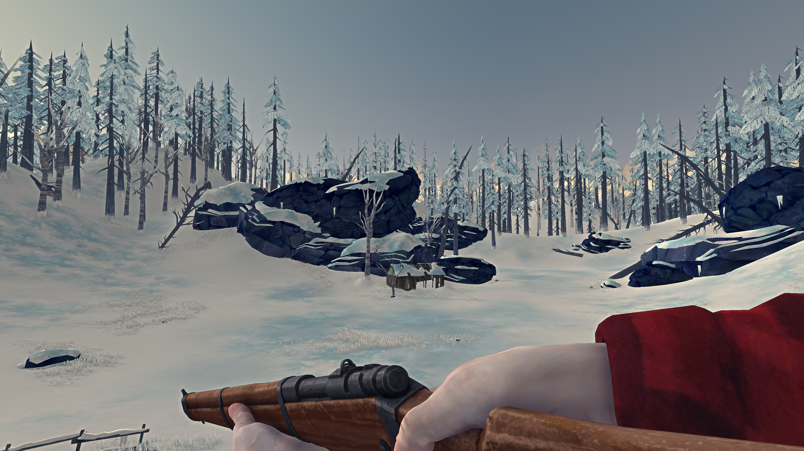

# Hunting Rifle

**Categories:** Story items, Tools · **Source:** [Fandom](https://thelongdark.fandom.com/wiki/Hunting_Rifle)

**Contents**

- [Overview](#overview)
- [Mechanics](#mechanics)
- [Loading](#loading)
- [Aiming](#aiming)
- [Jamming](#jamming)
- [Jamming Chances](#jamming-chances)
- [Cleaning](#cleaning)
- [Degrading](#degrading)
- [Variants](#variants)
- [Hunting](#hunting)
- [Bleed Out Time](#bleed-out-time)
- [Locations](#locations)
- [Ash Canyon](#ash-canyon)
- [Blackrock](#blackrock)
- [Bleak Inlet](#bleak-inlet)
- [Broken Railroad](#broken-railroad)
- [Coastal Highway](#coastal-highway)
- [Desolation Point](#desolation-point)
- [Forlorn Muskeg](#forlorn-muskeg)
- [Forsaken Airfield](#forsaken-airfield)
- [Hushed River Valley](#hushed-river-valley)
- [Mountain Town](#mountain-town)
- [Mystery Lake](#mystery-lake)
- [Pleasant Valley](#pleasant-valley)
- [Sundered Pass](#sundered-pass)
- [Timberwolf Mountain](#timberwolf-mountain)
- [Winding River](#winding-river)
- [Zone of contamination](#zone-of-contamination)
- [Prepper Cache](#prepper-cache)
- [Port Remnant](#port-remnant)
- [Wintermute](#wintermute)
- [Notes](#notes)
- [Trivia](#trivia)
- [References](#references)
- [Gallery](#gallery)

**Hunting Rifle**

_Hunting\_Rifle\_icon.png_

**General**

**Item Type:** Tool

**Statistics**

**Weight:** 4.00 kg(8.8 lbs)

**Harvest:** 1 Hour 2 × [Scrap Metal](./Scrap%20Metal.md)

**Repair:** [Firearm Cleaning Kit](./Firearm%20Cleaning%20Kit.md) 12-5 minutes / 3%-5%

> “**An old .303 calibre bolt-action hunting rifle. Will bring a deer down. Maybe a wolf.**”
>
> — In-game description

_This article is about the normal hunting rifle. For variants, see [Vaughn's Rifle](./Vaughn%27s%20Rifle.md), [Barb's Rifle](./Barb%27s%20Rifle.md), [Bunker Rifle](./Bunker%20Rifle.md), or [Curator's Rifle](./Curator%27s%20Rifle.md)._

The **Hunting Rifle** is a bolt-action weapon with an internal magazine capacity of 10 rounds that can be used to scare away or kill [Wildlife](./Wildlife.md). When hitting a target, it provides experience in the [Rifle Firearm](./Rifle%20Firearm.md) skill.

## Overview

The hunting rifle is the first firearm to be added to the game and one of three a player may find throughout the regions of Great Bear Island. It is the heaviest ranged weapon a player can have in their inventory. The rifle can inflict a critical hit to targets, and cartridges are lighter than [Simple Arrows](./Simple%20Arrow.md). The rifle's condition will degrade after a shot, requiring regular Cleaning.

## Mechanics

### Loading

A rifle can be loaded with 10 rounds of [Rifle Ammunition](./Rifle%20Ammunition.md). 5 rounds can be loaded at once with stripper clips, but rounds will be loaded individually if there are 6 or more rounds in the magazine already or if the player does not have 5 or more rounds on them. Loading will continue until interrupted by clicking or canceling, or the magazine is fully loaded.

Firing a rifle will automatically expend a [Rifle Shell Casing](./Rifle%20Shell%20Casing.md) out of the ejection port and onto the ground as a new round is cycled into the chamber, and can be picked up.

### Aiming

Depending on the player's rifle skill and condition, when aimed, the rifle will sway or shudder slightly, affecting the player's ability to aim. The sway increases if the player's [Fatigue](./Fatigue.md) is low. The player will also begin to shiver when freezing, making aiming even more difficult.

Although the rifle does not have a scope, aiming at a point will cause the player's view to zoom in towards said point, effectively allowing the rifle to be used as a weak optic. The same can be done with the [Survival Bow](./Survival%20Bow.md) and the [Woodright's Bow](./Woodwright%27s%20Bow.md).

### Jamming

The rifle will begin jamming under the 50% condition threshold, then it has the chance to improperly load the next cartridge. Attempting to fire will result in a misfire. To clear the jam, the bolt must be cycled again manually by pressing the reload button/key. Doing so will eject the unspent cartridge onto the ground near the player, from where it can be picked up and used again. Unloading and reloading the rifle in the player's inventory will also clear the jam, but without dropping any ammo.

Low quality Ammunition created from [Gunsmithing](./Gunsmithing.md) can also cause a misfire, even if the gun is in relatively good condition.

### Jamming Chances

| Condition | 50% | 45% | 40% | 30% | 20% | 10% | 5% | 0% |
| --- | --- | --- | --- | --- | --- | --- | --- | --- |
| Jamming Chance | 0% | 14% | 18% | 26% | 34% | 42% | 46% | 50% |

### Cleaning

_Main article: [Cleaning](./Cleaning.md)_

Hunting Rifles can be cleaned with a [Firearm Cleaning Kit](./Firearm%20Cleaning%20Kit.md) to prevent jamming and improve accuracy.

Cleaning a rifle consumes 5% condition from the rifle cleaning kit and restores some condition to the hunting rifle, based on the player's skill level. Each rifle cleaning kit can be used up to 20 times for repairing hunting rifles.

The player may use a [Milling Machine](./Milling%20Machine.md) with one [Scrap Metal](./Scrap%20Metal.md) during an active [Aurora](./Aurora.md) to repair the rifle by 40% condition (Increased by [Gunsmithing Skill](./Gunsmithing.md)). The milling machine can also repair completely ruined rifles for the cost of 5 scrap metal, 1 fir firewood, and 4 hours of time.

### Degrading

In **[Survival Mode](./Survival%20Mode.md)**, the Hunting Rifle degrades **1.325%** for each shot taken. When the rifle is at full condition, 75 shots can be taken before it degrades to broken. The Hunting Rifle can be cleaned to restore condition and increase the number of total shots that can be taken.

If the player obtains a level 5 Rifle Firearm skill, the Hunting Rifle degrades **0.6625%**for each shot taken. When the rifle is at full condition, 150 shots can be taken before it degrades to broken.

In [Wintermute](./Wintermute.md), the Hunting Rifle degrades **0.6625%**for each shot taken. When the rifle is at full condition, 150 shots can be taken before it degrades to broken. The Hunting Rifle can be cleaned to restore condition and increase the number of total shots that can be taken.

The player cannot increase or decrease the degradation rate of the Hunting Rifle in Story mode, as there are no skills in Wintermute.

## Variants

The Hunting Rifle has 3 variants, each having distinct differences from the base hunting rifle. These variants each spawn once per game, and they can be viewed in more detail below:

- [Barb's Rifle](./Barb%27s%20Rifle.md) - Heavier but more durable
- [Bunker Rifle](./Bunker%20Rifle.md) - Lighter and faster, but breaks quickly
- [Vaughn's Rifle](./Vaughn%27s%20Rifle.md) - Lighter and faster, but breaks quickly (though slower than bunker rifle)
- [Curator's Rifle](./Curator%27s%20Rifle.md) - Longer effective firing range
- [Hunting Lodge Rifle](./Hunting%20Lodge%20Rifle.md) - A cut reskin of the Hunting Rifle

## Hunting

_Main article: [Hunting](./Hunting.md)_

The rounds fired from the Hunting Rifle move at a high velocity, and travel in a straight line. Upon hitting a target, they can cause massive internal injuries, potentially killing animals instantly. If the round fails to cause internal injuries sufficient enough to kill instantly, the round will still result a bleeding wound that will kill the animal eventually.

The rifle has a maximum range of approximately 50 paces. Targets beyond the maximum range cannot be hit. Hitting a fleshy target will produce a blood spray effect.

### Bleed Out Time

Bears, Deer and Wolves have hit spots with a bleed out time. Moose and Cougar do not bleed. Rabbits and Ptarmigan die instantly.

| Zone Hit | Bear | Deer | Wolf |
| --- | --- | --- | --- |
| Head | 60 minutes | Instant | Instant |
| Neck | 90 minutes | 15 minutes | 20 minutes |
| Torso | 240 minutes | 45 minutes | 60 minutes |
| Hip | 360 minutes | 60 minutes | 90 minutes |
| Limb | 480 minutes | 240 minutes | 120 minutes |

## Locations

As with other loot items, the hunting rifle will randomly spawn in different locations on different play-throughs and difficulties, although a few maps have a guaranteed rifle spawn separate from the random spawn. Each major map used to be guaranteed to have at least one rifle spawn in it (until the Tales from the Far Territory update), except on Interloper where none will spawn.

Possible hunting rifle spawn locations include:

### **[Ash Canyon](./Ash%20Canyon.md)**

No Hunting Rifle spawns here, but if [Tales from the Far Territory](./Tales%20from%20the%20Far%20Territory.md) is installed, the [Curator's Rifle](./Curator%27s%20Rifle.md) is guaranteed to spawn in one of the following places:

- At [High Meadow](./High%20Meadow.md) next to a corpse at the vista location.
- At the [Gold Mine](./Gold%20Mine.md) next to a corpse at the top of the waterfall.
- Next to a corpse on the ledge along the [Gold Mine](./Gold%20Mine.md) path near [Wolf's Jaw Overlook](./Wolf%27s%20Jaw%20Overlook.md).
- Next to a corpse by the tree at [Wolf's Jaw Overlook](./Wolf%27s%20Jaw%20Overlook.md) near the rose hip climb.
- In the cave with the bed at the top of the [Runaway Bridge](./Runaway%20Bridge.md) plateau across the fallen tree.

### **[Blackrock](./Blackrock.md)**

- Inside a [Supply Cache](./Supply%20Cache.md) near [Cook's Farm](./Cook%27s%20Farm.md) (dlc-only).

### **[Bleak Inlet](./Bleak%20Inlet.md)**

- Next to a corpse at the end of the [Secret Mountain Path](./Secret%20Mountain%20Path.md).
- inside a cabin at [Cannery Worker Residences](./Cannery%20Worker%20Residences.md).
- Inside a [Supply Cache](./Supply%20Cache.md) south of the [Lower Raven Falls](./Lower%20Raven%20Falls.md) cabin (dlc-only).

### **[Broken Railroad](./Broken%20Railroad.md)**

- [Hunting Lodge](./Hunting%20Lodge.md): upstairs in one of the bedrooms, on the gun rack above the fireplace, in an old washing tub in the basement. This rifle is guaranteed.
- In the ravine near the southmost waterfall.

### **[Coastal Highway](./Coastal%20Highway.md)**

- [Jackrabbit Island](./Jackrabbit%20Island.md): Inside house, beside wardrobe in bedroom.
- [Abandoned Lookout](./Abandoned%20Lookout.md): in gun rack.
- [Cinder Hills Coal Mine](./Cinder%20Hills%20Coal%20Mine.md): in one of the side passages, next to a corpse.
- Inside a [Supply Cache](./Supply%20Cache.md) at [Bear Creek Campground](./Bear%20Creek%20Campground.md) (dlc-only).

If [Tales from the Far Territory](./Tales%20from%20the%20Far%20Territory.md) is installed, [Barb's Rifle](./Barb%27s%20Rifle.md) is guaranteed to spawn once in the region:

- Inside [Quonset Garage](./Quonset%20Garage.md).
- In one of the many [Fishing Huts](./Fishing%20Hut.md) leaning against the wall next to the stove.
- In a train log car near the trailer at [Train Unloading](./Train%20Unloading.md).
- Under the concrete bridge near [Rockfall](./Rockfall.md).

### **[Desolation Point](./Desolation%20Point.md)**

- Inside a [Supply Cache](./Supply%20Cache.md) west of the [Lonely Lighthouse](./Lonely%20Lighthouse.md) (dlc-only).

### **[Forlorn Muskeg](./Forlorn%20Muskeg.md)**

- Inside a [Supply Cache](./Supply%20Cache.md) at [Marsh Ridge](./Marsh%20Ridge.md) (dlc-only).

### [**Forsaken Airfield**](./Forsaken%20Airfield.md)

- Inside a [Supply Cache](./Supply%20Cache.md) on [Drift Island](./Drift%20Island.md) (dlc-only).

### [Hushed River Valley](./Hushed%20River%20Valley.md)

Guaranteed in one of the five locations:

- Near the northwest [Ice Cave](./Ice%20Cave.md) entrance, next to a corpse.
- On the hill behind the northwest [Ice Cave](./Ice%20Cave.md) entrance.
- On the path behind the waterfall, next to the northernmost [Ice Cave](./Ice%20Cave.md) entrance near [Mammoth Falls](./Mammoth%20Falls.md).
- On the path leading from the [Hushed River Valley](./Hushed%20River%20Valley.md) entrance to the nearest bear den, next to a corpse.
- Between rope climbs at [Pensive Vista](./Pensive%20Vista.md), near the [Memento](./Mementos.md) note.

### [**Mountain Town**](./Mountain%20Town.md)

- Before [Rocky Refuge](./Rocky%20Refuge.md) in the secluded area next to a corpse.

### **[Mystery Lake](./Mystery%20Lake%20%28region%29.md)**

- On the gun rack in [Trapper's Cabin](./Trapper%27s%20Homestead.md), above the safe.
- Inside a [Supply Cache](./Supply%20Cache.md) near the [Unnamed Pond](./Unnamed%20Pond.md) cabin (dlc-only).
- Inside the Hydroelectric Dam, on the catwalk in the huge room with the mountaineering rope, in the furthest corner from the rope, leaned up against a console behind a chair. It may be hard to spot without a light source and from certain angles. (Confirmed April 2, 2025, WITHOUT DLC. Please verify with DLC installed.)
- Inside the Lower Dam, in the far corner of the room with a computer, leaning on a barrel. (Confirmed with no DLC)

If [Tales from the Far Territory](./Tales%20from%20the%20Far%20Territory.md) is installed, [Vaughn's Rifle](./Vaughn%27s%20Rifle.md) is guaranteed to spawn either here or in [Winding River](./Winding%20River.md):

- Inside [Carter Hydro Dam](./Carter%20Hydro%20Dam.md) at one of several potential spawn locations;
  - In the main turbine room upper dam on a catwalk south east corner of the room
  - In the broken window room coming in from Winding River in the lower dam, (in a corner to the left when entering near a metal table)

### **[Pleasant Valley](./Pleasant%20Valley.md)**

- Guaranteed in one of the five locations:
  - Near fallen tree bridge leading to [Burned Ridge Cave](./Burned%20Ridge%20Cave.md), next to a corpse.
  - In the destroyed barn between [Heartbreak Bridge](./Heartbreak%20Bridge.md) and [Long Falls](./Long%20Falls.md).
  - In the cave west from [Hilltop Cave](./Hilltop%20Cave.md).
  - [Three Strikes Farmstead](./Three%20Strikes%20Farmstead.md).
  - Rock formation northwest from the [Farmstead](./Pleasant%20Valley%20Farmstead.md).
- [Supply Cache](./Supply%20Cache.md) near [Cinder Hills Coal Mine](./Cinder%20Hills%20Coal%20Mine.md) entrance (dlc-only).

### [Sundered Pass](./Sundered%20Pass.md)

- At the [Weather Station](./Weather%20Station.md): in the radar building, in the garage, in the truck. This rifle is guaranteed to spawn (dlc-only).

### **[Timberwolf Mountain](./Timberwolf%20Mountain.md)**

- Inside one of the [Tail Section](./Tail%20Section.md) [Cargo Containers](./Cargo%20Container.md). Hacksaw required. This rifle is guaranteed to spawn.

### **[Winding River](./Winding%20River.md)**

No normal Hunting Rifle will spawn here. If [Tales from the Far Territory](./Tales%20from%20the%20Far%20Territory.md) is installed, [Vaughn's Rifle](./Vaughn%27s%20Rifle.md) is guaranteed to spawn either here or in [Mystery Lake](./Mystery%20Lake%20%28disambiguation%29.md):

- Inside the pipes at on the dam platform near the exit door to the dam in. It may be behind pallets that need to be broken down.
- In the small cave to the west at the base of the dam.

### [Zone of contamination](./Zone%20of%20Contamination.md)

- Locked inside the mine office in the [Langston Mine](./Langston%20Mine.md), unlocked with the [Mine Office Key](./Mine%20Office%20Key.md). This rifle is guaranteed to spawn (dlc-only).

### [Prepper Cache](./Prepper%20Cache.md)

- Guaranteed in one of the nine [prepper caches](./Prepper%20Cache.md).

### [Port Remnant](./Port%20Remnant.md)

- Guaranteed spawn in the left branch of the cave linking the plateau on which the [Desecrated Church](./Desecrated%20Church.md) is located to the main part of the region.

### **[Wintermute](./Wintermute.md)**

- [Episode 1](./Episode%201%20-%20Do%20Not%20Go%20Gentle.md)
  - A rifle is used by the [Grey Mother](./Grey%20Mother.md), but none can be obtained in this Episode.
- [Episode 2](./Episode%202%20-%20Luminance%20Fugue.md)
  - A rifle is given to you by [Jeremiah](./Jeremiah.md) at the beginning of the episode.
- [Episode 3](./Episode%203%20-%20Crossroads%20Elegy.md)
  - A rifle can be found in the small hut near the river in [Thompson's Crossing](./Thomson%27s%20Crossing.md).
- [Episode 4](./Episode%204%20-%20Fury%2C%20Then%20Silence.md)
  - Rifles can be found to fight off Timberwolves, but care should be taken when returning to the prison, as the Convicts will confiscate it if it is not stored when meeting with them.

## Notes

- The rifle cannot be used with a [Sprained Wrist](./Sprained%20Wrist.md).
- Bullets have higher critical hit chance (instant kills) than arrows especially when hitting an animal's head or neck.
- Bullets cause less bleeding than arrows, making bleed-out times longer.
- Firearms discharged indoors will cause temporary ear-ringing and deafness.
- Rifles and other weapons are dropped during a [Struggle](./Struggle.md) with big game ([Bear](./Bear.md), [Moose](./Moose.md) and [Cougar](./Cougar.md)).

## Trivia

- The rifle is inspired by the Lee-Enfield bolt action rifle which was Britain's standard issue rifle until the 1960s [¹](#fn1) and used by the Canadian Rangers until 2015.
- Rifle jamming in-game depicts a "rim-lock", which is when the rim on two cartridges snag and cause loading problems.
- Shooting a [Recycled Can](./Recycled%20Can.md) or [Spray Paint](./Spray%20Paint.md) will cause the cans to fly through the air a moderate distance.

## References

## Gallery

_Jammed cartridge failed to chamber properly old version_

_Rifle iron sights. (pre-v1.48 update)_

_Hunting rifle ejecting a casing after a shot._

_A 5-round stripper clip being loaded._

\[Missing image: Hunting\_Rifle\_icon\_(story).png\]

_Old Epiosde 2 Predux story model icon for a second Hunting Rifle_

_A hunting rifle on the rack in the [Trapper's Homestead](./Trapper%27s%20Homestead.md)_

_Old Hunting Rifle model (Pre-alpha)_

_Old Hunting Rifle model in hands (Pre-Alpha)_

_Old Hunting Rifle model in hands (Early Access period)_

_Old Hunting Rifle model in hands (Pre-1.0)_

_Old Hunting Rifle model in hands (1.0-1.47 version)_

_Old Hunting Rifle model in hands (1.48-2.23 version)_

_New Hunting Rifle model in hands (v2.25-Present)_

## Notes

---

1. [https://x.com/RaphLife/status/1126240186050834432](https://x.com/RaphLife/status/1126240186050834432)[↩︎](#fnref1)
