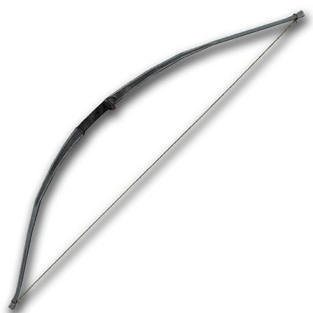
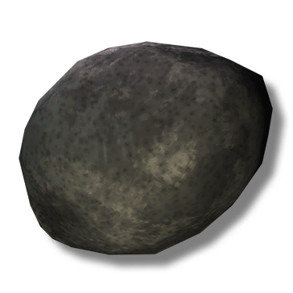
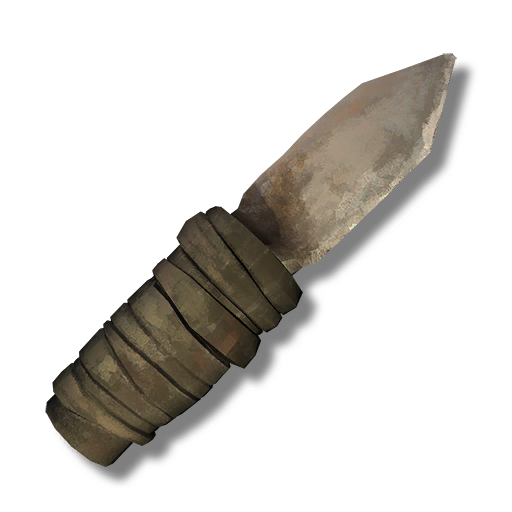

# Hunting

**Contents**

- [Overview](#Overview)
- [Weapons](#Weapons)
- [Hunting Rifle](#Hunting_Rifle)
- [Survival Bow](#Survival_Bow)
- [Revolver](#Revolver)
- [Stones](#Stones)
- [Distress Pistol](#Distress_Pistol)
- [Noisemakers](#Noisemakers)
- [Other Hunting Methods](#Other_Hunting_Methods)
- [Using Tools during a Struggle](#Using_Tools_during_a_Struggle)
- [Trapping](#Trapping)
- [Using Wolves to hunt Prey for you](#Using_Wolves_to_hunt_Prey_for_you)
- [Approach](#Approach)
- [Crouching](#Crouching)
- [Aiming and Shivering](#Aiming_and_Shivering)
- [Hunting the hunters](#Hunting_the_hunters)
- [Baiting and Scent](#Baiting_and_Scent)
- [Wounding](#Wounding)
- [Critical Hits](#Critical_Hits)
- [Graze shots](#Graze_shots)
- [Bleeding](#Bleeding)
- [Tracking](#Tracking)
- [Blood trails](#Blood_trails)
- [Lost contact](#Lost_contact)
- [Carcasses](#Carcasses)
- [Drowning](#Drowning)

<table>
<colgroup>
<col style="width: 33%" />
<col style="width: 33%" />
<col style="width: 33%" />
</colgroup>
<tbody>
<tr>
<td style="vertical-align: top; font-size: 3em; color: #5d5980; padding-right: 10px">
“
</td>
<td>
M - What can you tell me about hunting? 
J - Trick is to spot your target, get as close as you can, take a shot, and don't miss. 
M - That all? 
J - Pretty much. A few years of practice and you might have a clue. 

&#10;

<a href="./Will%20Mackenzie.md" class="wikilink" title="Will Mackenzie">Will Mackenzie</a> and <a href="./Jeremiah.md" class="wikilink" title="Jeremiah">Jeremiah</a> discussing Hunting

</td>
<td style="vertical-align: bottom; font-size: 3em; color: #5d5980; padding-left: 10px">
”
</td>
</tr>
</tbody>
</table>

**Hunting** <a href="./Wildlife.md" class="wikilink" title="Wildlife">Wildlife</a> is the process of searching for, stalking, and killing animals to harvest their flesh/hides and acquire <a href="./Food%20And%20Drink.md" class="wikilink" title="food">food</a> or crafting materials in *<a href="./The%20Long%20Dark.md" class="wikilink" title="The Long Dark">The Long Dark</a>*.

## Overview

Hunting in *The Long Dark* has been greatly simplified by keeping the animals conspicuous. Very little tracking needs to be done to find animals. Furthermore, while the player can see them from a great distance, all animals seem oblivious to anything farther than 30 meters away. Approaching them is rather easy, especially if one is crouching and not carrying any raw meat, which makes the player "visible" from further away. On top of that, certain <a href="./Skills.md" class="wikilink" title="Skills">Skills</a> can increase the damage output of their respective Weapons.

Large animals (<a href="./Deer.md" class="wikilink" title="Deer">Deer</a>, <a href="./Cougar.md" class="wikilink" title="Cougar">Cougar</a>, <a href="./Timberwolf.md" class="wikilink" title="Timberwolf">Timberwolf</a>, <a href="./Wolf.md" class="wikilink" title="Wolf">Wolf</a>, <a href="./Poisoned%20Wolf.md" class="wikilink" title="Poisoned Wolf">Poisoned Wolf</a>, <a href="./Bear.md" class="wikilink" title="Bear">Bear</a>, <a href="./Moose.md" class="wikilink" title="Moose">Moose</a>) have 5 areas of their bodies that calculate damage; Head, Neck, Torso, Hips, Limbs. Critical hits responsible for one-hit kills are a mechanic available on every large animal (the small animals are always one-hit kills).

Unlike actual hunting, aiming for the Torso will often not instantly kill targets, such as aiming for the heart. Shooting limbs does not cripple the mobility of the animal, and they will continue moving at their normal speed. Headshots are the most effective method to kill an animal in one hit, but bleeding will always begin once an animal is struck by an weapon projectile (except for the Moose and Cougar) regardless of where they are hit. Bleeding almost always leads to the eventual death of the animal (exception made for some buggy behaviours on the game's part).

Smaller animals like <a href="./Rabbit.md" class="wikilink" title="Rabbit">Rabbit</a> and <a href="./Ptarmigan.md" class="wikilink" title="Ptarmigan">Ptarmigan</a> die instantly when hit with any large projectile, regardless of where the shot lands. <a href="./Crow.md" class="wikilink" title="Crows">Crows</a> cannot be harmed in any way, due to a lack of collision/hitboxes. Fish cannot be shot under the ice, and only appear as items when <a href="./Ice%20Fishing.md" class="wikilink" title="Ice Fishing">Ice Fishing</a>.

## Weapons

Weapons are defined as <a href="./Tools.md" class="wikilink" title="Tools">Tools</a> that are capable of damaging Wildlife. These items also have their own dedicated space in the Weapons section of the <a href="./Radial%20Menu.md" class="wikilink" title="Radial Menu">Radial Menu</a>.

Shooting animals with projectiles is the most effective way to kill game while completely bypassing the animals' natural defences. Bullets and arrows move too quickly to be blocked or dodged and can be fired from outside the animal's zone of perception. The Cougar is the only exception since, whether intended or not by the developers, its animation cycle includes a choppy weaving and bobbing pattern that allows them to dodge arrows milliseconds before they hit.

Five ranged weapons currently exist in the game: <a href="./Stone.md" class="wikilink" title="Stone">Stone</a>, the <a href="./Hunting%20Rifle.md" class="wikilink" title="Hunting Rifle">Hunting Rifle</a>, the <a href="./Survival%20Bow.md" class="wikilink" title="Survival Bow">Survival Bow</a>, the <a href="./Revolver.md" class="wikilink" title="Revolver">Revolver</a>, and the <a href="./Distress%20Pistol.md" class="wikilink" title="Distress Pistol">Distress Pistol</a>. The Hunting Rifle, Survival Bow and the Revolver all have available weapon variants that have different weight, condition loss, damage output, swaying or stamina loss. Other Tools that can damage wildlife include the <a href="./Noisemaker.md" class="wikilink" title="Noisemaker">Noisemaker</a> and tools normally used for <a href="./Carcass%20Harvesting.md" class="wikilink" title="Carcass Harvesting">Carcass Harvesting</a> or <a href="./Crafting.md" class="wikilink" title="Crafting">Crafting</a> that can be used in a <a href="./Struggle.md" class="wikilink" title="Struggle">Struggle</a>.

### Hunting Rifle

<table class="gallery">
<colgroup>
<col style="width: 25%" />
<col style="width: 25%" />
<col style="width: 25%" />
<col style="width: 25%" />
</colgroup>
<tbody>
<tr>
<td><figure>

<figcaption><a href="./Hunting%20Rifle.md" class="wikilink" title="Hunting Rifle">Hunting Rifle</a></figcaption>
</figure></td>
<td><figure>

<figcaption><a href="./Barb%27s%20Rifle.md" class="wikilink" title="Barb&#39;s Rifle">Barb's Rifle</a></figcaption>
</figure></td>
<td><figure>

<figcaption><a href="./Bunker%20Rifle.md" class="wikilink" title="Bunker Rifle">Bunker Rifle</a></figcaption>
</figure></td>
<td><figure>

<figcaption><a href="./Curator%27s%20Rifle.md" class="wikilink" title="Curator&#39;s Rifle">Curator's Rifle</a></figcaption>
</figure></td>
</tr>
<tr>
<td><figure>

<figcaption><a href="./Vaughn%27s%20Rifle.md" class="wikilink" title="Vaughn&#39;s Rifle">Vaughn's Rifle</a></figcaption>
</figure></td>
<td><figure>

<figcaption><a href="./Hunting%20Lodge%20Rifle.md" class="wikilink" title="Hunting Lodge Rifle">Hunting Lodge Rifle</a> cut weapon</figcaption>
</figure></td>
<td></td>
<td></td>
</tr>
</tbody>
</table>

Rifle sightsThe <a href="./Hunting%20Rifle.md" class="wikilink" title="Hunting Rifle">Hunting Rifle</a> is an offensive tool used to fire <a href="./Rifle%20Ammunition.md" class="wikilink" title="Rifle Ammunition">Rifle Ammunition</a> at targets. The high velocity rounds travel in a straight line and cause massive internal injuries to the first object they encounter, potentially killing animals instantly if aimed at the head. If the round fails to cause internal injuries sufficient enough to kill instantly, the round will still result in a bleeding wound that will kill the animal eventually, just more slowly. Expended rounds will be dropped next to the player as <a href="./Rifle%20Shell%20Casing.md" class="wikilink" title="Rifle Shell Casings">Rifle Shell Casings</a> which can be picked up and used to craft new Rifle Ammunition at an Ammunition Workbench (found exclusively at <a href="./Last%20Resort%20Cannery.md" class="wikilink" title="Last Resort Cannery">Last Resort Cannery</a> in <a href="./Bleak%20Inlet.md" class="wikilink" title="Bleak Inlet">Bleak Inlet</a> and the <a href="./Blackrock%20Prison.md" class="wikilink" title="Blackrock Penitentiary">Blackrock Penitentiary</a> workshop in <a href="./Blackrock.md" class="wikilink" title="Blackrock">Blackrock</a>). In Survival Mode, the effectiveness of a Hunting Rifle is improved by increasing the <a href="./Rifle%20Firearm.md" class="wikilink" title="Rifle Firearm">Rifle Firearm</a> skill.

- Hitting a fleshy target will produce a blood spray effect.
- Hitting a solid target will produce a smoke effect often accompanied with a "clank" sound.
- Hitting most environmental targets will produce a snow scatter effect or wood splinter effect.

### Survival Bow

<table class="gallery">
<colgroup>
<col style="width: 25%" />
<col style="width: 25%" />
<col style="width: 25%" />
<col style="width: 25%" />
</colgroup>
<tbody>
<tr>
<td><figure>

<figcaption><a href="./Survival%20Bow.md" class="wikilink" title="Survival Bow">Survival Bow</a></figcaption>
</figure></td>
<td><figure>

<figcaption><a href="./Woodwright%27s%20Bow.md" class="wikilink" title="Woodwright&#39;s Bow">Woodwright's Bow</a></figcaption>
</figure></td>
<td><figure>

<figcaption><a href="./Sport%20Bow.md" class="wikilink" title="Sport Bow">Sport Bow</a></figcaption>
</figure></td>
<td><figure>

<figcaption><a href="./Bushcraft%20Bow.md" class="wikilink" title="Bushcraft Bow">Bushcraft Bow</a></figcaption>
</figure></td>
</tr>
</tbody>
</table>

The <a href="./Survival%20Bow.md" class="wikilink" title="Survival Bow">Survival Bow</a> is a craftable tool used to launch <a href="./Simple%20Arrow.md" class="wikilink" title="Simple Arrows">Simple Arrows</a>, <a href="./Manufactured%20Arrow.md" class="wikilink" title="Manufactured Arrows">Manufactured Arrows</a> or <a href="./Fire%20Hardened%20Arrow.md" class="wikilink" title="Fire Hardened Arrows">Fire Hardened Arrows</a> at targets. Its variants (<a href="./Woodwright%27s%20Bow.md" class="wikilink" title="Woodwright&#39;s Bow">Woodwright's Bow</a> and <a href="./Sport%20Bow.md" class="wikilink" title="Sport Bow">Sport Bow</a>) cannot be crafted but function the same as an ordinal Survival Bow. Simple Arrows are the only craftable arrow type that can take down Large Animals. Manufactured Arrows deal a lot more damage than Simple Arrows but cannot be crafted and have to be traded with the Trader. They also cannot be harvested for parts used to craft more arrows; once they reach 0% condition and break, the Broken Manufactured Arrows that takes their place is useless. Fire Hardened Arrows are also craftable and useful for killing Rabbits and Ptarmigan, but cannot be used to kill larger animals (they will scare them away if fired at them).

Arrows travel in an arc, so aiming needs to take into account how far away the target is. Arrows can kill animals instantly, but more commonly cause massive bleeding wounds that will drain their health quickly. Arrows are retrievable, however they do take damage each time they hit anything (even missed shots that land in the snow, trees or hit the ice will degrade arrows, with different condition loss amounts for different materials hit):

- Reaching 0% quality breaks the arrow. Aiming at hard targets up close (solid rock, trees, concrete, floors of buildings) will instantly break or severely damage arrows.
- <a href="./Broken%20Arrow.md" class="wikilink" title="Broken Arrows">Broken Arrows</a>, Broken Manufactured Arrows and <a href="./Broken%20Fire%20Hardened%20Arrow.md" class="wikilink" title="Broken Fire Hardened Arrows">Broken Fire Hardened Arrows</a> do not stick to targets, falling instead to the ground where they hit.
- Sighting the bow is a challenge for new players. No hard sight exists, rather one must estimate. The best references for aiming are the arrow tip for elevation and the bottom of the bow for horizontal alignment. This requires a lot of practice and can be done on small game with Fire Hardened Arrows to not damage the more precious arrow types. There are also Archery targets behind the Barn at <a href="./Pleasant%20Valley%20Outbuildings.md" class="wikilink" title="Pleasant Valley Outbuildings">Pleasant Valley Outbuildings</a>.
- Arrows that are stuck in the side of the animal may come loose when they die, and you will find them lying next to them. Arrows are notoriously buggy and will frequently be found floating around the animals, both when they're alive and fleeing and when they drop as a carcass. They can be picked up even when floating in the air around the carcass, but clicking on the carcass will automatically harvest all the arrows and put them in your inventory (there is a known bug where harvesting your Manufactured Arrows using this method will give you the pick-up notification for Simple Arrows instead. Only the notification is bugged, this will still give you your Manufactured Arrows back).

In Survival Mode, the effectiveness of the bow, its swaying and the ability to crouch while aiming are improved by increasing the <a href="./Archery.md" class="wikilink" title="Archery">Archery</a> skill.

### Revolver

<table class="gallery">
<colgroup>
<col style="width: 25%" />
<col style="width: 25%" />
<col style="width: 25%" />
<col style="width: 25%" />
</colgroup>
<tbody>
<tr>
<td><figure>

<figcaption><a href="./Revolver.md" class="wikilink" title="Revolver">Revolver</a></figcaption>
</figure></td>
<td><figure>

<figcaption><a href="./Forester%27s%20Revolver.md" class="wikilink" title="Forester&#39;s Revolver">Forester's Revolver</a></figcaption>
</figure></td>
<td><figure>

<figcaption><a href="./Hunter%27s%20Revolver.md" class="wikilink" title="Hunter&#39;s Revolver">Hunter's Revolver</a></figcaption>
</figure></td>
<td><figure>

<figcaption><a href="./Warden%27s%20Revolver.md" class="wikilink" title="Warden&#39;s Revolver">Warden's Revolver</a></figcaption>
</figure></td>
</tr>
</tbody>
</table>

A handgun that is much lighter than the Hunting Rifle, but its ammunition is much smaller and is useful for more defensive situations, a <a href="./Revolver.md" class="wikilink" title="Revolver">Revolver</a> and its variants (<a href="./Forester%27s%20Revolver.md" class="wikilink" title="Forester&#39;s Revolver">Forester's Revolver</a>, <a href="./Hunter%27s%20Revolver.md" class="wikilink" title="Hunter&#39;s Revolver">Hunter's Revolver</a>, <a href="./Warden%27s%20Revolver.md" class="wikilink" title="Warden&#39;s Revolver">Warden's Revolver</a>) can be used to hunt if desperate enough. While <a href="./Revolver%20Ammunition.md" class="wikilink" title="Revolver Ammunition">Revolver Ammunition</a> is abundant, the Revolver has a much smaller chance to instantly kill wildlife compared to the rifle or bow, regardless of the <a href="./Revolver%20Firearm.md" class="wikilink" title="Revolver Firearm">Revolver Firearm</a> skill level. That said, even a single wound dealt by the revolver will still cause animals to bleed out, but over a longer period of time compared to rifle rounds or arrows. Even head shots do not guarantee a kill when hunting deer and wolves with the Revolver. Using the Revolver as a hunting tool requires patience and tracking.

Killing smaller animals like Rabbits and Ptarmigan can be much easier (albeit a wasteful use of ammunition) due to the fast firing rate. Entire flocks of Ptarmigan can be hunted with good reflexes and aim due to the quick cycling rate of a Revolver compared to a Hunting Rifle however.

### Stones

<table class="gallery">
<colgroup>
<col style="width: 100%" />
</colgroup>
<tbody>
<tr>
<td><figure>

<figcaption><a href="./Stone.md" class="wikilink" title="Stone">Stone</a></figcaption>
</figure></td>
</tr>
</tbody>
</table>

A basic tool that can be found lying around outdoors and in caves, <a href="./Stone.md" class="wikilink" title="Stones">Stones</a> are useful early game tools used to hunt small game, and can be used even in late game to preserve Ammunition for projectile weapons. Its utility for hunting is somewhat limited, however Stones are able to temporarily stun <a href="./Rabbit.md" class="wikilink" title="Rabbits">Rabbits</a> and <a href="./Ptarmigan.md" class="wikilink" title="Ptarmigan">Ptarmigan</a> if the Stone hits their body. The player must then quickly run up and grab the stunned animal where they are given a choice to either release or break its neck. Ptarmigan that are hunted unsuccessfully with Stones will always flee the area and not return for 1-4 days, whereas Rabbits will slowly return to their designated spots after being frightened away.

Stones are unable to injure larger game, but still have some use to alter their behavior. Stones that hit Wolves in the face have a chance to cause the Wolf to flee, while leaving a single blood stain in the snow (This will not be enough to cause extensive bleedout however, even if done repeatedly). Predators will investigate a thrown stone that lands near them, while prey animals will flee. Hunters can use these behaviors to their advantage to distract predators or scare prey into Wolves.

### Distress Pistol

<table class="gallery">
<colgroup>
<col style="width: 100%" />
</colgroup>
<tbody>
<tr>
<td><figure>

<figcaption><a href="./Distress%20Pistol.md" class="wikilink" title="Distress Pistol">Distress Pistol</a></figcaption>
</figure></td>
</tr>
</tbody>
</table>

The lack of proper sights and the low arc of shots fired from this weapon make it a relatively poor choice for a hunting tool. However, if a <a href="./Flare%20Shell.md" class="wikilink" title="Flare Shell">Flare Shell</a> fired from it manages to connect with target wildlife, it will cause wounds that bleed out quickly.

- Because wildlife will always flee from Distress Pistol shots, this makes it a fairly safe choice for hunting dangerous wildlife. Allowing an animal to charge the player and firing right in its face can greatly increase the chance of a successful hit. This is a surprisingly effective method for hunting bears, which provide a large target and suffer from bleeding wounds.
- The greatest disadvantage to using the Distress Pistol is the general rareness of the weapon and its ammunition. Also, the Pistol itself cannot be repaired and Flare Shells are the only projectile that cannot be harvested or crafted.

### Noisemakers

<table class="gallery">
<colgroup>
<col style="width: 100%" />
</colgroup>
<tbody>
<tr>
<td><figure>

<figcaption><a href="./Noisemaker.md" class="wikilink" title="Noisemaker">Noisemaker</a></figcaption>
</figure></td>
</tr>
</tbody>
</table>

An improvised explosive primarily designed to scare hostile wildlife away, <a href="./Noisemaker.md" class="wikilink" title="Noisemakers">Noisemakers</a> make for a very impractical weapon to hunt with (aside from destroying <a href="./Cougar.md" class="wikilink" title="Cougar">Cougar</a> dens).

- Noisemakers will instantly kill small animals like Rabbits and Ptarmigans (even killing a whole Ptarmigan flock if thrown at the right time).
- They do not cause bleedout to large animals, but merely deal a flat damage value instead.
- Larger animals will most likely run away in fear of the explosion, making it harder to chase them down and continue throwing Noisemakers to kill them.
- Using Noisemakers can put the user at risk for <a href="./Burns.md" class="wikilink" title="Burns">Burns</a> and <a href="./Condition.md" class="wikilink" title="Condition">Condition</a> damage if they do not throw the bomb at the right time, or if they throw them while wildlife is too close.
- Noisemakers are hard to produce, with the resources needed to make <a href="./Can%20of%20Gunpowder.md" class="wikilink" title="Can of Gunpowder">Can of Gunpowder</a> being uncommon and the <a href="./Ammunition%20Work%20Bench.md" class="wikilink" title="Ammunition Work Bench">Ammunition Work Bench</a> table being so rare, resulting in a very resource intensive and expensive weapon that often causes more destruction to the user than to would be quarry.

## Other Hunting Methods

### Using Tools during a Struggle

<table class="gallery">
<colgroup>
<col style="width: 100%" />
</colgroup>
<tbody>
<tr>
<td><figure>

<figcaption>Knives can be used to damage a Wolf in a Struggle</figcaption>
</figure></td>
</tr>
</tbody>
</table>

A very dangerous method that can be used to exclusively hunt Wolves is to allow yourself to be attacked by a Wolf (start a <a href="./Struggle.md" class="wikilink" title="Struggle">Struggle</a>) and to use a weapon that can Puncture the beast in order for it to slowly Bleed Out. When a Struggle begins, many Tools normally used for <a href="./Carcass%20Harvesting.md" class="wikilink" title="Carcass Harvesting">Carcass Harvesting</a> or other uses can be used to damage a Wolf as the Struggle is ongoing. Be aware that using Struggles to hunt carries a high risk of Death and Afflictions, including <a href="./Torn%20Clothing.md" class="wikilink" title="Torn Clothing">Torn Clothing</a>, <a href="./Blood%20Loss.md" class="wikilink" title="Blood Loss">Blood Loss</a>, <a href="./Infection%20Risk.md" class="wikilink" title="Infection Risk">Infection Risk</a>, <a href="./Sprained%20Ankle.md" class="wikilink" title="Sprained Ankle">Sprained Ankle</a>, <a href="./Sprained%20Wrist.md" class="wikilink" title="Sprained Wrist">Sprained Wrist</a>, <a href="./Pain.md" class="wikilink" title="Pain">Pain</a>, and loss of Condition. Higher difficulties will almost certainly result in the player dying from MASSIVE Condition loss by using this method if their Condition is below 80% when a Struggle begins. Using this method also degrades Tool Condition.

Weapon damage is divided into 5 categories: Desperation, Puncture, Slash, Scare, and Strike:

- Desperation is the default method of attacking a Wolf without tools, and does very poor damage per second, often resulting in the player's death.
- Puncture can be used almost exclusively to cause a Wolf to bleed out after the Struggle is successful, albeit causing the Struggle to last longer.
- Slashing wounds the Wolf but does not cause it to bleed out.
- Scare does less damage to the Wolf, but has a high chance of causing it to flee faster.
- Strike is when the survivor uses the barrel of a Revolver to strike the Wolf. Eventually, they get their hand on the trigger and the "Take Shot" option appears to shoot the Wolf. This can result in two outcomes: it instantly kills the Wolf or just scares it off while causing it to bleed.

<table style="width:100%;">
<colgroup>
<col style="width: 14%" />
<col style="width: 14%" />
<col style="width: 14%" />
<col style="width: 14%" />
<col style="width: 14%" />
<col style="width: 14%" />
<col style="width: 14%" />
</colgroup>
<thead>
<tr>
<th>
Image
</th>
<th>
Weapon
</th>
<th>
Damage Type
</th>
<th>
Damage<a href="#fn1" class="footnote-ref" id="fnref1" role="doc-noteref">1</a>
</th>
<th>
Flee Chance<a href="#fn2" class="footnote-ref" id="fnref2" role="doc-noteref">2</a>
</th>
<th>
Puncture Bleedout
</th>
<th>
Tool Decay
</th>
</tr>
</thead>
<tbody>
<tr>
<td><figure>

<figcaption>Anywhere_icon.png</figcaption>
</figure></td>
<td>
Bare Hands
</td>
<td>
Desperation
</td>
<td>
0.00%
</td>
<td>
1.00%
</td>
<td>
None
</td>
<td>
None
</td>
</tr>
<tr>
<td><figure>

<figcaption>Hunting_Knife_icon.png</figcaption>
</figure></td>
<td>
<a href="./Hunting%20Knife.md" class="wikilink" title="Hunting Knife">Hunting Knife</a>
</td>
<td>
Puncture
</td>
<td>
3.00%
</td>
<td>
1.30%
</td>
<td>
12 min
</td>
<td>
High
</td>
</tr>
<tr>
<td><figure>

<figcaption>Improvised_Knife_icon.png</figcaption>
</figure></td>
<td>
<a href="./Improvised%20Knife.md" class="wikilink" title="Improvised Knife">Improvised Knife</a>
</td>
<td>
Puncture
</td>
<td>
2.00%
</td>
<td>
1.30%
</td>
<td>
20 min
</td>
<td>
Very High
</td>
</tr>
<tr>
<td><figure>

<figcaption>Scrap_Metal_Shard_icon.png</figcaption>
</figure></td>
<td>
<a href="./Scrap%20Metal%20Shard.md" class="wikilink" title="Scrap Metal Shard">Scrap Metal Shard</a>
</td>
<td>
Puncture
</td>
<td>
3.00%
</td>
<td>
1.30%
</td>
<td>
N/A
</td>
<td>
N/A
</td>
</tr>
<tr>
<td><figure>

<figcaption>Jeremiah's_Knife_icon.png</figcaption>
</figure></td>
<td>
<a href="./Jeremiah%27s%20Knife.md" class="wikilink" title="Jeremiah&#39;s Knife">Jeremiah's Knife</a>
</td>
<td>
Puncture
</td>
<td>
3.00%
</td>
<td>
1.30%
</td>
<td>
N/A
</td>
<td>
N/A
</td>
</tr>
<tr>
<td><figure>

<figcaption>Cougar_Claw_Knife_icon.png</figcaption>
</figure></td>
<td>
<a href="./Cougar%20Claw%20Knife.md" class="wikilink" title="Cougar Claw Knife">Cougar Claw Knife</a>
</td>
<td>
Puncture
</td>
<td>
4.00%
</td>
<td>
1.30%
</td>
<td>
10 min
</td>
<td>
Low
</td>
</tr>
<tr>
<td><figure>

<figcaption>Survival_Knife_icon.png</figcaption>
</figure></td>
<td>
<a href="./Survival%20Knife.md" class="wikilink" title="Survival Knife">Survival Knife</a>
</td>
<td>
Puncture
</td>
<td></td>
<td></td>
<td></td>
<td></td>
</tr>
<tr>
<td><figure>

<figcaption>Hatchet_icon.png</figcaption>
</figure></td>
<td>
<a href="./Hatchet.md" class="wikilink" title="Hatchet">Hatchet</a>
</td>
<td>
Slashing
</td>
<td>
4.00%
</td>
<td>
1.50%
</td>
<td>
30 min
</td>
<td>
High
</td>
</tr>
<tr>
<td><figure>

<figcaption>Improvised_Hatchet_icon.png</figcaption>
</figure></td>
<td>
<a href="./Improvised%20Hatchet.md" class="wikilink" title="Improvised Hatchet">Improvised Hatchet</a>
</td>
<td>
Slashing
</td>
<td>
3.00%
</td>
<td>
1.25%
</td>
<td>
40 min
</td>
<td>
Very High
</td>
</tr>
<tr>
<td><figure>

<figcaption>Prybar_icon.png</figcaption>
</figure></td>
<td>
<a href="./Prybar.md" class="wikilink" title="Prybar">Prybar</a>
</td>
<td>
Scare
</td>
<td>
1.25%
</td>
<td>
1.50%
</td>
<td>
None
</td>
<td>
Medium
</td>
</tr>
<tr>
<td><figure>

<figcaption>Heavy_Hammer_icon.png</figcaption>
</figure></td>
<td>
<a href="./Heavy%20Hammer.md" class="wikilink" title="Heavy Hammer">Heavy Hammer</a>
</td>
<td>
Scare
</td>
<td>
2.00%
</td>
<td>
4.00%
</td>
<td>
None
</td>
<td>
Very Low
</td>
</tr>
<tr>
<td><figure>

<figcaption>Revolver_icon.png</figcaption>
</figure></td>
<td>
<a href="./Revolver.md" class="wikilink" title="Revolver">Revolver</a><a href="#fn3" class="footnote-ref" id="fnref3" role="doc-noteref">3</a>
</td>
<td>
Strike
</td>
<td>
1.00%
</td>
<td>
1.00%
</td>
<td>
None
</td>
<td>
Low
</td>
</tr>
<tr>
<td><figure>

<figcaption>Forester's_Revolver_icon.png</figcaption>
</figure></td>
<td>
<a href="./Forester%27s%20Revolver.md" class="wikilink" title="Forester&#39;s Revolver">Forester's Revolver</a><a href="#fn4" class="footnote-ref" id="fnref4" role="doc-noteref">4</a>
</td>
<td>
Strike
</td>
<td>
1.00%
</td>
<td>
1.00%
</td>
<td>
None
</td>
<td>
Low
</td>
</tr>
<tr>
<td><figure>

<figcaption>Hunter's_Revolver_icon.png</figcaption>
</figure></td>
<td>
<a href="./Hunter%27s%20Revolver.md" class="wikilink" title="Hunter&#39;s Revolver">Hunter's Revolver</a><a href="#fn5" class="footnote-ref" id="fnref5" role="doc-noteref">5</a>
</td>
<td>
Strike
</td>
<td>
1.00%
</td>
<td>
1.00%
</td>
<td>
None
</td>
<td>
Low
</td>
</tr>
<tr>
<td><figure>

<figcaption>Warden's_Revolver_icon.png</figcaption>
</figure></td>
<td>
<a href="./Warden%27s%20Revolver.md" class="wikilink" title="Warden&#39;s Revolver">Warden's Revolver</a><a href="#fn6" class="footnote-ref" id="fnref6" role="doc-noteref">6</a>
</td>
<td>
Strike
</td>
<td>
1.00%
</td>
<td>
1.00%
</td>
<td>
None
</td>
<td>
Low
</td>
</tr>
</tbody>
</table>
<section id="footnotes" class="footnotes footnotes-end-of-document" role="doc-endnotes">

<ol>
<li id="fn1">Per hit<a href="#fnref1" class="footnote-back" role="doc-backlink">↩︎</a></li>
<li id="fn2">Per hit<a href="#fnref2" class="footnote-back" role="doc-backlink">↩︎</a></li>
<li id="fn3">Struggle is guaranteed to end after "Take Shot" is chosen (70% to flee, 30% to kill)<a href="#fnref3" class="footnote-back" role="doc-backlink">↩︎</a></li>
<li id="fn4"></li>
<li id="fn5"></li>
<li id="fn6"></li>
</ol>
</section>

Knives with the Puncture type will lead a Wolf to bleed after the Struggle, cause it to constantly flee and run around until its movements slows down, eventually causing it to die. The Heavy Hammer and the Cougar Claw Knife in particular are well known for causing high amounts of damage, usually killing the Wolf during the Struggle before the bar is full. Revolvers can either kill or scare the Wolf off of you, but are more unreliable methods of killing a Wolf during a Struggle. Other tools generally do not hurt Wolves as badly as Knives and the Heavy Hammer (affectionately nicknamed "Wolf Bonker" by players).

### Trapping

<table class="gallery">
<colgroup>
<col style="width: 50%" />
<col style="width: 50%" />
</colgroup>
<tbody>
<tr>
<td><figure>

<figcaption><a href="./Snare.md" class="wikilink" title="Snare">Snare</a></figcaption>
</figure></td>
<td><figure>

<figcaption><a href="./Fishing%20Tip-Up.md" class="wikilink" title="Fishing Tip-Up">Fishing Tip-Up</a></figcaption>
</figure></td>
</tr>
</tbody>
</table>

<a href="./Trapping.md" class="wikilink" title="Trapping">Trapping</a> is a passive form of Hunting that involves placing traps to catch small animals. Trapping has its own dedicated page for how to use Snares and Fishing Tip-Ups.

### Using Wolves to hunt Prey for you

<table class="gallery">
<colgroup>
<col style="width: 33%" />
<col style="width: 33%" />
<col style="width: 33%" />
</colgroup>
<tbody>
<tr>
<td><figure>

<figcaption>A Wolf after hunting a Ptarmigan</figcaption>
</figure></td>
<td><figure>
[Missing image: Wolf_feeding_on_deer.jpg]
<figcaption>A Wolf after hunting a Deer</figcaption>
</figure></td>
<td><figure>
[Missing image: Wolf_pursuit.jpg]
<figcaption>A Wolf chasing a Rabbit</figcaption>
</figure></td>
</tr>
</tbody>
</table>

The ordinarily dangerous <a href="./Wolf.md" class="wikilink" title="Wolf">Wolf</a> can be used to hunt Prey animals for you with enough cunning and planning. Scaring Prey Wildlife into running into the direction of a nearby Wolf will cause the Wolf to stalk and charge the Prey animal. If prey is far away the wolf could be guided towards the prey by grabbing its attention and walking it towards the area of the prey, then crouching. Once the Wolf catches up, the Prey animal instantly dies and the Wolf will begin feeding on it. From here, coming close and aiming a weapon (Stone, Rifle, Revolver, etc) will cause the Wolf to flee, allowing the Carcass to be Harvested. Some meat will be consumed by the Wolf during the process, with more meat being lost the longer you wait to scare the Wolf off of the Carcass.

This tactic can also be used as a distraction when walking through a dangerous area, as Wolves will ignore you and instead hunt Prey animals you lure to them. Be aware that this will only works if there are enough Prey animals per Wolf, as larger Wolf packs will individually attack a Prey animal, while the rest follow you. Note that intact <a href="./Timberwolf.md" class="wikilink" title="Timberwolf">Timberwolf</a> packs ignore any Prey they catch once they gain sight of you, and will begin a pack attack.

## Approach

Some animals run, others are attracted to you. Various methods exist for approaching each type of intended game. See the specific animal pages for preferred methods to hunt each.

### Crouching

Crouching allows the player to move more quietly and less visibly, decreasing the animal's ability to detect them. Remaining still while crouching further reduces detection, allowing a player to get very close to intended game.

- Only firearms and stones can be used from the crouching position without Survival Skill Bonuses. To shoot the bow while crouching, you must have a Survival Skill level of 5 in Archery. To attain level 5 Archery, you must reach 150 points. Archery points are increased by scoring a hit on an animal or by crafting arrows.
- Without being Level 5 in Archery, you must first stand up to draw and loose the arrow - potentially alerting your prey and necessitating a rushing of the aiming process.

### Aiming and Shivering

<table>
<colgroup>
<col style="width: 33%" />
<col style="width: 33%" />
<col style="width: 33%" />
</colgroup>
<tbody>
<tr>
<td style="vertical-align: top; font-size: 3em; color: #5d5980; padding-right: 10px">
“
</td>
<td>
When using a Rifle, a Revolver, or a Distress Pistol, cold temperatures can cause Shivering, affecting your aim.

&#10;

<a href="./Load%20Screen.md" class="wikilink" title="Load Screen">Load Screen</a> Description

</td>
<td style="vertical-align: bottom; font-size: 3em; color: #5d5980; padding-left: 10px">
”
</td>
</tr>
</tbody>
</table>

Most weapons cannot be used unless the player aims down sights. Aiming uses <a href="./Stamina.md" class="wikilink" title="Stamina">Stamina</a> and displays an aiming meter in the bottom right corner. The lower the survivor's <a href="./Fatigue.md" class="wikilink" title="Fatigue">Fatigue</a>, the less time the player has to aim their weapon. If the player's <a href="./Warmth.md" class="wikilink" title="Warmth">Warmth</a> reaches 0, the survivor will begin to shiver uncontrollably, and this will negatively effect the player's aim. Raising Warmth to above 0 will remove the shivering effect.

Stones, Noisemakers, and Revolvers can be "fired" without having to aim down sights.

### Hunting the hunters

Predators may decide to pursue a player that intends to hunt them. This trait can be used against them, to lure them into traps and ambushes or draw them close for an easy kill. Carrying items that give off <a href="./Scent.md" class="wikilink" title="Scent">Scent</a> will draw predators to the player. By manipulating scent while crouching, it is possible to line up ideal shots, while the tracking animal remains oblivious. Predators can also be moved into a better position by throwing stones, which they will investigate if they can't see the player.

If the predator begins its charge, it will quickly be on top of the player unless they have taken steps to prevent it, or they get one powerful shot properly connected with this rapidly moving target. Bait can be used to escape predators before they charge, but afterward there are fewer options. Predators will never directly cross a <a href="./Campfire.md" class="wikilink" title="Campfire">Campfire</a> and will usually be kept at bay if one is between them and the player. The will also turn and flee if they can't find a path to the player (e.g. the player has climbed a narrow tree limb or ledge).

Be aware that <a href="./Bear.md" class="wikilink" title="bears">bears</a> may withstand more than one bullet/arrow that hits their head, while <a href="./Wolf.md" class="wikilink" title="wolves">wolves</a> and <a href="./Timberwolf.md" class="wikilink" title="timberwolves">timberwolves</a> drop dead instantly, if a head shot is scored.

<a href="./Moose.md" class="wikilink" title="Moose">Moose</a> behave more defensively and will not stalk players, but they are incredibly territorial and aggressive. They can survive more than one shot to the head, and will not bleed out, requiring multiple rounds from any weapon.

### Baiting and Scent

As mentioned before, <a href="./Scent.md#Baiting%2FDecoys" class="wikilink" title="Baiting">Baiting</a> can be used to escape predators before they charge, but it can also be used to draw predators to your location. Raw meat and fish is always the best item to use for Baiting, as Cooked meat gives off less odor. Bears in particular will travel the entire lengths of the map to your location (even leaving their normal dedicated stomping grounds to investigate the smell) if a sufficient quantity of "Decoys" are dropped onto the ground or the player's <a href="./Scent.md" class="wikilink" title="Scent">Scent</a> is at maximum. This can be a very time consuming venture to wait for a bear to come for you however, given the very slow walking speed of a bear.

Wolves on the other hand will very quickly detect the player with high enough Scent or if Decoys are placed nearby, picking up speed and switching into their "investigating" behavior, luring them straight towards you. Prey Wildlife is always uninterested in Baiting tactics however.

## Wounding

It is possible to kill any animal with one shot, a mechanic called a "Critical Hit". Critical hits are random occurrences, and are more likely in an animal's designated critical areas. Hitting an animal but not immediately killing it still means that animal has a bleeding wound. A bleeding animal will always die if given enough time for its wound to finish bleeding.

### Critical Hits

Animals have five core hitbox areas, the head, neck, the front shoulder and chest, the hindquarters, and their legs. Shots to the head and neck have the best chance to cause a critical hit, with shots to the front shoulder and chest being second. Shots to the feet seem to be immune to critical hits.

Below is an example of the Critical Hit chance for a <a href="./Wolf.md" class="wikilink" title="Wolf">Wolf</a>.

<table style="width:100%;">
<colgroup>
<col style="width: 14%" />
<col style="width: 14%" />
<col style="width: 14%" />
<col style="width: 14%" />
<col style="width: 14%" />
<col style="width: 14%" />
<col style="width: 14%" />
</colgroup>
<thead>
<tr>
<th colspan="2">
Weapon
</th>
<th colspan="5">
Critical Hit Chance
</th>
</tr>
</thead>
<tbody>
<tr>
<td>
Head
</td>
<td>
Neck
</td>
<td>
Torso
</td>
<td>
Hips
</td>
<td>
Limb
</td>
<td></td>
<td></td>
</tr>
<tr>
<td><figure>

<figcaption>Hunting_Rifle_icon.png</figcaption>
</figure></td>
<td>
<a href="./Hunting%20Rifle.md" class="wikilink" title="Hunting Rifle">Hunting Rifle</a>
</td>
<td rowspan="3">
Guaranteed
</td>
<td rowspan="3">
Guaranteed
</td>
<td rowspan="3">
33%
</td>
<td rowspan="3">
10%
</td>
<td rowspan="3">
10%
</td>
</tr>
<tr>
<td><figure>

<figcaption>Distress_Pistol_icon.png</figcaption>
</figure></td>
<td>
<a href="./Distress%20Pistol.md" class="wikilink" title="Distress Pistol">Distress Pistol</a>
</td>
</tr>
<tr>
<td><figure>

<figcaption>Survival_Bow_icon.png</figcaption>
</figure></td>
<td>
<a href="./Survival%20Bow.md" class="wikilink" title="Survival Bow">Survival Bow</a>
</td>
</tr>
<tr>
<td><figure>

<figcaption>Revolver_icon.png</figcaption>
</figure></td>
<td>
<a href="./Revolver.md" class="wikilink" title="Revolver">Revolver</a>
</td>
<td>
40%
</td>
<td>
20%
</td>
<td>
15%
</td>
<td>
5%
</td>
<td>
5%
</td>
</tr>
</tbody>
</table>

### Graze shots

Shots that only catch the very outside of an animals silhouette may only graze its skin. Such grazing shots will produce a blood spatter on impact and an audible body hit, but seemingly do not injure the animal at all, there will be no blood on the ground at the point of impact and no blood trail. Additionally, bouncing an arrow off terrain that then hits an animal may produce the body hit noise, but again, the animal feels no effect.

### Bleeding

  
*Main article: <a href="./Hunting%20Rifle.md#Bleed_out_time" class="wikilink" title="Hunting rifle#Bleed out time">Hunting rifle#Bleed out time</a>*

<!-- -->

  
*Main article: <a href="./Survival%20Bow.md#Bleed_out_time" class="wikilink" title="Survival bow#Bleed out time">Survival bow#Bleed out time</a>*

Blood trail Other than grazing shots, all hits will cause bleeding wounds that will eventually kill the animal (<a href="./Moose.md" class="wikilink" title="moose">moose</a> and <a href="./Cougar.md" class="wikilink" title="cougar">cougar</a> excluded). Animals will bleed out according to which area they were shot in last. Bleeding wounds do not stack, meaning that multiple shots to the same area will not reduce bleed-out time. However, shooting an animal in an area of higher blood loss will override a previous shot in a lower blood loss area. The reverse is also true, making it unnecessary to fire at a fleeing animal that has a head wound since it has the fastest bleed out time. <a href="./Moose.md" class="wikilink" title="Moose">Moose</a> and <a href="./Cougar.md" class="wikilink" title="Cougar">Cougar</a> do not bleed out and may require multiple shots to kill them.

The bleed-out timers above elapse even while performing time-accelerated activities. This means that after wounding an animal, you can simply use 'Pass time' via the 'Campcraft' menu to accelerate its death relative to real time, but the animal will also move at an accelerated speed.

## Tracking

\[Missing image: Tracking_wounded_wolf.jpg\]Tracking is fairly straightforward when the animal chooses to run away. Blood drops will fall along its path for you to follow. The wounded animal is also still quite obvious against its background of snow. And animals tend to run in straight lines unless they are blocked. So following them visually is fairly easy, too. Sprinting can keep pace with all but the bear. Use your limited speed boost to keep your quarry in sight. Also when wounded, bears may charge back at you randomly, making tracking difficult sometimes.

### Blood trails

Blood trails are temporary and will fade. Snow and wind increase the rate of fade. Fading trails may seem to disappear as the spot in front of you vanishes then you turn around and there are no longer any spots behind either. Actually, there are spots still ahead of you rapidly disappearing, too. But if you are not running faster than the animal that dropped them, you will never catch up to the fade point to see that.

- Presently animals only bleed onto the ground when they are running away. When they charge or go back to walking, blood will not appear on the ground. They are however still bleeding and will eventually die. Blood drops will again appear if the animal is encouraged to run away (gunshot, throw a lit flare at it, close missed shot with an arrow).

### Lost contact

If an animal successfully outruns you far enough to where you lose contact with it, it can stop running and return to a walking pace. Typically, these animals will be found returning along the same path they just fled along as they try to get back to their correct positions in the world.

### Carcasses

Bleeding animals will eventually drop dead, regardless of whether the player is there to see it or not. Finding the carcass can be difficult if contact was lost as they fled. Carcasses no longer move about and do not leave a trail, so spotting some may be difficult; however, if the player suspects their prey died in a certain area, using charcoal to map that area will reveal the location of the carcass if the player is close enough (mapping from an elevated position helps greatly with this). Players should take advantage of elevated spots to look down into low areas. Search every side of obstacles, and look for <a href="./Crow.md" class="wikilink" title="crows">crows</a> circling over an area. Carcasses will begin to freeze and meat will begin to decay the moment the animal dies. If left alone, a carcass will disappear after a few days. Frozen carcasses can be thawed by placing campfires near them, reducing the amount of time it takes to harvest meat.

## Drowning

In some areas (e.g. <a href="./Coastal%20Highway.md" class="wikilink" title="Coastal Highway">Coastal Highway</a> or <a href="./Desolation%20Point.md" class="wikilink" title="Desolation Point">Desolation Point</a>) the Rabbits, Deer and Wolves can be directed towards the water. While hunting on the open ice is easier due to the even ground, attention is advised if they get too close to the water. If they run out too far, that animal will simply disappear, probably because of it drowning, resulting in the effort (and maybe a few arrows) going down the drain. If unlucky, deer and wolves may die on the <a href="./Weak%20Ice.md" class="wikilink" title="Weak Ice">Weak Ice</a>, so that the player can't harvest the carcasses without risking falling through the Ice.

**Lua execution error in Module:Navbox function navbox**

## Notes

