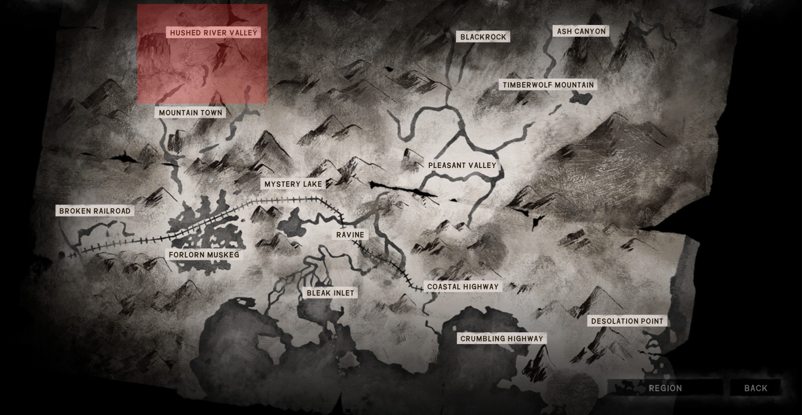
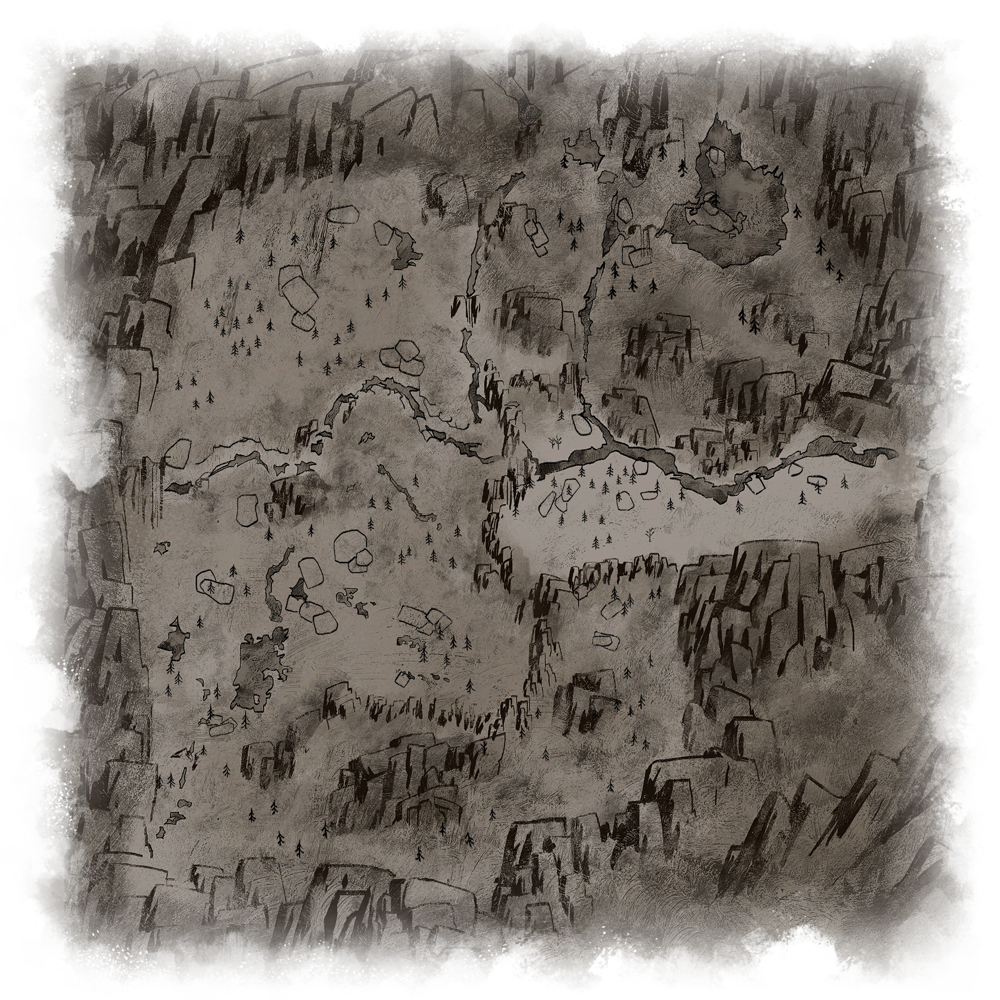
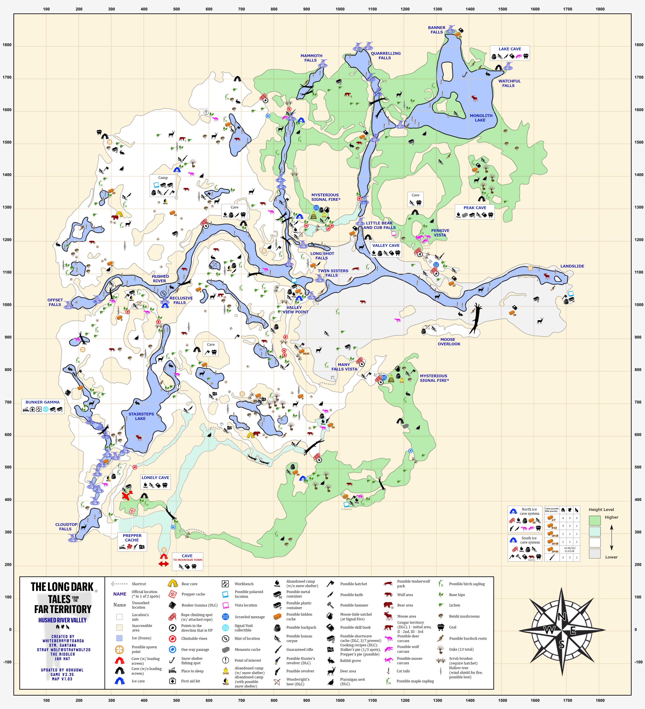
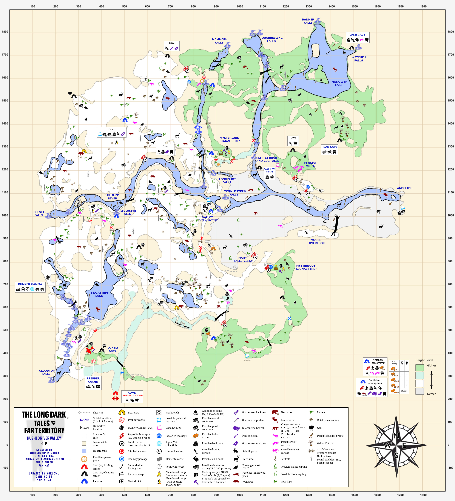
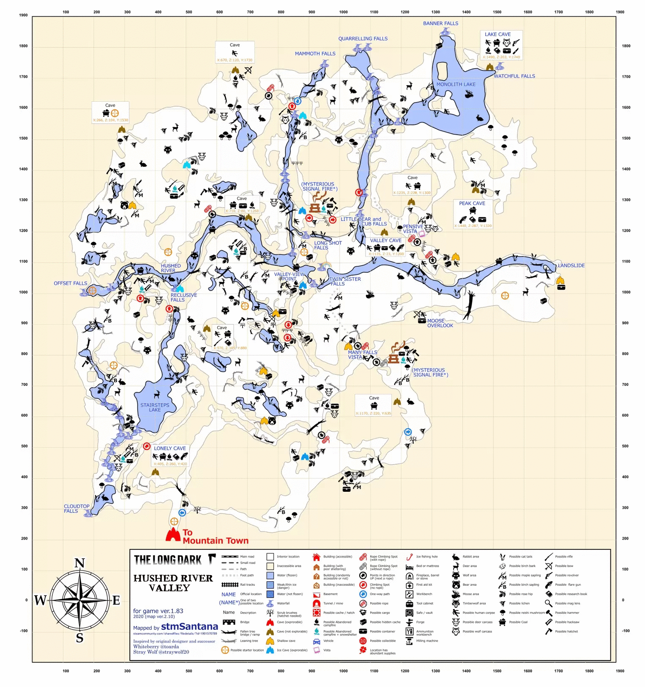
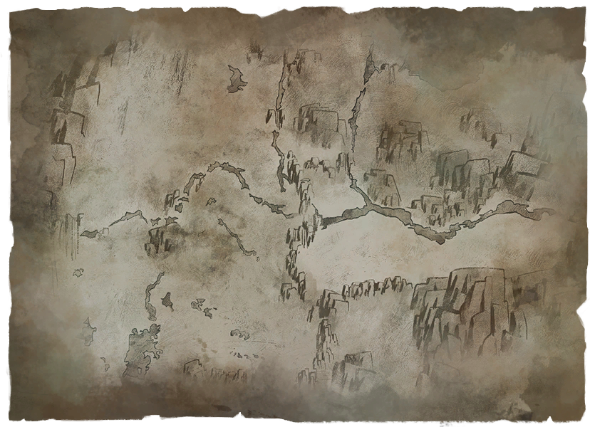
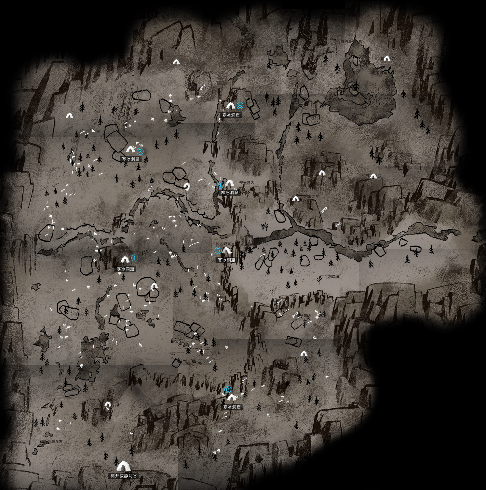
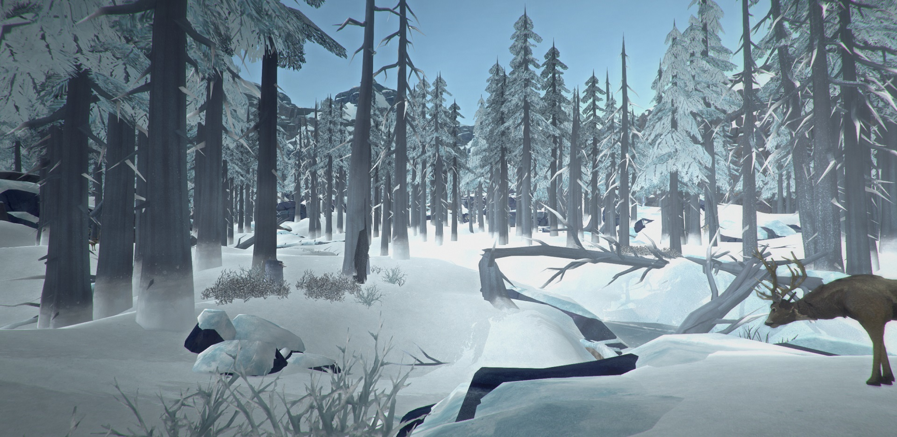
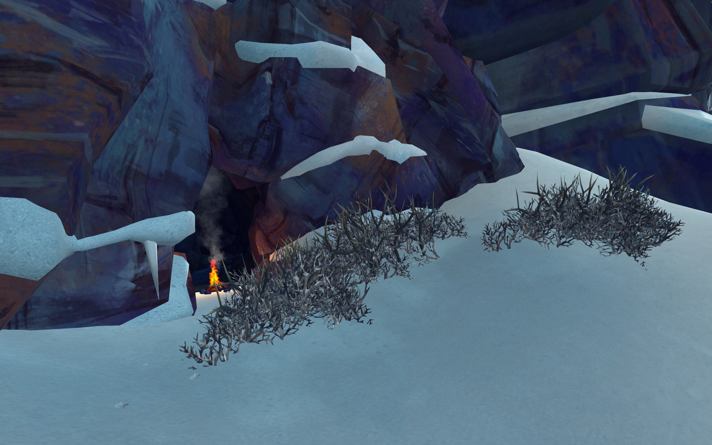
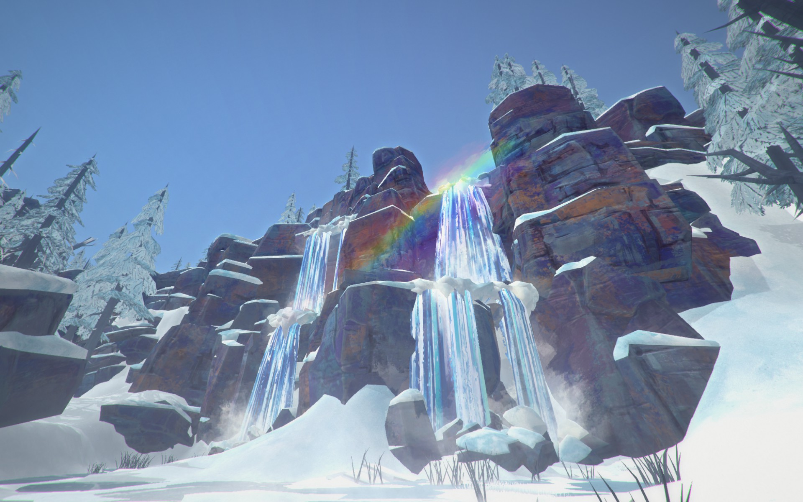

# Hushed River Valley

**Categories:** Regions · **Source:** [Fandom](https://thelongdark.fandom.com/wiki/Hushed_River_Valley)

**Contents**

- [Survivability](#survivability)
- [Description](#description)
- [Western area](#western-area)
- [Lower valley](#lower-valley)
- [Monolith Lake and area](#monolith-lake-and-area)
- [High plateau](#high-plateau)
- [Base camp](#base-camp)
- [Ice caves](#ice-caves)
- [Notable loot](#notable-loot)
- [Hidden caches](#hidden-caches)
- [Distress Pistol](#distress-pistol)
- [Moose-hide satchel](#moose-hide-satchel)
- [Heavy Hammer](#heavy-hammer)
- [Mackinaw Jacket](#mackinaw-jacket)
- [Woodwright's Bow](#woodwrights-bow)
- [Locations](#locations)
- [Trivia](#trivia)
- [Maps](#maps)
- [Gallery](#gallery)
- [Reference](#reference)

**Hushed River Valley**

\[\[File: /  / _Hushed\_River\_Valley\_title\_card.png_

250px\]\]

**Location on [Great Bear Island](./Great%20Bear%20Island.md)**

_Hushed\_River\_Valley\_Location.png_

_Hushed\_River\_Valley\_Region\_Map.png_

**Details**

**Description:** A wilderness almost untouched by human hands, filled with deep valleys and steep cliff walls.

**Connecting Regions:** [Mountain Town](./Mountain%20Town.md)

**Characters:** None

**Difficulty:** Advanced

**Interloper Region Spawn:** Yes

**Locations:** 25

**Hazards and Survivability:** Lots of wind with limited shelter from weather and wildlife.

**Date Added:** 14 June 2018

> “**For advanced players. A remote, wind-blown valley known for its sheer cliffs, dense forests, and steep, winding paths. Although devoid of human settlements, it has long been a destination for the area's toughest mountaineers, and may still have a few secrets to reveal.**”
>
> — - In game description

**Hushed River Valley**is the 9th [Region](./Region.md) added to the game, as a part of the [Vigilant Flame](./The%20Long%20Dark%20%E2%80%94%20Changelog%20%E2%80%94%20Archive%201.md#1.33_%28Vigilant_Flame_Update%29) update. The region connects to [Mountain Town](./Mountain%20Town.md) via a cave that runs from an area between the [Trailer](./Trailer%20%28Mountain%20Town%20Region%29.md) and [Spruce Falls Bridge](./Spruce%20Falls%20Bridge.md) to a ridge top in the valley.

Geographically, the river valley is defined by steep cliffs and canyons; the lowest point lies in the middle of the region, with higher altitudes toward the edges of the map. The central valley features several waterfalls, and there are a few snow shelters that may spawn at higher elevation points (e.g., near the cave that connects to [Mountain Town](./Mountain%20Town.md)).

## Survivability

Although not the coldest region on Great Bear, the Hushed River Valley is quite chilly, making [campfires](./Campfire.md) necessary to avoid freezing, especially during night-time blizzards. Due to the lack of human-made structures, mass produced clothing, food, and tools are sparse; typically only found in [hidden caches](./Hidden%20Cache.md) scattered throughout the region, inside the region's many caves, or near abandoned campsites. Since the inclusion of [Bleak Inlet](./Bleak%20Inlet.md) and [Ash Canyon](./Ash%20Canyon.md), this is no longer the only region to have hidden caches in [Survival Mode](./Survival%20Mode.md), though it still contains the greatest number of them.

The lack of even natural [bedding](./Bed.md) means that having a [Bedroll](./Bedroll.md) is a virtual necessity for anyone wishing to explore the region, although at least one bedroll will spawn somewhere in the region, even on Interloper. One [prepper cache](./Prepper%20Cache.md) spawns at a fixed location in the region on the high plateau, offering a bed but requiring a rope climb to the plateau. For players who do not own [Tales](./Tales%20from%20the%20Far%20Territory.md), this is the only location which can be edited using [Safehouse Customization](./Safehouse%20Customization.md), allowing the creation of a [work bench](./Work%20Bench.md). [Bunker Gamma](./Bunker%20Gamma.md) is also equipped with beds and a [work bench](./Work%20Bench.md), though it is only available to players who have the [Tales from the Far Territory](./Tales%20from%20the%20Far%20Territory.md) DLC installed.

The lack of encroachment by civilization seems to have allowed local flora and fauna to flourish. Animal and plant life are abundant, so opportunities for hunting, scavenging, and foraging natural foods and supplies such as [rose hips](./Rose%20Hip.md) are relatively common. However, in that same vein, many predators also stalk the region. It's also the region that is most likely to spawn a [moose](./Moose.md).

## Description

In a rough sense, the Hushed River Valley can be divided into four smaller areas. Travel between these areas requires the use of [mountaineering ropes](./Mountaineering%20Rope.md).

### Western area

This is the largest area of the region, and is where the player will first enter the Hushed River Valley from [Mountain Town](./Mountain%20Town.md). Four of the five possible player spawns are located here too. Notable landmarks include [Cloudtop Falls](./Cloudtop%20Falls.md), located a short distance west of the entrance cave and [Stairsteps Lake](./Stairsteps%20Lake.md), located a short distance north of Cloudtop Falls. The [Hushed River](./Hushed%20River.md) cuts this roughly in half, and can only be reached by climbing down logs or from its westernmost end near [Offset Falls](./Offset%20Falls.md). A rope can also be used to climb up and down the northern bank of the river. Halfway down the river lie the [Reclusive Falls](./Reclusive%20Falls.md), through which the player will have to pass to enter one of the [ice caves](./Ice%20Cave.md) (getting soaked in the process). Finally, the player can enjoy a panoramic view of much of the region from [Valley View Point](./Valley%20View%20Point.md), near the east of this area on the south bank of the Hushed River.

In addition to the [ice caves](./Ice%20Cave.md), there are multiple smaller caves that can serve as shelters. One is located to the northeast of [Stairsteps Lake](./Stairsteps%20Lake.md), another along the [Hushed River](./Hushed%20River.md), and two located on the northwestern and northern cliffs of the area.

While this area boasts the most resources, plentiful shelter, and excellent hunting and trapping opportunities, it is likely the most dangerous, with multiple [wolf](./Wolf.md) spawning locations scattered throughout, along with up to two [bears](./Bear.md), so caution is advised, especially given the general lack of ammunition spawns in the region.

### Lower valley

This area is the lowest part of the Hushed River Valley, and is located towards the eastern part of the region, encompassing [Little Bear and Cub Falls](./Little%20Bear%20and%20Cub%20Falls.md), [Twin Sisters Falls](./Twin%20Sisters%20Falls.md), [Long Shot Falls](./Long%20Shot%20Falls.md), [the Landslide](./Landslide%20%28Hushed%20River%20Valley%29.md), [Moose Overlook](./Moose%20Overlook.md), and [Valley Cave](./Valley%20Cave.md). It is possible to spawn in here a short distance west of the Landslide. In order to enter or leave this area, a rather long rope climb from either [Pensive Vista](./Pensive%20Vista.md) or [Many Falls Vista](./Many%20Falls%20Vista.md) is required.

Most players in this area will end up using Valley Cave as their base of operations, as it is the only decent shelter. A [distress pistol](./Distress%20Pistol.md) can sometimes spawn here, and a [hunting rifle](./Hunting%20Rifle.md) can sometimes be found next to a corpse located not far to the west.

No bears will spawn here, and there are abundant [deer](./Deer.md) hunting opportunities, along with a rabbit grove for snaring, and lots of [cattails](./Cat%20Tail.md) for food or tinder. The [moose](./Moose.md) located near the Landslide can be hunted, providing a good source of food and a hide, easily cured in Valley Cave.

The area is relatively free from predators and offers great foraging, [deer](./Deer.md) hunting opportunities, but occasionally, one [wolf](./Wolf.md) or even a pack of [timberwolves](./Timberwolf.md) may spawn a short distance west of Valley Cave.

One special precaution that must be taken when exploring this area is to bring along a [bedroll](./Bedroll.md), as there is no guarantee that one will spawn. If players become exhausted and have no way to refill their fatigue, they will become trapped and unable to climb out. This is especially problematic if the player got [Broken Ribs](./Broken%20Ribs.md) from a moose struggle, which will make it impossible to leave the area without the use of an [emergency stim](./Emergency%20Stim.md).

### Monolith Lake and area

Getting here generally requires either a rope climb from the lower valley, a rope climb through one of the [ice caves](./Ice%20Cave.md), or a rope climb near [Mammoth Falls](./Mammoth%20Falls.md), but it is possible to scramble up to this area via several root climbs from the ice cave entrance nearest Valley View Point without using a rope at all. From the ice cave exit, one of the two possible spawn locations for the [Mysterious Signal Fire](./Mysterious%20Signal%20Fire.md) may be found by going due south and cutting through some scrub brush. Other notable landmarks include [Mammoth Falls](./Mammoth%20Falls.md) and [Quarrelling Falls](./Quarrelling%20Falls.md), located to the north of the area, and [Monolith Lake](./Monolith%20Lake.md) itself, around which can be found [Banner Falls](./Banner%20Falls.md), [Watchful Falls](./Watchful%20Falls.md) and [Lake Cave](./Lake%20Cave.md). Finally, two more isolated caves can be found, one at [Pensive Vista](./Pensive%20Vista.md), and [Peak Cave](./Peak%20Cave.md), located at the top of a mountain at the east end of Monolith Lake.

Aside from the ice cave entrance, there are a number of other caves that offer good base opportunities. [Lake Cave](./Lake%20Cave.md) is centrally located, not far from where the [moose](./Moose.md) spawns (making hide curing easier), and offers a possible [revolver](./Revolver.md) spawn, but the nearby waterfall may be distractedly loud to some players. The cave at [Pensive Vista](./Pensive%20Vista.md) is a little less central, but is much quieter. [Peak Cave](./Peak%20Cave.md) offers a very secluded experience and a possible [distress pistol](./Distress%20Pistol.md) spawn, but requires a long, steep climb to access, making sprains rather likely.

This area is relatively free of predators, and offers good foraging opportunities, along with [moose](./Moose.md) and [deer](./Deer.md) hunting and [rabbit](./Rabbit.md) snaring. Players who have purchased [Tales from the Far Territory](./Tales%20from%20the%20Far%20Territory.md) will find four [Ptarmigan](./Ptarmigan.md) nests in the local area. One wolf can spawn near one of the entrances to the ice cave network, but tends not to wander too far. It is also the only part of the region where the water is deep enough for [ice fishing](./Ice%20Fishing.md), namely on Monolith Lake.

### High plateau

The smallest area of the Hushed River Valley, there are two ways to reach this high, desolate plateau. One method involves travelling through an [Ice cave](./Ice%20Cave.md), which requires a short rope climb. The other is to take a much longer rope climb southwest of [Many Falls Vista](./Many%20Falls%20Vista.md). Once this area has been visited, a rope can be placed near one of the two possible spawn locations for the [Mysterious Signal Fire](./Mysterious%20Signal%20Fire.md), allowing easier access to Many Falls Vista.

There are three caves located in this area. The westernmost is [Lonely Cave](./Lonely%20Cave.md), which may contain a [distress pistol](./Distress%20Pistol.md), but its isolated location limits its usefulness as a longer-term base. The entrance to the ice cave is relatively warm, and offers bioluminescent lighting regardless of the time of day. The easternmost cave is located closest to the rabbit grove, but doesn't offer the same advantages of warmth as the ice cave. The [snow shelter](./Snow%20Shelter.md) at the Mysterious Signal Fire can be used as a short-term base, but is expensive to maintain.

One wolf may spawn on this plateau, but otherwise there isn't any significant amount of game to be hunted here, aside from some [rabbits](./Rabbit.md) near the easternmost cave.

## Base camp

There are a few high elevation points where a [Snow Shelter](./Snow%20Shelter.md) (the only type of man-made shelter in the region) might spawn. If found before they decay, the snow shelters may serve as a base (note that they require maintenance and cloth to repair). There is also a chance food and tools may spawn near the snow shelters or inside/near natural shelters. A burned-out [campfire](./Campfire.md) may also be found near each of the snow shelters.

While these camps can serve as short-term bases, the lack of sturdy artificial structures means that natural formations such as rock overhangs, cliffside caves, and ice caves will generally serve as the best safe houses in the region. The [Prepper Cache](./Prepper%20Cache.md) could also serve as a base, though its location strongly limits its usefulness. [Bunker Gamma](./Bunker%20Gamma.md) could also make a good base, though it requires [Tales from the Far Territory](./Tales%20from%20the%20Far%20Territory.md) to be installed, and is quite difficult to find.

Storage can also be a challenge, due to the lack of containers. However, one solution as of the Fearless Navigator update is to build a [rock cache](./Rock%20Cache.md), which can store up to 30 kg of supplies. This will also make it easier for the player to find their base camp.

One thing to keep in mind is that there is no workbench in this region aside from the one in Bunker Gamma, meaning that players will not be able to craft many items without a trip to the [Trailer](./Trailer%20%28Mountain%20Town%20Region%29.md), located in [Mountain Town](./Mountain%20Town.md).

## Ice caves

This region contains special caves called [ice caves](./Ice%20Cave.md), which share similarities with other deep caves. Inside the ice caves almost constant cracking (likely from the ice shifting) can be heard echoing from within. Ice caves' walls are grey-blue and appear slightly translucent; rockier walls may feature bioluminescent moss growing in some areas.

These caves form an extensive network around the region and are important for exploring safely, offering protection from the weather and predators (usually). The many twists and turns in the cave systems and the significant distances between bioluminescent moss patches can make navigation tricky, especially in the dark. [Stones](./Stone.md), spent [torches](./Torch.md), or other items can be used as markers to help the player retrace paths through the caves. [Spray Paint](./Spray%20Paint.md) may also be used to make path markers.

There are two ice cave networks in total--one of which may be inhabited by a wolf. Each cave system has multiple entrances/exits, which often have icicles hanging on the rock face around their exteriors; rose hip bushes and other useful flora often grow directly around the entrances, as well. Reaching different parts of an ice cave may require climbing ropes to reach high ledges or passing through frigid waterfalls inside or at the entrances of a cave system.

## Notable loot

In addition to the rich natural resources present in the region, along with excellent hunting opportunities, the Hushed River Valley contains some items that are somewhat challenging to get.

### Hidden caches

The region contains at least 4 [hidden caches](./Hidden%20Cache.md) of food or other supplies. Certain cache boxes will spawn in the same location in every game, while others can spawn in any of several specific locations. Generally, caches may be found tucked into corners and niches near landmarks (such as inside ice caves or beside waterfalls) or near landscape features such as fallen trees or at the top of cliffs.

Caches are small grey boxes with orange lids, and each may contain collections of somewhat related items such as rifle accessories. Most caches have the same level loot as supply caches in [Wintermute](./Wintermute.md), with up to 4 high-quality supplies (e.g., mid- to high-level [Clothing](./Clothing.md), medicine, and food). These caches can contain fairly rare items, particularly on Interloper difficulty.

### Distress Pistol

One [Distress Pistol](./Distress%20Pistol.md), along with a few [shells](./Flare%20Shell.md), will always spawn in this region. The distress pistol spawns in either [Valley Cave](./Valley%20Cave.md), [Lonely Cave](./Lonely%20Cave.md), or [Peak Cave](./Peak%20Cave.md). This is one of five locations in which it's possible to find this item in survival mode, aside from the [Fallen Lighthouse](./Fallen%20Lighthouse.md) in [Bleak Inlet](./Bleak%20Inlet.md), the [Tail Section](./Tail%20Section.md) atop [Timberwolf Mountain](./Timberwolf%20Mountain.md), the [Train Shuttle](./Train%20Shuttle.md) in the [Ravine Basin](./Ravine%20Basin.md), and at the bottom of the canyon underneath the rope bridge in [Keeper's Pass North](./Keeper%27s%20Pass%20North.md).

### Moose-hide satchel

One [Moose-Hide Satchel](./Moose-Hide%20Satchel.md) will always spawn in this region, except on Interloper difficulty. This satchel is located at the [Mysterious Signal Fire](./Mysterious%20Signal%20Fire.md), which may spawn in one of two different locations.

### Heavy Hammer

On Interloper difficulty, one [Heavy Hammer](./Heavy%20Hammer.md) spawns at the Mysterious Signal Fire.

### Mackinaw Jacket

Another item that can be found near the Mysterious Signal Fire is the [Mackinaw Jacket](./Mackinaw%20Jacket.md), which will spawn in all difficulty levels. Although it's not the warmest coat in the game, it's the best coat obtainable in Interloper.

### Woodwright's Bow

The [Woodwright's Bow](./Woodwright%27s%20Bow.md), a variant on the [Survival Bow](./Survival%20Bow.md), will always spawn once in this region, except on Interloper difficulty. It is 50% heavier than the normal bow, but sways 30% less, and is twice as durable.

## Locations

In addition to the many caves, the region has a number of named locations:

- [Banner Falls](./Banner%20Falls.md)
- [Bunker Gamma](./Bunker%20Gamma.md)
- [Cloudtop Falls](./Cloudtop%20Falls.md)
- [Hushed River](./Hushed%20River.md)
- [Lake Cave](./Lake%20Cave.md)
- [Landslide](./Landslide%20%28Hushed%20River%20Valley%29.md)
- [Little Bear and Cub Falls](./Little%20Bear%20and%20Cub%20Falls.md)
- [Lonely Cave](./Lonely%20Cave.md)
- [Long Shot Falls](./Long%20Shot%20Falls.md)
- [Mammoth Falls](./Mammoth%20Falls.md)
- [Many Falls Vista](./Many%20Falls%20Vista.md)
- [Monolith Lake](./Monolith%20Lake.md)
- [Moose Overlook](./Moose%20Overlook.md)

- [Mysterious Signal Fire](./Mysterious%20Signal%20Fire.md) can spawn in 2 different places
- [Offset Falls](./Offset%20Falls.md)
- [Peak Cave](./Peak%20Cave.md)
- [Pensive Vista](./Pensive%20Vista.md)
- [Quarreling Falls](./Quarrelling%20Falls.md)
- [Reclusive Falls](./Reclusive%20Falls.md)
- [Stairsteps Lake](./Stairsteps%20Lake.md)
- To Cave System (Transition to [Mountain Town](./Mountain%20Town.md))
- [Twin Sisters Falls](./Twin%20Sisters%20Falls.md)
- [Valley Cave](./Valley%20Cave.md)
- [Valley View Point](./Valley%20View%20Point.md)
- [Watchful Falls](./Watchful%20Falls.md)

There is also 1 [Prepper Cache](./Prepper%20Cache.md) and a crashed plane located near [Lonely Cave](./Lonely%20Cave.md). A large network of [Ice Caves](./Ice%20Cave.md) is also present in the region.

## Trivia

- This region contains new waterfall effects and new cave systems; the region also features a new form of [Scrub Brush](./Scrub%20Brush.md) that acts as a physical barrier, potentially blocking some direct paths completely. However, this form of brush can also be broken down with a [hatchet](./Hatchet.md), yielding 12 [sticks](./Stick.md). Some scrub barriers can be bypassed by careful navigation on nearby ledges.
- It has higher vertical cliffs and features a system of climbing that utilizes preexisting roots from [Rose Hip](./Rose%20Hip.md) bushes, with the addition of a few [Mountaineering Ropes](./Mountaineering%20Rope.md) in ice caves and on high cliffs.
- There are few human-made shelters on the map, aside from:
  - Three snow shelters, one of which will always spawn near the Signal Fire point.
  - The [Prepper Cache](./Prepper%20Cache.md) near [Lonely Cave](./Lonely%20Cave.md).
  - [Bunker Gamma](./Bunker%20Gamma.md) south of [Offset Falls](./Offset%20Falls.md).
- The region shares many defining features with [Timberwolf Mountain](./Timberwolf%20Mountain.md), including extensive caves, rugged terrain, and a continuous lack of human habitation.
- It was released with the Vigilant Flame Update on June 14th, 2018 and was released on XBOX1/1S Friday, June 15th, 2018.
- The original name of the region was **River Valley** as placeholder name. The name was changed to **Hushed River Valley** when the update was released.
- Ice caves can be found in this region.
- [Moose](./Moose.md) can spawn near Monolith Lake, Stairsteps Lake and in the central valley.

## Maps

_A detailed map of Hushed River Valley v2.35 (spoilers)_

_Map of Hushed River Valley v2.35 (Interloper/Misery edition, spoilers)_

_HRV Ice Caves Map (Interior)_

_Hushed River Valley map v1.83 (spoilers)_

_A charcoal map of the region_

_Hushed River Valley Item Spawn Locations_

_A fully explored map_

_An ice cave map (Exterior Overlay)_

## Gallery

_River\_Valley\_-\_cave.png_

_River\_Valley\_-\_waterfall.png_

_River\_Valley\_-\_river.jpg_

_A cave in Hushed River Valley. To rest and to cure hides._

_Rainbow as seen at Twin Sister Falls_

## Reference

[\[1](http://www.thelongdark.com/news/dev-diary-april-2018/)\]
