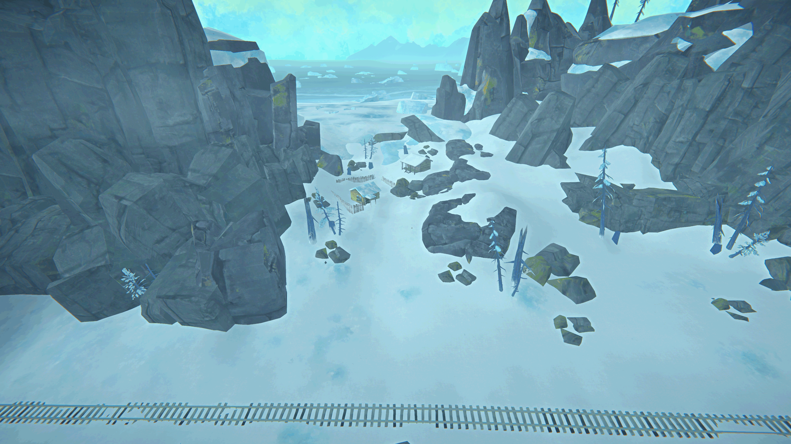
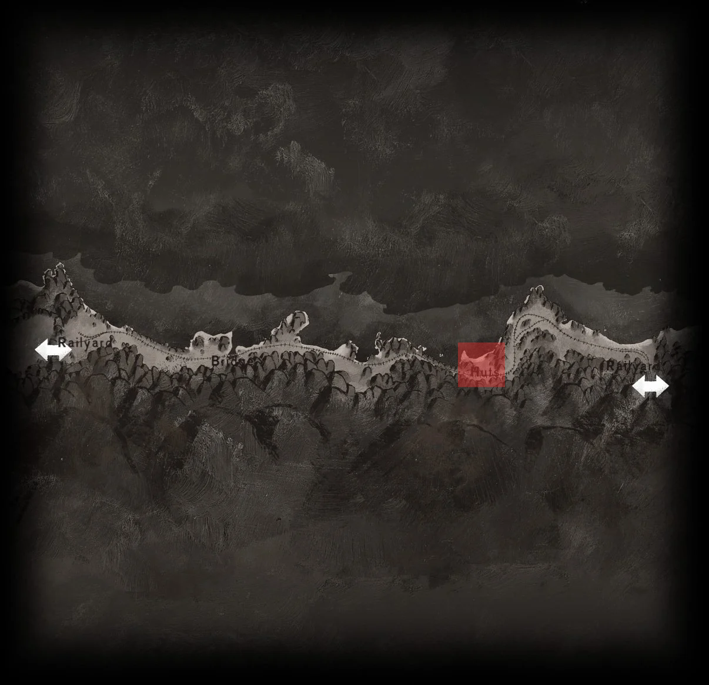

# Huts

| Column 1 | Column 2 | Column 3 |
| --- | --- | --- |
|  / *Seal\_icon.png* | **DLC-Exclusive content.** / This content requires the [Iron Road](./Iron%20Road.md) addon to be installed before it can be seen or used in regular gameplay. | \|} / **Huts** / \| Property \| Details \| / \| --- \| --- \| / \|  \|  / *Huts.png* \| / \| **Location** \|  \| / \|  \|  / *Huts\_Location.png* \| / \| Region \| [Anna Island -- Track Section 1](./Anna%20Island%20--%20Track%20Section%201.md)\\|- \| / \| Description \| A collection of 2 cabins, all boarded up save for 1. \| / \| **General** \|  \| / \|  / *bed\_icon.png* \| Has a bed \| / \|  \| Has an interior\\|} / **Huts** is a location in [Anna Island -- Track Section 1](./Anna%20Island%20--%20Track%20Section%201.md). / ## Overview / A small collection of cabins not far from the rails in the mid eastern section of the map. Of the 2 cabins, only 1 can be entered. [Rabbits](./Rabbit.md) may spawn in the area.**Lua execution error in Module:Navbox function navbox** \| |
|  / *Huts.png* |  |  |
| **Location** |  |  |
|  / *Huts\_Location.png* |  |  |
| Region | [Anna Island -- Track Section 1](./Anna%20Island%20--%20Track%20Section%201.md)\|- |  |
| Description | A collection of 2 cabins, all boarded up save for 1. |  |
| **General** |  |  |
|  / *bed\_icon.png* | Has a bed |  |
|  | Has an interior\|} / **Huts** is a location in [Anna Island -- Track Section 1](./Anna%20Island%20--%20Track%20Section%201.md). / ## Overview / A small collection of cabins not far from the rails in the mid eastern section of the map. Of the 2 cabins, only 1 can be entered. [Rabbits](./Rabbit.md) may spawn in the area.**Lua execution error in Module:Navbox function navbox** |  |
