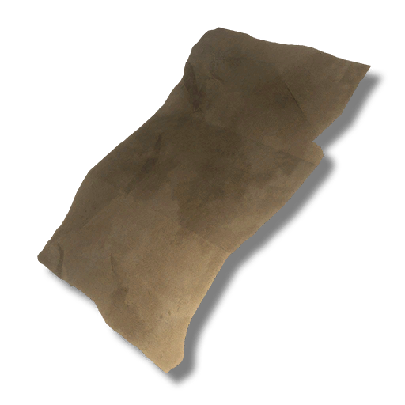

# Hymnal

<table class="infobox">
<caption>Hymnal</caption>
<colgroup>
<col style="width: 50%" />
<col style="width: 50%" />
</colgroup>
<tbody>
<tr>
<td colspan="2"><figure>

<figcaption>Hymnal_icon.png</figcaption>
</figure></td>
</tr>
<tr>
<td>
Release
</td>
<td>
<a href="./The%20Long%20Dark%20%E2%80%94%20Early%20Access%20Changelog.md#1.00" class="wikilink" title="1 August 2017">1 August 2017</a>
</td>
</tr>
<tr>
<td>
Wintermute
</td>
<td>
<a href="./Episode%201%20-%20Do%20Not%20Go%20Gentle.md" class="wikilink" title="Episode 1">Episode 1</a>
</td>
</tr>
<tr>
<td colspan="2" class="section">
<strong>Properties</strong>
</td>
</tr>
<tr>
<td>
Item type
</td>
<td>
<a href="./Collectibles.md" class="wikilink" title="Collectibles">Collectibles</a>|-
</td>
</tr>
<tr>
<td>
Stackable
</td>
<td>
No
</td>
</tr>
<tr>
<td>
Examine
</td>
<td>
Lyrics to the hymn DIES IRAE
</td>
</tr>
<tr>
<td colspan="2" class="section">
<strong>Values</strong>
</td>
</tr>
<tr>
<td>
Weight
</td>
<td>
0.00 kg (0 lbs)
</td>
</tr>
<tr>
<td colspan="2" class="section">
<strong>Actions</strong>
</td>
</tr>
<tr>
<td>
Backpack
</td>
<td>
Examine
</td>
</tr>
<tr>
<td>
On ground
</td>
<td>
Take It, Leave It
</td>
</tr>
</tbody>
</table>

**Hymnal** is a <a href="./Collectibles.md" class="wikilink" title="Collectible">Collectible</a> item found in <a href="./Episode%201%20-%20Do%20Not%20Go%20Gentle.md" class="wikilink" title="Episode 1: Do Not Go Gentle">Episode 1: Do Not Go Gentle</a> of the <a href="./Wintermute.md" class="wikilink" title="Wintermute">Wintermute</a> story mode in <a href="./St.%20Christopher%27s%20Church.md" class="wikilink" title="St. Christopher&#39;s Church">St. Christopher's Church</a>. It is found on the floor next to the burned out <a href="./Campfire.md" class="wikilink" title="Campfire">Campfire</a>.

## Transcript

The following text is transcribed from **Hymnal**

Latin column:

Dies iræ, dies illa,

Solvet sæclum in favilla,

Teste David cum Sibylla.

Quantus tremor est futurus,

Quando judex est venturus,

Cuncta stricte discussurus!

Tuba, mirum spargens sonum,

Per sepulchra regionum,

Coget omnes ante thronum.

Mors stupebit, et natura,

Cum resurget creatura,

Iudicanti responsura.

English column:

Day of wrath and doom impending.

David's word with Sibyl's blending,

Heaven and earth in ashes ending.

Oh, what fear man's bosom rendeth,

When from heaven the Judge descendeth,

On whose sentence all dependeth.

Wondrous sound the trumpet flingeth;

Through earth's sepulchres it ringeth;

All before the throne it bringeth.

Death is struck, and nature quaking,

All creation is awaking,

To its Judge an answer making.

## Trivia

The hymn is based off of [Dies Irae](https://en.wikipedia.org/wiki/Dies_irae).

## Update history

- UPDATE **1 August 2017 (<a href="./The%20Long%20Dark%20%E2%80%94%20Changelog.md#1.00" class="wikilink" title="Update">Update</a>):**
  - Added to game.

**Lua execution error in Module:Navbox function navbox**

