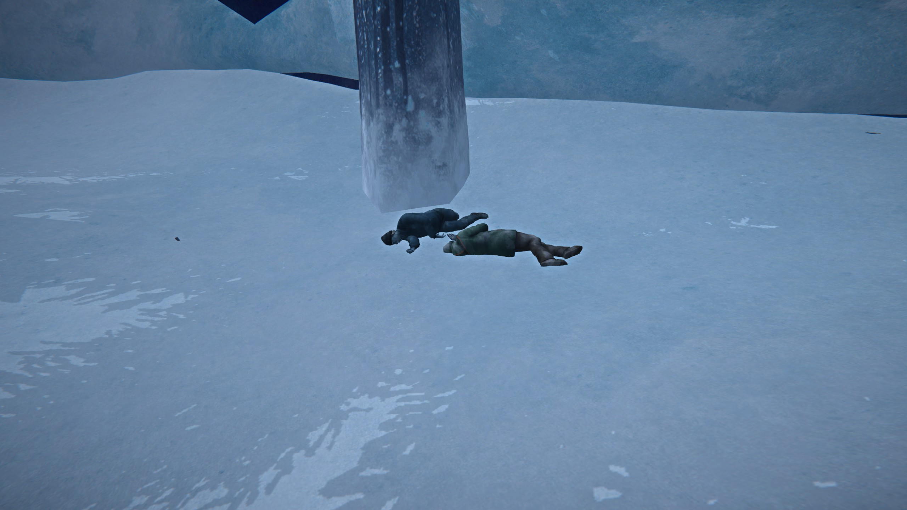

# ID \- F\. Leblanc

**Categories:** Collectibles, Pages with update history · **Source:** [Fandom](https://thelongdark.fandom.com/wiki/ID_-_F._Leblanc)

**ID - F. Leblanc**

| Property | Details |
| --- | --- |
| | [ID D. Belanger icon](../assets/ID_-_D._Belanger_icon.png) |
| Release | [22 October 2019](./The%20Long%20Dark%20%E2%80%94%20Changelog%20%E2%80%94%20Archive%202.md#1-60-crossroads-elegy-update) |
| Wintermute | [Episode 3](./Episode%203%20-%20Crossroads%20Elegy.md) - [Fallen Star](./Fallen%20Star.md) |
| **Properties** | |
| Item type | [Collectibles](./Collectibles.md) |
| Equipable | No |
| Stackable | No |
| Examine | An identification card belonging to F. Leblanc. |
| **Values** | |
| Weight | 0.00 kg (0 lbs) |
| **Actions** | |
| Backpack | Examine |
| On ground | Take It, Read Text, Leave It |

**ID - F. Leblanc** is a [Collectible](./Collectibles.md) item found in [Episode 3](./Episode%203%20-%20Crossroads%20Elegy.md) of the [Wintermute](./Wintermute.md) story mode as a part of the [Fallen Star](./Fallen%20Star.md) mission.

During the course of the mission, Astrid finds the ID on a corpse at the [Crash Site (Pleasant Valley)](./Crash%20Site%20%28Pleasant%20Valley%29.md).

## Location

The ID is located on a [Frozen Corpse](./Frozen%20Corpse.md) found after immediately falling from the main body of the plane and turning to the left, over the hill in a ditch near a nearby tree with the corpse of [K. Morrison](./ID%20-%20K.%20Morrison.md). The ID is later returned to Chloe at the [Community Hall](./Community%20Hall.md), with Astrid giving her sympathies.

## Update history

- UPDATE **22 October 2019 ([Update](./The%20Long%20Dark%20%E2%80%94%20Changelog%20%E2%80%94%20Archive%202.md#1-60-crossroads-elegy-update)):**
  - Added to game.
