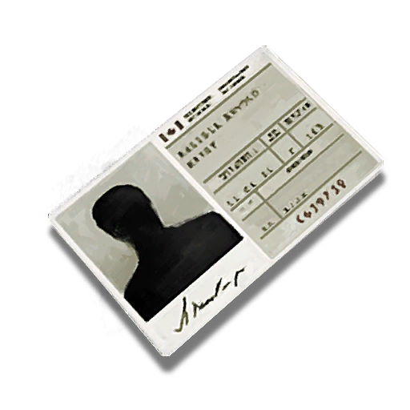
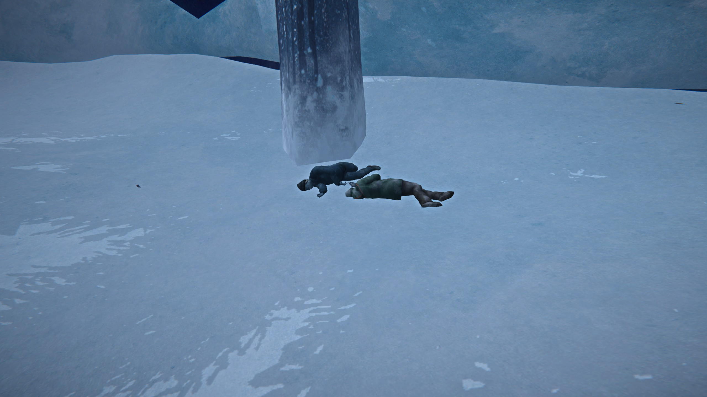

# ID \- K\. Morrison

**ID - K. Morrison**

| Property | Details |
| --- | --- |
|  |  / *ID\_-\_D.\_Belanger\_icon.png* |
| Release | [22 October 2019](./The%20Long%20Dark%20%E2%80%94%20Changelog.md#1.60) |
| Wintermute | [Episode 3](./Episode%203%20-%20Crossroads%20Elegy.md) - [Fallen Star](./Fallen%20Star.md) |
| **Properties** |  |
| Item type | [Collectibles](./Collectibles.md)\|- |
| Stackable | No |
| Examine | A driver's license belonging to K. Morrison. |
| **Values** |  |
| Weight | 0.00 kg (0 lbs) |
| **Actions** |  |
| Backpack | Examine |
| On ground | Take It, Read Text, Leave It |

**ID - K. Morrison** is a [Collectible](./Collectibles.md) item found in [Episode 3](./Episode%203%20-%20Crossroads%20Elegy.md) of the [Wintermute](./Wintermute.md) story mode as a part of the [Fallen Star](./Fallen%20Star.md) mission.

During the course of the mission, Astrid finds the ID on a corpse at the [Crash Site (Pleasant Valley)](./Crash%20Site%20%28Pleasant%20Valley%29.md).

## Location

The ID is located on a [Frozen Corpse](./Frozen%20Corpse.md) found after immediately falling from the main body of the plane and turning to the left, over the hill in a ditch near a nearby tree with the corpse of [ID - F. Leblanc](./ID%20-%20F.%20Leblanc.md). The ID is later returned to Bennett at the [Community Hall](./Community%20Hall.md), with Astrid giving her sympathies. 

## Update history

- UPDATE **22 October 2019 ([Update](./The%20Long%20Dark%20%E2%80%94%20Changelog.md#1.60)):**
  - Added to game.

**Lua execution error in Module:Navbox function navbox**
