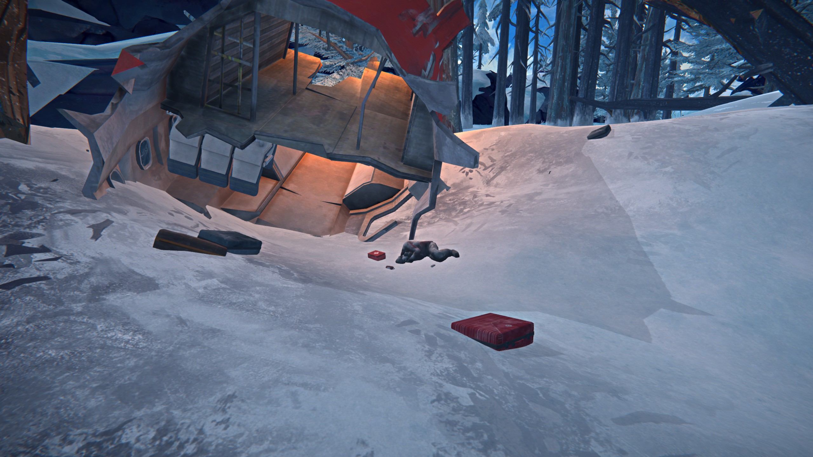

# ID \- O\. Gould

**Categories:** Collectibles, Pages with update history · **Source:** [Fandom](https://thelongdark.fandom.com/wiki/ID_-_O._Gould)

**ID - O. Gould**

[ID D. Belanger icon](../assets/ID_-_D._Belanger_icon.png)

**Release:** [22 October 2019](./The%20Long%20Dark%20%E2%80%94%20Changelog%20%E2%80%94%20Archive%202.md#1.60)

**Wintermute:** [Episode 3](./Episode%203%20-%20Crossroads%20Elegy.md) - [Fallen Star](./Fallen%20Star.md)

**Properties**

**Item type:** [Collectibles](./Collectibles.md)

**Stackable:** No

**Examine:** An identification card belonging to O. Gould.

**Values**

**Weight:** 0.00 kg (0 lbs)

**Actions**

**Backpack:** Examine

**On ground:** Take It, Read Text, Leave It

**ID - O. Gould** is a [Collectible](./Collectibles.md) item found in [Episode 3](./Episode%203%20-%20Crossroads%20Elegy.md) of the [Wintermute](./Wintermute.md) story mode as a part of the [Fallen Star](./Fallen%20Star.md) mission.

During the course of the mission, Astrid finds the ID on a corpse at the [Crash Site (Pleasant Valley)](./Crash%20Site%20%28Pleasant%20Valley%29.md).

<!-- #Location -->
​

<!-- #location -->
## Location

The ID is located on a [Frozen Corpse](./Frozen%20Corpse.md) found directly in front of the middle plane section in the valley. The ID is later returned to Jake at the [Community Hall](./Community%20Hall.md), with Astrid giving her sympathies.

<!-- #update_history -->
​

<!-- #Update_history -->
​

<!-- #Update_History -->
​

<!-- #update-history -->
## Update history

\* UPDATE **22 October 2019 ([Update](./The%20Long%20Dark%20%E2%80%94%20Changelog%20%E2%80%94%20Archive%202.md#1.60)):**

  - Added to game.
