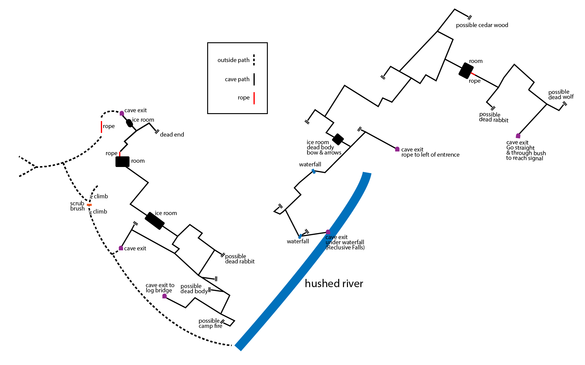
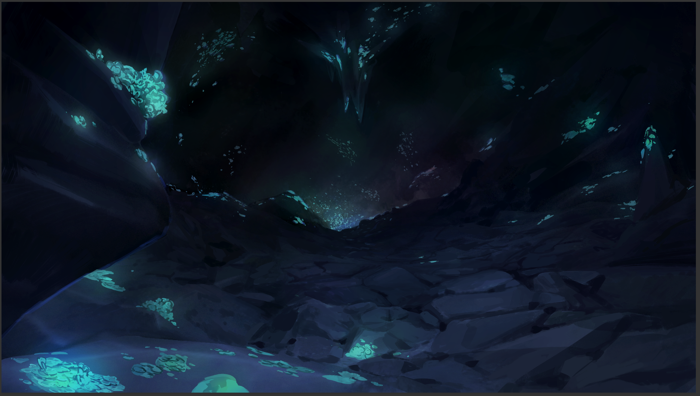

# Ice Cave

**Ice caves** are interior locations mainly found in the <a href="./Hushed%20River%20Valley.md" class="wikilink" title="Hushed River Valley">Hushed River Valley</a> region. Another ice cave connects <a href="./Keeper%27s%20Pass%20North.md" class="wikilink" title="Keeper&#39;s Pass North">Keeper's Pass North</a> with <a href="./Keeper%27s%20Pass%20South.md" class="wikilink" title="Keeper&#39;s Pass South">Keeper's Pass South</a>, and a small ice cave can be found in <a href="./Pleasant%20Valley.md" class="wikilink" title="Pleasant Valley">Pleasant Valley</a>, located in the back of the cave at <a href="./Misty%20Falls%20Picnic%20Area.md" class="wikilink" title="Misty Falls Picnic Area">Misty Falls Picnic Area</a>.

## Overview

Ice caves have small patches of bio-luminescent moss along some of the walls. Ice caves act as interior environments (i.e., there is a loading screen when entering and leaving a cave) and are typically warm enough to prevent even a poorly clothed character from freezing. When inside an ice cave, near-constant creaking, presumably from the shifting of the ice, can be heard.

There may also be waterfalls and streams found inside some caves, which will give your character <a href="./Hypothermia.md" class="wikilink" title="Hypothermia">Hypothermia</a>, make all worn <a href="./Clothing.md" class="wikilink" title="clothes">clothes</a> wet, and put out a lit <a href="./Flare.md" class="wikilink" title="flare">flare</a>, <a href="./Storm%20Lantern.md" class="wikilink" title="storm lantern">storm lantern</a>, or <a href="./Torch.md" class="wikilink" title="torch">torch</a> if you step into them.

There are two ice cave systems in the Hushed River Valley region, each with multiple entrances. The sprawling caves may have sections that require climbing a short <a href="./Mountaineering%20Rope.md" class="wikilink" title="mountaineering rope">mountaineering rope</a> to reach. The Ice cave connecting the two halves of Keeper's Pass is much more linear in layout than the two in Hushed River Valley, acting like a normal transition cave.

Just like normal caves, lumps of <a href="./Coal.md" class="wikilink" title="coal">coal</a> may occasionally be found lying on the ground, except in the small ice cave at Misty Falls.

## Trivia

- Ice Caves were added to the game as part of the Vigilant Flame update released for PC on 14 June 2018 and for XBOX on 15 June 2018
- You can find valuable loot inside ice caves such as <a href="./Rifle%20Ammunition.md" class="wikilink" title="rifle ammunition">rifle ammunition</a>, <a href="./Cedar%20Firewood.md" class="wikilink" title="cedar firewood">cedar firewood</a>, <a href="./Fir%20Firewood.md" class="wikilink" title="fir firewood">fir firewood</a>, and more.
- The ambient temperature of most ice caves is above freezing (0+ °C and 32+ °F).
- A <a href="./Wolf.md" class="wikilink" title="wolf">wolf</a> can spawn in the cave without the waterfalls. Be careful, since it may not spawn initially. Once dealt with, it will respawn.

## Gallery

<table class="gallery">
<colgroup>
<col style="width: 25%" />
<col style="width: 25%" />
<col style="width: 25%" />
<col style="width: 25%" />
</colgroup>
<tbody>
<tr>
<td><figure>

<figcaption>Map-IceCave-wtM-100.png</figcaption>
</figure></td>
<td><figure>

<figcaption>Map-IceCave-noM-101.png</figcaption>
</figure></td>
<td><figure>

<figcaption>A rough map of the ice cave system</figcaption>
</figure></td>
<td><figure>

<figcaption>River_Valley_-_cave.png</figcaption>
</figure></td>
</tr>
<tr>
<td><figure>

<figcaption>A <a href="./Frozen%20Corpse.md" class="wikilink" title="frozen corpse">frozen corpse</a> in an ice cave</figcaption>
</figure></td>
<td><figure>

<figcaption>An ice room lit with moss</figcaption>
</figure></td>
<td></td>
<td></td>
</tr>
</tbody>
</table>

**Lua execution error in Module:Navbox function navbox**

