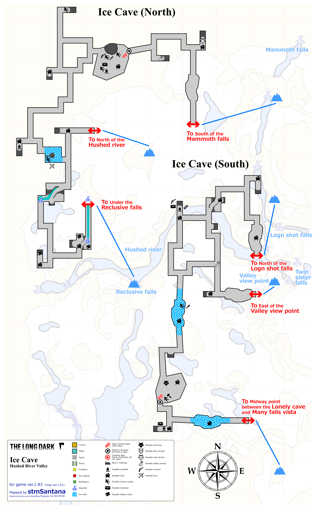
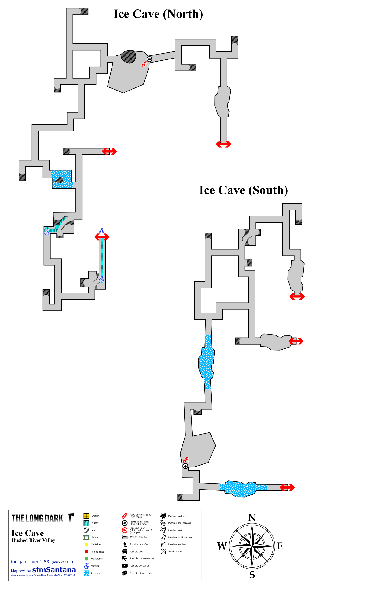
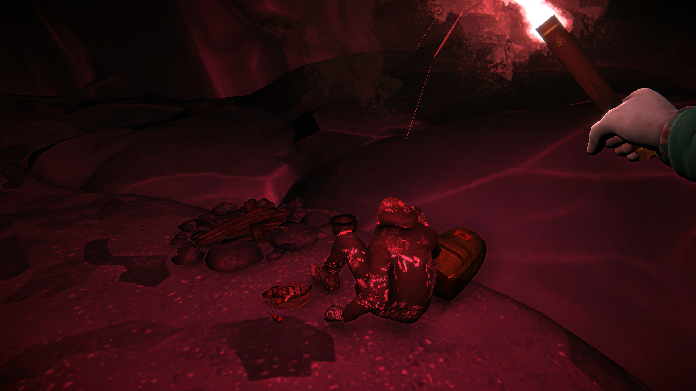
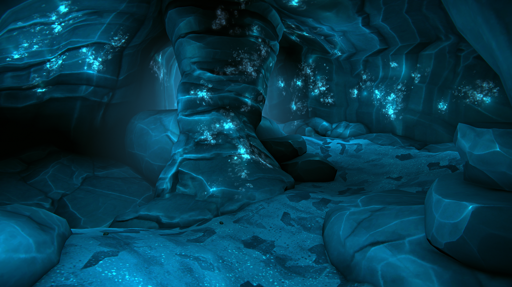

# Ice Cave

**Categories:** Locations, Locations in Hushed River Valley · **Source:** [Fandom](https://thelongdark.fandom.com/wiki/Ice_Cave)

**Ice caves** are interior locations mainly found in the [Hushed River Valley](./Hushed%20River%20Valley.md) region. Another ice cave connects [Keeper's Pass North](./Keeper%27s%20Pass%20North.md) with [Keeper's Pass South](./Keeper%27s%20Pass%20South.md), and a small ice cave can be found in [Pleasant Valley](./Pleasant%20Valley.md), located in the back of the cave at [Misty Falls Picnic Area](./Misty%20Falls%20Picnic%20Area.md).

## Overview

Ice caves have small patches of bio-luminescent moss along some of the walls. Ice caves act as interior environments (i.e., there is a loading screen when entering and leaving a cave) and are typically warm enough to prevent even a poorly clothed character from freezing. When inside an ice cave, near-constant creaking, presumably from the shifting of the ice, can be heard.

There may also be waterfalls and streams found inside some caves, which will give your character [Hypothermia](./Hypothermia.md), make all worn [clothes](./Clothing.md) wet, and put out a lit [flare](./Flare.md), [storm lantern](./Storm%20Lantern.md), or [torch](./Torch.md) if you step into them.

There are two ice cave systems in the Hushed River Valley region, each with multiple entrances. The sprawling caves may have sections that require climbing a short [mountaineering rope](./Mountaineering%20Rope.md) to reach. The Ice cave connecting the two halves of Keeper's Pass is much more linear in layout than the two in Hushed River Valley, acting like a normal transition cave.

Just like normal caves, lumps of [coal](./Coal.md) may occasionally be found lying on the ground, except in the small ice cave at Misty Falls.

## Trivia

- Ice Caves were added to the game as part of the Vigilant Flame update released for PC on 14 June 2018 and for XBOX on 15 June 2018
- You can find valuable loot inside ice caves such as [rifle ammunition](./Rifle%20Ammunition.md), [cedar firewood](./Cedar%20Firewood.md), [fir firewood](./Fir%20Firewood.md), and more.
- The ambient temperature of most ice caves is above freezing (0+ °C and 32+ °F).
- A [wolf](./Wolf.md) can spawn in the cave without the waterfalls. Be careful, since it may not spawn initially. Once dealt with, it will respawn.

## Gallery

_A [frozen corpse](./Frozen%20Corpse.md) in an ice cave_

