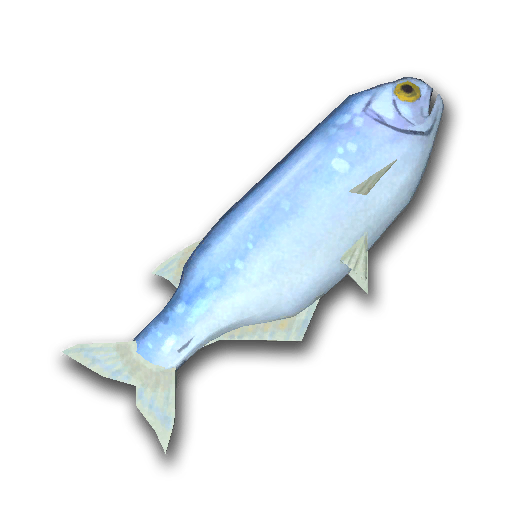
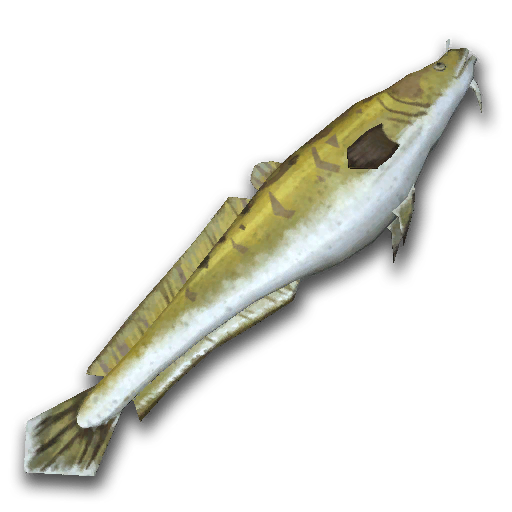
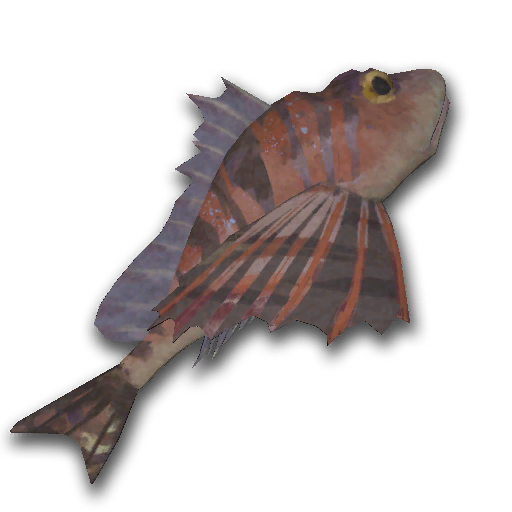
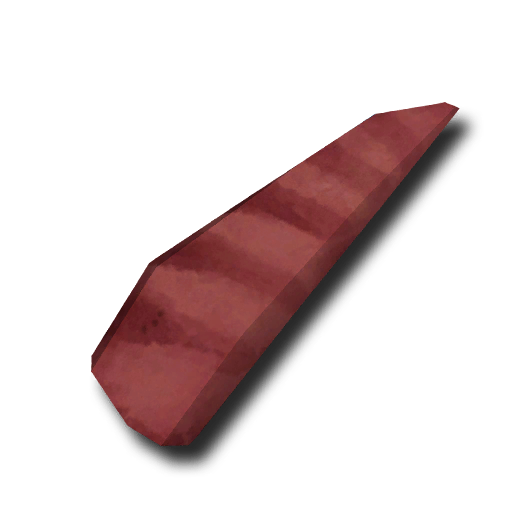
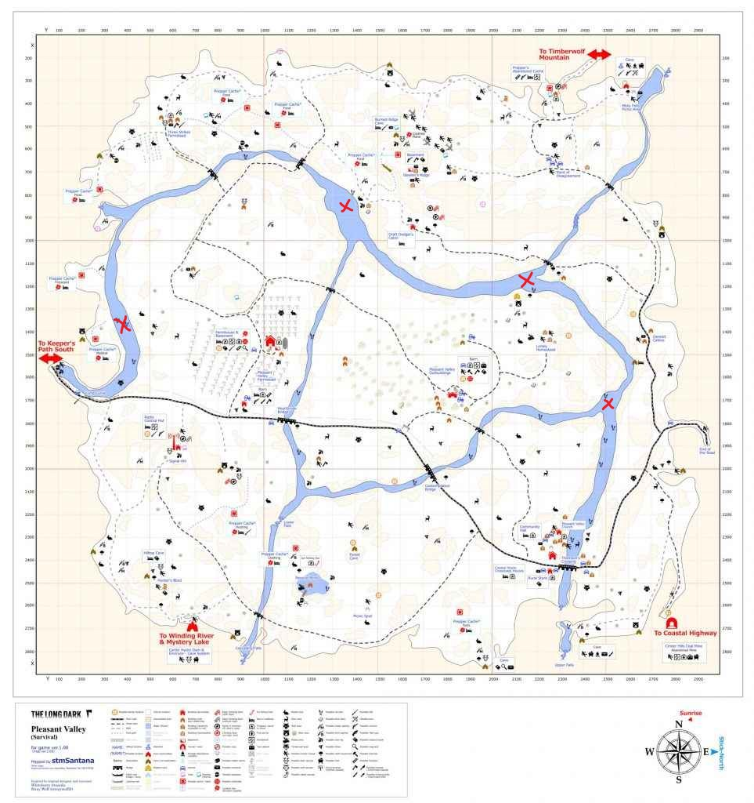

# Ice Fishing

**Contents**

- [Overview](#Overview)
- [Equipment](#Equipment)
- [Fishing Tackle](#Fishing_Tackle)
- [Ice Breaker](#Ice_Breaker)
- [Fishing Tip-Ups](#Fishing_Tip-Ups)
- [Fishing Bait](#Fishing_Bait)
- [Fishing Lures](#Fishing_Lures)
- [Fishing Holes](#Fishing_Holes)
- [Fishing Huts](#Fishing_Huts)
- [Free-Form Ice Fishing Holes](#Free-Form_Ice_Fishing_Holes)
- [Valid Areas for Free-Form Ice Fishing:](#Valid_Areas_for_Free-Form_Ice_Fishing%3A)
- [Skill Levels](#Skill_Levels)
- [Trivia](#Trivia)

<table class="infobox">
<caption>Ice Fishing</caption>
<colgroup>
<col style="width: 50%" />
<col style="width: 50%" />
</colgroup>
<tbody>
<tr>
<td colspan="2"><figure>

<figcaption>Ice_Fishing_background.png</figcaption>
</figure></td>
</tr>
<tr>
<td>
Release
</td>
<td>
<a href="./The%20Long%20Dark%20%E2%80%94%20Early%20Access%20Changelog.md#0.346" class="wikilink" title="Penitent Scholar (v0.346)">Penitent Scholar (v0.346)</a>
</td>
</tr>
<tr>
<td>
Date
</td>
<td>
23 June 2016
</td>
</tr>
</tbody>
</table>

 **Ice Fishing** is the <a href="./Skills.md" class="wikilink" title="Skill">Skill</a> to catch fish in *The Long Dark*. It is performed at fishing holes, which are cut in the ice of fish-bearing bodies of water.

## Overview

\[Missing image: Fishing_hut_outside.jpg\] A fishing hut is one of the safest and simplest locations to ice fish. Ice Fishing is the skill to catch fish for <a href="./Food%20And%20Drink.md" class="wikilink" title="food">food</a>, <a href="./Lantern%20Fuel.md" class="wikilink" title="lantern oil">lantern oil</a> and source renewable Vitamin-C to avoid <a href="./Scurvy.md" class="wikilink" title="Scurvy">Scurvy</a>. It is performed at any fish-bearing body of water, at hole(s) cut in its ice. These holes are found inside all Fishing Huts, and can also be made manually with any Tool (via the <a href="./Radial%20Menu.md" class="wikilink" title="Radial Menu">Radial Menu</a>). The Survivor can fish manually with a <a href="./Fishing%20Tackle.md" class="wikilink" title="Fishing Tackle">Fishing Tackle</a>, or semi-automatically with <a href="./Fishing%20Tip-Up.md" class="wikilink" title="Fishing Tip-Ups">Fishing Tip-Ups</a> (crafted fish traps). When choosing to fish the survivor can select to use bait, lures and how long to fish for. While fishing time is accelerated, and the task may be canceled early (ESC or "Cancel").

There are two methods of Ice Fishing:

- Manual Ice Fishing: requires Fishing Tackle(s) and accelerates time while fishing. Catching fish manually both increases and benefits from Ice Fishing Skill. Manual Fishing is versatile and simple. needing few materials to do.
- Fish Trapping: requires Fishing Tip-Up(s) and is semi-automatic. Deployed Tip-Ups catch fish independent of the survivor, but lose condition while deployed and require regular ice-clearing in their holes to prevent re-freeze. Deploying more than 6 Fishing Tip-Ups in the same <a href="./Region.md" class="wikilink" title="Region">Region</a> will cause 'overfishing', resulting in diminishing returns (4 for <a href="./Zone%20of%20Contamination.md" class="wikilink" title="Zone of Contamination">Zone of Contamination</a>). Trapping fish with Tip-Ups does not increase or benefit from Ice Fishing Skill. Deploying 6 Tip-Ups and actively maintaining them will yield a substantially higher amount of calories per hour (around 3.7x) compared to manually fishing (level 5), however this requires more resources and effort from the player.

Fishing Requires:

- <a href="./Fishing%20Tackle.md" class="wikilink" title="Fishing Tackle">Fishing Tackle</a> or <a href="./Fishing%20Tip-Up.md" class="wikilink" title="Fishing Tip-Up">Fishing Tip-Up</a>
- <a href="./Tools.md" class="wikilink" title="Tool">Tool</a> to cut hole, or break ice on an existing hole
- Hole cut in the ice (survivor-made, or inside of a Fishing Hut)

Fishing Optionally Requires:

- <a href="./Reclaimed%20Wood.md" class="wikilink" title="Fuel">Fuel</a> and a lit <a href="./Wood%20Matches.md" class="wikilink" title="Fire">Fire</a> for warmth
- <a href="./Fishing%20Bait.md" class="wikilink" title="Fishing Bait">Fishing Bait</a>: increases weight of caught fish
- <a href="./Fishing%20Lure%20%28disambiguation%29.md" class="wikilink" title="Fishing Lure">Fishing Lure</a>: increases odds of catching rare fish and increases bite times
- <a href="./Cooking%20Pot.md" class="wikilink" title="Cooking Pot">Cooking Pot</a>/<a href="./Cooking%20Skillet.md" class="wikilink" title="Cooking Skillet">Cooking Skillet</a>/<a href="./Recycled%20Can.md" class="wikilink" title="Recycled Can">Recycled Can</a> for boiling water
- <a href="./Water%20%28Potable%29.md" class="wikilink" title="Water">Water</a>/<a href="./Bedroll.md" class="wikilink" title="Bedroll">Bedroll</a> for sleeping on-site
- <a href="./Travois.md" class="wikilink" title="Travois">Travois</a> for hauling fuel to a fishing site, or fish away
- <a href="./Snow%20Shelter.md" class="wikilink" title="Snow Shelter">Snow Shelter</a> if using a cut hole near a snowy bank

Each fishing session is treated separately, so longer sessions will likely catch more fish than the same time broken into multiple sessions. Fishing for less than the "maximum bite time" will result in no fish ever being caught. Overfishing is caused by using more than 6 Tip-Ups in the same region (more than 4 in Zone of Contamination)

There are two types of fish: saltwater and freshwater, and four rarity: common, uncommon and two rare types. Fishing Lures only increase the odds of "rare" fish (at the cost of increase bite wait times).

<table>
<colgroup>
<col style="width: 11%" />
<col style="width: 11%" />
<col style="width: 11%" />
<col style="width: 11%" />
<col style="width: 11%" />
<col style="width: 11%" />
<col style="width: 11%" />
<col style="width: 11%" />
<col style="width: 11%" />
</colgroup>
<thead>
<tr>
<th>
Image
</th>
<th>
Name
</th>
<th>
Rarity
</th>
<th>
Type
</th>
<th>
Minimum weight
</th>
<th>
Maximum weight
</th>
<th>
Raw caloric density
</th>
<th>
Fuel ¹
</th>
<th>
Odds
</th>
</tr>
</thead>
<tbody>
<tr>
<td><figure>

<figcaption>Lake_Whitefish_(Raw)_icon.png</figcaption>
</figure></td>
<td>
<a href="./Lake%20Whitefish%20%28Raw%29.md" class="wikilink" title="Lake Whitefish">Lake Whitefish</a>
</td>
<td>
Common
</td>
<td>
Fresh water
</td>
<td>
1.50 kg 
(3.3 lb)
</td>
<td>
2.30 kg 
(5.06 lb)
</td>
<td>
250 cal/kg
</td>
<td>
0.015 L/kg
</td>
<td>
70
</td>
</tr>
<tr>
<td><figure>

<figcaption>Rainbow_Trout_(Raw)_icon.png</figcaption>
</figure></td>
<td>
<a href="./Rainbow%20Trout%20%28Raw%29.md" class="wikilink" title="Rainbow Trout">Rainbow Trout</a>
</td>
<td>
Common
</td>
<td>
Salt water
</td>
<td>
0.50 kg 
(1.1 lb)
</td>
<td>
2.30 kg 
(5.06 lb)
</td>
<td>
250 cal/kg
</td>
<td>
0.025 L/kg
</td>
<td>
70
</td>
</tr>
<tr>
<td><figure>

<figcaption>Coho_Salmon_(Raw)_icon.png</figcaption>
</figure></td>
<td>
<a href="./Coho%20Salmon%20%28Raw%29.md" class="wikilink" title="Coho Salmon">Coho Salmon</a>
</td>
<td>
Uncommon
</td>
<td>
Salt water
</td>
<td>
2.80 kg 
(6.16 lb)
</td>
<td>
5.50 kg 
(12.1 lb)
</td>
<td>
300 cal/kg
</td>
<td>
0.032 L/kg
</td>
<td>
30
</td>
</tr>
<tr>
<td><figure>

<figcaption>Smallmouth_Bass_(Raw)_icon.png</figcaption>
</figure></td>
<td>
<a href="./Smallmouth%20Bass%20%28Raw%29.md" class="wikilink" title="Smallmouth Bass">Smallmouth Bass</a>
</td>
<td>
Uncommon
</td>
<td>
Fresh water
</td>
<td>
1.80 kg 
(3.96 lb)
</td>
<td>
5.00 kg 
(11 lb)
</td>
<td>
300 cal/kg
</td>
<td>
0.025 L/kg
</td>
<td>
30
</td>
</tr>
<tr>
<td><figure>

<figcaption>Goldeye_icon.png</figcaption>
</figure></td>
<td>
<a href="./Goldeye%20%28Raw%29.md" class="wikilink" title="Goldeye">Goldeye</a>
</td>
<td>
Rare
</td>
<td>
Fresh water
</td>
<td>
0.50 kg 
(1.1 lb)
</td>
<td>
2.10 kg 
(4.62 lb)
</td>
<td>
300 cal/kg
</td>
<td>
0.015 L/kg
</td>
<td>
5
</td>
</tr>
<tr>
<td><figure>

<figcaption>Burbot_icon.png</figcaption>
</figure></td>
<td>
<a href="./Burbot%20%28Raw%29.md" class="wikilink" title="Burbot">Burbot</a>
</td>
<td>
Rare
</td>
<td>
Fresh water
</td>
<td>
3.90 kg 
(8.58 lb)
</td>
<td>
6.00 kg 
(13.2 lb)
</td>
<td>
325 cal/kg
</td>
<td>
0.030 L/kg
</td>
<td>
2
</td>
</tr>
<tr>
<td><figure>

<figcaption>Rockfish_icon.png</figcaption>
</figure></td>
<td>
<a href="./Rockfish%20%28Raw%29.md" class="wikilink" title="Rockfish">Rockfish</a>
</td>
<td>
Rare
</td>
<td>
Salt water
</td>
<td>
1.80 kg 
(3.96 lb)
</td>
<td>
5.00 kg 
(11 lb)
</td>
<td>
300 cal/kg
</td>
<td>
0.025 L/kg
</td>
<td>
5
</td>
</tr>
<tr>
<td><figure>

<figcaption>Red_Irish_Lord_icon.png</figcaption>
</figure></td>
<td>
<a href="./Red%20Irish%20Lord%20%28Raw%29.md" class="wikilink" title="Red Irish Lord">Red Irish Lord</a>
</td>
<td>
Rare
</td>
<td>
Salt water
</td>
<td>
1.50 kg 
(3.3 lb)
</td>
<td>
3.10 kg 
(6.82 lb)
</td>
<td>
300 cal/kg
</td>
<td>
0.020 L/kg
</td>
<td>
2
</td>
</tr>
<tr>
<td><figure>

<figcaption>Big_Bass_(Raw)_icon.png</figcaption>
</figure></td>
<td>
<em><a href="./Big%20Bass%20%28Raw%29.md" class="wikilink" title="Big Bass*">Big Bass*</a></em>
</td>
<td>
Unique
</td>
<td>
Fresh water
</td>
<td>
15.00 kg 
(33 lb)
</td>
<td>
15.00 kg 
(33 lb)
</td>
<td>
300 cal/kg
</td>
<td>
0.37L
</td>
<td>
Scripted
</td>
</tr>
</tbody>
</table>

*\*Big Bass is found only in Wintermute*

¹ Amount Oil / Latern Fuel gained when fish is cooked. Source: Detailed analysis by Bashrobe, <https://www.youtube.com/watch?v=l8BIygi4K_k&t=174s>

## Equipment

Fishing Tackle and a tool to cut hole(s) in the ice are required for fishing. Optionally Bait and/or Lures can be used to increase bite-rate, or the odds of catching rare fish. Fishing on the ice for hours is very cold, so a lit fire with fuel and/or <a href="./Snow%20Shelter.md" class="wikilink" title="Snow Shelter">Snow Shelter</a> is often required. Before fishing, it's advisable to travel light or bring along a <a href="./Travois.md" class="wikilink" title="Travois">Travois</a>, since the weight of multiple freshly-caught fish can <a href="./Encumbrance.md" class="wikilink" title="add up quickly">add up quickly</a>.

### Fishing Tackle

 <a href="./Fishing%20Tackle.md" class="wikilink" title="Fishing Tackle">Fishing Tackle</a> are the primary tool for fishing. They are crafted from a <a href="./Hook.md" class="wikilink" title="Hook">Hook</a> and <a href="./Line.md" class="wikilink" title="Line">Line</a>. Tackle lasts until they break during fishing, and only degrade condition when used to Repair clothing (Tackle durability has no effect on break rate).

### Ice Breaker

Ice breakers are any tool used to clear ice holes. Fully clearing a hole takes the full break time, with a partially frozen hole taking much less. Prybar and Heavy Hammer take longer to clear than bladed tools, but sustain less condition loss when doing so. Prybars are non-renewable or repairable, but Heavy Hammers may be repaired sustainably (but not replaced if ruined).

Tip: On PC, pressing Enter also acts as clicking the Break Ice button.

<table>
<colgroup>
<col style="width: 25%" />
<col style="width: 25%" />
<col style="width: 25%" />
<col style="width: 25%" />
</colgroup>
<thead>
<tr>
<th colspan="2">
Tool
</th>
<th>
Break rate 
(minutes to clear ice)
</th>
<th>
Tool decay
</th>
</tr>
</thead>
<tbody>
<tr>
<td><figure>

<figcaption>Prybar_icon.png</figcaption>
</figure></td>
<td>
<a href="./Prybar.md" class="wikilink" title="Prybar">Prybar</a>
</td>
<td>
45.0 min
</td>
<td>
2.0%
</td>
</tr>
<tr>
<td><figure>

<figcaption>Heavy_Hammer_icon.png</figcaption>
</figure></td>
<td>
<a href="./Heavy%20Hammer.md" class="wikilink" title="Heavy Hammer">Heavy Hammer</a>
</td>
<td>
45.0 min
</td>
<td>
2.0%
</td>
</tr>
<tr>
<td><figure>

<figcaption>Hatchet_icon.png</figcaption>
</figure></td>
<td>
<a href="./Hatchet.md" class="wikilink" title="Hatchet">Hatchet</a>
</td>
<td>
20.0 min
</td>
<td>
5.0%
</td>
</tr>
<tr>
<td><figure>

<figcaption>Hunting_Knife_icon.png</figcaption>
</figure></td>
<td>
<a href="./Hunting%20Knife.md" class="wikilink" title="Hunting Knife">Hunting Knife</a>
</td>
<td>
40.0 min
</td>
<td>
5.0%
</td>
</tr>
<tr>
<td><figure>

<figcaption>Improvised_Hatchet_icon.png</figcaption>
</figure></td>
<td>
<a href="./Improvised%20Hatchet.md" class="wikilink" title="Improvised Hatchet">Improvised Hatchet</a>
</td>
<td>
30.0 min
</td>
<td>
10.0%
</td>
</tr>
<tr>
<td><figure>

<figcaption>Improvised_Knife_icon.png</figcaption>
</figure></td>
<td>
<a href="./Improvised%20Knife.md" class="wikilink" title="Improvised Knife">Improvised Knife</a>
</td>
<td>
50.0 min
</td>
<td>
8.0%
</td>
</tr>
<tr>
<td><figure>

<figcaption>Cougar_Claw_Knife_icon.png</figcaption>
</figure></td>
<td>
<a href="./Cougar%20Claw%20Knife.md" class="wikilink" title="Cougar Claw Knife">Cougar Claw Knife</a>
</td>
<td>
40.0 min
</td>
<td>
5.0%
</td>
</tr>
<tr>
<td><figure>

<figcaption>Survival_Knife_icon.png</figcaption>
</figure></td>
<td>
<a href="./Survival%20Knife.md" class="wikilink" title="Survival Knife">Survival Knife</a>
</td>
<td>
40.0 min
</td>
<td>
2.5%
</td>
</tr>
</tbody>
</table>

### Fishing Tip-Ups

 <a href="./Fishing%20Tip-Up.md" class="wikilink" title="Fishing Tip-Ups">Fishing Tip-Ups</a> are tools to trap fish at Fishing Holes (including those inside of Fishing Huts). They can be fitted with Lures or Bait, and function similar to <a href="./Snare.md" class="wikilink" title="Snares">Snares</a>, but unlike Snares are not effective when used passively: as they require regular ice-clearing to function, and will lose condition while deployed.

After clearing an ice hole and placing the Tip-Up in the water the tool will auto fish. As time passes and a fish bites the tackle, the tool will "Tip-Up" and fall upright with a metallic jingling sound. Tip-Ups lose condition when deployed (1% per hour outside, 0.5% per hour inside a Fishing Hut) and 10% on line break. Catching fish with Tip-Ups does not yield Ice Fishing Skill or benefit from it.

Any number of Tip-Ups may be deployed in a region, but deploying more than 6 per separate body of water will result in 'overfishing penalties', yielding diminishing return catch rates (4 max in <a href="./Zone%20of%20Contamination.md" class="wikilink" title="Zone of Contamination">Zone of Contamination</a>).

### Fishing Bait

 <a href="./Fishing%20Bait.md" class="wikilink" title="Fishing Bait">Fishing Bait</a> are an optional tool to catch larger fish. Using Bait increases average fish size by +30%, but one piece of Bait will be consumed for each fish caught. Bait is crafted by harvesting any raw fish and takes 30 minutes regardless of fish weight. Heavier fish yield more Bait when harvested (3 Bait per 1kg of Raw Fish weight).

### Fishing Lures

<a href="./Fishing%20Lure%20%28disambiguation%29.md" class="wikilink" title="Fishing Lures">Fishing Lures</a> are an optional tool for catching rare fish. Using lures increases the odds of catching a rare fish by 5-10x, but increases the maximum possible wait time for a fish to bite by +20%-75%. Lures are crafted at a <a href="./Work%20Bench.md" class="wikilink" title="Work Bench">Work Bench</a> and do not lose condition when used, but will be lost if a Fishing Tackle breaks or Tip-Up's line breaks while fishing. All fishing lures weigh 0.01kg.

<table style="width:100%;">
<colgroup>
<col style="width: 16%" />
<col style="width: 16%" />
<col style="width: 16%" />
<col style="width: 16%" />
<col style="width: 16%" />
<col style="width: 16%" />
</colgroup>
<thead>
<tr>
<th>
Image
</th>
<th>
Lure
</th>
<th>
Rare Fish Bonus
</th>
<th>
Maximum Wait Penalty
</th>
<th>
Materials
</th>
<th>
Creation Time
</th>
</tr>
</thead>
<tbody>
<tr>
<td><figure>

<figcaption>Simple_Fishing_Lure_icon.png</figcaption>
</figure></td>
<td>
<a href="./Simple%20Fishing%20Lure.md" class="wikilink" title="Simple Fishing Lure">Simple Fishing Lure</a>
</td>
<td>
+500%
</td>
<td>
+20%
</td>
<td><ul>
<li>1 <a href="./Scrap%20Metal.md" class="wikilink" title="Scrap Metal">Scrap Metal</a></li>
</ul></td>
<td>
30 min
</td>
</tr>
<tr>
<td><figure>

<figcaption>Fishing_Lure_(Acorns)_icon.png</figcaption>
</figure></td>
<td>
<a href="./Fishing%20Lure%20%28Acorns%29.md" class="wikilink" title="Fishing Lure (Acorns)">Fishing Lure (Acorns)</a>
</td>
<td>
+800%
</td>
<td>
+50%
</td>
<td><ul>
<li>1 <a href="./Acorns.md" class="wikilink" title="Acorns">Acorns</a></li>
<li>1 <a href="./Crow%20Feather.md" class="wikilink" title="Crow Feather">Crow Feather</a></li>
<li>1 <a href="./Scrap%20Metal.md" class="wikilink" title="Scrap Metal">Scrap Metal</a></li>
</ul></td>
<td>
50 min
</td>
</tr>
<tr>
<td><figure>

<figcaption>Fishing_Lure_(Revolver_Shell_Casing)_icon.png</figcaption>
</figure></td>
<td>
<a href="./Fishing%20Lure%20%28Revolver%20Shell%20Casing%29.md" class="wikilink" title="Fishing Lure (Casing)">Fishing Lure (Casing)</a>
</td>
<td>
+800%
</td>
<td>
+50%
</td>
<td><ul>
<li>1 <a href="./Revolver%20Shell%20Casing.md" class="wikilink" title="Revolver Shell Casing">Revolver Shell Casing</a></li>
<li>1 <a href="./Crow%20Feather.md" class="wikilink" title="Crow Feather">Crow Feather</a></li>
<li>1 <a href="./Scrap%20Metal.md" class="wikilink" title="Scrap Metal">Scrap Metal</a></li>
</ul></td>
<td>
50 min
</td>
</tr>
<tr>
<td><figure>

<figcaption>Fishing_Lure_(Wire_Bundle)_icon.png</figcaption>
</figure></td>
<td>
<a href="./Fishing%20Lure%20%28Wire%20Bundle%29.md" class="wikilink" title="Fishing Lure (Wire)">Fishing Lure (Wire)</a>
</td>
<td>
+1000%
</td>
<td>
+75%
</td>
<td><ul>
<li>1 <a href="./Wires.md" class="wikilink" title="Wire Bundle">Wire Bundle</a></li>
<li>1 <a href="./Crow%20Feather.md" class="wikilink" title="Crow Feather">Crow Feather</a></li>
<li>1 <a href="./Scrap%20Metal.md" class="wikilink" title="Scrap Metal">Scrap Metal</a></li>
</ul></td>
<td>
50 min
</td>
</tr>
</tbody>
</table>

## Fishing Holes

Ice Fishing by the survivor or their Tip-Ups requires holes cut in the ice of fishable bodies of water. These holes may be found inside of all Fishing Huts (small green structures found on the ice in many Regions), or cut manually by the water with any Tool. Holes will gradually re-freeze over, and must be manually cleared periodically to continue use. Completely clearing ice holes will pause freezing progress for 10 in-game minutes.

Fishing on Pilgrim, Voyageur and Stalker have the same fishing rates. Fishing on Interloper begins at the same rate, but increases the bite-times to twice as long on average (starting from Day 10, reaching maximum effect at day 50).

Fishing inside of Fishing Huts is more efficient than survivor-cut holes. The Fishing Hut in <a href="./Bitter%20Marsh.md" class="wikilink" title="Bitter Marsh">Bitter Marsh</a> (<a href="./Ash%20Canyon.md" class="wikilink" title="Ash Canyon">Ash Canyon</a>) is unique and grants a further bonus to fishing rate.

|                 | Free Form Holes | Fishing Huts  | Fishing Hut (Ash Canyon) |
|-----------------|-----------------|---------------|--------------------------|
| Time to Catch\* | 30-120 minutes  | 10-90 minutes | 10-70 minutes            |
| Tip-Up Decay    | 1%/hour         | 0.5/hour      | 0.5/hour                 |
| Ice Hole Freeze | 12.5/hour       | 4.16%/hour    | 4.16%/hour               |

\*Time to Catch on Interloper mode progressively increases up to a maximum of twice as long at Day 50, while beginning at the same value as Pilgrim/Voyageur/Stalker.

### Fishing Huts

<a href="./Fishing%20Hut.md" class="wikilink" title="Fishing Huts">Fishing Huts</a> are small structures on the ice which provide protection from the elements and wildlife. All fishing huts contain a pre-cut hole in the ice for fishing. Huts also contain a <a href="./Pot%20Belly%20Stove.md" class="wikilink" title="Pot Belly Stove">Pot Belly Stove</a> to keep warm, cook or boil water, and some have door and provide a warmth bonus in their interior. Wildlife cannot enter a fishing hut even when the door is open.

All fishing holes inside Fishing Huts are more efficient than survivor-made ones outside, with all Fishing Huts being identical except for Ash Canyon's which has a higher bite-rate

### Free-Form Ice Fishing Holes

<figure>

<figcaption>Free_Form_Fishing_Hole_icon.png</figcaption>
</figure>

The survivor can cut holes in the ice to fish from with any tool on fishable ice (deep blue ice, not white ice). Without a Fishing Hut for protection, fishing manually at a cut hole runs the risk of exposure or wildlife attacks. It is also impossible to place holes in areas designated as Weak Ice areas. Cutting Ice Fishing Holes was added as part of the free update for Part 3 of the <a href="./Tales%20from%20the%20Far%20Territory.md" class="wikilink" title="Tales from the Far Territory">Tales from the Far Territory</a>.

Fishing at cut Ice Fishing Holes catches fewer fish per hour, cause double Tip-Up condition decay, and freeze over faster than the holes inside of Fishing Huts, but may be created anywhere on valid ice surfaces. It is possible to use fishing holes from the safety of snow shelters, and up to 4 holes may be accessed at once with close placement.

Free-Formed ice fishing holes will disappear if left to freeze back to 100% unless the player exits and re-enters the area via loading screen while a cut ice hole is open, which will result in that hole becoming permanent and impossible to remove.

### Valid Areas for Free-Form Ice Fishing:

| <a href="./Region.md" class="wikilink" title="Region">Region</a> | Hut Present? | Location | Water type |
|----|----|----|----|
| <a href="./Ash%20Canyon.md" class="wikilink" title="Ash Canyon">Ash Canyon</a> | Yes | <a href="./Bitter%20Marsh.md" class="wikilink" title="Bitter Marsh">Bitter Marsh</a> | Fresh Water |
| <a href="./Ash%20Canyon.md" class="wikilink" title="Ash Canyon">Ash Canyon</a> | No | <a href="./Long%20Falls.md" class="wikilink" title="Long Falls">Long Falls</a> | Fresh Water |
| <a href="./Ash%20Canyon.md" class="wikilink" title="Ash Canyon">Ash Canyon</a> | No | Between <a href="./Angler%27s%20Den.md" class="wikilink" title="Angler&#39;s Den">Angler's Den</a> and <a href="./Broad%20Falls.md" class="wikilink" title="Broad Falls">Broad Falls</a> | Fresh Water |
| <a href="./Bleak%20Inlet.md" class="wikilink" title="Bleak Inlet">Bleak Inlet</a> | Yes (east side) | The entire ocean areas to the south | Salt Water |
| <a href="./Broken%20Railroad.md" class="wikilink" title="Broken Railroad">Broken Railroad</a> | No | Pond north of <a href="./Maintenance%20Yard.md" class="wikilink" title="Maintenance Yard">Maintenance Yard</a> | Fresh Water |
| <a href="./Coastal%20Highway.md" class="wikilink" title="Coastal Highway">Coastal Highway</a> | Yes | The entire ocean area | Salt Water |
| <a href="./Desolation%20Point.md" class="wikilink" title="Desolation Point">Desolation Point</a> | No | The entire ocean area | Salt Water |
| <a href="./Forsaken%20Airfield.md" class="wikilink" title="Forsaken Airfield">Forsaken Airfield</a> | Yes | <a href="./Shoulder%20Lake.md" class="wikilink" title="Shoulder Lake">Shoulder Lake</a> | Fresh Water |
| <a href="./Forsaken%20Airfield.md" class="wikilink" title="Forsaken Airfield">Forsaken Airfield</a> | No | Pond near <a href="./Final%20Approach.md" class="wikilink" title="Final Approach">Final Approach</a> and <a href="./Surveyor%27s%20Memory.md" class="wikilink" title="Surveyor&#39;s Memory">Surveyor's Memory</a> | Fresh Water \|Fresh Water |
| <a href="./Hushed%20River%20Valley.md" class="wikilink" title="Hushed River Valley">Hushed River Valley</a> | No | <a href="./Monolith%20Lake.md" class="wikilink" title="Monolith Lake">Monolith Lake</a> | Fresh Water |
| <a href="./Keeper%27s%20Pass%20South.md" class="wikilink" title="Keeper&#39;s Pass South">Keeper's Pass South</a> | Yes | River area near <a href="./Mirthless%20Fork.md" class="wikilink" title="Mirthless Fork">Mirthless Fork</a> | Fresh Water |
| <a href="./Mountain%20Town.md" class="wikilink" title="Mountain Town">Mountain Town</a> | No | <a href="./Milton%20Basin.md" class="wikilink" title="Milton Basin">Milton Basin</a> | Fresh Water |
| <a href="./Mystery%20Lake%20%28region%29.md" class="wikilink" title="Mystery Lake">Mystery Lake</a> | Yes | <a href="./Mystery%20Lake%20%28location%29.md" class="wikilink" title="Mystery Lake">Mystery Lake</a> | Fresh Water |
| <a href="./Mystery%20Lake%20%28region%29.md" class="wikilink" title="Mystery Lake">Mystery Lake</a> | No | <a href="./Unnamed%20Pond.md" class="wikilink" title="Unnamed Pond">Unnamed Pond</a> | Fresh Water |
| <a href="./Crumbling%20Highway.md" class="wikilink" title="Crumbling Highway">Crumbling Highway</a> | No | The entire ocean area | Salt Water |
| <a href="./Pleasant%20Valley.md" class="wikilink" title="Pleasant Valley">Pleasant Valley</a> | Yes | <a href="./Pensive%20Pond.md" class="wikilink" title="Pensive Pond">Pensive Pond</a> | Fresh water |
| <a href="./Pleasant%20Valley.md" class="wikilink" title="Pleasant Valley">Pleasant Valley</a> | No | Various points on the large main river (See below map) | Fresh water |
| <a href="./Timberwolf%20Mountain.md" class="wikilink" title="Timberwolf Mountain">Timberwolf Mountain</a> | Yes | <a href="./Crystal%20Lake.md" class="wikilink" title="Crystal Lake">Crystal Lake</a> | Fresh Water |
| <a href="./Sundered%20Pass.md" class="wikilink" title="Sundered Pass">Sundered Pass</a> | Yes | <a href="./Ambler%27s%20Lake.md" class="wikilink" title="Ambler&#39;s Lake">Ambler's Lake</a> | Fresh Water |
| <a href="./Sundered%20Pass.md" class="wikilink" title="Sundered Pass">Sundered Pass</a> | No | <a href="./Giant%27s%20Thumbprint.md" class="wikilink" title="Giant&#39;s Thumbprint">Giant's Thumbprint</a> | Fresh Water |
| <a href="./Sundered%20Pass.md" class="wikilink" title="Sundered Pass">Sundered Pass</a> | No | <a href="./Seedling%20Spring.md" class="wikilink" title="Seedling Spring">Seedling Spring</a> | Fresh Water |
| <a href="./Winding%20River.md" class="wikilink" title="Winding River">Winding River</a> | No | River area in front of <a href="./Carter%20Hydro%20Dam.md" class="wikilink" title="Carter Hydro Dam">Carter Hydro Dam</a> | Fresh Water |
| <a href="./Zone%20of%20Contamination.md" class="wikilink" title="Zone of Contamination">Zone of Contamination</a> | No | <a href="./Unquenched%20Extraction.md" class="wikilink" title="Unquenched Extraction">Unquenched Extraction</a> | Fresh Water |
| <a href="./Port%20Remnant.md" class="wikilink" title="Port Remnant">Port Remnant</a> | No | Ocean ice flats | Salt Water |
| <a href="./Anna%20Island%20--%20Track%20Section%201.md" class="wikilink" title="Anna Island -- Track Section 1">Anna Island -- Track Section 1</a> | No | Ocean ice flats | Salt Water |
| <a href="./Anna%20Island%20--%20Track%20Section%202.md" class="wikilink" title="Anna Island -- Track Section 2">Anna Island -- Track Section 2</a> | No | Ocean ice flats | Salt Water |
| <a href="./Anna%20Island%20--%20Track%20Section%203.md" class="wikilink" title="Anna Island -- Track Section 3">Anna Island -- Track Section 3</a> | No | Ocean ice flats | Salt Water |
| <a href="./Anna%20Island%20--%20Track%20Section%205.md" class="wikilink" title="Anna Island -- Track Section 5">Anna Island -- Track Section 5</a> | No | Ocean ice flats | Salt Water |
|  |  |  |  |

<figure class="thumb">

<figcaption aria-hidden="true">The Free Form Ice Fishing spots on the river in Pleasant Valley</figcaption>
</figure>

## Skill Levels

Players can increase their Ice Fishing skill by catching any fish.

A limited increase can be obtained from the <a href="./Research%20Book.md" class="wikilink" title="Research Book">Research Book</a> *<a href="./The%20Frozen%20Angler.md" class="wikilink" title="The Frozen Angler">The Frozen Angler</a>*, which increases the Ice Fishing by 10 skill points with 5 hours of research. This means that you can reach level 2 directly by reading your first book.

\<table-progress-tracking table-id="3" unique-column-index="1"\>

<table>
<colgroup>
<col style="width: 20%" />
<col style="width: 20%" />
<col style="width: 20%" />
<col style="width: 20%" />
<col style="width: 20%" />
</colgroup>
<thead>
<tr>
<th>
Level
</th>
<th>
Skill points needed
</th>
<th>
Points to next level
</th>
<th style="text-align: left; width: 30%;">
Effects
</th>
<th>
Flavor text
</th>
</tr>
</thead>
<tbody>
<tr>
<td>
1
</td>
<td>
0
</td>
<td>
10
</td>
<td style="text-align: left;"><ul>
<li>Basic ice fishing skill</li>
</ul></td>
<td>
You don't really know what you're doing yet. You know which end of the line the hook goes on.
</td>
</tr>
<tr>
<td>
2
</td>
<td>
10
</td>
<td>
40
</td>
<td style="text-align: left;"><ul>
<li>Fishing time reduced by 5%</li>
<li>8% chance of line break on catch</li>
</ul></td>
<td>
You're getting more comfortable with fishing in the Winter. You're better with your fishing gear, and you're developing a feel for when a fish is on the line.
</td>
</tr>
<tr>
<td>
3
</td>
<td>
50
</td>
<td>
100
</td>
<td style="text-align: left;"><ul>
<li>Fishing time reduced by 10%</li>
<li>5% chance of line break on catch</li>
</ul></td>
<td>
You're quite good at ice fishing. You rarely break your lines now, and you catch more fish per hour.
</td>
</tr>
<tr>
<td>
4
</td>
<td>
150
</td>
<td>
100
</td>
<td style="text-align: left;"><ul>
<li>10% to average fish weight</li>
<li>Fishing time reduced by 20%</li>
<li>3% chance of line break on catch</li>
</ul></td>
<td>
You are fantastic at ice fishing. You seem to catch fish more often, more quickly, and somehow you get the bigger ones too!
</td>
</tr>
<tr>
<td>
5
</td>
<td>
250
</td>
<td>
Max level
</td>
<td style="text-align: left;"><ul>
<li>25% to average fish weight</li>
<li>Fishing time reduced by 30%</li>
<li>1% chance of line break on catch</li>
</ul></td>
<td>
You are the Pied Piper of ice fishers. You barely have to clear the ice hole for fish to nearly jump out of the water. You catch bigger fish, more often, and in less time.
</td>
</tr>
</tbody>
</table>

\</table-progress-tracking\>

## Trivia

- Cooked Fish yield a small amount of <a href="./Lantern%20Fuel.md" class="wikilink" title="Lantern Oil">Lantern Oil</a> when picked up. This is automatically added to existing oil containers in the survivor's inventory. <a href="./Jerry%20Can.md" class="wikilink" title="Jerry Cans">Jerry Cans</a> hold fuel more efficiently than "Lantern Fuel" bottles.
- Seawater fish provide more oil per kg than freshwater fish. Uncommon fish provide more oil per kg than common fish.
- Common fish provide more Vitamin-C per kg than uncommon fish, however, rare fish never contain Vitamin-C.
- Fish have a much poorer calories:weight ratio than other meat types, especially while raw. Cooking improves this rate, but even Rabbit/Ptarmigan meat is more efficient for travel food.
- Three recipes use fish: <a href="./Trout%20Stew.md" class="wikilink" title="Trout Stew">Trout Stew</a>, <a href="./Dockworker%27s%20Pie.md" class="wikilink" title="Dockworker&#39;s Pie">Dockworker's Pie</a> and <a href="./Coastal%20Fishcakes.md" class="wikilink" title="Coastal Fishcakes">Coastal Fishcakes</a>.

**Lua execution error in Module:Navbox function navbox**<a href="ru:%D0%A0%D1%8B%D0%B1%D0%B0%D0%BB%D0%BA%D0%B0" class="wikilink" title="ru:Рыбалка">ru:Рыбалка</a> <a href="fr:P%C3%AAche_sur_glace" class="wikilink" title="fr:Pêche sur glace">fr:Pêche sur glace</a>

