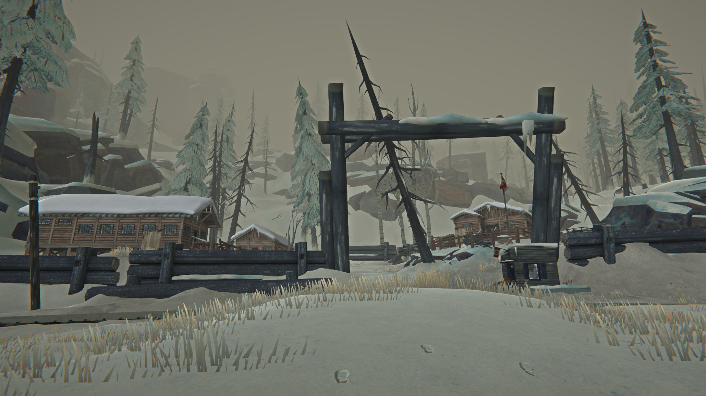

# Idle Camp

**Categories:** Indoor locations, Locations, Locations in Zone of Contamination · **Source:** [Fandom](https://thelongdark.fandom.com/wiki/Idle_Camp)

**Idle Camp**

**Location**

**Region:** [Zone of Contamination](./Zone%20of%20Contamination.md)

**General**

**Firebox:** [Stove](./Stove.md)

Has a bed

Has an interior **Idle Camp** is one of the two major human settlements in the [Zone of Contamination](./Zone%20of%20Contamination.md).

## Overview

2 lodging barracks hold numerous [Beds](./Bed.md), [Lockers](./Locker.md), and bathrooms containing [Toilets](./Toilet.md). Rare, region exclusive clothing such as a [Hardhat](./Hardhat.md), [Miner's Jacket](./Miner%27s%20Jacket.md), [Miner's Pants](./Miner%27s%20Pants.md), and [Chemical Boots](./Chemical%20Boots.md) have a chance to spawn in the 3 buildings and the nearby [Train Shuttle](./Train%20Shuttle.md) near the road.

The mess hall building contains a mess hall with several wooden tables and a kitchen containing several [Fridges](./Fridge.md), [Freezers](./Freezer.md), a Vegetable Drawer, and an invaluable [Stove](./Stove.md). The ponds around the nearby buildings have [Cat Tails](./Cat%20Tail.md) that can be harvested.

2 [Trucks](./Truck.md) can be found outside and slept in, which can be useful if the player has [Cabin Fever](./Cabin%20Fever.md) after spending many hours exploring the mines.

Multiple [Poisoned Wolves](./Poisoned%20Wolf.md) often patrol the field across the train tracks from the camp, and can wander into the Camp if the player is spotted.

