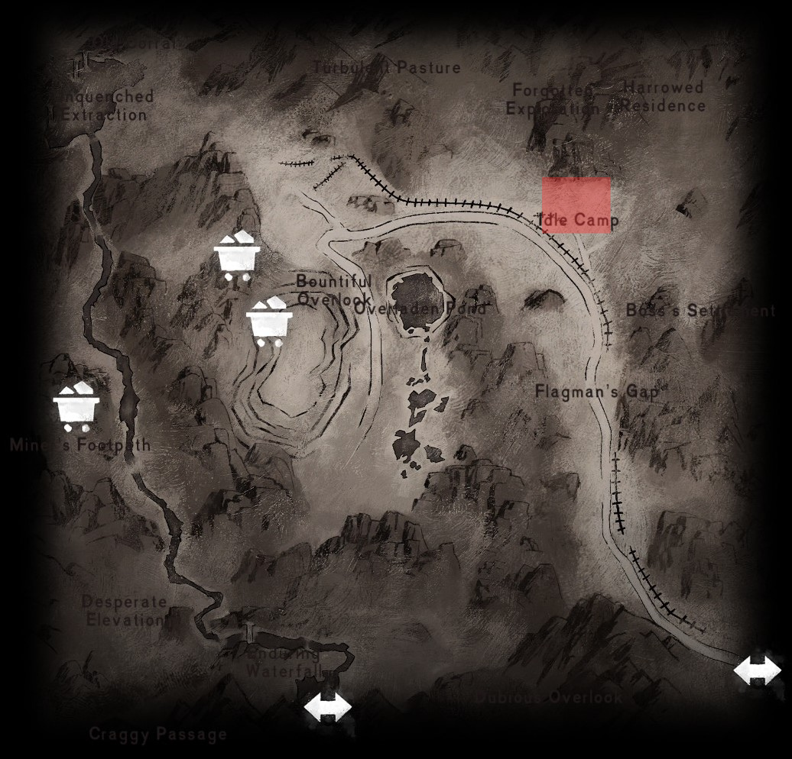
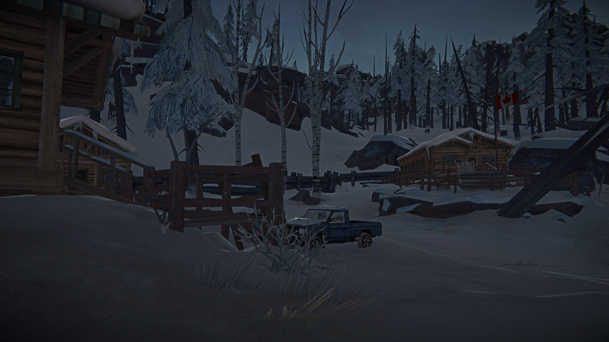
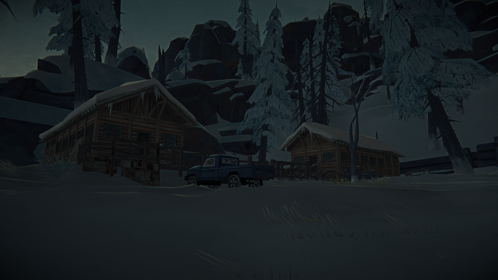

# Idle Camp

**Categories:** Indoor locations, Locations, Locations in Zone of Contamination · **Source:** [Fandom](https://thelongdark.fandom.com/wiki/Idle_Camp)

**Idle Camp**

| Property | Details |
| --- | --- |
|  |  / _Idle\_Camp.jpg_ |
| **Location** |  |
|  |  / _Idle\_Camp\_Location.png_ |
| Region | [Zone of Contamination](./Zone%20of%20Contamination.md)\|- |
| **General** |  |
| Firebox | [Stove](./Stove.md) |
|  / _bed\_icon.png_ | Has a bed |

|  / _Idle\_Camp\_closeup.png_ |  / _Bunkhouses_ |
