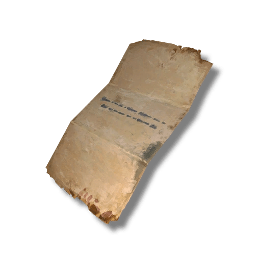

# Illegible Note

**Illegible Note**

| Property | Details |
| --- | --- |
|  |  / *Illegible\_Note\_icon.png* |
| Release | [1 August 2017](./The%20Long%20Dark%20%E2%80%94%20Early%20Access%20Changelog.md#1.00) |
| Wintermute | [Episode 2](./Episode%202%20-%20Luminance%20Fugue.md) - [Mystery Lake Supply Caches](./Mystery%20Lake%20Supply%20Caches.md) |
| **Properties** |  |
| Item type | [Collectibles](./Collectibles.md)\|- |
| Stackable | No |
| Examine | A crudely drawn map to a hidden supply cache. |
| **Values** |  |
| Weight | 0.00 kg (0 lbs) |
| **Actions** |  |
| Backpack | Examine |
| On ground | Take It, Read Text, Leave It |

**Illegible Note** is a [Collectible](./Collectibles.md) item found in [Episode 2](./Episode%202%20-%20Luminance%20Fugue.md) of the [Wintermute](./Wintermute.md) story mode found on a table in the [Forestry Lookout](./Forestry%20Lookout.md).

## Transcript

*The following text is transcribed from **Illegible Note***

**The text on this note is largely unreadable. If this message was meant for someone, hopefully they were able to decipher it. Fortunately, there are a handful of recognizable landmarks - and a bold arrow pointing to a large 'X'.**

## Update history

\* UPDATE **1 August 2017 ([Update](./The%20Long%20Dark%20%E2%80%94%20Changelog.md#1.00)):**

- 
  - Added to game.

**Lua execution error in Module:Navbox function navbox**
