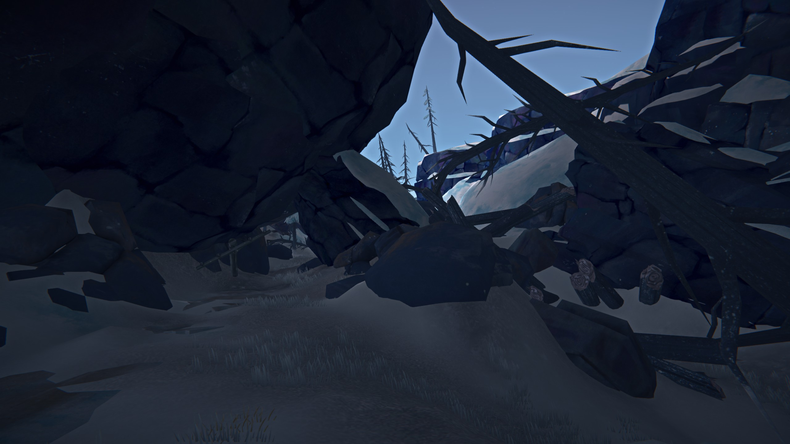

# Immutable Hesitation

**Immutable Hesitation**

| Property | Details |
| --- | --- |
|  |  / *Immutable\_Hesitation.jpg* |
| **Location** |  |
|  |  / *Immutable\_Hesitation\_Location.png* |
| Region | [Transfer Pass](./Transfer%20Pass.md)\|- |
| **General** |  |
|  / *bed\_icon.png* |  |
|  / *workbench\_icon\_green.png* |  |
|  | Has no shelter\|} / **Immutable Hesitation** is a landslide found at the very northern section of the map within the [Transfer Pass](./Transfer%20Pass.md) region. The landslide obstructs both the region's railroad line and a nearby road. [Rabbits](./Rabbit.md) can be found nearby along with some metal boxes and [Scrap Metal](./Scrap%20Metal.md) for loot. The area offers some protection from the elements, but is mainly used to gain admittance to the [Zone of Contamination](./Zone%20of%20Contamination.md). / **Lua execution error in Module:Navbox function navbox** [ru:Незыблемый тупик](ru:%D0%9D%D0%B5%D0%B7%D1%8B%D0%B1%D0%BB%D0%B5%D0%BC%D1%8B%D0%B9_%D1%82%D1%83%D0%BF%D0%B8%D0%BA) |
