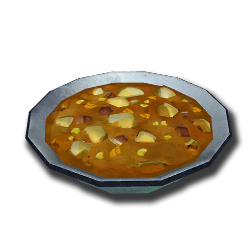

# Improved Rest

<table class="infobox">
<caption>Improved Rest</caption>
<colgroup>
<col style="width: 50%" />
<col style="width: 50%" />
</colgroup>
<tbody>
<tr>
<td colspan="2"><figure>
[Missing image: Improved_Rest_icon.png]
<figcaption>Improved_Rest_icon.png</figcaption>
</figure></td>
</tr>
<tr>
<td>
Release
</td>
<td>
<a href="./The%20Long%20Dark%20%E2%80%94%20Changelog.md#0.181" class="wikilink" title="17 December 2014">17 December 2014</a>
</td>
</tr>
<tr>
<td>
Update
</td>
<td>
0.181
</td>
</tr>
<tr>
<td colspan="2" class="section">
<strong>Properties</strong>
</td>
</tr>
<tr>
<td>
Category
</td>
<td>
<a href="./Afflictions.md" class="wikilink" title="Afflictions">Afflictions</a>
</td>
</tr>
<tr>
<td>
Caused By
</td>
<td>
Consume <a href="./Food%20And%20Drink.md" class="wikilink" title="Food And Drink">Food And Drink</a>
</td>
</tr>
<tr>
<td>
Effect
</td>
<td>
Positive
</td>
</tr>
<tr>
<td>
Type
</td>
<td>
Benefit
</td>
</tr>
<tr>
<td>
Benefit Duration
</td>
<td>
3-6 Hours
</td>
</tr>
<tr>
<td colspan="2" class="section">
<strong>Advanced Data</strong>
</td>
</tr>
<tr>
<td>
Item Key
</td>
<td>
ConditionRestBuff
</td>
</tr>
</tbody>
</table>

<table>
<colgroup>
<col style="width: 33%" />
<col style="width: 33%" />
<col style="width: 33%" />
</colgroup>
<tbody>
<tr>
<td style="vertical-align: top; font-size: 3em; color: #5d5980; padding-right: 10px">
“
</td>
<td>
This will help you Rest more deeply. You'll recover more Condition per hour of Rest.

&#10;

In-game Description

</td>
<td style="vertical-align: bottom; font-size: 3em; color: #5d5980; padding-left: 10px">
”
</td>
</tr>
</tbody>
</table>

**Improved Rest** is a positive affliction gained by eating or drinking certain <a href="./Food%20And%20Drink.md" class="wikilink" title="Food And Drink">Food And Drink</a> and will increase condition gained while sleeping by an extra 2% (1% for Interloper) an hour while the benefit is still active. This benefit is used whenever sleeping, whether this be all at once or across multiple sleep sessions.

## Causes

Improved Rest is received when consuming any of the following items:

<table>
<colgroup>
<col style="width: 33%" />
<col style="width: 33%" />
<col style="width: 33%" />
</colgroup>
<thead>
<tr>
<th></th>
<th>
Food and Drink
</th>
<th>
Duration
</th>
</tr>
</thead>
<tbody>
<tr>
<td><figure>

<figcaption>Cup_of_Herbal_Tea_icon.png</figcaption>
</figure></td>
<td>
<a href="./Cup%20of%20Herbal%20Tea.md" class="wikilink" title="Cup of Herbal Tea">Cup of Herbal Tea</a>
</td>
<td>
6 hours
</td>
</tr>
<tr>
<td><figure>

<figcaption>Stalker's_Pie_icon.png</figcaption>
</figure></td>
<td>
<a href="./Stalker%27s%20Pie.md" class="wikilink" title="Stalker&#39;s Pie">Stalker's Pie</a>
</td>
<td>
6 hours
</td>
</tr>
<tr>
<td><figure>

<figcaption>Ptarmigan_Stew_icon.png</figcaption>
</figure></td>
<td>
<a href="./Ptarmigan%20Stew.md" class="wikilink" title="Ptarmigan Stew">Ptarmigan Stew</a>
</td>
<td>
3 hours
</td>
</tr>
<tr>
<td><figure>

<figcaption>Ranger_Stew_icon.png</figcaption>
</figure></td>
<td>
<a href="./Ranger%20Stew.md" class="wikilink" title="Ranger Stew">Ranger Stew</a>
</td>
<td>
3 hours
</td>
</tr>
<tr>
<td><figure>

<figcaption>Rabbit_Stew_icon.png</figcaption>
</figure></td>
<td>
<a href="./Rabbit%20Stew.md" class="wikilink" title="Rabbit Stew">Rabbit Stew</a>
</td>
<td>
3 hours
</td>
</tr>
<tr>
<td><figure>

<figcaption>Thomson_Family_Stew_icon.png</figcaption>
</figure></td>
<td>
<a href="./Thomson%20Family%20Stew.md" class="wikilink" title="Thomson Family Stew">Thomson Family Stew</a>
</td>
<td>
3 hours
</td>
</tr>
<tr>
<td><figure>

<figcaption>Trout_Stew_icon.png</figcaption>
</figure></td>
<td>
<a href="./Trout%20Stew.md" class="wikilink" title="Trout Stew">Trout Stew</a>
</td>
<td>
3 hours
</td>
</tr>
<tr>
<td><figure>

<figcaption>Venison_Stew_icon.png</figcaption>
</figure></td>
<td>
<a href="./Venison%20Stew.md" class="wikilink" title="Venison Stew">Venison Stew</a>
</td>
<td>
3 hours
</td>
</tr>
</tbody>
</table>

## Effects

This affliction causes the following effects:

|  | Effect | Magnitude |
|----|----|----|
| **Template:iconlink plain** | <a href="./Condition.md" class="wikilink" title="Condition">Condition</a> restoration | 2% per hour[^1] |

## Gallery

<table class="gallery">
<colgroup>
<col style="width: 100%" />
</colgroup>
<tbody>
<tr>
<td><figure>
[Missing image: Improved_rest.png]
<figcaption>Old icon.</figcaption>
</figure></td>
</tr>
</tbody>
</table>

**Lua execution error in Module:Navbox function navbox**<a href="ru:%D0%91%D0%BE%D0%BB%D0%B5%D0%B5_%D1%8D%D1%84%D1%84%D0%B5%D0%BA%D1%82%D0%B8%D0%B2%D0%BD%D1%8B%D0%B9_%D0%BE%D1%82%D0%B4%D1%8B%D1%85" class="wikilink" title="ru:Более эффективный отдых">ru:Более эффективный отдых</a>

## Notes

[^1]: 1% on Interloper
