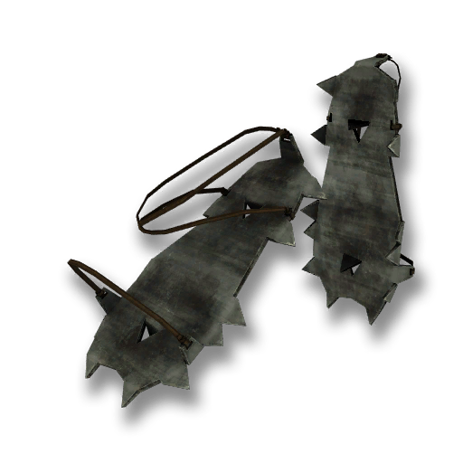

# Improvised Crampons

**Contents**

- [Overview](#overview)
- [Repairing](#repairing)
- [Obtaining](#obtaining)
- [Crafting](#crafting)
- [Gallery](#gallery)
- [Update history](#update-history)

**Improvised Crampons**

| Property | Details |
| --- | --- |
|  |  / *Improvised\_Crampons\_icon.png* |
| **General** |  |
| Item Type | Clothing\|- |
| Clothing Slot | Accessory |
| **Statistics** |  |
| Weight | 0.75 kg(1.65 lbs) |
| Warmth bonus | 0.0 °C(0 °F) |
| Windproof bonus | 0.0 °C(0 °F) |
| Waterproof bonus | 100% |
| Protection | 3% |
| Mobility | -5% |
| Harvest | Cannot Harvest |
| Repair | 2 × [Scrap Metal](./Scrap%20Metal.md) / 60 minutes / 20% Condition |

> “**Makeshift traction for your feet. Better than nothing.**”

**Improvised Crampons** are a [clothing](./Clothing.md) accessory in *The Long Dark*.

## Overview

When worn in the either accessory slot, Improvised Crampons grant the Benefit [Sure Footing](./Sure%20Footing.md) which has three effects:

- Decreases chance of [sprains](./Afflictions.md) by 70% when on slopes. (This is a bug, was supposed to be 30% only)
- Decreases drain rate of [climbing](./Rope%20Climbing.md) stamina by 60% (This is a bug, was supposed to be 40% only)
- Increases the (invisible) timer of [Weak Ice](./Weak%20Ice.md) by 0.5 seconds (aka 10% more time to move off weak Ice, before falling in) for a total time of 5.5 seconds.

Crampons are particularly useful in [regions](./Region.md) with multiple [Mountaineering Rope](./Mountaineering%20Rope.md) climbs, such as [Timberwolf Mountain](./Timberwolf%20Mountain.md), [Ash Canyon](./Ash%20Canyon.md), [Mountain Town](./Mountain%20Town.md), and [Hushed River Valley](./Hushed%20River%20Valley.md), or in areas with [Weak Ice](./Weak%20Ice.md) such as [Forlorn Muskeg](./Forlorn%20Muskeg.md) or when [Beachcombing](./Beachcombing.md) in regions like [Coastal Highway](./Coastal%20Highway.md) or [Bleak Inlet](./Bleak%20Inlet.md).

Improvised Crampons cannot be harvested, and provide lesser benefits compared to [Crampons.](./Crampons.md)

If the player's footwear (shoes and 2 socks slots) are removed (whether by the player or their footwear is ruined) then their Improvised Crampons will automatically be removed, removing the [Sure Footing](./Sure%20Footing.md) affliction.

- Despite being designed to attach to shoes, the player can wear Improvised Crampons on their socks, which should not be possible.

## Repairing

Can be repaired with 2 pieces of [Scrap Metal](./Scrap%20Metal.md) using [Simple](./Simple%20Tools.md) or [Quality Tools](./Quality%20Tools.md) as of Signal Void. Need to be unequipped to repair.

## Obtaining

Improvised Crampons, unlike their [non-improvised counterpart](./Crampons.md), are craftable as seen below. They cannot be found naturally in the world. (except on Interloper)

## Crafting

**Improvised Crampons**

| Property | Details |
| --- | --- |
|  | - |
|  | - |
|  | 240 minutes (4 hour 0 minutes) |
| **Requirements** |  |
| Facility | **Template:iconlink** |
| **Materials** |  |
| **Template:iconlink plain** |  |
| Item | [Scrap Metal](./Scrap%20Metal.md) |
| Quantity | 4 |
| **Template:iconlink plain** |  |
|  | [Cured Leather](./Cured%20Leather.md) |
|  | 2 |

## Gallery

| Column 1 |
| --- |
|  / *Clothing model icon* |

## Update history

- UPDATE **30 March 2023 ([Update](./The%20Long%20Dark%20%E2%80%94%20Changelog.md#2.09_%26_2.10)):**
  - Added to game.

== Trivia==

- Improvised crampons are the only accessory that cannot be found naturally in the world. The [Moose-Hide Satchel](./Moose-Hide%20Satchel.md), while also craftable, can be found naturally in [Hushed River Valley](./Hushed%20River%20Valley.md) near [Mysterious Signal Fire](./Mysterious%20Signal%20Fire.md).

**Lua execution error in Module:Navbox function navbox** [ru:Кустарные альпинистские кошки](ru:%D0%9A%D1%83%D1%81%D1%82%D0%B0%D1%80%D0%BD%D1%8B%D0%B5_%D0%B0%D0%BB%D1%8C%D0%BF%D0%B8%D0%BD%D0%B8%D1%81%D1%82%D1%81%D0%BA%D0%B8%D0%B5_%D0%BA%D0%BE%D1%88%D0%BA%D0%B8)
